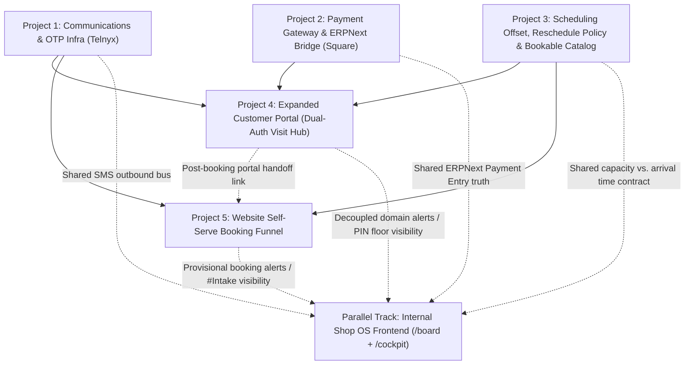

# Customer Portal Expansion & Core Infrastructure — High-Level Program Roadmap

> **Document Purpose:** Agent-friendly, high-level program roadmap (intentionally free of code, mock code, schemas, or implementation logic). Forward this document to follow-up sessions to generate detailed technical roadmaps and per-project Swarm implementation plans in `todo_snippets/`.

---

## 1. Program Vision & Architectural Principle

The current customer portal is a single-purpose, login-free quote authorization page (`/quote-approval`). Expanding it into a trustworthy self-serve portal (appointment management, binary repair status, PIN-to-Drive capture, online deposit/balance payments, invoice self-service, and website self-serve booking) exposes three foundational prerequisites that are currently intertwined:

1. **Communications & OTP Infrastructure** (SMS delivery, webhook tracking, and OTP identity verification)
2. **Payment Gateway & ERPNext Accounting Bridge** (online deposits/payments and automated ERPNext ledger posting)
3. **Scheduling Policy & Bookable Catalog Foundations** (silent arrival-time offset, predictable self-serve packages, and reschedule rules)

Rather than building these inside one monolithic branch, this program decomposes the work into **five sequential/parallelizable projects** plus an explicit **Internal Shop OS Alignment Contract** covering overlaps with `shop_os_frappe_frontend_roadmap.md`. Each project is scoped into disjoint, Swarm-ready work chunks suitable for execution via the Swarm plugin and isolated Frappe bench testing (`test-in-slot.ps1`).

---

## 2. Locked Product Decisions & Non-Goals

Follow-up planning sessions must treat the following product rules as locked unless explicitly revised by the owner:

### Locked Requirements
- **Dual-Path Access & Persistent Cookie Sessions (Zero Front-Desk Friction + Cross-Device Security):**
  - **Shop-Sent Tokenized Links (Direct Entry):** Portal links sent directly by the shop to a customer's SMS or email open immediately **without an OTP prompt**, removing friction when customers view quotes at the front desk. Opening a valid tokenized link automatically sets a **persistent, HttpOnly, Secure, signed session cookie** on that browser/device.
  - **Public-Facing Portal Entry / Cross-Device Re-Entry (SMS OTP Gate):** Visiting the public portal without an active session cookie or valid tokenized link reveals **zero** personal data, vehicle details, appointment times, quote items, or invoices until the visitor verifies via mobile phone + Telnyx SMS OTP (**no email OTP fallback**). Passing OTP sets the same persistent session cookie.
  - **Persistent Returning Sessions:** Once a device has been authorized—via either a shop-sent tokenized link or public SMS OTP—returning visits on that browser stay signed in via the persistent cookie (with server-side revocation support and an explicit "Sign out on this device" option).
- **SMS Provider (Telnyx Only):** Wire outbound SMS, OTP delivery, and inbound status/opt-out handling exclusively on **Telnyx** (preserving Custom HTTP Webhook / deterministic Mock mode for hermetic testing; no Twilio integration).
- **Payment Provider (Embedded Square Web Payments SDK) + Immediate ERPNext Bank Reconciliation (CAD):** Wire online **deposit payments** and **invoice balance payments** inline inside the Customer Portal using the **embedded Square Web Payments SDK** (client-side payment tokenization with server-side Square charge execution in **CAD** so raw card data never touches Frappe). Deposit requests are **manually initiated** by shop staff on a Repair Order. Treat **Square directly as an ERPNext Bank Account** so every confirmed Square payment posts and reconciles immediately into the Square Bank Account without manual double-entry.
- **Binary Repair Status Only (No ETA, No Mid-Work Progress):** Do **not** display estimated completion times, countdowns, or granular per-service completion progress on the customer portal. Only surface clear high-level visit states: upcoming appointment, **Being Worked On**, and **Done & Ready for Pickup**.
- **Post-Authorization PIN-to-Drive Capture:** Immediately after a customer approves a quote, **always prompt** for their vehicle's **PIN-to-Drive** code with a 1-tap **"No PIN-to-Drive enabled"** opt-out. Protect it as sensitive ephemeral data: masked after entry, visible only to authorized shop roles during active work, and **automatically purged when the Repair Order reaches `Closed / Released`**.
- **Silent Earlier Arrival Offset (15-Minute Leeway):** Apply a configurable earlier arrival offset (default **15 minutes**) uniformly across all capacity slots—including the opening slot of the day (e.g., an `08:00` internal capacity slot presents to the customer as a `07:45` arrival/drop-off time). Never communicate this buffer to the customer—on all customer-facing screens and notifications, the earlier offset time is simply presented as their on-time appointment time. Internal capacity math and shop schedules keep the true bay start time (`08:00`).
- **Self-Serve Appointment Management:** Authorized customers can view their scheduled appointment and self-reschedule into real available slots subject to shop cutoff and lifecycle rules.
- **Self-Serve Invoice Access (Including Unpaid Invoices):** Authorized customers can download a PDF copy of their invoice or email themselves a copy as soon as a submitted **`Sales Invoice`** exists on the Repair Order—**even while unpaid** (alongside the inline balance payment form).
- **Website Self-Serve Booking (Hosted Frappe Site):** Provide a public "Book Now" workflow hosted directly on the Frappe site where ISM is installed (linked directly from the external website's button; no embeddable iframe required). Customers enter personal/vehicle details, select from a curated collection of **predictable** service packages, verify their phone via SMS OTP, and book directly against live shop capacity (with the silent arrival offset applied; no upfront booking deposit required).

### Explicit Non-Goals
- No customer username/password accounts or email OTP fallback (access stays strictly tokenized SMS/Email link, public phone + SMS OTP, and persistent signed session cookies).
- No live estimated completion time (ETA) or mid-job task progress checklist on the customer portal.
- No embeddable iframe booking widget (direct link to hosted Frappe route only).
- No direct contact with canonical `development.localhost:8000` during development or testing; all work remains Frappe-Cloud compatible and verified exclusively in isolated bench slots.

---

## 3. Program Dependency Map

### Recommended Execution Order
1. **Stage A — Parallel Infrastructure Foundation:** Projects **1**, **2**, and **3** have no mutual runtime dependencies and can be planned and executed in parallel (or sequentially in priority order: Project 1 → Project 3 → Project 2) once `ISM Settings` section boundaries are respected.
2. **Stage B — Customer-Facing Product Surfaces:** Project **4** (Expanded Customer Portal) starts once Projects 1, 2, and 3 reach their verified contracts. Project **5** (Website Self-Serve Booking) can begin as soon as Projects 1 and 3 are complete, with portal link handoff aligned with Project 4.

---

## 4. Project Breakdown & Swarm-Ready Work Chunks

Each project below is sized for its own dedicated technical plan and single-Swarm execution (following repository Swarm guardrails: max 3 concurrent workspace-sharing authors per wave, strict disjoint file ownership, cross-family Gemini 4 verification, and batched `test-in-slot.ps1` acceptance gates).

---

### Project 1 — Communications & OTP Infrastructure (Telnyx)

**Goal:** Replace the minimal single-webhook SMS utility with a production-grade messaging and OTP verification foundation powered exclusively by Telnyx.

**Existing Codebase Anchor Points (for next-session planner):**
- Outbound SMS gateway module (`ism/api/sms.py`)
- Shop settings (`ISM Settings` SMS section)
- Existing SMS callers (approval link dispatch, ready-for-pickup notification)

**Capabilities Included:**
- **Telnyx Production Carrier & Test Fallback:** Clean separation between application callers and the Telnyx transport adapter, retaining existing Custom HTTP Webhook and deterministic Mock mode strictly for local development and hermetic automated testing (no Twilio scope).
- **Telnyx Integration:** Authenticated outbound SMS sending, E.164 phone normalization, carrier message tracking IDs, and signature-verified webhook ingestion for delivery statuses and opt-out/unsubscribe compliance (`STOP` / `HELP`).
- **Messaging Audit Log:** Durable metadata log of outbound dispatches and delivery outcomes (explicitly redacting sensitive contents such as OTP codes).
- **Reusable SMS OTP & Persistent Guest Session Service:** Short-lived SMS-only one-time passcodes (no email OTP fallback), per-phone and per-IP rate limiting, brute-force attempt caps and lockouts, resend cooldowns, single-use invalidation, and a unified **persistent signed HttpOnly session cookie** service issuable from either OTP verification or a validated shop-sent magic link (usable by both the Customer Portal and Website Booking funnel).
- **Transactional Email Alignment:** Consistent, rate-limited email dispatch wrapper for self-serve invoice copies and booking confirmations.

**Swarm-Suitable Chunks:**
| Chunk | Ownership Boundary | Parallelizable? | Dependencies |
| :--- | :--- | :---: | :--- |
| **1A — Messaging Settings, Audit Ledger & Provider Contract** | Settings fields, message audit records, provider interface contract, phone normalization rules | Wave 1 | None |
| **1B — Telnyx Adapter & Webhook Ingestion** | Telnyx outbound client, webhook signature verification, delivery status & opt-out handling, deterministic mock adapter | Wave 1 | Contract from 1A (or Wave 2 after 1A freeze) |
| **1C — SMS OTP Challenge & Persistent Guest Cookie Session Service** | SMS OTP generation/storage, throttling/lockout rules, unified persistent signed cookie issuance/verification/revocation | Wave 2 | 1A, 1B |
| **1D — Caller Wiring & Verification Gate** | Wiring existing ISM SMS notifications onto upgraded bus, full mocked & slot test verification | Wave 3 | 1C |

---

### Project 2 — Payment Gateway & ERPNext Accounting Bridge (Square Web Payments SDK)

**Goal:** Enable secure inline online deposit and invoice balance payments in **CAD** through the **embedded Square Web Payments SDK** with guaranteed, idempotent, immediate posting and reconciliation into ERPNext's **Square Bank Account**.

**Existing Codebase Anchor Points (for next-session planner):**
- Repair Order billing and deposit engine (`ism/ism/doctype/repair_order/billing.py`)
- ERPNext ledger event hooks (`Sales Invoice` and `Payment Entry` hooks in `ism/hooks.py`)
- Shop settings (`ISM Settings`) and existing billing test suite (`test_billing_and_deposits.py`)

**Capabilities Included:**
- **Square Configuration & ERPNext Bank Account Mapping:** Secure management of Square server credentials (Access Token, Webhook Signature Key) and client SDK identifiers (Application ID, Location ID) across Sandbox vs. Production plus deterministic Mock mode, configured in **CAD** and mapped directly to a Square Mode of Payment backed by ERPNext's **Square Bank Account** (treating Square as a bank for immediate reconciliation).
- **Manual Deposit Request Lifecycle:** Shop staff manually initiate a deposit request on a Repair Order (specifying the requested deposit amount), exposing it to the Customer Portal as a payable obligation without auto-triggering deposits on quotes or website bookings.
- **Payment Transaction Ledger:** Dedicated internal tracking record linking external Square payment IDs to a Repair Order (and Sales Invoice when applicable), capturing payment intent type (Manual Deposit Request vs. Final Balance), status transitions, idempotency keys, and raw webhook audit trace.
- **Embedded Web Payments SDK + Server-Side Charge Execution:** Portal captures payment details inline via Square's tokenized Web Payments SDK and submits only the short-lived payment token to Frappe. The backend verifies the active manual deposit request or outstanding invoice balance server-side in **CAD** (never trusting client-submitted amounts) and executes the Square payment using strict idempotency keys.
- **Verified Webhook Ingestion & Concurrency Safety:** Signature-verified Square webhook receiver with strict deduplication and row-locked processing so webhook retries or simultaneous client confirmation responses never double-post payments.
- **Automated Immediate ERPNext Bank Posting & Reconciliation Bridge:**
  - **Deposits:** Automatically creates, submits, and reconciles a tagged ERPNext Customer Advance `Payment Entry` directly into the **Square Bank Account** linked to the Repair Order so existing advance reconciliation applies it seamlessly when the final Sales Invoice is generated.
  - **Invoice Balances:** Automatically creates, submits, and reconciles an ERPNext `Payment Entry` directly into the **Square Bank Account** allocated against the submitted `Sales Invoice` and synchronizes Repair Order payment totals and status.
  - **Refunds, Voids & Failures:** Reflects Square refund/void/failure webhooks back onto the internal payment ledger and flags exceptions for manager reconciliation without silently corrupting submitted accounting entries.

**Swarm-Suitable Chunks:**
| Chunk | Ownership Boundary | Parallelizable? | Dependencies |
| :--- | :--- | :---: | :--- |
| **2A — Square Settings, Bank Account Mapping, Manual Deposit Request & Ledger** | Settings section (server + SDK public IDs, CAD + Square Bank Account mapping), manual deposit request fields/state, transaction ledger DocType/records, state lifecycle contract | Wave 1 | None |
| **2B — Square Payments API Adapter & Webhook Verification** | Server-side tokenized CAD charge execution, client SDK boot config helper, webhook signature verification, sandbox/mock harness | Wave 2 | 2A |
| **2C — Idempotent Immediate ERPNext Bank Posting & Reconciliation Bridge** | Row-locked payment/webhook processor, immediate Square Bank Account `Payment Entry` posting for deposits & Sales Invoices, refund/exception sync | Wave 2 | 2A |
| **2D — Financial Integrity & Concurrency Verification Gate** | Duplicate-replay tests, synchronous-return vs. webhook race tests, Square Bank Account ledger reconciliation assertions, regression against existing billing suite | Wave 3 | 2B, 2C |

---

### Project 3 — Scheduling Policy, Arrival Offset & Predictable Catalog Foundations

**Goal:** Establish the domain rules that allow customers to view appointments, self-reschedule, and self-book predictable services safely without breaking internal bay/technician capacity math.

**Existing Codebase Anchor Points (for next-session planner):**
- Scheduling engine (`ism/scheduling/*`, `ism/api/scheduling.py`)
- `Schedule Entry` (already supports provisional customer/vehicle intake fields)
- `Service Package` (catalog of jobs, models, flat-rate labor times, required parts)
- `ISM Settings` scheduling section

**Capabilities Included:**
- **Silent Earlier Arrival Offset Policy:**
  - Configurable earlier arrival lead-time offset in shop settings (default **15 minutes**).
  - Canonical conversion rules between **Internal Capacity Slot Start (`T`)** (bay/technician start time) and **Customer Arrival / Drop-Off Time (`T - offset`)**.
  - Applies uniformly to every slot including the opening slot of the day (e.g., an `08:00` internal capacity slot yields a `07:45` customer drop-off time—do not shift or drop the `08:00` capacity slot).
  - Uniform helper consumed by Customer Portal, Website Booking, and outbound SMS/Email confirmations so customers always see one consistent drop-off time with zero mention of internal leeway.
- **Predictable Self-Serve Service Catalog:**
  - Curation controls on `Service Package` designating which packages are deemed predictable and eligible for website self-serve booking.
  - Customer-facing display metadata (clear title, plain-language summary, transparent pricing or estimate range display rules, expected booking duration, and vehicle model eligibility).
- **Self-Serve Rescheduling & Booking Policy Rules:**
  - Configurable reschedule cutoff window (minimum hours before arrival), maximum reschedule count, and hard lifecycle locks (no self-rescheduling once the vehicle is checked in, being worked on, or completed).
  - Atomic slot-swap / re-allocation flow that validates bay and technician capacity, releases the old slot only when the new slot succeeds, and emits internal shop notifications.
  - Provisional customer/vehicle intake normalization for website bookings so advisors can convert them cleanly to Repair Orders upon arrival.

**Swarm-Suitable Chunks:**
| Chunk | Ownership Boundary | Parallelizable? | Dependencies |
| :--- | :--- | :---: | :--- |
| **3A — Arrival Offset & Dual-Time Policy Contract** | Settings fields, uniform earlier arrival-vs-capacity time conversion rules (including opening-slot earlier drop-off) | Wave 1 | None |
| **3B — Predictable Service Package Catalog Curation** | `Service Package` self-booking flags/customer metadata, curated public catalog query surface | Wave 1 | None |
| **3C — Self-Serve Reschedule & Provisional Booking Engine** | Cutoff/lifecycle guards, atomic slot re-booking, provisional booking creation & shop alerts | Wave 2 | 3A, 3B |
| **3D — Capacity Parity & Regression Verification Gate** | Boundary tests (opening-slot `08:00` → `07:45` drop-off, breaks, holidays, concurrent booking race), existing scheduling regression suite | Wave 3 | 3C |

---

### Project 4 — Expanded Customer Portal (Dual-Auth Visit Hub)

**Goal:** Upgrade the existing login-free `/quote-approval` page into a cohesive Customer Portal supporting zero-friction shop-sent links, OTP-gated cross-device return access, persistent browser cookie sessions, quote authorization, PIN-to-Drive capture, binary repair status, appointment viewing/rescheduling, inline Square deposits/payments, and invoice self-service.

**Prerequisites:** Projects **1**, **2**, and **3** complete.

**Existing Codebase Anchor Points (for next-session planner):**
- Current guest portal page (`ism/templates/pages/quote_approval.{py,html}`) and route rule (`ism/hooks.py`)
- Public approval API (`ism/api/approval.py`) and RO authorization core (`ism/ism/doctype/repair_order/authorization.py`)
- Repair Order lifecycle statuses and Sales Invoice linkage (`ism/ism/doctype/repair_order/*`)

**Capabilities Included:**
- **Dual-Path Authentication & Persistent Cookie Sessions:**
  - **Path 1 — Shop-Sent Direct Tokenized Link (Zero OTP Friction):** Clicking a valid tokenized link sent by the shop via SMS or email opens the portal immediately without an OTP challenge (critical for smooth front-desk quote reviews), exchanges/binds access into a **persistent, HttpOnly, Secure, signed session cookie** on that device, and cleans the raw token from active navigation where practical.
  - **Path 2 — Public-Facing Portal Entry / Cross-Device Lookup (SMS OTP Gate):** Opening the public portal directly without a valid tokenized link or active session cookie displays only non-sensitive shop branding and a phone/SMS OTP prompt—returning **zero** PII, vehicle details, appointment times, quote items, or invoices until verified via Telnyx SMS OTP (no email OTP fallback). Verification issues the exact same persistent signed session cookie.
  - **Path 3 — Returning Device Continuity:** Subsequent visits from an already-authorized browser automatically restore the customer's portal view via the persistent cookie without re-prompting, alongside an explicit "Sign out on this device" control and server-side session revocation.
  - **Lifecycle Action Locks:** Once a Repair Order reaches `Closed / Released`, mutating actions (authorize, reschedule, PIN submission) lock automatically while read-only invoice and payment records remain accessible.
- **Quote Authorization & Always-Prompt PIN-to-Drive Workflow:**
  - Retains full per-service Approve/Decline selection, legal disclaimer, digital signature capture, and immutable approval audit trail.
  - Immediately following quote approval, **always prompts** for **PIN-to-Drive** with a 1-tap **"No PIN-to-Drive enabled"** opt-out.
  - Security lifecycle: encrypted storage, masked/write-only from the customer's perspective after submission (with ability to update before work starts), role-restricted visibility for shop technicians/advisors during active work, audited reads, and **automatic purge/redaction strictly when the Repair Order transitions to `Closed / Released`**.
- **Simplified Binary Vehicle Status View:**
  - Strictly omits estimated completion times and mid-repair service-item progress.
  - Maps internal Repair Order / Schedule states into clean customer-facing visit banners:
    - **Scheduled** (shows drop-off time using Project 3's silent earlier offset)
    - **Being Worked On** (vehicle checked in / active in shop)
    - **Done & Ready for Pickup** (vehicle ready, displaying shop pickup hours and payment/invoice actions)
- **Appointment Management & Self-Serve Rescheduling:**
  - Displays customer's current appointment date and drop-off time (silent offset applied).
  - Enables self-serve rescheduling via live available slots when permitted by Project 3's cutoff and lifecycle guards, triggering an updated confirmation via Project 1.
- **Online Deposit & Balance Payment Experience (Embedded Square SDK):**
  - Surfaces clear payment state (Manual Deposit Requested, Deposit Paid, Balance Due, Paid in Full).
  - Renders the **embedded Square Web Payments SDK** directly inline inside the portal when a manually initiated deposit request or outstanding invoice balance is payable, submitting tokenized payment data to Project 2 and reflecting immediate ERPNext Square Bank Account reconciliation cleanly.
- **Invoice Download & Self-Email (Unpaid & Paid):**
  - Unlocks as soon as a submitted **`Sales Invoice`** is linked to the Repair Order—**including unpaid invoices**—allowing authorized customers to download the official PDF invoice directly or email a copy to themselves (rate-limited via Project 1).

**Swarm-Suitable Chunks:**
| Chunk | Ownership Boundary | Parallelizable? | Dependencies |
| :--- | :--- | :---: | :--- |
| **4A — Dual-Path Auth, Persistent Cookie Guard & Public Entry Gate** | Direct tokenized link exchange (zero-OTP), public zero-PII landing + SMS OTP lookup, persistent signed cookie session lifecycle, sign-out/revocation, RO lifecycle read/write locks | Wave 1 | Projects 1, 3 |
| **4B — PIN-to-Drive Secure Lifecycle & Floor Visibility** | Encrypted PIN storage, post-approval always-prompt + opt-out handling, role-gated internal reveal, automatic purge on `Closed / Released` | Wave 1 | None (parallel with 4A) |
| **4C — Portal Feature APIs (Status, Reschedule, Pay, Invoice)** | Binary status projection, self-serve reschedule proxy, Square tokenized payment submission & SDK config proxy, unpaid/paid PDF download & self-email endpoints | Wave 2 | 4A, 4B, Projects 1–3 |
| **4D — Unified Mobile-First Customer Portal Frontend** | Responsive customer portal UI upgrading `/quote-approval` with direct-link & public-OTP entry, persistent return state, status banner, quote/PIN flow, reschedule picker, embedded Square Web Payments SDK form, and unpaid/paid invoices | Wave 3 | 4C |
| **4E — Security, PII-Leak & Live Browser Verification Gate** | Direct-link zero-OTP flow, public pre-OTP zero-PII audit, persistent cookie return & sign-out proof, IDOR/cross-customer isolation, `Closed / Released` PIN auto-purge proof, live `-Serve` walkthrough (with mocked Square SDK) | Wave 4 | 4D |

---

### Project 5 — Website Self-Serve Booking Workflow ("Book Now" Funnel)

**Goal:** Give prospective and returning customers a direct self-serve booking route hosted on the ISM Frappe site (linked from a "Book Now" button on the shop's external website) to schedule predictable service packages against real shop capacity.

**Prerequisites:** Projects **1** and **3** complete (Project **4** aligns the post-booking persistent-cookie portal handoff; no upfront payment dependency on Project 2 since deposits are initiated manually).

**Capabilities Included:**
- **Hosted Frappe Entry Point (Direct Link, No Iframe):** Clean, brandable public booking route served directly from the Frappe site where ISM is installed and linked from the shop website's "Book Now" button (mobile-first ergonomics; no embeddable iframe mode needed).
- **Predictable Package & Vehicle Selection:**
  - Captures vehicle details (model, year, optional VIN/plate) and filters Project 3's curated predictable `Service Package` catalog accordingly.
  - Allows selecting one or more compatible predictable packages and computes required shop duration behind the scenes.
- **Capacity-Backed Slot Selection (Silent Arrival Offset):**
  - Displays live open dates and drop-off times using Project 3's capacity engine and silent earlier arrival offset (e.g., `08:00` slot displayed as `07:45`)—never exposing internal bay IDs, technician names, or buffer mechanics.
- **Personal Info Capture & Pre-Commit SMS OTP Verification:**
  - Collects customer name, mobile phone, email, and brief visit notes (plus waiter vs. drop-off preference if enabled).
  - Requires Telnyx SMS OTP verification (Project 1) *before* locking a calendar slot to eliminate bot spam and validate contact details.
- **Confirmation & Seamless Persistent-Cookie Portal Handoff:**
  - Commits a provisional `Schedule Entry` (Project 3), sends confirmation SMS/email showing the customer drop-off time (including a direct tokenized link for later access), and promotes the verified OTP session into the **persistent portal session cookie** so clicking straight into the Customer Portal (Project 4) requires zero re-authentication.

**Swarm-Suitable Chunks:**
| Chunk | Ownership Boundary | Parallelizable? | Dependencies |
| :--- | :--- | :---: | :--- |
| **5A — Public Booking API, Anti-Abuse & OTP Commit Flow** | Guest catalog/slot endpoints, bot/rate-limit protection, SMS OTP-gated provisional booking commit, persistent cookie + direct portal link handoff | Wave 1 | Projects 1, 3 |
| **5B — Public Self-Serve Booking Frontend** | Step-by-step responsive booking UI on hosted Frappe site (Vehicle → Predictable Packages → Arrival Slot Picker → Customer Info & SMS OTP → Confirmation) | Wave 2 | 5A |
| **5C — Funnel, Abuse-Guard & Live Browser Verification Gate** | End-to-end slot reservation, arrival-offset parity, duplicate/spam throttling, seamless cookie handoff into Customer Portal | Wave 3 | 5B |

---

## 5. Overlap & Coordination Map with Internal Shop OS (`shop_os_frappe_frontend_roadmap.md`)

The existing internal frontend plan (`shop_os_frappe_frontend_roadmap.md` in `todo_snippets/`) builds `/board`, `/cockpit`, Google Drive media storage, server-side pricing, and `#Intake` / `#Receiving-AP` channels. The two programs overlap in **six concrete seams**. Future planners must honor these boundaries so both programs can ship in **either order** without merge conflicts or duplicated logic:

| Shared Seam | Internal Shop OS Plan (`/board` + `/cockpit`) | Customer Portal & Infra Program (This Roadmap) | Required Coordination Rule |
| :--- | :--- | :--- | :--- |
| **1. `ISM Settings` Schema** | Adds `sb_media_storage`, `sb_board_ai`, `sb_parts_pricing` | Expands `sb_sms_settings` (Telnyx); adds Square payment, Customer Portal/OTP, and Scheduling offset/booking settings | Keep all new sections strictly disjoint with non-colliding section names and separate seed defaults. |
| **2. Outbound SMS & Context Firewall** | `/board` dispatches `DISPATCH_CUSTOMER_SMS`, `SEND_QUOTE_APPROVAL`, and reschedule ETA SMS via `ism.api.sms.dispatch_sms` | Project 1 upgrades `ism.api.sms` to Telnyx + delivery tracking + opt-out enforcement | Preserve backward compatibility on the core outbound SMS dispatch contract so `/board` automatically inherits Telnyx delivery and opt-out protection with zero rework. |
| **3. Deposits & ERPNext Billing Truth** | `/board` offers 1-tap `RECORD_DEPOSIT` and `CHECKOUT_REPAIR_ORDER`; `/cockpit` displays billing/WIP KPIs | Project 2 tracks manual deposit requests and posts/reconciles inline Square Web Payments SDK deposits and invoice balances in **CAD** directly into ERPNext's **Square Bank Account**, syncing Repair Order totals | Both flows write through ERPNext's canonical ledger and Repair Order payment sync. Never maintain a parallel payment balance outside ERPNext. *(Future synergy: `/board` approval card to initiate a manual deposit request surfaced in the Customer Portal's inline Square payment form.)* |
| **4. Scheduling & Arrival Offset** | `/cockpit` renders Bay/Tech swimlanes; `#Intake` books appointments; `/board` reschedules delayed ROs | Project 3 introduces the silent 15-minute earlier customer arrival offset and self-serve booking/rescheduling | Internal `/cockpit` swimlanes and capacity checks always use **Internal Capacity Start (`T`)**. All customer-facing messages—whether from Customer Portal, Website Booking, or `/board` Context Firewall—must read **Customer Arrival Time (`T - offset`)** from Project 3's single source of truth. |
| **5. Shop Floor Visibility of Customer Actions** | `/cockpit` Action Queue + `/board` threads (`RO:<id>`, `SHOP:INTAKE`) surface shop work needing attention | Projects 4 & 5 generate customer events: new website bookings, self-reschedules, quote approvals, PIN-to-Drive submissions, and online Square payments | Emit decoupled Frappe domain events / `Shop Action Item` records from Projects 2, 4, and 5. If Shop OS is present, optional listeners post `SYSTEM` cards into `RO:<id>` or `SHOP:INTAKE`—never hard-couple Portal code to Shop OS DocTypes. |
| **6. PIN-to-Drive Access for Technicians** | Technicians operate primarily on `/board` mobile PWA (plus Desk fallback) | Project 4 always prompts for PIN-to-Drive post-approval (with opt-out), encrypts it, and auto-purges it strictly at `Closed / Released` | Expose role-gated PIN retrieval via a dedicated backend permission check so Desk displays it immediately and `/board` Andon header can display a masked tap-to-reveal pill once Shop OS lands. |

---

## 6. Cross-Cutting Swarm Execution Standards

Every per-project technical plan generated from this roadmap must follow these repository-wide invariants:

1. **Bench Isolation:** All Frappe migrations, tests, and live `-Serve` browser checks run exclusively via `ism-frappe/scripts/test-in-slot.ps1` (max 3 concurrent `workspace:"share"` authors per wave; batched comma-separated test suites per slot invocation; zero contact with `development.localhost:8000`).
2. **Frappe Cloud & Lightweight Dependency Discipline:** Prefer pure HTTPS REST calls via `requests` and Frappe-bundled `cryptography` (for Telnyx/Square API calls, webhook HMAC validation, and PIN encryption) rather than adding heavy third-party SDK dependencies unless explicitly approved in the technical plan.
3. **Hermetic Testability:** Telnyx (Project 1) and Square (Project 2) must ship with first-class deterministic Mock adapters so all automated unit, integration, and live `-Serve` browser smoke tests run reliably offline with zero live carrier charges or external network flakiness.
4. **Disjoint Wave Ownership & Cross-Family Verification:** Each Swarm plan assigns non-overlapping file ownership per wave and enforces Gemini 4 cross-family verification (`hydrogen-*` authors verified by `neon-high`; `neon-*` authors verified by `carbon-high`) per `model-triage` rules.

---

## 7. Next-Session Planning Handoff Protocol

When forwarding this roadmap to another session to create detailed technical roadmaps and Swarm implementation plans, generate one standalone plan file per project inside `todo_snippets/` (following the structural depth of `shop_os_frappe_frontend_roadmap.md`):

1. `todo_snippets/plan_p1_comms_telnyx_otp.md` — Project 1 Technical & Swarm Plan
2. `todo_snippets/plan_p2_payments_square_erpnext.md` — Project 2 Technical & Swarm Plan
3. `todo_snippets/plan_p3_scheduling_offset_catalog.md` — Project 3 Technical & Swarm Plan
4. `todo_snippets/plan_p4_customer_portal_expansion.md` — Project 4 Technical & Swarm Plan
5. `todo_snippets/plan_p5_website_self_serve_booking.md` — Project 5 Technical & Swarm Plan

Each generated technical plan should treat **Section 2** and **Section 8** as locked decisions, audit the anchor files listed under its project, freeze cross-project contracts, define exact Swarm waves/file ownership/model pinning, and end with a batched `test-in-slot.ps1` + live `-Serve` acceptance gate.

---

## 8. Resolved Operational Decisions Register (All Locked)

All discovery decisions are now resolved—no blocking open questions remain before generating detailed per-project technical plans:

| Topic | Locked Decision | Applies To |
| :--- | :--- | :--- |
| **SMS Carrier** | **Telnyx only** (no Twilio); Custom HTTP Webhook / Mock kept for local & test runs only. | Project 1 |
| **Portal Access & Persistence** | **Dual-path auth + persistent signed cookie:** shop-sent SMS/Email tokenized links open directly with **zero OTP friction**; public/cross-device portal entry requires **SMS OTP** before revealing any PII; either path sets a persistent HttpOnly/Secure session cookie so returning visits on that device stay signed in. | Projects 1, 4, 5 |
| **Missing Mobile Phone Fallback** | **No email OTP fallback** (SMS OTP only; non-critical). | Projects 1, 4 |
| **Square UX & Deposits** | **Embedded Square Web Payments SDK** inline in portal; deposits are **manually initiated** by shop staff on Repair Orders (no upfront booking deposit on website self-booking). | Projects 2, 4, 5 |
| **Currency & ERPNext Reconciliation** | **CAD**; **Square is treated directly as an ERPNext Bank Account** so confirmed Square payments post and reconcile immediately against the Square Bank Account. | Project 2 |
| **Silent Arrival Offset** | Default **15 minutes earlier** applied uniformly across every slot—including the opening slot (`08:00` internal capacity slot → `07:45` customer drop-off), never communicated as a buffer. | Projects 3, 4, 5 |
| **Repair Progress Display** | **Binary status only** (**Being Worked On** / **Done & Ready for Pickup** + Scheduled); no ETA and no mid-work progress bar or service checklist. | Project 4 |
| **PIN-to-Drive Lifecycle** | **Always prompt** immediately after quote approval with a 1-tap **"No PIN-to-Drive enabled"** opt-out; **auto-purge at `Closed / Released`**. | Project 4 |
| **Invoice Self-Service Timing** | PDF download and self-email unlock as soon as a submitted **`Sales Invoice`** exists—**unpaid invoices are visible and downloadable**. | Project 4 |
| **Website Booking Hosting** | Linked directly from external website button to the **hosted Frappe site where ISM is installed** (no embeddable iframe mode). | Project 5 |
