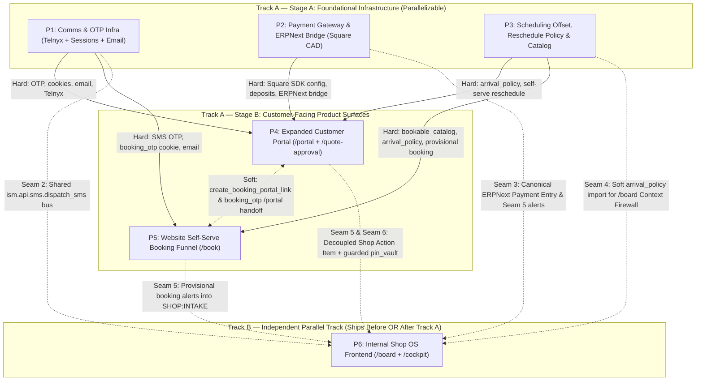

# ISM Platform Master Program Roadmap — Tracks A & B (Projects P1–P6)

> **Document Purpose:** Authoritative Master Program Roadmap, Frozen Cross-Project Contract Registry, and Swarm Plugin Execution Handbook governing all six standalone technical implementation plans inside `todo_snippets/roadmap/`.

---

## Context Isolation Policy

`todo_snippets/roadmap/` is a **self-contained program folder** governing **Track A (Customer Portal Expansion & Core Infrastructure, Projects P1–P5)** and **Track B (Internal Shop OS Frontend, Project P6)**.

**Mandatory Context Isolation Rule for Future Execution Sessions:**
- When launching a `/swarm` session to execute any individual project plan (`plan_p1_*.md` through `plan_p6_*.md`), load **ONLY**:
  1. `todo_snippets/roadmap/ROADMAP.md` (this file), and
  2. The target project's plan file (`todo_snippets/roadmap/plan_p<N>_*.md`).
- **Do NOT load unrelated sibling documents outside this folder** (such as `todo_snippets/nl_agent_optimization_swarm.md`) into coordinator or worker context. Keeping sibling plans out of context prevents token bloat, conflicting conventions, and scope drift.
- Each `plan_p*.md` file is self-contained for its own swarm execution and references frozen cross-project contracts registered in Section 4 below so workers never need to read all six plans simultaneously.

---

## 1. Program Architecture & Multi-Track Overview

The ISM Platform expansion advances two cohesive, decoupled tracks inside `ism-frappe` (with thin `ism-agent-os` CLI/back-office support on Track B):

1. **Track A — Customer Portal Expansion & Core Infrastructure (Projects P1–P5):**
   Evolves ISM's existing single-purpose, login-free quote signature page (`/quote-approval`) into a complete, trustworthy customer self-service platform spanning **Telnyx SMS & OTP infrastructure** (P1), **inline CAD Square Web Payments SDK with immediate ERPNext Square Bank Account reconciliation** (P2), **silent earlier arrival-offset scheduling & curated predictable self-serve catalog foundations** (P3), a **dual-auth Customer Portal Visit Hub** (`/portal`, P4), and a **hosted Website Self-Serve Booking Funnel** (`/book`, P5).
2. **Track B — Internal Shop OS Frontend (Project P6):**
   Consolidates daily shop-floor operations directly inside `ism-frappe` via a mobile-first **Shop Floor Blackboard PWA** (`/board`) and an **Executive & Dispatch Cockpit** (`/cockpit`), powered by a generalized append-only event log (`Shop Board Thread` / `Shop Board Event`), external **Google Drive** streaming media storage, server-side 4-regime parts pricing, bounded multimodal AI orchestration with a strict **Context Firewall**, and thin `ism-agent-os` CLI integration.

Both tracks share `ism-frappe` and ERPNext's canonical ledger/scheduling truth while interacting strictly across **six explicit, non-colliding integration seams** (Section 4.5). Neither track hard-imports the other's DocTypes, allowing Track B (P6) and Track A (P1–P5) to ship in **either order** without merge conflicts, schema collisions, or runtime import errors.

### Master Program Dependency Graph



### Recommended Execution Sequencing

1. **Stage A — Parallel Infrastructure Foundation (Track A: P1, P2, P3):**
   Projects **P1**, **P2**, and **P3** have **zero mutual runtime dependencies** and strictly disjoint `ISM Settings` sections (Section 4.1). Execute them in parallel feature branches or sequentially in recommended priority order: **P1 → P3 → P2**.
2. **Stage B — Customer-Facing Product Surfaces (Track A: P4, P5):**
   - **P4 (Expanded Customer Portal)** begins once **P1, P2, and P3** are merged and verified.
   - **P5 (Website Self-Serve Booking)** can begin as soon as **P1 and P3** are merged (it has **zero** dependency on P2 because deposits are manually initiated later on Repair Orders). P5 ships cleanly either before or after P4 via a guarded soft import of `ism.portal.auth.create_booking_portal_link` and automatically upgrades to direct tokenized booking links once P4 is present.
3. **Parallel Track B — Internal Shop OS Frontend (P6):**
   **P6** has **zero hard prerequisites** on Track A and ships as one continuous single-`/swarm` execution covering Phase 1 (`/board`) + Phase 2 (`/cockpit`, server pricing, `#Intake`, `#Receiving-AP`). It can be executed **before, alongside, or after** Track A; every Track A touchpoint uses either stable canonical contracts (`dispatch_sms`, ERPNext `Payment Entry`, `Shop Action Item`) or guarded `try/except ImportError` boundaries (`arrival_policy`, `pin_vault`).

---

## 2. Master Index of Swarm Implementation Plans

| Project | Plan Document | Track | Prerequisites | Waves (Checkpoints) | Delivery / Verifier Workers *(+ opt. `monitor`)* | Max Concurrent `share` Authors | New / Total Slot Test Suites | Swarm Title | Status |
| :--- | :--- | :--- | :--- | :---: | :---: | :---: | :---: | :--- | :---: |
| **P1** | [plan_p1_comms_telnyx_otp.md](./plan_p1_comms_telnyx_otp.md) | Track A (Stage A Infra) | None | 4 (`M1`–`M3`) | 6 authors + 2 verifiers *(+1)* | 3 | 6 new / 10 total | `P1 Telnyx comms and OTP infra` | Merged on `main` |
| **P2** | [plan_p2_payments_square_erpnext.md](./plan_p2_payments_square_erpnext.md) | Track A (Stage A Infra) | None | 4 (`M1`–`M3`) | 5 authors + 2 verifiers *(+1)* | 3 | 5 new / 10 total | `Square CAD payments and ERPNext bridge` | Merged on `main` |
| **P3** | [plan_p3_scheduling_offset_catalog.md](./plan_p3_scheduling_offset_catalog.md) | Track A (Stage A Infra) | None | 3 (`M1`–`M2`) | 3 authors + 1 verifier *(+1)* | 2 | 3 new / 8 total | `Scheduling policy, arrival offset and catalog` | Merged on `main` |
| **P4** | [plan_p4_customer_portal_expansion.md](./plan_p4_customer_portal_expansion.md) | Track A (Stage B Surface) | P1, P2, P3 | 4 (`M1`–`M3`) | 6 authors + 2 verifiers *(+1)* | 3 | 6 new / 10 total | `P4 dual-auth customer portal hub` | Ready *(P1–P3 merged)* |
| **P5** | [plan_p5_website_self_serve_booking.md](./plan_p5_website_self_serve_booking.md) | Track A (Stage B Surface) | P1, P3 *(soft P4)* | 4 (`M1`–`M3`) | 3 authors + 1 verifier *(+1)* | 1 | 1 new / 8 total | `P5 Website Self-Serve Booking Funnel` | Ready *(P1, P3 merged)* |
| **P6** | [plan_p6_shop_os_frontend.md](./plan_p6_shop_os_frontend.md) | Track B (Parallel Shop OS) | None *(Independent)* | 4 (`M1`–`M3`) | 8 authors + 2 verifiers *(+1)* | 3 | 5 new / 12 total Frappe *(+1 CLI / full `ism-agent-os` unittest)* | `Shop OS board and cockpit` | Merged on `main` |

> **Note:** Every worker name across all six rosters conforms strictly to `^[a-z0-9][a-z0-9_-]{0,23}$`, and every project respects the repository bench concurrency ceiling of `<= 3` concurrent `workspace:"share"` authors per wave.

---

## 3. Locked Program Decisions & Non-Goals Register

All product, security, and architectural decisions below are **locked** across Tracks A & B and must not be reopened during execution unless explicitly revised by the owner.

### 3.1 Track A — Customer Portal & Infrastructure Locked Decisions

| Domain | Locked Decision | Governs |
| :--- | :--- | :---: |
| **Dual-Path Portal Auth & Persistent Cookie** | **Path 1 (Shop-Sent Tokenized Links):** Links sent directly by the shop via SMS/email (`/quote-approval?token=...`, `/portal?booking_token=...`) open immediately with **zero OTP friction** (smooth front-desk quote reviews), strip raw tokens from browser history, and set a persistent, `HttpOnly`, `Secure`, `SameSite=Lax`, HMAC-signed + DB-backed session cookie (`ism_portal_session`). **Path 2 (Public / Cross-Device Re-Entry):** Visiting `/portal` without an active cookie or valid tokenized link reveals **zero** PII, vehicle details, appointment times, quotes, or invoices until verified via mobile phone + Telnyx SMS OTP (non-enumerating). **Path 3 (Returning Continuity):** Authorized browsers restore seamlessly via persistent cookie with explicit **"Sign out on this device"** and server-side revocation. | P1, P4, P5 |
| **Telnyx-Only SMS & Zero Email OTP Fallback** | Production outbound SMS, OTP delivery, delivery receipts, and inbound `STOP`/`START`/`HELP` compliance run exclusively on **Telnyx Messaging API v2** (no Twilio; legacy `"Twilio"` setting coerces safely to `"Disabled"`). Retain `"Custom HTTP Webhook"` and add `"Mock (Deterministic Test)"` for hermetic offline testing. **SMS OTP only — strictly zero email OTP fallback.** | P1, P4, P5 |
| **Embedded Square Web Payments SDK (CAD) & Immediate ERPNext Bank Reconciliation** | Capture deposit and invoice balance payments inline inside `/portal` via Square's **embedded Web Payments SDK** (tokenized `source_id` only; raw PAN/CVV never touches Frappe). Execute server-side charges strictly in **CAD** (never trusting client amounts). Treat **Square directly as an ERPNext Bank Account** (`Square - <abbr>`, `account_type="Bank"`, zero `Cash` fallback) so confirmed Square payments post and reconcile immediately via ERPNext `Payment Entry` (Customer Advance with `[RO:<name>]` for deposits; Invoice allocation for `Sales Invoice` balances). | P2, P4 |
| **Manual Staff-Initiated Deposit Requests** | Shop staff (`ISM Manager` / `ISM Service Advisor`) **manually initiate** deposit requests on a Repair Order. Never auto-trigger deposits on quotes or require upfront deposits during website self-serve booking. | P2, P4, P5 |
| **Silent Earlier Arrival Offset (15-Minute Leeway)** | Apply configurable `customer_arrival_offset_minutes` (default **15 minutes**, valid `0..120`) **uniformly across every capacity slot — including the opening slot of the day** (e.g., an `08:00` internal bay/tech capacity slot presents to customers as a **`07:45`** drop-off time; never shift or drop the `08:00` capacity slot). Never disclose buffer, leeway, grace period, or "arrive early" language on any customer-facing screen, API payload, SMS, or email. Internal Desk calendars, capacity math, DB columns (`scheduled_time`), and `/cockpit` swimlanes always retain true Internal Capacity Start (`T`). | P3, P4, P5, P6 |
| **Binary Repair Status Only** | Surface strictly high-level visit states on `/portal`: **Scheduled** (with silent drop-off time), **Being Worked On**, **Done & Ready for Pickup** (with shop pickup hours and payment/invoice actions), and **Cancelled**. Strictly omit estimated completion times (ETAs), countdowns, progress bars, or mid-work service-item completion checklists. | P4 |
| **Post-Approval Always-Prompt PIN-to-Drive & Auto-Purge** | Immediately after quote approval, **always prompt** for the vehicle's 4-digit **PIN-to-Drive** with a prominent 1-tap **"No PIN-to-Drive enabled"** opt-out. Encrypt at rest using Frappe-bundled `cryptography.fernet` bound to the RO + Frappe `Password` (`__Auth`), render write-only/masked (`••••`) to customers (updatable only before work starts), gate internal reveal strictly to active shop roles with audit comments and a 15-second auto-mask timer (Desk `Workshop` button + P6 `/board` Seam 6 pill), and **automatically purge ciphertext (`0` rows in `__Auth`) when the RO reaches `Closed / Released` (or `Cancelled`)**. | P4, P6 |
| **Self-Serve Appointment Management** | Authorized customers view their appointment (`T - offset`) and self-reschedule into live capacity-backed slots via row-locked atomic swaps subject to `reschedule_cutoff_hours`, `max_self_reschedules`, and hard lifecycle locks (blocked once checked in, in progress, or released). | P3, P4 |
| **Unpaid & Paid Sales Invoice Self-Service** | PDF download and rate-limited self-email unlock **immediately** as soon as a submitted **`Sales Invoice`** is linked to the Repair Order — **including unpaid invoices** (displayed alongside the inline Square balance payment form) — and remain read-only accessible after `Closed / Released`. | P1, P4 |
| **Hosted Frappe `/book` Route (Direct Link, No Iframe)** | External marketing website links its "Book Now" button directly to `https://<ism-site>/book` hosted natively by Frappe. Select vehicle + curated predictable `Service Package` items (`allow_self_serve_booking = 1`), choose capacity-backed arrival slot (`T - offset`), verify phone via Telnyx SMS OTP *before* locking capacity, commit a provisional `Schedule Entry`, and promote the OTP verification directly into `ism_portal_session` for zero-reauth `/portal` handoff. **No embeddable iframe mode** (enforce `X-Frame-Options: DENY` and `Content-Security-Policy: frame-ancestors 'none'`). | P1, P3, P4, P5 |

### 3.2 Track B — Internal Shop OS Frontend Locked Decisions (Project 6)

| Domain | Locked Decision |
| :--- | :--- |
| **Frappe-First Operations & Asymmetric Ergonomics** | Build `/board` (glove-friendly mobile/desktop PWA with PTT voice, camera snaps, 1-tap clarification/approval/undo cards) and `/cockpit` (7 gauges, prioritized Action Queue with Snooze/Dismiss/Reopen, Bay/Tech swimlane) natively in `ism-frappe`. Retire localhost `stage_server.py` / `cockpit_ui.html` for daily shop operations while keeping thin `ism-agent-os` CLI/back-office ingestion (`board-threads`, `board-thread`, `board-post`, `board-resolve`, `board-undo`). |
| **Generalized Event-Log Schema** | Threads use generalized `thread_key` (`RO:<ro_name>`, `SHOP:INTAKE`, `SHOP:AP_RECEIVING`, `SHOP:DISPATCH`) and `thread_type` with nullable indexed `repair_order`, backed by append-only `Shop Board Event` and deterministic `Shop Board Thread` projections. |
| **Strict RBAC & Confidence Gateways** | **9 Autonomous Internal Actions** (`AI_RECEIPT` with exact compensating `undo_spec`: `LOG_RO_NOTE`, `ATTACH_INSPECTION_MEDIA`, `ADD_SUPPLEMENT_DRAFT`, `SET_PARTS_HOLD`, `CLEAR_PARTS_HOLD`, `DRAFT_PURCHASE_ORDER`, `UPDATE_JOB_STATUS`, `TOGGLE_SERVICE_COMPLETION`, `ADD_DEFERRED_SERVICES`) vs. **13 Manager / Advisor Gated Commits ONLY** (`SUBMIT_PO`, `AMEND_QUOTE`, `SEND_QUOTE_APPROVAL`, `DISPATCH_CUSTOMER_SMS`, `DISPATCH_CUSTOMER_EMAIL`, `RECORD_DEPOSIT`, `CHECKOUT_REPAIR_ORDER`, `RESCHEDULE_APPOINTMENT`, `INTAKE_QUOTE_AND_BOOK`, `CONVERT_APPOINTMENT_TO_RO`, `RECEIVE_PO`, `POST_PURCHASE_INVOICE`, `PAY_PURCHASE`). `ISM Technician` receives `frappe.PermissionError` server-side on gated commits and `/cockpit`. Zero hallucination on missing mandatory fields (`odometer_in`, `odometer_out`, `payment_method`, `bill_no`, `LH`/`RH`). |
| **Context Firewall (Zero Internal Leakage)** | Customer-facing SMS, Email, and Quote drafts run in an isolated single-turn call fed strictly an allowlisted `SanitizedCustomerFactPayload`, stripping raw chat history, transcripts, shop slang, bay/tech IDs, supplier costs, margin %, Tesla OEM prices, `override_notes`, and `verbal_notes`. |
| **External Google Drive Streaming Media** | Stream uploads/downloads directly to Google Drive via pure `requests` (zero heavy media written to local Frappe disk in Drive mode), defaulting to **OAuth2 Refresh Token** with optional **Service Account JSON**, served via authenticated `Range`-capable proxy, with `Frappe Private File` kept as dev/test/offline fallback. Audio is retained in `<Drive Root>/<thread_folder>/` for auditability. |
| **Row-Locked Idempotency & Server Pricing** | `resolve_board_card` and `undo_board_receipt` lock target `Shop Board Event` via `SELECT ... FOR UPDATE` honoring client `idempotency_key`. Port the 4-regime Tesla-offset & cost-floor pricing rules into server-only `ism.board.pricing` (never exposed to customer serializers). |

### 3.3 Cross-Program Engineering Standards & Explicit Non-Goals

- **Zero Node Build Step:** All frontend surfaces (`/portal`, `/quote-approval`, `/book`, `/board`, `/cockpit`) ship as Frappe `www/` / `templates/pages/` controllers with vanilla ES modules and CSS under `ism-frappe/ism/public/` — no Webpack, Vite, or npm build pipeline.
- **Zero Extra `pyproject.toml` Dependencies:** All external integrations (Telnyx v2, Square v2, Google Drive API, Gemini REST API, Ed25519/HMAC webhook validation, Fernet PIN encryption) use pure HTTPS `requests` and Frappe-bundled `cryptography` — zero new packages added to `ism-frappe/pyproject.toml`.
- **Hermetic Offline Testability:** Telnyx (P1), Square (P2), and Multimodal AI / Drive fallback (P6) each ship with first-class `"Mock (Deterministic Test)"` adapters so all automated and live `-Serve` browser checks execute offline with zero carrier charges or network flakiness.
- **Zero Canonical Bench Contact:** No worktree or swarm worker ever touches canonical `development.localhost:8000` (`sync-to-wsl.ps1`, `watch-sync.*`, `promote-to-main.ps1`, or raw `wsl`/`docker exec` targeting `frappe-bench`). All migrations, tests, and previews run exclusively via `scripts\test-in-slot.ps1`.
- **Explicit Non-Goals:**
  - No customer username/password accounts or email OTP fallback.
  - No Twilio SMS integration.
  - No automatic deposits on quotes or upfront deposits on website self-serve bookings.
  - No live ETA, countdowns, or mid-work task checklists on `/portal`.
  - No embeddable iframe booking widget or `postMessage` bridge.
  - No parallel payment balances outside ERPNext and no silent auto-cancellation of submitted ERPNext `Payment Entry` or `Sales Invoice` records on refund/void webhooks.

---

## 4. Frozen Cross-Project & Cross-Track Contract Registry

All tables below are verified 100% against the six individual plans (`plan_p1_*.md` through `plan_p6_*.md`). Every project must treat these names, namespaces, and signatures as frozen contracts.

### 4.1 `ISM Settings` Non-Colliding Section & Field Ownership Matrix

`ISM Settings` currently has **6 existing sections** (`sb_approval_settings`, `sb_sms_settings`, `sb_scheduling`, `sb_capacity`, `sb_estimation`, `sb_pricing`). Across P1–P6, **1 existing section is expanded in-place** (P1) and **8 strictly disjoint new sections** are added (**14 total sections, zero fieldname collisions**):

| Owner | Section Break (`fieldname` / Label) | Owned Fields & Key Defaults | `seed.py` & Validation Contract |
| :--- | :--- | :--- | :--- |
| **Existing (Untouched)** | `sb_approval_settings`, `sb_scheduling`, `sb_capacity`, `sb_estimation`, `sb_pricing` | All pre-existing approval, shop-hours, bay/tech capacity, duration estimation, and base labor/markup fields | Untouched by P1–P6; `ISM Settings.on_update` cache invalidation preserved |
| **P1 (Expanded)** | `sb_sms_settings` (`Outbound SMS Gateway Settings`) | Preserves `sms_gateway_provider` (`Disabled`/`Telnyx`/`Custom HTTP Webhook`/`Mock (Deterministic Test)`), `sms_gateway_endpoint`, `sms_gateway_api_key`, `sms_sender_id`, `enable_ready_for_pickup_sms`; adds `sms_default_country_code` (`+1`), `cb_sms_settings`, `telnyx_api_key` (`Password`), `telnyx_messaging_profile_id`, `telnyx_webhook_public_key`, `sms_webhook_hmac_secret` (`Password`), `telnyx_webhook_tolerance_seconds` (`300`), `sms_enforce_opt_out` (`1`), `sms_help_reply_text` | Legacy `"Twilio"` coerces to `"Disabled"`; `_validate_comms_and_otp_settings()` enforces country code regex & tolerance `30..3600` |
| **P1 (New)** | `sb_otp_and_sessions` (`OTP & Portal Sessions`) | `otp_code_length` (`6`), `otp_ttl_seconds` (`300`), `otp_resend_cooldown_seconds` (`60`), `otp_max_verify_attempts` (`5`), `otp_lockout_seconds` (`900`), `otp_phone_rate_limit_per_hour` (`5`), `otp_ip_rate_limit_per_hour` (`20`), `cb_otp_and_sessions`, `portal_session_cookie_name` (`ism_portal_session`), `portal_session_ttl_days` (`30`), `portal_session_signing_secret` (`Password`), `portal_session_cookie_samesite` (`Lax`/`Strict`, default `Lax`), `portal_session_secure_cookie` (`1`), `transactional_email_rate_limit_per_hour` (`5`), `transactional_email_ip_rate_limit_per_hour` (`20`) | `seed.py` auto-generates `portal_session_signing_secret` (`secrets.token_urlsafe(48)`) only when blank; validates bounds (`otp_code_length` `4..8`, `portal_session_ttl_days` `1..90`) |
| **P2 (New)** | `sb_square_payments` (`Square Online Payments (CAD)`) | `square_environment` (`Disabled`/`Sandbox`/`Production`/`Mock (Deterministic Test)`), `square_application_id`, `square_location_id`, `square_currency` (`CAD`, `read_only`), `cb_square_payments`, `square_access_token` (`Password`), `square_webhook_signature_key` (`Password`), `square_webhook_notification_url`, `square_mode_of_payment` (`Square`), `square_bank_account` (`Square - <abbr>`) | `ensure_square_bank_account_and_mop()` idempotently seeds per-company CAD `Bank` Account + `Square` MOP; `_validate_square_settings()` enforces `CAD` & `account_type=="Bank"` |
| **P3 (New)** | `sb_customer_scheduling_policy` (`Customer Scheduling & Self-Serve Policy`) | `customer_arrival_offset_minutes` (`15`, `0..120`), `reschedule_cutoff_hours` (`24`), `max_self_reschedules` (`2`), `cb_customer_scheduling_policy`, `self_serve_default_entry_type` (`Diagnostic`), `self_serve_min_lead_time_minutes` (`120`), `self_serve_horizon_days` (`30`, `1..180`), `enable_waiter_preference` (`1`) | Zero-capable fields in `_ISM_SETTINGS_NONE_DEFAULTS`; cached via `ism.scheduling.time_utils.get_shop_settings()` |
| **P4 (New)** | `sb_customer_portal` (`Customer Portal Settings`) | `enable_customer_portal` (`1`), `portal_brand_name`, `portal_support_phone`, `portal_pickup_hours_text`, `cb_customer_portal`, `portal_booking_token_ttl_days` (`30`, `1..180`), `portal_invoice_print_format` (`Standard`), `portal_pin_encryption_key` (`Password`), `portal_pin_prompt_disclaimer` | `seed.py` auto-generates 32-byte Fernet `portal_pin_encryption_key` only when blank; `_validate_customer_portal_parameters()` validates TTL `1..180` |
| **P5 (New)** | `sb_self_serve_booking` (`Website Self-Serve Booking Funnel`) | `enable_self_serve_booking` (`0`), `self_serve_booking_title`, `self_serve_booking_intro`, `self_serve_max_packages_per_booking` (`5`, `1..10`), `cb_self_serve_booking`, `self_serve_require_email` (`0`), `self_serve_booking_ip_rate_limit_per_hour` (`15`, `1..500`), `self_serve_booking_phone_rate_limit_per_day` (`3`, `1..20`), `self_serve_honeypot_enabled` (`1`) | Zero duplication of P3 fields (reads horizon/lead-time/waiter via P3 `get_self_serve_policy()`); `_validate_self_serve_booking_settings()` enforces bounds |
| **P6 (New)** | `sb_media_storage`, `sb_board_ai`, `sb_parts_pricing` | **Media:** `media_storage_backend` (`Frappe Private File`/`Google Drive`), `gdrive_auth_mode` (`OAuth2 Refresh Token`/`Service Account JSON`), `gdrive_client_id`, `gdrive_client_secret`, `gdrive_refresh_token`, `gdrive_service_account_json`, `gdrive_root_folder_id`, `media_max_audio_mb` (`15`), `media_max_image_mb` (`10`). **AI:** `board_ai_provider` (`Disabled`/`Mock (Deterministic Test)`/`Gemini REST API`/`OpenAI Compatible`), `board_ai_api_key`, `board_ai_endpoint`, `board_ai_orchestrator_model` (`gemini-2.5-flash`), `board_ai_comms_model` (`gemini-2.5-flash`), `board_ai_confidence_threshold` (`0.90`), `board_ai_auto_process`. **Parts Pricing:** `parts_pricing_baseline_discount_pct` (`30.0`), `parts_pricing_small_ticket_max_tesla_price` (`20.0`), `parts_pricing_small_ticket_discount_pct` (`0.0`), `parts_pricing_min_sell_price` (`5.0`), `parts_pricing_min_cost_markup_pct` (`25.0`), `parts_pricing_min_cost_margin_dollars` (`5.0`), `parts_pricing_fallback_cost_markup_pct` (`40.0`), `parts_pricing_rounding_increment` (`0.01`), `parts_pricing_condition_overrides_json`, `parts_pricing_tesla_search_url_template` | `seed.py` seeds defaults matching `ism-agent-os/rules/parts_pricing.json` (`media_storage_backend="Frappe Private File"`, `board_ai_provider="Disabled"`) and calls `ensure_singleton_shop_threads()` during `after_migrate` |

### 4.2 Shared DocType, Route, Hook, UI & Teardown Extension Matrix

| Shared Target | Owning Projects & Exact Disjoint Boundaries | Merge / Composition Rule |
| :--- | :--- | :--- |
| **`Repair Order` (`repair_order.json`)** | **P2** (`tab_billing`, after `outstanding_amount`): `sec_deposit_request`, `deposit_request_status`, `deposit_request_amount`, `deposit_request_note`, `cb_deposit_request`, `deposit_request_requested_by`, `deposit_request_requested_at`, `deposit_request_paid_at`, `deposit_request_transaction`; widens `tab_billing.depends_on`.<br>**P4** (`tab_workshop`, below `sec_bay`): `sec_pin_to_drive`, `pin_to_drive_status`, `pin_to_drive_encrypted` (`Password`, hidden), `pin_to_drive_submitted_at`, `pin_to_drive_updated_at`, `cb_pin_to_drive`, `pin_to_drive_opted_out_at`, `pin_to_drive_purged_at`, `pin_to_drive_last_viewed_by`, `pin_to_drive_last_viewed_at`, `pin_to_drive_view_count`. | Disjoint tabs (`tab_billing` vs. `tab_workshop`) and disjoint prefixes (`deposit_request_*` vs. `pin_to_drive_*`). Zero overlap. |
| **`Schedule Entry` (`schedule_entry.{json,py,js}`)** | **P3** (before `section_break_notes`): `section_break_self_serve`, `booking_source`, `waiter_preference`, `reschedule_count`, `cb_self_serve_meta`, `last_rescheduled_at`, `provisional_vehicle_model`, `provisional_vehicle_year`, `provisional_vin_or_plate`, `booked_packages_json`; trims provisional fields & fallback display vehicle.<br>**P4** (after P3 `section_break_self_serve`, before `section_break_notes`): `section_break_portal_link`, `portal_booking_token_hash` (SHA-256 only), `portal_booking_token_expires_at`. | Disjoint sections & prefixes; P4 executes after P3. |
| **`Service Package` (`service_package.{json,py,js}`)** | **P3 ONLY** (before `sb_items`): `sb_self_serve_catalog`, `allow_self_serve_booking`, `self_serve_sort_order`, `customer_title`, `customer_summary`, `applicable_year_from`, `applicable_year_to`, `cb_self_serve_pricing`, `customer_price_display_mode`, `customer_estimate_min`, `customer_estimate_max`, `self_serve_duration_minutes`, `self_serve_required_tags`. | Single owner (P3). |
| **`hooks.py` — `website_route_rules`** | **Existing:** `/quote-approval -> quote_approval`<br>**P4:** `/portal -> portal`<br>**P5:** `/book -> book`<br>**P6:** `/board/<thread_key> -> board`, `/board -> board`, `/cockpit -> cockpit` | Strictly disjoint routes; keep `/board/<thread_key>` ordered before `/board`. |
| **`hooks.py` — `doc_events`** | **Existing:** `Customer`, `ISM Settings`, `Holiday List`, `Purchase Receipt/Invoice`, `Stock Entry/Reconciliation`, `Sales Invoice`, `Payment Entry` (untouched by P1–P6).<br>**P4:** `Repair Order.on_update` -> `ism.portal.pin_vault.on_repair_order_update_purge_pin`<br>**P6:** `Repair Order.after_insert` -> `ism.board.projections.on_repair_order_after_insert`; `Repair Order.on_update` -> `ism.board.projections.on_repair_order_update`; `Schedule Entry.on_update` -> `ism.board.projections.on_schedule_entry_update`; `Shop Action Item.after_insert` -> `ism.board.projections.on_shop_action_item_after_insert` (Seam 5). | **Mandatory list syntax on `Repair Order.on_update`** when both P4 and P6 are merged so both handlers execute without overwriting each other. |
| **`hooks.py` — `scheduler_events["daily"]`, `default_log_clearing_doctypes`, `ignore_links_on_delete`** | **P1:** daily `ism.comms.otp.cleanup_expired_otp_challenges`, `ism.comms.sessions.cleanup_expired_portal_sessions`; `default_log_clearing_doctypes = {"SMS Audit Log": 180}`; appends `"SMS Audit Log"`, `"Portal OTP Challenge"`, `"Customer Portal Session"` to `ignore_links_on_delete`.<br>**P4:** appends daily `ism.portal.pin_vault.purge_stale_closed_ro_pins`. | Additive list entries only; preserve existing `"Repair Order Schedule Entry"` in `ignore_links_on_delete`. |
| **`repair_order.js` Button Groups** | **P2 (`Billing` group, `// 2. Billing Actions`):** `Request Online Deposit`, `Cancel Deposit Request`.<br>**P4 (`Workshop` group via `setup_pin_to_drive_controls`):** `🔐 Reveal PIN-to-Drive` (15s auto-mask modal).<br>**P6 (`Navigation` group):** `Open Shop Board` (`/board?thread=RO:<doc.name>`). | Strictly disjoint button groups (`Billing` vs. `Workshop` vs. `Navigation`). |
| **`ism/workspace/ism/ism.json`** | **P6 ONLY:** Adds `"Shop Floor Blackboard"` (`/board`) and `"Shop Cockpit"` (`/cockpit`) shortcuts. | Single owner (P6). |
| **`setup_tasks/seed.py`** | Additive defaults per project in `_ISM_SETTINGS_FALSY_DEFAULTS` / `_ISM_SETTINGS_NONE_DEFAULTS`, plus idempotent helpers: **P1** (`portal_session_signing_secret`), **P2** (`ensure_square_bank_account_and_mop`), **P4** (`portal_pin_encryption_key`), **P6** (`ensure_singleton_shop_threads` in `after_migrate`). | Never overwrite operator-configured values or explicit `0` flags on re-migration. |
| **`tests/base.py` (`_TEARDOWN_ORDER`) & `tests/cleanup.py`** | **P1:** `"Customer Portal Session": 0`, `"Portal OTP Challenge": 1`, `"SMS Audit Log": 2`, `"SMS Opt Out": 3`.<br>**P2:** `"ISM Payment Transaction": 1` + `_teardown_repair_order` cleanup + `tests/cleanup.py::_cleanup_payment_transactions`.<br>**P6:** `"Shop Board Event": 9`, `"Shop Board Thread": 10` + `_teardown_repair_order` cleanup. | All child/ledger DocTypes rank strictly below `Repair Order` (`13`) and `Customer` (`21`) for hermetic test teardown. |

### 4.3 New DocType & Python Package Namespace Registry

| Project | New DocTypes (Module: `ISM`, Engine: `InnoDB`) | New Python Package(s) | New / Extended API Modules | Hosted Frontend Routes & Assets |
| :--- | :--- | :--- | :--- | :--- |
| **P1** | `SMS Audit Log` (`sms_audit_log`), `SMS Opt Out` (`sms_opt_out`), `Portal OTP Challenge` (`portal_otp_challenge`), `Customer Portal Session` (`customer_portal_session`) *(4)* | `ism-frappe/ism/comms/` (`contracts`, `providers`, `telnyx`, `sessions`, `email_dispatch`, `otp`) | `[MODIFY] ism/api/sms.py`, `[NEW] ism/api/comms_webhooks.py`, `[MODIFY] ism/api/approval.py` | None |
| **P2** | `ISM Payment Transaction` (`ism_payment_transaction`, autoname `PAYTX-.YYYY.-.#####`) *(1)* | `ism-frappe/ism/payments/` (`contracts`, `square_client`, `webhooks`, `erpnext_bridge`, `deposit_requests`) | `[NEW] ism/api/payments.py` | None *(Desk `Billing` dialogs only)* |
| **P3** | None *(extends `Service Package` & `Schedule Entry`)* | Extends `ism-frappe/ism/scheduling/` (`[NEW] arrival_policy`, `bookable_catalog`, `self_serve`; `[MODIFY] time_utils`, `capacity`, `slot_search`) | `[NEW] ism/api/self_serve_scheduling.py` *(leaves `ism/api/scheduling.py` untouched)* | None |
| **P4** | None *(extends `Repair Order` & `Schedule Entry`)* | `ism-frappe/ism/portal/` (`contracts`, `auth`, `pin_vault`, `events`, `invoices`, `visit_view`) | `[NEW] ism/api/portal.py`, `[MODIFY] ism/api/approval.py` | `/portal` (`ism/www/portal.{py,html}`), upgraded `/quote-approval` (`ism/templates/pages/quote_approval.{py,html}`), `ism/public/portal/{portal.css,api.js,auth.js,quote_pin.js,reschedule.js,payments.js,invoices.js,app.js}` |
| **P5** | None | `ism-frappe/ism/booking/` (`contracts`, `anti_abuse`, `service`) | `[NEW] ism/api/booking.py` | `/book` (`ism/www/book.{py,html}`), `ism/public/book/{book.css,api.js,state.js,app.js}` |
| **P6** | `Shop Board Thread` (`shop_board_thread`), `Shop Board Event` (`shop_board_event`) *(2)* | `ism-frappe/ism/board/` (`contracts`, `projections`, `media_storage`, `pricing`, `cockpit_view`, `gateways`, `comms_firewall`, `ai_providers`, `orchestrator`) | `[NEW] ism/api/board.py`, `[MODIFY] ism/api/agent_serializers.py` *(+ `ism-agent-os/tools/{client,cli_parsers,cli_commands,cli_validation}.py`)* | `/board` & `/board/<thread_key>` (`ism/www/board.{py,html}`, `ism/public/board/*`), `/cockpit` (`ism/www/cockpit.{py,html}`, `ism/public/cockpit/*`) |

**Program Totals:** **7** new DocTypes across `ism-frappe`, **6** dedicated package domains (`comms`, `payments`, `scheduling`, `portal`, `booking`, `board`), **5** hosted Frappe routes (`/quote-approval`, `/portal`, `/book`, `/board`, `/cockpit`), **0** new PyPI dependencies, and **0** Node build steps.

### 4.4 Cross-Project Public Python & Event Interface Contracts

Downstream projects must consume upstream capabilities strictly through these frozen interfaces:

#### P1 Exports → Consumed by P3, P4, P5, P6
- **`ism.api.sms` (Seam 2 backward-compatible facade):**
  - `dispatch_sms(phone_number, message, *, message_type="Notification", reference_doctype=None, reference_name=None, redact_body=False, redacted_preview=None, respect_opt_out=True) -> dict` *(preserves 2-arg positional calls & `{"success", "message_id", "error"}` keys)*
- **`ism.comms.contracts`:**
  - `normalize_phone_e164(raw_phone, default_country_code="+1")`, `mask_phone_e164(phone_e164)`, `redact_otp_body(body, preview_override=None)`, `get_client_ip(ip_override=None)` *(P3 softly delegates E.164 normalization here when P1 is installed)*
- **`ism.comms.otp` (SMS-only; zero email OTP fallback):**
  - `request_sms_otp(phone, *, purpose="portal_login", client_ip=None, user_agent=None, context_ref_doctype=None, context_ref_name=None) -> OTPChallengeResult`
  - `verify_sms_otp(challenge_id, code, *, phone=None, purpose=None, client_ip=None, consume=True) -> OTPVerifyResult`
  - `consume_verified_otp_challenge(challenge_id, *, expected_purpose=None, expected_phone=None) -> OTPVerifyResult`
  - `check_otp_lockout(phone_e164) -> dict`, `get_last_mock_otp(phone_e164) -> str | None` *(Mock mode only)*
- **`ism.comms.sessions` (Persistent `ism_portal_session` HttpOnly/Secure cookie):**
  - `issue_portal_session(*, auth_method, scope_type="customer", customer=None, phone_e164=None, repair_order=None, schedule_entry=None, source_otp_challenge=None, source_magic_token=None, client_ip=None, user_agent=None, set_response_cookie=True) -> PortalSessionInfo`
  - `verify_portal_session(cookie_value=None, *, touch=True, required_scope_type=None) -> PortalSessionInfo | None`
  - `rotate_portal_session(...) -> PortalSessionInfo`, `revoke_portal_session(...) -> bool`, `revoke_all_sessions_for_phone(...) -> int`, `revoke_all_sessions_for_customer(...) -> int`
- **`ism.comms.email_dispatch`:**
  - `dispatch_transactional_email(*, recipient, subject, html_body, email_type="transactional", reference_doctype=None, reference_name=None, attachments=None, client_ip=None, bypass_rate_limit=False, delayed=False) -> EmailDispatchResult`

#### P2 Exports → Consumed by P4, P6
- **`ism.payments.square_client`:** `get_sdk_boot_config() -> SquareSdkBootConfig` *(non-secret public config only; `currency="CAD"`)*
- **`ism.payments.deposit_requests`:** `create_deposit_request(ro_name, amount, note=None)`, `cancel_deposit_request(ro_name, reason=None)`, `get_ro_payment_state(ro_name) -> PaymentStateSummary`, `list_ro_payment_transactions(ro_name)`
- **`ism.payments.erpnext_bridge`:** `execute_tokenized_payment(repair_order, payment_intent, source_id, *, idempotency_key=None, expected_amount_cents=None, buyer_email=None, initiated_by="Customer Portal", client_ip=None, square_client=None) -> SquareChargeResult`, `resolve_square_accounting_config(company) -> SquareAccountingConfig`
- **`ism.api.payments`:** Staff (`request_ro_deposit`, `cancel_ro_deposit_request`, `get_ro_payment_ledger`) and Guest/Portal (`get_square_sdk_boot_config`, `get_ro_payment_summary`, `submit_square_payment`, `square_webhook`).

#### P3 Exports → Consumed by P4, P5, P6
- **`ism.scheduling.arrival_policy` (Seam 4 single source of truth; `08:00 -> 07:45` opening-slot invariant):**
  - `get_arrival_offset_minutes() -> int`
  - `to_customer_arrival_time(internal_start, offset_minutes=None) -> str`
  - `to_internal_slot_start(customer_arrival, offset_minutes=None) -> str`
  - `to_customer_arrival_datetime(scheduled_date, internal_start, offset_minutes=None) -> datetime`
  - `to_internal_slot_datetime(customer_date, customer_arrival, offset_minutes=None) -> datetime`
  - `format_customer_arrival_time(internal_start, offset_minutes=None, *, use_12h=True) -> str`
  - `format_customer_appointment_display(scheduled_date, internal_start, offset_minutes=None, *, use_12h=True) -> dict`
  - `to_public_slot_projection(scheduled_date, internal_slot, offset_minutes=None, *, use_12h=True) -> dict`
- **`ism.scheduling.bookable_catalog`:** `normalize_vehicle_model`, `is_package_eligible_for_vehicle`, `format_package_price_display`, `list_bookable_packages(*, vehicle_model=None, vehicle_year=None, search=None)`, `compute_packages_booking_requirements(package_ids, *, vehicle_model=None, vehicle_year=None)`
- **`ism.scheduling.self_serve`:** `get_self_serve_policy()`, `evaluate_reschedule_eligibility(schedule_entry, *, now_dt=None)`, `find_self_serve_slots(...)`, `reschedule_self_serve_appointment(schedule_entry, target_date, customer_arrival_time, *, reason=None, now_dt=None, emit_notification=True)`, `create_provisional_booking(...)`, `emit_scheduling_domain_event(event_type, payload, *, create_action_item=True)`

#### P4 ↔ P5 & P4 → P6 Exports
- **P4 → P5 (Soft Import):** `ism.portal.auth.create_booking_portal_link(schedule_entry: str) -> str` *(P5's `ism.booking.contracts.resolve_booking_portal_link` imports this under `try/except ImportError` and falls back to `<site_url>/portal` if P4 is absent; `/portal` natively honors P5's `auth_method="booking_otp"`, `scope_type="booking"` sessions and auto-follows `se.repair_order` once converted).*
- **P4 → P6 (Seam 6 Soft Import):**
  - `ism.portal.pin_vault.get_ro_pin_state(repair_order: str) -> dict` *(non-sensitive metadata only; never reads `__Auth`)*
  - `ism.portal.pin_vault.get_ro_pin_for_staff(repair_order: str, *, channel: str = "Desk") -> dict` *(role-gated + audited RO `Comment` + 15s `auto_mask_seconds`; raises `frappe.PermissionError` on unauthorized role or `Closed / Released`/`Cancelled`)*

#### Decoupled Event & `Shop Action Item` Bus (Seam 5)
Track A projects **never import `ism.board`**. Instead, P2, P3, P4, and P5 emit deduplicated `Shop Action Item` records (`category="General"`, `source="Agent"`, carrying `reference_doctype` = `"Repair Order"` or `"Schedule Entry"` and `reference_name`) alongside `after_commit=True` Frappe realtime events:
- **P2:** `frappe.publish_realtime("ism_payment_event", ...)` + `Shop Action Item` on confirmed payments and refund/void/dispute/mismatch exceptions.
- **P3 / P5:** `frappe.publish_realtime("ism_scheduling_domain_event", ...)` + `Shop Action Item` on provisional bookings and self-serve reschedules.
- **P4:** `frappe.publish_realtime("ism_portal_event", ...)` + legacy `ism_ro_approval_updated` + `Shop Action Item` on quote approvals and PIN status updates (never containing PIN digits).
- **P6 (`ism.board.projections`):** Soft `doc_events["Shop Action Item"]["after_insert"]` listener (`on_shop_action_item_after_insert`) projects these alerts onto `RO:<id>` / `SHOP:INTAKE` / `SHOP:DISPATCH` as idempotent `SYSTEM` cards (`idempotency_key="action_item:<name>"`), skipping self-echoes (`dedup_key` starting with `"board:"` or `source == "Rule Snooze"`), and broadcasts `"ism_board_projection"` / `"ism_board_thread_summary"`.

### 4.5 Six-Seam Track A ↔ Track B Alignment Matrix

These six contracts guarantee that Track A (P1–P5) and Track B (P6) ship in **either order** with zero merge conflicts, zero duplicated logic, and zero broken imports:

| Seam | Track A Counterpart | Track B (P6) Ownership & Guard | If P6 Ships **Before** Track A | If P6 Ships **After / Alongside** Track A |
| :--- | :--- | :--- | :--- | :--- |
| **Seam 1: `ISM Settings` Schema** | P1 (`sb_sms_settings`, `sb_otp_and_sessions`), P2 (`sb_square_payments`), P3 (`sb_customer_scheduling_policy`), P4 (`sb_customer_portal`), P5 (`sb_self_serve_booking`) | Strictly disjoint sections `sb_media_storage`, `sb_board_ai`, `sb_parts_pricing` (existing `sb_pricing` untouched) | Migrates cleanly with zero future collisions | All 14 sections coexist cleanly with zero fieldname or seed overwrites |
| **Seam 2: Outbound SMS & Context Firewall** | P1 upgrades `ism.api.sms.dispatch_sms` to Telnyx + `SMS Audit Log` + `SMS Opt Out` | `ism/board/gateways.py` calls canonical `ism.api.sms.dispatch_sms(phone_number, message)` | Dispatches via existing webhook/Mock adapter | Automatically inherits Telnyx delivery, audit logging, and STOP opt-out compliance with zero rework |
| **Seam 3: Deposits & ERPNext Billing Truth** | P2 adds manual deposit requests + CAD Square Web Payments SDK posting to Square Bank Account | `RECORD_DEPOSIT` & `CHECKOUT_REPAIR_ORDER` write strictly through canonical ERPNext `Sales Invoice`/`Payment Entry` (`billing.py`); `/cockpit` reads canonical ERPNext/RO totals | Floor deposits & checkouts post cleanly to ERPNext | Floor payments and online Square payments share one canonical ERPNext ledger truth with zero double-counting *(future synergy: `/board` card triggering P2 manual deposit request)* |
| **Seam 4: Scheduling & Silent Arrival Offset** | P3 exports `ism.scheduling.arrival_policy.to_customer_arrival_time` (`08:00 -> 07:45`) | `/cockpit` swimlanes & capacity checks ALWAYS use internal start `T`; `ism/board/comms_firewall.py` (`resolve_customer_arrival_time`) uses guarded `try/except ImportError` | Falls back cleanly to raw scheduled time `T` | `/board` customer ETA/reschedule/intake SMS automatically quote `T - offset` matching `/portal` and `/book` |
| **Seam 5: Shop Floor Visibility of Customer Actions** | P2, P3, P4, P5 insert deduplicated `Shop Action Item` records + realtime events (zero `ism.board` imports) | `ism/board/projections.py` registers soft `Shop Action Item.after_insert` listener (`on_shop_action_item_after_insert`) with `"board:"` self-echo guard | Projects existing manual/agent `Shop Action Item` alerts onto `/board` | Automatically surfaces website bookings (`SHOP:INTAKE`), reschedules, approvals, PIN updates, and Square payment alerts (`RO:<id>`) live on `/board` and `/cockpit` |
| **Seam 6: Technician PIN-to-Drive Access** | P4 encrypts PIN post-approval, exports `ism.portal.pin_vault.get_ro_pin_state` & `get_ro_pin_for_staff`, auto-purges at `Closed / Released` | `ism/api/board.py` returns non-sensitive `pin_state` + whitelisted `reveal_ro_pin` calling P4 via guarded `try/except ImportError`; `/board` Andon header renders masked tap-to-reveal pill (15s auto-mask, zero client storage) | `pin_feature_installed: False`; pill stays hidden cleanly with zero errors | Techs/advisors tap-to-reveal audited PIN directly in `/board` Andon header; pill vanishes automatically on `Closed / Released` purge |

---

## 5. Swarm Plugin Execution Handbook (How to Run Any Plan)

Follow this standardized runbook whenever executing any `plan_p*.md` file via Antigravity's native `/swarm` plugin:

1. **Branch Setup & Context Isolation:**
   - Start from a clean, up-to-date `main` branch and check out a dedicated project integration branch (e.g., `git checkout -b feat/p1-comms-telnyx-otp`). Never merge swarm worker branches directly into canonical `main` during active execution.
   - Load **ONLY** `todo_snippets/roadmap/ROADMAP.md` and the single target `todo_snippets/roadmap/plan_p<N>_*.md`.
2. **Swarm Title & Overview Plan (`swarm_pane`):**
   - Name the swarm immediately on startup using `swarm{action:"title", title:"<project title from Section 2>"}`.
   - Immediately after spawning Wave 1, write `<appData>/brain/<coordinator-conversation-id>/.system_generated/swarm/plan.json` using the ready-to-write JSON blueprint inside Section 4 of the target plan (`goal.title` 4–8 words, `goal.line` <=12 words, 1–6 outcome-based `threads`, deliverable workers only — never list `monitor` and never store status or blockers in `plan.json`). Refresh `plan.json` only if workers are added or scope shifts.
   - End the startup turn with the exact `open_board` line returned by `swarm{action:"add"}` / `swarm{action:"status"}`.
3. **Stall Monitor & No Narrator:**
   - Spawn `monitor` (`workspace:"inherit"`) in the startup turn **only** if the `swarm_monitor` skill is available; never assign implementation tasks to `monitor`.
   - Do **not** spawn a `narrator` agent unless explicitly requested by the user — the Swarm Overview UI (`plan.json`) replaces it.
4. **Workspace Isolation Ceiling & Merge Checkpoints (`M1`..`Mn`):**
   - Keep concurrent `workspace:"share"` authors strictly at **`<= 3` per wave** (comfortably within `slot-1`..`slot-5`). Readers, reviewers, and verifiers always use `workspace:"inherit"`.
   - Enforce strict disjoint file ownership within every wave (zero overlapping file edits between concurrent workers).
   - At each **Merge Checkpoint (`M1`, `M2`, `M3`)**: verify all wave authors posted `[done]`, merge or cherry-pick their `share` commits into the integration branch, confirm clean `git status` and frozen contract exports, **and ONLY THEN call `swarm{action:"kill", name}`** on completed authors (`kill` permanently deletes a worker's share workspace; never reuse killed names).
5. **Board Addressing & Handoff Hygiene:**
   - `@name` is a wakeup doorbell, never a CC. Peer-to-peer handoffs tag only the next acting peer; tag `@coordinator` when a deliverable is complete, on blockers, or when no next peer exists.
   - Cite earlier board reports by sequence number (`#seq`) instead of re-quoting summaries.
   - Workers prefix final deliverable posts with `[done]` (e.g., `@coordinator [done] ...`). At final swarm closeout, kill remaining temporary workers and post one unaddressed `[done] <summary>` line (no `@`) so `monitor` quiets cleanly.
6. **Model Selection & In-Place Escalation:**
   - **Default `/swarm` Mode:** Omit `model` on `swarm{action:"add"}` so every worker inherits the coordinator's active session model.
   - **Optional `/model-triage` Mode (only when explicitly requested):** Call `swarm{action:"models", all:true}` once; restrict strictly to active **Gemini 4** tiers (`gemini-4-hydrogen-*`, `gemini-4-neon-*`, `gemini-4-carbon-*` — never `argon-*`, `Gemini 3.8 Flash`, `Claude`, `GPT-OSS`, `flash`, `Neon (Low)`, `Hydrogen (High/XHigh)`, or leaf `Orchestrator`); enforce **cross-family verification** (`hydrogen-medium` authors verified by `gemini-4-neon-high`; `neon-medium`/`neon-high` authors verified by `gemini-4-carbon-high`).
   - **In-Place Escalation / Quota Recovery:** If any worker stalls, fails verification twice, or hits quota/capacity limits, wait until its state is `waiting` and upgrade in-place via `swarm{action:"model", name, model}` — never `kill` + `add` to switch models.
7. **Isolated Bench Testing (`test-in-slot.ps1`) & Guardrails:**
   - Run all migrations, tests, and live `-Serve` browser walkthroughs exclusively via:
     ```powershell
     powershell -ExecutionPolicy Bypass -File scripts\test-in-slot.ps1 -Module "<comma,separated,suites>"
     ```
   - Never fire parallel `test-in-slot.ps1` calls inside the same worktree; batch all required new and regression suites into a single comma-separated invocation.
   - Use `-Serve start` and `-Serve stop` exclusively against the leased isolated slot URL (`http://wt1..wt5.localhost:8001..8005`). Inspect slot health via `powershell -ExecutionPolicy Bypass -File scripts\provision-bench-slots.ps1 -Status -History 10`.
   - **Zero `development.localhost:8000` contact:** Never invoke `sync-to-wsl.ps1`, `watch-sync.*`, `promote-to-main.ps1`, or raw `wsl` / `docker exec` targeting canonical `frappe-bench` from any worktree or swarm worker (enforced by `.agents/scripts/enforce_bench_isolation.py`).

---

## 6. Master Program Progress & Cutover Checklist

### Track A — Customer Portal Expansion & Core Infrastructure
- [x] **Stage A — Project 1 (`plan_p1_comms_telnyx_otp.md`):** Telnyx v2 adapter, `SMS Audit Log` / `SMS Opt Out` / `Portal OTP Challenge` / `Customer Portal Session`, SMS-only OTP, persistent `ism_portal_session` cookie, rate-limited transactional email, batched 10-suite slot gate + `-Serve` webhook smoke passed.
- [x] **Stage A — Project 2 (`plan_p2_payments_square_erpnext.md`):** `ISM Payment Transaction`, Square CAD Bank Account & MOP seeding, manual staff deposit requests, embedded SDK boot config, row-locked immediate ERPNext `Payment Entry` bridge, HMAC webhooks, batched 10-suite slot gate + `-Serve` Mock smoke passed.
- [x] **Stage A — Project 3 (`plan_p3_scheduling_offset_catalog.md`):** Silent 15-min earlier arrival offset (`08:00 -> 07:45` opening-slot parity), curated predictable `Service Package` catalog, `Schedule Entry` extensions, atomic slot-swap reschedule & provisional booking engine, batched 8-suite slot gate passed.
- [ ] **Stage B — Project 4 (`plan_p4_customer_portal_expansion.md`):** Dual-path auth + persistent cookie `/portal` & upgraded `/quote-approval`, encrypted always-prompt PIN-to-Drive + `Closed / Released` auto-purge, binary repair status only, self-serve reschedule, inline Square SDK deposits/balances, unpaid & paid `Sales Invoice` PDF/self-email, batched 10-suite slot gate + 9-step `-Serve` walkthrough passed.
- [ ] **Stage B — Project 5 (`plan_p5_website_self_serve_booking.md`):** Hosted `/book` route (direct link, `X-Frame-Options: DENY`, zero iframe), anti-abuse & pre-commit SMS OTP funnel, seamless `booking_otp` cookie handoff to `/portal`, batched 8-suite slot gate + `-Serve` walkthrough passed.

### Track B — Internal Shop OS Frontend (Independent)
- [x] **Project 6 (`plan_p6_shop_os_frontend.md`):** Generalized `Shop Board Thread` / `Shop Board Event`, Google Drive streaming storage + Range proxy, server-side 4-regime parts pricing, 9 autonomous + 13 Manager/Advisor-gated actions, multimodal AI Orchestrator + Context Firewall, `/board` PWA & `/cockpit` dashboard, 5 `ism-agent-os` CLI commands, batched 12-suite Frappe slot gate + `ism-agent-os` unittest + `-Serve` mobile/desktop walkthrough passed.

### Cross-Track Integration & Cutover Verification (Seams 1–6)
- [ ] **Seam 1 (`ISM Settings`):** All 14 sections coexist after `bench migrate` with zero fieldname collisions and preserved operator overrides on re-seeding.
- [x] **Seam 2 (Outbound SMS):** `/board` customer SMS actions execute cleanly through P1's Telnyx/Mock bus with audit redaction and `STOP` opt-out enforcement.
- [x] **Seam 3 (Billing Truth):** Floor payments (`RECORD_DEPOSIT`, `CHECKOUT_REPAIR_ORDER`) and online Square portal payments reconcile identically through ERPNext `Sales Invoice` / `Payment Entry` with zero parallel balances.
- [ ] **Seam 4 (Arrival Offset Parity):** `/cockpit` swimlanes stay on Internal Capacity Start (`T`) while `/portal`, `/book`, confirmations, and `/board` Context Firewall all quote `T - offset` (`08:00 -> 07:45`) with zero buffer wording.
- [ ] **Seam 5 (Shop Floor Alerts):** P2/P3/P4/P5 `Shop Action Item` records project into `RO:<id>` / `SHOP:INTAKE` as idempotent `SYSTEM` cards on `/board` with zero `ism.board` imports in Track A and zero `"board:"` self-echoes.
- [ ] **Seam 6 (PIN-to-Drive Visibility):** `/board` Andon header and Desk `Workshop` button both reveal audited PINs with 15-second auto-mask while active and hide/block immediately after `Closed / Released` purge (`0` rows in `__Auth`).
- [ ] **Hook & Dependency Audit:** `hooks.py` composes `Repair Order.on_update` in list-form cleanly across P4 + P6; `ism-frappe/pyproject.toml` has `0` new external packages; `0` Node build artifacts; `0` stray files in `git status`.

### Final Coordinator Cutover (Canonical `D:\ism` on `main` ONLY)
- [ ] Merge each verified project branch onto canonical `main` in `D:\ism` (honoring `hooks.py` list-form `doc_events` and `ISM Settings` section placement).
- [ ] Run a combined cross-track batched regression pass via `test-in-slot.ps1` covering all new suites and core ISM regression suites.
- [ ] Execute canonical bench cutover strictly from `D:\ism` on `main` via:
  ```powershell
  powershell -ExecutionPolicy Bypass -File scripts\promote-to-main.ps1
  ```
- [ ] Verify live site health, configure production `ISM Settings` credentials (Telnyx API key & Ed25519 public key, Square Production credentials & `CAD` Square Bank Account, Google Drive OAuth2/SA credentials, `enable_self_serve_booking` when ready), and archive completed milestone items.
