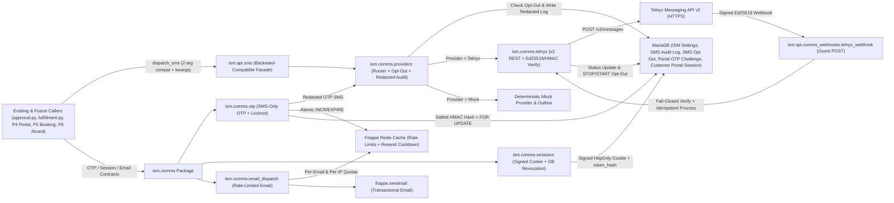
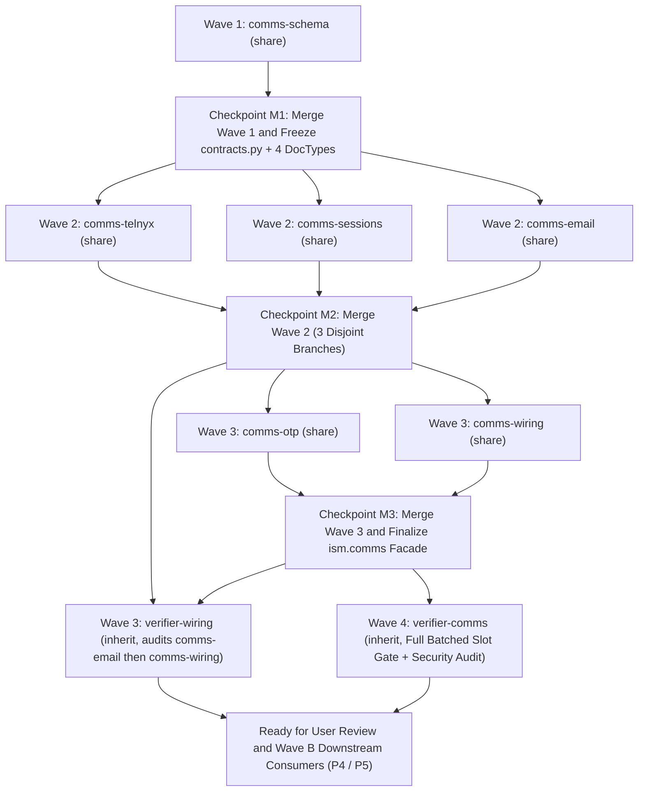

# Project 1: Communications & OTP Infrastructure (Telnyx) — Technical & Swarm Implementation Plan

| Metadata | Value |
| :--- | :--- |
| **Program Track / Project** | Track A / Project 1 (`P1`) |
| **Prerequisites** | None (Stage A foundational infrastructure; parallelizable with P2, P3, and Track B P6) |
| **Downstream Consumers** | Project 4 (Expanded Customer Portal), Project 5 (Website Self-Serve Booking), Project 6 (Shop OS `/board` via Seam 2) |
| **Governing Roadmap** | [`ROADMAP.md`](./ROADMAP.md) (derived from `todo_snippets/customer_portal_and_infra_roadmap.md`) |
| **Target Repository** | `ism-frappe` (`ism` Frappe v16 / ERPNext v16 app, Python `>=3.14`, zero new PyPI dependencies) |
| **Recommended Session Entry** | Launch `/swarm` on a fresh feature branch. By default, follow `native_swarm` rules and omit `model` on `swarm{action:"add"}` so every worker inherits the coordinator's active model. If the user explicitly requests `/model-triage` quota arbitrage, pin the active Gemini 4 tiers listed in Section 4 (`gemini-4-hydrogen-*`, `gemini-4-neon-*`, `gemini-4-carbon-*` only, with mandatory cross-family verification). |

---

## 1. Strategic Objective & Locked Decisions

Replace the current minimal single-webhook SMS helper (`ism/api/sms.py`) with a production-grade, Frappe-Cloud-compatible communications, SMS OTP, persistent guest session, and rate-limited transactional email foundation (`ism/comms/`) without breaking any existing ISM SMS caller or test suite.

### Locked Product & Architectural Decisions
All items below are locked by the governing program roadmap and must not be re-opened during implementation:

1. **Telnyx-Only Production Carrier (No Twilio):** Production outbound SMS, OTP delivery, delivery-receipt tracking, and inbound `STOP`/`START`/`HELP` compliance run exclusively on **Telnyx Messaging API v2** over pure HTTPS `requests` and Frappe-bundled `cryptography`. Legacy `"Twilio"` values in `ISM Settings` continue to coerce safely to `"Disabled"`.
2. **Hermetic Test & Dev Backends:** Preserve `"Custom HTTP Webhook"` (for custom relay setups and existing regression suites) and add a first-class `"Mock (Deterministic Test)"` provider so every automated test and isolated `-Serve` browser walkthrough executes reliably offline with zero carrier charges or network flakiness.
3. **SMS-Only OTP (Zero Email OTP Fallback):** Public portal re-entry (P4) and website self-serve booking verification (P5) use short-lived **SMS-only OTP** codes. Do **not** build an email OTP fallback channel.
4. **Unified Persistent Signed Guest Session Cookie:** Provide one shared, persistent, `HttpOnly`, `Secure`, `SameSite=Lax`, HMAC-signed + DB-backed session cookie (`ism_portal_session`) issuable from either:
   - a validated shop-sent tokenized magic link (zero OTP friction for front-desk and SMS/email link visits), or
   - a verified Telnyx SMS OTP challenge (public portal lookup in P4 or pre-commit booking verification in P5).
   Support atomic rotation (e.g., promoting a booking session into a customer portal session) and immediate server-side revocation ("Sign out on this device" and staff revocation).
5. **Durable Messaging Audit Ledger with Strict OTP Redaction:** Persist metadata and delivery lifecycle transitions for every outbound/inbound SMS in `SMS Audit Log`, while **strictly redacting OTP code values** so plaintext passcodes never appear in audit logs, error logs, or database tables.
6. **Opt-Out Compliance Ledger (`SMS Opt Out`):** Maintain a canonical per-E.164-number opt-out registry updated automatically by signature-verified Telnyx `STOP`/`START`/`HELP` inbound webhooks and carrier opt-out error codes, enforced prior to every outbound dispatch.
7. **Rate-Limited Transactional Email Wrapper:** Provide a reusable, Redis-rate-limited, header-injection-safe wrapper around `frappe.sendmail` for P4 self-serve invoice copies (including unpaid invoices) and P5 booking confirmations.

---

## 2. System Architecture & Codebase Anchor Audit

### System Architecture



### Concrete Codebase Anchor Audit (`ism-frappe`)

Every existing file, caller, setting, and test assertion audited prior to planning is recorded below so workers preserve 100% compatibility:

| Anchor File | Audited Findings | Required P1 Handling |
| :--- | :--- | :--- |
| `ism-frappe/ism/api/sms.py` | 134 lines. Defines `SUPPORTED_SMS_PROVIDERS = ("Disabled", "Custom HTTP Webhook")`, `_BLOCKED_SMS_HOSTS`, `_is_valid_sms_webhook_url(endpoint)`, `dispatch_sms(phone_number, message) -> dict`, and `get_sms_unconfigured_reason(settings=None) -> str | None`. Uses `requests.post(...)` directly with `timeout=10, allow_redirects=False`. | Keep all exported symbols intact. Upgrade `dispatch_sms` with optional keyword-only metadata args (`message_type`, `reference_doctype`, `reference_name`, `redact_body`, `redacted_preview`, `respect_opt_out`) while keeping 2-arg positional calls and `{"success", "message_id", "error"}` response keys unchanged. Pass `http_post=requests.post` from `ism.api.sms` into the webhook adapter so existing tests patching `"ism.api.sms.requests.post"` continue to pass unmodified. |
| `ism-frappe/ism/ism/doctype/ism_settings/ism_settings.json` | Single DocType (`issingle: 1`). Currently defines 6 sections: `sb_approval_settings`, `sb_sms_settings`, `sb_scheduling`, `sb_capacity`, `sb_estimation`, `sb_pricing`. `sb_sms_settings` has 5 fields: `sms_gateway_provider` (`Select`: `Disabled\nCustom HTTP Webhook`), `sms_gateway_endpoint` (`Data`), `sms_gateway_api_key` (`Password`), `sms_sender_id` (`Data`, default `"ISM"`), `enable_ready_for_pickup_sms` (`Check`, default `0`). Permissions: `System Manager`/`ISM Manager` read+write; `ISM Service Advisor`/`ISM Technician` read-only. | Expand `sb_sms_settings` in place (preserving all 5 existing fieldnames and `enable_ready_for_pickup_sms` type `Check`). Expand `sms_gateway_provider` options to `Disabled\nTelnyx\nCustom HTTP Webhook\nMock (Deterministic Test)`. Add strictly disjoint section `sb_otp_and_sessions`. Store all secrets (`telnyx_api_key`, `sms_webhook_hmac_secret`, `portal_session_signing_secret`) as `fieldtype: "Password"`. |
| `ism-frappe/ism/ism/doctype/ism_settings/ism_settings.py` | 77 lines. `before_validate()` calls `_normalize_sms_settings()` which coerces empty or `"Twilio"` `sms_gateway_provider` to `"Disabled"`. `validate()` checks operating hours, break hours, estimation params, and pricing params. | Preserve legacy `"Twilio"` coercion in `_normalize_sms_settings()`. Add `_validate_comms_and_otp_settings()` in `validate()` to enforce bounds on Telnyx replay tolerance, OTP length/TTL/cooldown/attempts/lockout/rate limits, session TTL, and email rate limits. |
| `ism-frappe/ism/ism/doctype/ism_settings/test_ism_settings.py` | **Critical regression anchor (line 259):** `test_sms_gateway_provider_options_and_twilio_migration` explicitly asserts `options == ["Disabled", "Custom HTTP Webhook"]`. | Update line 259 in Wave 1 (`comms-schema`) to assert `["Disabled", "Telnyx", "Custom HTTP Webhook", "Mock (Deterministic Test)"]` while preserving the `"Twilio"` coercion test and adding tests for all new `sb_sms_settings` and `sb_otp_and_sessions` defaults and validation bounds. |
| `ism-frappe/ism/api/approval.py` | Lines 13, 454, 475, 522. Imports `dispatch_sms, get_sms_unconfigured_reason` from `ism.api.sms`. `_dispatch_sms_approval` calls `dispatch_sms(phone, sms_text)` (line 475) and falls back to `"Link Only (SMS Unconfigured)"` when `get_sms_unconfigured_reason()` returns a string. `_dispatch_email_approval` calls `frappe.sendmail(...)` (line 522). Lines 21–75 also establish ISM's Redis rate-limiting pattern (`frappe.cache()`, `_get_portal_client_ip`, `clear_portal_rate_limits`). | Wire `_dispatch_sms_approval` to pass keyword-only audit metadata (`message_type="Approval Link"`, `reference_doctype="Repair Order"`, `reference_name=doc.name`) while keeping `(phone, sms_text)` positional so existing mock unpackers stay green. Route `_dispatch_email_approval` via `dispatch_transactional_email(..., bypass_rate_limit=True)` (which delegates to `frappe.sendmail`) so `patch("frappe.sendmail")` in `test_approval_and_inspection.py` L358 remains green. |
| `ism-frappe/ism/ism/doctype/repair_order/fulfillment.py` | Lines 15, 529–563. `_maybe_send_ready_for_pickup_sms(ro)` checks `enable_ready_for_pickup_sms` and calls `dispatch_sms(phone, sms_text)` (line 558). | Pass keyword-only metadata (`message_type="Ready For Pickup"`, `reference_doctype="Repair Order"`, `reference_name=ro.name`) while keeping `(phone, sms_text)` positional so `test_approval_and_inspection.py` L901 (`phone_arg, msg_arg = mock_sms.call_args.args`) stays 100% green. |
| `ism-frappe/ism/tests/test_approval_and_inspection.py` | Lines 28, 301–369, 615–655, 848–904. Directly imports `_is_valid_sms_webhook_url`, `dispatch_sms`, `get_sms_unconfigured_reason`; forces `"Twilio"` via `frappe.db.set_single_value` and asserts `"Unsupported SMS provider" in legacy_res["error"]`; patches `"ism.api.sms.requests.post"` and `"ism.ism.doctype.repair_order.fulfillment.dispatch_sms"`. | Zero edits required to `test_approval_and_inspection.py` — all existing tests must pass unmodified as part of the Wave 4 regression gate. |
| `ism-frappe/ism/tests/test_agent_facade.py` & `test_auth_and_roles.py` | `test_agent_facade.py` L726–739 toggles `sms_gateway_provider = "Disabled"`, L1171 patches `"ism.api.approval.dispatch_sms"`. `test_auth_and_roles.py` L117 asserts `("enable_ready_for_pickup_sms", "Check")` exists on `ISM Settings`. | Zero edits required — must pass unmodified in Wave 4 regression gate. |
| `ism-frappe/ism/setup_tasks/seed.py` & `ism/setup.py` | `setup_default_ism_settings()` seeds `_ISM_SETTINGS_FALSY_DEFAULTS`, `_ISM_SETTINGS_NONE_DEFAULTS`, and coerces empty/`"Twilio"` `sms_gateway_provider` to `"Disabled"`. Called idempotently on `after_install` and `after_migrate`. | Append declarative defaults for all new `sb_sms_settings` and `sb_otp_and_sessions` fields to `_ISM_SETTINGS_FALSY_DEFAULTS` / `_ISM_SETTINGS_NONE_DEFAULTS`, and auto-generate `portal_session_signing_secret` (`secrets.token_urlsafe(48)`) if unset. |
| `ism-frappe/ism/hooks.py` | Currently has commented-out `scheduler_events` (L178) and `default_log_clearing_doctypes` (L276), and `ignore_links_on_delete = ["Repair Order Schedule Entry"]` (L230). | Enable `scheduler_events["daily"]` with `ism.comms.otp.cleanup_expired_otp_challenges` and `ism.comms.sessions.cleanup_expired_portal_sessions`. Add `default_log_clearing_doctypes = {"SMS Audit Log": 180}` and add `"SMS Audit Log"`, `"Portal OTP Challenge"`, `"Customer Portal Session"` to `ignore_links_on_delete`. |
| `ism-frappe/ism/tests/base.py` | `_TEARDOWN_ORDER` (L31–58) governs reverse-dependency deletion order in `ISMTestCase.cleanup_tracked_docs()`. | Register `"Customer Portal Session": 0`, `"Portal OTP Challenge": 1`, `"SMS Audit Log": 2`, `"SMS Opt Out": 3` (before `Repair Order` at 13 and `Customer` at 21). |
| `ism-frappe/pyproject.toml` | `dependencies = []` (Frappe/ERPNext v16 managed by bench), Python `>=3.14`, Ruff rules `F, E, W, I, UP, B, RUF` with tab indentation (`indent-style = "tab"`). | Add **zero** third-party dependencies. Use only stdlib (`hmac`, `hashlib`, `secrets`, `base64`, `ipaddress`, `re`, `json`), `requests`, and Frappe-bundled `cryptography` (`Ed25519PublicKey`). |

---

## 3. Locked Architectural, Security & Cross-Track Invariants

1. **Zero `development.localhost:8000` Contact & Isolated Slot Execution:**
   - Never run `sync-to-wsl.ps1`, `watch-sync.*`, `promote-to-main.ps1`, or raw `wsl`/`docker exec` targeting `frappe-bench` or `development.localhost`.
   - Execute all Frappe migrations, tests, and live `-Serve` HTTP checks strictly via `powershell -ExecutionPolicy Bypass -File ism-frappe\scripts\test-in-slot.ps1`.
   - Never fire parallel `test-in-slot.ps1` invocations inside the same worktree; batch comma-separated `-Module` arguments into one call.
2. **Frappe Cloud Compatibility & Zero Extra Dependencies:**
   - Zero additions to `ism-frappe/pyproject.toml` or `deploy.dependencies.apt`.
   - Pure HTTPS REST via `requests` (`timeout=10`, `allow_redirects=False`) for Telnyx and Custom HTTP Webhook; Frappe-bundled `cryptography` for Ed25519 signature verification; stdlib `hmac`/`hashlib`/`secrets` for OTP hashing, HMAC webhook fallback, and cookie signing.
   - SSRF guards (`is_valid_sms_webhook_url`) continue blocking plain non-loopback HTTP, embedded credentials, link-local (`169.254.169.254`), `metadata.google.internal`, unspecified, and multicast targets. Telnyx outbound endpoint is locked to `https://api.telnyx.com/v2/messages`.
3. **Strict OTP Secret Redaction & Cryptographic Storage:**
   - Plaintext OTP codes are **never** persisted to `Portal OTP Challenge`, `SMS Audit Log`, `Error Log`, or application logs.
   - `Portal OTP Challenge` stores only a per-challenge 16-byte random `code_salt` and `code_hash = HMAC-SHA256(pepper, f"{challenge_id}:{code_salt}:{code}")`, verified via constant-time `hmac.compare_digest`.
   - `SMS Audit Log` always sets `is_redacted = 1` and stores a sanitized template (e.g., `"Your verification code is [REDACTED]."`) whenever `message_type == "OTP"` or `redact_body=True`.
   - The test-only inspection helper `get_last_mock_otp(phone_e164)` is strictly gated to `sms_gateway_provider == "Mock (Deterministic Test)"` and returns `None` in every other mode.
4. **Fail-Closed Telnyx Ed25519 & Custom HMAC Webhook Verification:**
   - Verify signatures exclusively over exact raw HTTP request bytes (`frappe.request.get_data(cache=True, as_text=False)`), never re-encoded JSON.
   - In `"Telnyx"` mode: **strictly require Ed25519** (`telnyx-signature-ed25519` + `telnyx-timestamp` over `f"{timestamp}|".encode("utf-8") + raw_body` using `Ed25519PublicKey.verify`), enforcing timestamp replay tolerance (`|now - ts| <= telnyx_webhook_tolerance_seconds`, default `300s`). Never silently downgrade to HMAC when provider is `"Telnyx"`.
   - In `"Custom HTTP Webhook"` or `"Mock (Deterministic Test)"` mode: accept valid Ed25519 (if `telnyx_webhook_public_key` configured and `telnyx-signature-ed25519` header supplied) OR valid HMAC-SHA256 (`X-ISM-Webhook-Signature` + `X-ISM-Webhook-Timestamp` over `f"{timestamp}|".encode() + raw_body` against `sms_webhook_hmac_secret` using `hmac.compare_digest` + replay window). Fail closed with HTTP `401` if keys are missing or verification fails.
   - Deduplicate webhook deliveries by `event_id` (`last_webhook_event_id`) inside `SELECT ... FOR UPDATE` transactions so duplicate retries never corrupt delivery state or opt-out records.
5. **Persistent Guest Session Cookie Security:**
   - Cookie value format: `v1.<session_id>.<raw_secret>.<hmac_b64url>` where `hmac_b64url = urlsafe_b64encode(HMAC-SHA256(signing_secret, f"v1.{session_id}.{raw_secret}"))`.
   - Database stores **only** `token_hash = SHA-256(raw_secret)` — never the raw secret or full cookie string.
   - Cookie attributes: `HttpOnly=True`, `SameSite=Lax` (configurable `Lax`/`Strict`), `Path=/`, `Max-Age = portal_session_ttl_days * 86400`, `Secure=True` (permitted `False` *only* when `portal_session_secure_cookie == 0` AND active request is loopback HTTP for local `-Serve` testing; always forced `True` on HTTPS or non-loopback hosts).
   - Rotation and revocation lock the `Customer Portal Session` row with `SELECT ... FOR UPDATE`, immediately rejecting revoked/rotated/expired cookies server-side.
6. **Cross-Track Seam Invariants (Seams 1 & 2):**
   - **Seam 1 (`ISM Settings` Namespace Isolation):** P1 touches ONLY `sb_sms_settings` and `sb_otp_and_sessions`. Zero collisions with P2 (`sb_square_payments`), P3 (`sb_customer_scheduling_policy`), P4 (`sb_customer_portal`), P5 (`sb_self_serve_booking`), or P6 (`sb_media_storage`, `sb_board_ai`, `sb_parts_pricing`).
   - **Seam 2 (Outbound SMS Backward Compatibility):** Existing callers (`ism/api/approval.py`, `ism/ism/doctype/repair_order/fulfillment.py`) and future P6 Shop OS `/board` actions (`DISPATCH_CUSTOMER_SMS`, `SEND_QUOTE_APPROVAL`, reschedule ETA SMS) call `ism.api.sms.dispatch_sms(phone, message, ...)` and automatically inherit Telnyx transport, E.164 normalization, `SMS Audit Log` tracking, and `SMS Opt Out` protection with zero rework.

---

## 4. Swarm Plugin Execution Blueprint

### Hard Guardrails
- **Bench Slot & Concurrency Ceiling:** Maximum `3` concurrent `workspace:"share"` authors per wave (staying safely within `slot-1`..`slot-5`). Never run parallel `test-in-slot.ps1` invocations inside the same worktree.
- **Disjoint File Ownership:** No two workers in the same wave edit the same file. Every brief explicitly enumerates owned files and forbidden files.
- **Model Selection Rule:**
  - **Default `/swarm` behavior (`native_swarm`):** Omit `model` in `swarm{action:"add"}` so every worker inherits the coordinator's active model.
  - **Optional `/model-triage` behavior (when user requests Gemini 4 tier arbitrage):** Call `swarm{action:"models", all:true}` once, restrict strictly to `gemini-4-hydrogen-*`, `gemini-4-neon-*`, and `gemini-4-carbon-*` (never `argon-*`, `Gemini 3.8 Flash`, `Claude`, `GPT-OSS`, `flash`, `Neon (Low)`, `Hydrogen (High/XHigh)`, or `Orchestrator` on leaf workers), and enforce **cross-family verification** (`hydrogen-medium` authors verified by `gemini-4-neon-high`; `neon-medium`/`neon-high` authors verified by `gemini-4-carbon-high`).
- **In-Place Model Escalation:** If a worker stalls or fails verification twice, wait until its state is `waiting` and upgrade in-place with `swarm{action:"model", name, model}` — never `kill` + `add` to change models.
- **Merge Before `kill`:** Always merge or cherry-pick a `workspace:"share"` worker's commits into the integration branch and verify clean `git status` BEFORE calling `swarm{action:"kill", name}` (since `kill` permanently deletes the share workspace).

### Coordinator Startup Protocol
1. Confirm the repository is on a clean feature/integration branch (e.g., `git checkout -b feat/p1-comms-telnyx-otp`), never canonical `main` during active swarm merges.
2. Name the swarm immediately:
   ```text
   swarm{"action": "title", "title": "P1 Telnyx comms and OTP infra"}
   ```
3. *(Only if `/model-triage` was requested)* Run `swarm{"action": "models", "all": true}` to confirm active Gemini 4 model IDs and remaining quota.
4. Spawn `monitor` (if `swarm_monitor` is in the skill list; never assign tasks to `monitor`) and spawn **Wave 1** (`comms-schema`).
5. Immediately write the Swarm UI overview plan file at `<appData>/brain/<coordinator-conversation-id>/.system_generated/swarm/plan.json` (refreshing it whenever a wave adds workers):
   ```json
   {
     "goal": {
       "title": "Telnyx SMS, OTP, and Portal Sessions",
       "line": "Build Telnyx messaging, SMS OTP, persistent sessions, and webhook verification."
     },
     "tasks": {
       "comms-schema": "Define contracts, 4 DocTypes, and ISM Settings",
       "comms-telnyx": "Build Telnyx adapter, provider bus, and webhooks",
       "comms-sessions": "Build persistent signed HttpOnly portal sessions",
       "comms-email": "Build rate-limited transactional email wrapper",
       "comms-otp": "Build SMS-only OTP challenge and lockout engine",
       "comms-wiring": "Wire approval and pickup SMS callers cleanly",
       "verifier-wiring": "Verify email wrapper and caller wiring diffs",
       "verifier-comms": "Run full-stack slot tests and security audit"
     },
     "threads": [
       {
         "id": "t-schema",
         "title": "Schema and frozen contracts",
         "goal": "Freeze comms contracts, 4 DocTypes, and disjoint ISM Settings.",
         "tasks": ["comms-schema"]
       },
       {
         "id": "t-transport",
         "title": "Telnyx bus, webhooks, and email",
         "goal": "Deliver Telnyx v2 transport, Ed25519 webhooks, and rate-limited email.",
         "tasks": ["comms-telnyx", "comms-email"]
       },
       {
         "id": "t-auth",
         "title": "SMS OTP and persistent sessions",
         "goal": "Deliver SMS-only OTP verification and signed HttpOnly session cookies.",
         "tasks": ["comms-sessions", "comms-otp"]
       },
       {
         "id": "t-verify",
         "title": "Caller wiring and verification gate",
         "goal": "Wire existing SMS callers and pass all slot tests and audits.",
         "tasks": ["comms-wiring", "verifier-wiring", "verifier-comms"]
       }
     ]
   }
   ```
6. At each **Merge Checkpoint (`M1`, `M2`, `M3`)**, merge finished `share` worker branches into the integration branch, confirm clean `git status` and frozen contracts, kill completed `share` workers whose commits are landed, and spawn the next wave.
7. After Wave 4 (`verifier-comms`) posts `@coordinator [done]` with all KPIs green, kill any remaining temporary workers (never `monitor` unless requested), post a final unaddressed `[done] <summary>` line so `monitor` quiets, and present the verification summary to the user.

### Worker Roster & Pinning Table

> **Note on `Model ID`:** Leave `model` omitted on `swarm{action:"add"}` by default (`native_swarm` inheritance). Apply the `/model-triage` Model ID column only when the user opts into `/model-triage` quota arbitrage.

| Worker | Wave | Role & Strict File Ownership | Workspace | `/model-triage` Model ID *(Default: Inherit)* | Depends On | Why This Assignment |
| :--- | :---: | :--- | :---: | :--- | :---: | :--- |
| `comms-schema` | 1 | `ism/comms/contracts.py`, initial `ism/comms/__init__.py`, 4 DocTypes (`sms_audit_log`, `sms_opt_out`, `portal_otp_challenge`, `customer_portal_session`), `ism_settings.{json,py}`, `test_ism_settings.py`, `seed.py`, `hooks.py`, `tests/base.py`, `test_comms_schema_and_contracts.py` | `share` | `gemini-4-neon-medium` | — | Schema invariants, frozen cross-project contracts, E.164 normalization, disjoint settings sections |
| `comms-telnyx` | 2 | `ism/comms/telnyx.py`, `ism/comms/providers.py`, `ism/api/sms.py`, `ism/api/comms_webhooks.py`, `test_comms_telnyx_and_webhooks.py` | `share` | `gemini-4-neon-high` | `M1` | Security-critical Ed25519/HMAC verification, replay guards, `FOR UPDATE` webhook idempotency, Seam 2 compat |
| `comms-sessions` | 2 | `ism/comms/sessions.py`, `test_comms_sessions.py` | `share` | `gemini-4-neon-high` | `M1` | Cryptographic cookie signing, DB `token_hash` verification, row-locked rotation & revocation |
| `comms-email` | 2 | `ism/comms/email_dispatch.py`, `test_comms_email_dispatch.py` | `share` | `gemini-4-hydrogen-medium` | `M1` | Bounded 2-file transactional email wrapper + Redis rate limiter & header-injection guards |
| `comms-otp` | 3 | `ism/comms/otp.py`, final `ism/comms/__init__.py`, `test_comms_otp.py` | `share` | `gemini-4-neon-high` | `M2` | Salted HMAC OTP hashing, atomic Redis throttling, `FOR UPDATE` lockout, strict audit redaction |
| `comms-wiring` | 3 | `ism/api/approval.py`, `ism/ism/doctype/repair_order/fulfillment.py`, `test_comms_caller_wiring.py` | `share` | `gemini-4-hydrogen-medium` | `M2` | Clean mechanical caller upgrade preserving 2-arg positional mock compatibility |
| `verifier-wiring` | 3–4 | Read-only cross-family review of `comms-email` (Wave 3) and `comms-wiring` (post-`M3`) diffs, rate-limit edge cases, and caller compatibility | `inherit` | `gemini-4-neon-high` | `M2` / `M3` | Cross-family verifier for `hydrogen-medium` authors; zero slot contention |
| `verifier-comms` | 4 | Cross-family full-stack gate for `neon-*` authors: single batched `test-in-slot.ps1` run (all 6 new suites + 4 regression suites), `ruff check`, live `-Serve` HTTP webhook/cookie smoke check, security & Seam 1/2 audit | `inherit` | `gemini-4-carbon-high` | `M3` | Cross-family verifier for `neon-medium`/`neon-high` authors + strongest shell reliability for `test-in-slot.ps1` |
| `monitor` | 1–4 | Standard `swarm_monitor` stall watcher (omit if `swarm_monitor` skill absent) | `inherit` | `gemini-4-hydrogen-low` | — | Lightweight timer-based stall recovery |

### Wave Dependency Graph



> **Zero-Conflict File Ownership Guarantee:**
> - Wave 1 (`comms-schema`) is the sole editor of `ism_settings.{json,py}`, `seed.py`, `hooks.py`, `tests/base.py`, `contracts.py`, and all 4 DocType directories.
> - Wave 2 splits into 3 completely non-overlapping territories: `comms-telnyx` (`telnyx.py`, `providers.py`, `api/sms.py`, `api/comms_webhooks.py`), `comms-sessions` (`sessions.py`), and `comms-email` (`email_dispatch.py`).
> - Wave 3 splits into 2 non-overlapping territories: `comms-otp` (`otp.py`, final `ism/comms/__init__.py`) and `comms-wiring` (`api/approval.py`, `repair_order/fulfillment.py`).
> - Wave 4 (`verifier-comms`) is read-only (`inherit`) and executes the single batched `test-in-slot.ps1` acceptance gate; any bugs found are posted directly to the responsible author by `@name` rather than edited by the verifier.

### Self-Contained Per-Worker Brief Templates

#### Wave 1 — `comms-schema`
> You own **Wave 1A** of Project 1 (`plan_p1_comms_telnyx_otp.md` Section 5, Wave 1A).
> **Owned files (create/modify ONLY these):**
> - `ism-frappe/ism/comms/__init__.py` (initial stub exporting `contracts` symbols)
> - `ism-frappe/ism/comms/contracts.py`
> - `ism-frappe/ism/ism/doctype/sms_audit_log/{__init__.py,sms_audit_log.json,sms_audit_log.py}`
> - `ism-frappe/ism/ism/doctype/sms_opt_out/{__init__.py,sms_opt_out.json,sms_opt_out.py}`
> - `ism-frappe/ism/ism/doctype/portal_otp_challenge/{__init__.py,portal_otp_challenge.json,portal_otp_challenge.py}`
> - `ism-frappe/ism/ism/doctype/customer_portal_session/{__init__.py,customer_portal_session.json,customer_portal_session.py}`
> - `ism-frappe/ism/ism/doctype/ism_settings/{ism_settings.json,ism_settings.py,test_ism_settings.py}`
> - `ism-frappe/ism/setup_tasks/seed.py`, `ism-frappe/ism/hooks.py`, `ism-frappe/ism/tests/base.py`
> - `ism-frappe/ism/tests/test_comms_schema_and_contracts.py`
> **Forbidden files:** Do NOT edit `ism/api/sms.py`, `ism/api/approval.py`, `repair_order/fulfillment.py`, `pyproject.toml`, or any `ISM Settings` section outside `sb_sms_settings` and `sb_otp_and_sessions`.
> **Hard rules:** Follow `plan_p1_comms_telnyx_otp.md` Section 5 (Wave 1A) verbatim. Zero contact with `development.localhost:8000`; run one batched `powershell -ExecutionPolicy Bypass -File ism-frappe\scripts\test-in-slot.ps1 -Module "ism.ism.doctype.ism_settings.test_ism_settings,ism.tests.test_comms_schema_and_contracts"` and `ruff check` on all owned files. Commit cleanly on your share branch.
> **Done:** Post `@coordinator [done]` with commit SHA, exact frozen contract symbols in `contracts.py`, and test/ruff pass results.

#### Wave 2 — `comms-telnyx`
> You own **Wave 2A** of Project 1 (`plan_p1_comms_telnyx_otp.md` Section 5, Wave 2A), building on Wave 1 (`#<M1-seq>`).
> **Owned files (create/modify ONLY these):**
> - `ism-frappe/ism/comms/telnyx.py`
> - `ism-frappe/ism/comms/providers.py`
> - `ism-frappe/ism/api/sms.py`
> - `ism-frappe/ism/api/comms_webhooks.py`
> - `ism-frappe/ism/tests/test_comms_telnyx_and_webhooks.py`
> **Forbidden files:** Do NOT edit `contracts.py`, `ism_settings.*`, DocType JSONs, `sessions.py`, `otp.py`, `email_dispatch.py`, `approval.py`, `fulfillment.py`, or `pyproject.toml`.
> **Hard rules:** Honor Seam 2 backward compatibility strictly: keep `SUPPORTED_SMS_PROVIDERS`, `_BLOCKED_SMS_HOSTS`, `_is_valid_sms_webhook_url`, `dispatch_sms(phone_number, message, ...)`, `get_sms_unconfigured_reason`, legacy `"Twilio"` error string `"Unsupported SMS provider: Twilio"`, and `patch("ism.api.sms.requests.post")` compatibility. Enforce fail-closed Ed25519 signature + replay verification in `Telnyx` mode (zero silent HMAC downgrade). Verify via one batched `test-in-slot.ps1 -Module "ism.tests.test_comms_telnyx_and_webhooks,ism.tests.test_approval_and_inspection"` and `ruff check`. Commit cleanly on your share branch.
> **Done:** Post `@coordinator [done]` with commit SHA, verified webhook endpoint path, and test/ruff pass summary.

#### Wave 2 — `comms-sessions`
> You own **Wave 2B** of Project 1 (`plan_p1_comms_telnyx_otp.md` Section 5, Wave 2B), building on Wave 1 (`#<M1-seq>`).
> **Owned files (create/modify ONLY these):**
> - `ism-frappe/ism/comms/sessions.py`
> - `ism-frappe/ism/tests/test_comms_sessions.py`
> **Forbidden files:** Do NOT edit `contracts.py`, `telnyx.py`, `providers.py`, `otp.py`, `email_dispatch.py`, `ism_settings.*`, or `pyproject.toml`.
> **Hard rules:** Implement `v1.<session_id>.<raw_secret>.<hmac_b64url>` persistent signed cookies, storing only `SHA-256(raw_secret)` in `Customer Portal Session.token_hash`. Support `sms_otp`, `magic_link`, and `booking_otp` auth methods, row-locked `FOR UPDATE` rotation and revocation, `HttpOnly`/`Secure`/`SameSite` attributes via Frappe's `CookieManager`, and `cleanup_expired_portal_sessions`. Verify via `test-in-slot.ps1 -Module "ism.tests.test_comms_sessions"` and `ruff check`. Commit cleanly on your share branch.
> **Done:** Post `@coordinator [done]` with commit SHA, exported session function signatures, and test/ruff pass summary.

#### Wave 2 — `comms-email`
> You own **Wave 2C** of Project 1 (`plan_p1_comms_telnyx_otp.md` Section 5, Wave 2C), building on Wave 1 (`#<M1-seq>`).
> **Owned files (create/modify ONLY these):**
> - `ism-frappe/ism/comms/email_dispatch.py`
> - `ism-frappe/ism/tests/test_comms_email_dispatch.py`
> **Forbidden files:** Do NOT edit `contracts.py`, `telnyx.py`, `providers.py`, `sessions.py`, `otp.py`, `ism_settings.*`, `approval.py`, or `pyproject.toml`.
> **Hard rules:** Implement `dispatch_transactional_email(...)` with strict email & CRLF header-injection validation, atomic Redis per-recipient/per-IP hourly rate limits (from `ISM Settings`), PDF attachment pass-through, and clean delegation to `frappe.sendmail`. Verify via `test-in-slot.ps1 -Module "ism.tests.test_comms_email_dispatch"` and `ruff check`. Commit cleanly on your share branch.
> **Done:** Post `@coordinator [done]` with commit SHA and test/ruff pass summary.

#### Wave 3 — `comms-otp`
> You own **Wave 3A** of Project 1 (`plan_p1_comms_telnyx_otp.md` Section 5, Wave 3A), building on Wave 2 (`#<M2-seq>`).
> **Owned files (create/modify ONLY these):**
> - `ism-frappe/ism/comms/otp.py`
> - `ism-frappe/ism/comms/__init__.py` (final public facade exporting all frozen contracts from `contracts`, `providers`, `telnyx`, `otp`, `sessions`, `email_dispatch`)
> - `ism-frappe/ism/tests/test_comms_otp.py`
> **Forbidden files:** Do NOT edit `telnyx.py`, `providers.py`, `sessions.py`, `email_dispatch.py`, `approval.py`, `fulfillment.py`, `ism_settings.*`, or `pyproject.toml`.
> **Hard rules:** Strictly SMS-only OTP (zero email fallback). CSPRNG code generation (`secrets.randbelow`), salted HMAC-SHA256 storage (`code_salt` + `code_hash`), atomic Redis per-phone/per-IP hourly quotas and resend cooldown, `FOR UPDATE` attempt counter and lockout, single-use & two-step consumption (`consume=True/False` + `consume_verified_otp_challenge`), mandatory `redact_body=True` in `SMS Audit Log`, and `get_last_mock_otp` gated exclusively to `"Mock (Deterministic Test)"`. Verify via `test-in-slot.ps1 -Module "ism.tests.test_comms_otp"` and `ruff check`. Commit cleanly on your share branch.
> **Done:** Post `@coordinator [done]` with commit SHA, finalized `ism.comms` `__all__` exports, and test/ruff pass summary.

#### Wave 3 — `comms-wiring`
> You own **Wave 3B** of Project 1 (`plan_p1_comms_telnyx_otp.md` Section 5, Wave 3B), building on Wave 2 (`#<M2-seq>`).
> **Owned files (create/modify ONLY these):**
> - `ism-frappe/ism/api/approval.py`
> - `ism-frappe/ism/ism/doctype/repair_order/fulfillment.py`
> - `ism-frappe/ism/tests/test_comms_caller_wiring.py`
> **Forbidden files:** Do NOT edit `ism/comms/*`, `ism/api/sms.py`, `ism/api/comms_webhooks.py`, `ism_settings.*`, or existing test files (`test_approval_and_inspection.py`, `test_agent_facade.py`).
> **Hard rules:** Pass `message_type`, `reference_doctype`, and `reference_name` as keyword arguments to `dispatch_sms(phone, sms_text, ...)` keeping `(phone, sms_text)` positional so existing mock assertions (`call_args.args`) remain 100% intact. Surface opted-out errors clearly on approval SMS and route `_dispatch_email_approval` through `dispatch_transactional_email(..., bypass_rate_limit=True)` preserving `patch("frappe.sendmail")`. Verify via one batched `test-in-slot.ps1 -Module "ism.tests.test_comms_caller_wiring,ism.tests.test_approval_and_inspection,ism.tests.test_agent_facade"` and `ruff check`. Commit cleanly on your share branch.
> **Done:** Post `@verifier-wiring [done]` (hand off directly to peer verifier) with commit SHA and test/ruff pass summary.

#### Wave 3–4 — `verifier-wiring` (Read-Only Cross-Family Verifier for `hydrogen-medium` Authors)
> You are the read-only cross-family verifier for `comms-email` (after `#<M2-seq>`) and `comms-wiring` (after `#<M3-seq>`). Do NOT edit repository files and do NOT run `test-in-slot.ps1` concurrently with `verifier-comms`.
> **Checklist:**
> 1. Audit `ism/comms/email_dispatch.py` and `test_comms_email_dispatch.py` for CRLF header injection, recipient validation, Redis atomic rate-limit correctness, `bypass_rate_limit` safety, and PDF attachment forwarding.
> 2. Audit `ism/api/approval.py`, `ism/ism/doctype/repair_order/fulfillment.py`, and `test_comms_caller_wiring.py` for Seam 2 backward compatibility, positional arg preservation, opt-out handling, and zero leak of internal errors.
> **Handoff:** If issues exist, post directly to `@comms-email` or `@comms-wiring` citing exact `file:line`. When both pass cleanly, post `@coordinator [done]` referencing the verified `#seq` posts.

#### Wave 4 — `verifier-comms` (Cross-Family Full-Stack Verification Gate)
> You are the cross-family full-stack verifier for Project 1 (`plan_p1_comms_telnyx_otp.md` Section 6) on the merged `M3` integration branch (`#<M3-seq>`). Do NOT edit repository files; report defects directly to the owning author by `@name`.
> **Required Verification Steps:**
> 1. Run the single batched `test-in-slot.ps1` gate covering all 6 new `test_comms_*` modules and all 4 core regression suites (`test_ism_settings`, `test_approval_and_inspection`, `test_agent_facade`, `test_auth_and_roles`).
> 2. Run `ruff check` across all new and modified Python files (`0` errors).
> 3. Run the isolated `-Serve` live HTTP smoke check verifying `telnyx_webhook` fail-closed `401` on invalid signature, valid Ed25519 `200` delivery + `STOP` opt-out persistence, and `Set-Cookie` attributes (`HttpOnly`, `SameSite=Lax`, `Path=/`). Stop `-Serve` cleanly afterward.
> 4. Audit all 6 Exit KPIs (zero plaintext OTP in DB/logs, zero `ISM Settings` namespace collisions, zero `pyproject.toml` dependency additions, zero `development.localhost:8000` contact, clean `git status`).
> **Done:** Post `@coordinator [done]` with exact pass counts, security audit checklist, and KPI sign-off.

---

## 5. Detailed Wave-by-Wave Implementation Specification

### Wave 1A — Frozen Contracts, 4 DocTypes, `ISM Settings` & Hygiene (`comms-schema`)

#### 1. `[NEW]` `ism-frappe/ism/comms/contracts.py`
Defines all immutable data structures, constants, protocols, and shared pure helpers consumed across Waves 2–3 and downstream Projects 4 & 5:

```python
SUPPORTED_SMS_PROVIDERS: tuple[str, ...] = (
	"Disabled",
	"Telnyx",
	"Custom HTTP Webhook",
	"Mock (Deterministic Test)",
)
TELNYX_MESSAGES_ENDPOINT: str = "https://api.telnyx.com/v2/messages"
OTP_PURPOSES: tuple[str, ...] = ("portal_login", "booking_verify", "portal_action")
SESSION_AUTH_METHODS: tuple[str, ...] = ("sms_otp", "magic_link", "booking_otp")
SESSION_SCOPE_TYPES: tuple[str, ...] = ("customer", "repair_order", "booking")
DEFAULT_PORTAL_COOKIE_NAME: str = "ism_portal_session"

STOP_KEYWORDS: frozenset[str] = frozenset(
	{"STOP", "STOPALL", "UNSUBSCRIBE", "CANCEL", "END", "QUIT", "REVOKE", "OPTOUT"}
)
START_KEYWORDS: frozenset[str] = frozenset({"START", "UNSTOP", "YES"})
HELP_KEYWORDS: frozenset[str] = frozenset({"HELP", "INFO"})
TELNYX_OPT_OUT_ERROR_CODES: frozenset[str] = frozenset({"40300", "40008"})
```

**Frozen Dataclasses (each implementing `.to_dict() -> dict`):**
- `SMSDispatchRequest`: `to_phone: str`, `body: str`, `message_type: str = "Notification"`, `reference_doctype: str | None = None`, `reference_name: str | None = None`, `redact_body: bool = False`, `redacted_preview: str | None = None`, `respect_opt_out: bool = True`.
- `SMSDispatchResult`: `success: bool`, `provider: str`, `status: str`, `message_id: str | None = None`, `audit_log: str | None = None`, `phone_e164: str | None = None`, `error: str | None = None`, `error_code: str | None = None`, `opted_out: bool = False`.
- `OTPChallengeResult`: `success: bool`, `challenge_id: str | None = None`, `phone_masked: str | None = None`, `expires_in_seconds: int = 0`, `resend_available_in_seconds: int = 0`, `locked_until: str | None = None`, `error: str | None = None`, `error_code: str | None = None`.
- `OTPVerifyResult`: `verified: bool`, `challenge_id: str | None = None`, `phone_e164: str | None = None`, `purpose: str | None = None`, `attempts_remaining: int = 0`, `locked_until: str | None = None`, `error: str | None = None`, `error_code: str | None = None`.
- `PortalSessionInfo`: `session_id: str`, `status: str`, `auth_method: str`, `scope_type: str`, `customer: str | None = None`, `phone_e164: str | None = None`, `repair_order: str | None = None`, `schedule_entry: str | None = None`, `issued_at: str | None = None`, `expires_at: str | None = None`, `cookie_value: str | None = None`. (Note: `.to_dict(include_cookie=False)` omits `cookie_value` by default so accidental JSON serialization never leaks bearer cookies into HTML/API bodies!)
- `EmailDispatchResult`: `success: bool`, `recipient: str`, `email_type: str`, `rate_limited: bool = False`, `retry_after_seconds: int = 0`, `error: str | None = None`, `error_code: str | None = None`.

**Frozen Pure Helpers & Protocol:**
- `normalize_phone_e164(raw_phone: str, default_country_code: str = "+1") -> str`:
  - Strips whitespace, hyphens, parentheses, dots, and `tel:` prefix; rejects embedded letters/control chars.
  - Handles `+` prefixed numbers (validates `^\+[1-9]\d{7,14}$` per ITU-T E.164).
  - Handles 10-digit North American numbers (when `default_country_code == "+1"`, validates area/exchange code digits and prefixes `"+1"`), 11-digit leading-`1` North American numbers (`1XXXXXXXXXX` -> `"+1XXXXXXXXXX"`), and `00`-prefixed international dialing (`00...` -> `+...`).
  - Raises `ValueError` with a clear message on invalid numbers.
- `mask_phone_e164(phone_e164: str) -> str`: Returns masked format preserving country prefix and last 4 digits (e.g., `"+14165550199"` -> `"+1******0199"`).
- `redact_otp_body(body: str, preview_override: str | None = None) -> str`: Returns `preview_override` (stripped of any 4–8 consecutive digit runs as defense-in-depth!) or replaces digit runs of length 4–8 in `body` with `"[REDACTED]"`.
- `is_valid_sms_webhook_url(endpoint: str) -> bool`: Ported cleanly from `ism/api/sms.py` with identical HTTPS / loopback-only HTTP / SSRF rules.
- `get_client_ip(ip_override: str | None = None) -> str`: Matches `ism/api/approval.py::_get_portal_client_ip`, ignoring `ip_override` whenever an active `frappe.local.request` exists so untrusted callers cannot spoof rate-limit buckets.
- `class SMSProvider(Protocol)`: `provider_name: str`, `validate_config(self, settings) -> str | None`, `send(self, phone_e164: str, body: str, settings, *, http_post=None) -> dict`.

#### 2. `[NEW]` 4 Frappe DocTypes (Module: `"ISM"`, Engine: `"InnoDB"`)

1. **`SMS Audit Log`** (`ism-frappe/ism/ism/doctype/sms_audit_log/sms_audit_log.{json,py}`):
   - `autoname`: `"hash"` (avoids `tabSeries` write-lock bottlenecks during OTP bursts).
   - Fields:
     - `direction` (`Select`: `Outbound\nInbound`, default `Outbound`, reqd 1, in_list_view 1)
     - `provider` (`Select`: `Telnyx\nCustom HTTP Webhook\nMock (Deterministic Test)\nDisabled`, reqd 1, in_list_view 1)
     - `message_type` (`Select`: `Notification\nApproval Link\nReady For Pickup\nOTP\nBooking Confirmation\nReschedule Confirmation\nCompliance Reply\nInbound Keyword\nOther`, default `Notification`, reqd 1, in_list_view 1)
     - `phone_e164` (`Data`, reqd 1, search_index 1, in_list_view 1)
     - `sender_id` (`Data`)
     - `provider_message_id` (`Data`, search_index 1)
     - `status` (`Select`: `Queued\nSent\nDelivered\nFailed\nBlocked - Opted Out\nBlocked - Unconfigured\nReceived`, default `Queued`, reqd 1, in_list_view 1)
     - `is_redacted` (`Check`, default `0`)
     - `message_preview` (`Small Text`, max 500 chars enforced in controller `validate()`)
     - `reference_doctype` (`Link`, options `DocType`, search_index 1)
     - `reference_name` (`Dynamic Link`, options `reference_doctype`, search_index 1)
     - `error_code` (`Data`)
     - `error_message` (`Small Text`)
     - `sent_at` (`Datetime`)
     - `delivered_at` (`Datetime`)
     - `last_webhook_event_id` (`Data`, search_index 1)
     - `webhook_payload_sanitized` (`Long Text`, read_only 1)
   - Controller defense-in-depth (`validate()`): If `self.message_type == "OTP"` or `cint(self.is_redacted)`, forcibly run `redact_otp_body(...)` on `self.message_preview` and set `self.is_redacted = 1` so even direct callers can never accidentally write an OTP code into `SMS Audit Log`.
   - Permissions: `System Manager` (read, write, delete, report), `ISM Manager` (read, report), `ISM Service Advisor` (read, report).

2. **`SMS Opt Out`** (`ism-frappe/ism/ism/doctype/sms_opt_out/sms_opt_out.{json,py}`):
   - `autoname`: `"field:phone_e164"` (unique canonical key per E.164 phone).
   - Fields:
     - `phone_e164` (`Data`, reqd 1, unique 1, in_list_view 1)
     - `is_opted_out` (`Check`, default `1`, in_list_view 1)
     - `source` (`Select`: `Telnyx STOP Keyword\nCarrier Opt-Out Error\nManual Staff Override\nCustomer Re-Opt-In (START)`, default `Telnyx STOP Keyword`, in_list_view 1)
     - `last_keyword` (`Data`)
     - `opted_out_at` (`Datetime`)
     - `opted_in_at` (`Datetime`)
     - `last_event_id` (`Data`)
     - `customer` (`Link`, options `Customer`)
     - `notes` (`Small Text`)
   - Controller (`before_validate()`): Normalizes `phone_e164` via `normalize_phone_e164` (throwing `frappe.ValidationError` on invalid numbers).
   - Permissions: `System Manager` (all), `ISM Manager` (read, write, create), `ISM Service Advisor` (read).

3. **`Portal OTP Challenge`** (`ism-frappe/ism/ism/doctype/portal_otp_challenge/portal_otp_challenge.{json,py}`):
   - `autoname`: `"hash"`
   - Fields:
     - `challenge_id` (`Data`, reqd 1, unique 1, search_index 1, read_only 1)
     - `purpose` (`Select`: `portal_login\nbooking_verify\nportal_action`, default `portal_login`, reqd 1, search_index 1)
     - `phone_e164` (`Data`, reqd 1, search_index 1)
     - `code_salt` (`Data`, reqd 1, read_only 1)
     - `code_hash` (`Data`, reqd 1, read_only 1)
     - `status` (`Select`: `Pending\nVerified\nExpired\nLocked\nSuperseded\nDelivery Failed`, default `Pending`, reqd 1, search_index 1)
     - `attempts` (`Int`, default `0`)
     - `max_attempts` (`Int`, default `5`)
     - `expires_at` (`Datetime`, reqd 1, search_index 1)
     - `verified_at` (`Datetime`)
     - `consumed_at` (`Datetime`)
     - `locked_until` (`Datetime`)
     - `request_ip` (`Data`)
     - `user_agent` (`Data`)
     - `sms_audit_log` (`Link`, options `SMS Audit Log`)
     - `context_ref_doctype` (`Link`, options `DocType`)
     - `context_ref_name` (`Dynamic Link`, options `context_ref_doctype`)
   - Permissions: `System Manager` (read, delete), `ISM Manager` (read).

4. **`Customer Portal Session`** (`ism-frappe/ism/ism/doctype/customer_portal_session/customer_portal_session.{json,py}`):
   - `autoname`: `"hash"`
   - Fields:
     - `session_id` (`Data`, reqd 1, unique 1, search_index 1, read_only 1)
     - `token_hash` (`Data`, reqd 1, unique 1, search_index 1, read_only 1)
     - `customer` (`Link`, options `Customer`, search_index 1)
     - `phone_e164` (`Data`, search_index 1)
     - `auth_method` (`Select`: `sms_otp\nmagic_link\nbooking_otp`, reqd 1, in_list_view 1)
     - `scope_type` (`Select`: `customer\nrepair_order\nbooking`, default `customer`, reqd 1)
     - `scope_repair_order` (`Link`, options `Repair Order`, search_index 1)
     - `scope_schedule_entry` (`Link`, options `Schedule Entry`, search_index 1)
     - `status` (`Select`: `Active\nRotated\nRevoked\nExpired`, default `Active`, reqd 1, search_index 1, in_list_view 1)
     - `issued_at` (`Datetime`, reqd 1)
     - `expires_at` (`Datetime`, reqd 1, search_index 1)
     - `last_seen_at` (`Datetime`)
     - `revoked_at` (`Datetime`)
     - `revoked_reason` (`Data`)
     - `issued_ip` (`Data`)
     - `last_ip` (`Data`)
     - `user_agent_hash` (`Data`)
     - `source_otp_challenge` (`Link`, options `Portal OTP Challenge`)
     - `source_token_hash` (`Data`)
   - Permissions: `System Manager` (read, write, delete), `ISM Manager` (read, write).

#### 3. `[MODIFY]` `ISM Settings`, `seed.py`, `hooks.py`, `tests/base.py`, `test_ism_settings.py`
- **`ism_settings.json`:**
  - Expand `sb_sms_settings` (preserving all 5 existing fields in place):
    - `sms_gateway_provider` options -> `"Disabled\nTelnyx\nCustom HTTP Webhook\nMock (Deterministic Test)"`
    - Add `depends_on: "eval:doc.sms_gateway_provider=='Custom HTTP Webhook'"` on `sms_gateway_endpoint` and `sms_gateway_api_key`
    - Add `sms_default_country_code` (`Data`, default `"+1"`), `cb_sms_settings` (`Column Break`), `telnyx_api_key` (`Password`, `depends_on: "eval:doc.sms_gateway_provider=='Telnyx'"`), `telnyx_messaging_profile_id` (`Data`, `depends_on: "eval:doc.sms_gateway_provider=='Telnyx'"`), `telnyx_webhook_public_key` (`Small Text`), `sms_webhook_hmac_secret` (`Password`), `telnyx_webhook_tolerance_seconds` (`Int`, default `300`), `sms_enforce_opt_out` (`Check`, default `1`), `sms_help_reply_text` (`Small Text`, default `"Reply STOP to unsubscribe from SMS alerts, or call the shop for assistance."`).
  - Add new section `sb_otp_and_sessions` immediately after `sb_sms_settings`:
    - `otp_code_length` (`Int`, default `6`)
    - `otp_ttl_seconds` (`Int`, default `300`)
    - `otp_resend_cooldown_seconds` (`Int`, default `60`)
    - `otp_max_verify_attempts` (`Int`, default `5`)
    - `otp_lockout_seconds` (`Int`, default `900`)
    - `otp_phone_rate_limit_per_hour` (`Int`, default `5`)
    - `otp_ip_rate_limit_per_hour` (`Int`, default `20`)
    - `cb_otp_and_sessions` (`Column Break`)
    - `portal_session_cookie_name` (`Data`, default `"ism_portal_session"`)
    - `portal_session_ttl_days` (`Int`, default `30`)
    - `portal_session_signing_secret` (`Password`)
    - `portal_session_cookie_samesite` (`Select`: `Lax\nStrict`, default `Lax`)
    - `portal_session_secure_cookie` (`Check`, default `1`)
    - `transactional_email_rate_limit_per_hour` (`Int`, default `5`)
    - `transactional_email_ip_rate_limit_per_hour` (`Int`, default `20`)
- **`ism_settings.py`:** Add `_validate_comms_and_otp_settings()` enforcing positive safe bounds (`4 <= otp_code_length <= 8`, `60 <= otp_ttl_seconds <= 900`, `15 <= otp_resend_cooldown_seconds <= 300`, `1 <= otp_max_verify_attempts <= 10`, `60 <= otp_lockout_seconds <= 86400`, `1 <= portal_session_ttl_days <= 90`, `30 <= telnyx_webhook_tolerance_seconds <= 3600`, valid cookie name regex `^[A-Za-z0-9_-]{3,64}$`, valid `sms_default_country_code` matching `^\+\d{1,3}$`, positive email/OTP rate limits).
- **`seed.py`:** Add all new defaults to `_ISM_SETTINGS_FALSY_DEFAULTS` / `_ISM_SETTINGS_NONE_DEFAULTS` and generate `portal_session_signing_secret = secrets.token_urlsafe(48)` only when empty (`not settings.portal_session_signing_secret`).
- **`hooks.py`:**
  - Uncomment and populate `scheduler_events["daily"]`: `["ism.comms.otp.cleanup_expired_otp_challenges", "ism.comms.sessions.cleanup_expired_portal_sessions"]`.
  - Add `default_log_clearing_doctypes = {"SMS Audit Log": 180}`.
  - Extend `ignore_links_on_delete` to `["Repair Order Schedule Entry", "SMS Audit Log", "Portal OTP Challenge", "Customer Portal Session"]`.
- **`tests/base.py`:** Insert `"Customer Portal Session": 0`, `"Portal OTP Challenge": 1`, `"SMS Audit Log": 2`, `"SMS Opt Out": 3` into `_TEARDOWN_ORDER`.
- **`test_ism_settings.py` & `test_comms_schema_and_contracts.py`:** Update provider options assertion in `test_ism_settings.py` and test all new settings bounds, E.164 normalization edge cases (Canadian 10-digit, 11-digit, formatted, international, invalid), `mask_phone_e164`, `redact_otp_body`, and `SMS Audit Log` OTP defense-in-depth redaction.

---

### Wave 2A — Telnyx Adapter, Provider Bus, Webhook Ingestion & `api/sms.py` (`comms-telnyx`)

#### 1. `[NEW]` `ism-frappe/ism/comms/telnyx.py`
- **`class TelnyxSMSProvider`:**
  - `provider_name = "Telnyx"`
  - `validate_config(settings) -> str | None`: Requires non-empty `telnyx_api_key` AND either valid E.164 `sms_sender_id` or non-empty `telnyx_messaging_profile_id`.
  - `send(phone_e164: str, body: str, settings, *, http_post=None) -> dict`:
    - Uses `http_post or requests.post` targeting locked `TELNYX_MESSAGES_ENDPOINT` (`https://api.telnyx.com/v2/messages`) with `timeout=10, allow_redirects=False`.
    - Headers: `{"Authorization": f"Bearer {api_key}", "Content-Type": "application/json", "Accept": "application/json"}`.
    - Payload: `{"to": phone_e164, "text": body, "type": "SMS"}`, adding `"from": sender_e164` when `sms_sender_id` normalizes to E.164 and `"messaging_profile_id": profile_id` when configured.
    - Parses Telnyx `data.id` on `200`/`201`/`202` -> `{"success": True, "message_id": msg_id, "status": "Queued", "error": None, "error_code": None}`.
    - Parses Telnyx `errors[0].code` and `detail` on `4xx`/`5xx`: if error code is in `TELNYX_OPT_OUT_ERROR_CODES` (`40300`, `40008`), returns `opted_out: True` and triggers automatic `SMS Opt Out` upsert (`source="Carrier Opt-Out Error"`).
- **Cryptographic Webhook Verification:**
  - `verify_telnyx_webhook_signature(raw_body: bytes, signature_b64: str | None, timestamp_str: str | None, public_key_str: str, *, tolerance_seconds: int = 300, now_ts: int | None = None) -> bool`:
    - Validates `timestamp_str` parses as integer Unix seconds and `abs((now_ts or int(time.time())) - ts) <= tolerance_seconds`.
    - Loads `Ed25519PublicKey` from either PEM (`-----BEGIN PUBLIC KEY-----`) or raw Base64 32-byte key (`Ed25519PublicKey.from_public_bytes(base64.b64decode(public_key_str))`).
    - Decodes `signature_b64` (must be 64 bytes) and calls `pub_key.verify(sig_bytes, f"{timestamp_str}|".encode("utf-8") + raw_body)`.
    - Returns `True` on valid signature, `False` on `InvalidSignature` or any malformed input (fail-closed, never raises uncaught traceback to guest caller).
  - `verify_custom_hmac_webhook_signature(raw_body: bytes, signature_hex: str | None, timestamp_str: str | None, hmac_secret: str, *, tolerance_seconds: int = 300, now_ts: int | None = None) -> bool`:
    - Checks timestamp replay window, strips optional `"sha256="` prefix, computes `hmac.new(secret.encode("utf-8"), f"{timestamp_str}|".encode("utf-8") + raw_body, hashlib.sha256).hexdigest()`, compares via `hmac.compare_digest`.
  - `verify_webhook_request(raw_body: bytes, headers: dict, settings=None, *, now_ts: int | None = None) -> tuple[bool, str]`:
    - Case-insensitive header lookup.
    - When `provider == "Telnyx"`: **strictly Ed25519 only** (rejects with `(False, "missing_ed25519_key")` or `(False, "invalid_ed25519_signature")`).
    - When `provider in ("Custom HTTP Webhook", "Mock (Deterministic Test)")`: prefers Ed25519 if `telnyx-signature-ed25519` header and `telnyx_webhook_public_key` are present; otherwise verifies HMAC-SHA256 against `sms_webhook_hmac_secret`; fails closed if neither credential is configured.
- **Idempotent Event Processor (`process_telnyx_webhook_event(payload: dict) -> dict`):**
  - Extracts `event_id = data.get("id")`, `event_type = data.get("event_type")`, `inner = data.get("payload") or {}`.
  - **Outbound status events (`message.sent`, `message.finalized`):**
    - Finds matching `SMS Audit Log` by `provider_message_id = inner.get("id")` using `SELECT name FROM \`tabSMS Audit Log\` WHERE provider_message_id = %s FOR UPDATE` (serialized against concurrent webhook retries).
    - If `event_id` matches `last_webhook_event_id`, returns `{"action": "duplicate_ignored", "event_id": event_id}`.
    - Maps Telnyx delivery statuses (`queued` -> `Queued`, `sent`/`sending` -> `Sent`, `delivered` -> `Delivered` + sets `delivered_at`, `delivery_failed`/`sending_failed`/`delivery_unconfirmed` -> `Failed` + captures `error_code`/`error_message`). Enforces monotonic state transitions (never regresses `Delivered` back to `Sent`/`Queued`).
    - If `errors` contains a carrier opt-out code (`40300`/`40008`), upserts `SMS Opt Out` (`is_opted_out = 1`, `source = "Carrier Opt-Out Error"`).
  - **Inbound compliance events (`message.received`):**
    - Extracts sender phone (`inner["from"]["phone_number"]`), normalizes to E.164, extracts first word of `inner["text"]` uppercased.
    - Creates an `Inbound` `SMS Audit Log` row (`message_type="Inbound Keyword"`, `status="Received"`, deduplicated by `last_webhook_event_id == event_id`).
    - Keyword routing:
      - `keyword in STOP_KEYWORDS`: Upserts `SMS Opt Out` (`is_opted_out=1`, `source="Telnyx STOP Keyword"`, `last_keyword=keyword`, `opted_out_at=now_datetime()`, `last_event_id=event_id`, best-effort links matching `Customer`).
      - `keyword in START_KEYWORDS`: Upserts `SMS Opt Out` (`is_opted_out=0`, `source="Customer Re-Opt-In (START)"`, `last_keyword=keyword`, `opted_in_at=now_datetime()`, `last_event_id=event_id`).
      - `keyword in HELP_KEYWORDS`: Sends compliance reply (`settings.sms_help_reply_text`) via `send_sms(..., message_type="Compliance Reply", respect_opt_out=False)` so customers receive required support info.

#### 2. `[NEW]` `ism-frappe/ism/comms/providers.py`
- **`DisabledSMSProvider`**, **`CustomWebhookSMSProvider`** (identical JSON payload `{"to", "from", "body"}`, Bearer `sms_gateway_api_key`, `is_valid_sms_webhook_url` SSRF check, HTTP 200/201/202 parsing, and `http_post` injection for `ism.api.sms.requests.post` patch compatibility), and **`MockSMSProvider`**:
  - `MockSMSProvider` appends deterministic records (`message_id = f"mock_sms_{seq:06d}"`, `phone_e164`, `body`, `sender_id`, `sent_at`) to a Redis-backed + in-process outbox (`ism:comms:mock_outbox`) so both in-process `unittest` suites and live `-Serve` HTTP smoke checks can inspect dispatched messages deterministically.
  - Supports `set_mock_sms_next_error(error_code, error_message)` for hermetic carrier-failure and opt-out-error simulation.
- **`send_sms(request: SMSDispatchRequest, *, settings=None, http_post=None) -> SMSDispatchResult`:**
  1. Validates non-empty phone and message. Normalizes destination phone via `normalize_phone_e164` using `settings.sms_default_country_code or "+1"`. (For legacy `Custom HTTP Webhook` calls with unusual non-E.164 test strings, falls back cleanly only if `provider == "Custom HTTP Webhook"` and `to_phone` is non-empty, while strictly enforcing E.164 for `Telnyx` and `Mock`.)
  2. Checks `get_sms_unconfigured_reason(settings)`: if unconfigured, writes an `SMS Audit Log` row (`status="Blocked - Unconfigured"`) when DB is writable and returns `SMSDispatchResult(success=False, error=reason, error_code="UNCONFIGURED")`.
  3. Checks `SMS Opt Out` when `request.respect_opt_out` and `cint(getattr(settings, "sms_enforce_opt_out", 1))`: if `is_phone_opted_out(phone_e164)` is `True`, writes `SMS Audit Log` (`status="Blocked - Opted Out"`, redacted if OTP) and returns `SMSDispatchResult(success=False, opted_out=True, error_code="OPTED_OUT", error="SMS delivery is opted out for this number. Text START to re-enable SMS alerts.")`.
  4. Executes provider `.send(...)` and persists `SMS Audit Log` (with mandatory `redact_otp_body` when `request.redact_body` or `request.message_type == "OTP"`).
  5. Wraps audit-log persistence safely so a non-fatal logging edge case never hides a carrier failure, while ensuring audit rows are committed cleanly inside normal Frappe request transactions.

#### 3. `[MODIFY]` `ism-frappe/ism/api/sms.py`
- Preserves 100% of existing public/private symbols (`SUPPORTED_SMS_PROVIDERS`, `_BLOCKED_SMS_HOSTS`, `_is_valid_sms_webhook_url`, `dispatch_sms`, `get_sms_unconfigured_reason`, module-level `requests`).
- `dispatch_sms(phone_number: str, message: str, *, message_type: str = "Notification", reference_doctype: str | None = None, reference_name: str | None = None, redact_body: bool = False, redacted_preview: str | None = None, respect_opt_out: bool = True) -> dict`:
  - Delegates to `ism.comms.providers.send_sms(..., http_post=requests.post)`.
  - Returns dict containing backward-compatible keys `{"success", "message_id", "error"}` plus `"provider"`, `"status"`, `"audit_log"`, `"opted_out"`, `"error_code"`.
  - Preserves exact legacy error string `f"Unsupported SMS provider: {provider}"` when an unsupported value (such as `"Twilio"`) is forced directly in DB.

#### 4. `[NEW]` `ism-frappe/ism/api/comms_webhooks.py`
- `@frappe.whitelist(allow_guest=True, methods=["POST"])` `def telnyx_webhook() -> dict`:
  - Reads exact raw body bytes (`frappe.request.get_data(cache=True, as_text=False)`).
  - Enforces per-IP sanity rate limit (e.g., 300 req/min via Redis) to blunt unauthenticated DoS floods while never throttling legitimate Telnyx bursts.
  - Verifies signature via `ism.comms.telnyx.verify_webhook_request(raw_body, headers)`. On failure, sets `frappe.local.response["http_status_code"] = 401` and returns `{"ok": False, "error": "Invalid webhook signature."}`.
  - Parses JSON (returning `400` on invalid JSON) and calls `process_telnyx_webhook_event(payload)`. Returns `200` `{"ok": True, ...}`.
- `@frappe.whitelist()` `def get_sms_opt_out_status(phone_number: str) -> dict`:
  - Restricted to `ISM Manager`, `ISM Service Advisor`, `System Manager` (throws `frappe.PermissionError` otherwise). Returns normalized `phone_e164`, `is_opted_out`, `source`, `opted_out_at`, `opted_in_at`.

#### 5. `[NEW]` `ism-frappe/ism/tests/test_comms_telnyx_and_webhooks.py`
- Covers: Telnyx v2 outbound success (`data.id` captured in `SMS Audit Log`), Telnyx 4xx/5xx error handling, carrier opt-out error code `40300` auto-populating `SMS Opt Out`, Mock provider deterministic outbox & forced-error mode, Ed25519 valid signature acceptance (using ephemeral generated `Ed25519PrivateKey` in test!), tampered body rejection (`401`), stale timestamp replay rejection (`401`), refusal to downgrade to HMAC when provider is `"Telnyx"`, Custom HMAC verification in Custom/Mock modes, `message.finalized` delivered/failed transitions & duplicate `event_id` idempotency, `message.received` `STOP` -> outbound block -> `START` -> outbound resumed -> `HELP` compliance auto-reply, and RBAC check on `get_sms_opt_out_status`.

---

### Wave 2B — Persistent Signed Guest Session Cookie Service (`comms-sessions`)

#### 1. `[NEW]` `ism-frappe/ism/comms/sessions.py`
- **Signing Secret Resolution:** Reads `portal_session_signing_secret` from `ISM Settings` via `get_password("portal_session_signing_secret", raise_exception=False)`. If blank (e.g., before `after_migrate` ran in a unit test), lazily generates a 48-byte URL-safe secret, saves it to `ISM Settings`, and uses it; never falls back to a hardcoded constant!
- **Wire Token Construction & Fast Verification:**
  - `session_id = secrets.token_urlsafe(24)` (192 bits)
  - `raw_secret = secrets.token_urlsafe(32)` (256 bits)
  - `token_hash = hashlib.sha256(raw_secret.encode("utf-8")).hexdigest()` (stored in `Customer Portal Session.token_hash`)
  - `payload = f"v1.{session_id}.{raw_secret}"`
  - `sig = base64.urlsafe_b64encode(hmac.new(secret_bytes, payload.encode("utf-8"), hashlib.sha256).digest()).rstrip(b"=").decode("ascii")`
  - `cookie_value = f"{payload}.{sig}"`
  - Verification splits on `.` (must be exactly 4 segments with version `"v1"`), recomputes HMAC, verifies via `hmac.compare_digest` BEFORE querying MariaDB, then loads `Customer Portal Session` by `session_id` and compares `token_hash` via `hmac.compare_digest` + checks `status == "Active"` and `now_datetime() < get_datetime(expires_at)`.
- **Cookie Security Helper:**
  - `set_portal_session_cookie(cookie_value: str, *, max_age_seconds: int) -> None`:
    - Resolves `cookie_name` (`portal_session_cookie_name` or `"ism_portal_session"`), `samesite` (`"Lax"` or `"Strict"`), and `secure` flag (`True` whenever `cint(settings.portal_session_secure_cookie)` is `1` OR request is HTTPS OR request host is non-loopback; `False` only on explicit loopback HTTP dev mode).
    - Sets via `frappe.local.cookie_manager.set_cookie(cookie_name, cookie_value, max_age=max_age_seconds, httponly=True, secure=is_secure, samesite=samesite)` (passing `path="/"` via `CookieManager` / `expires` as supported by Frappe v16 — verified in slot tests). Gracefully no-ops if `frappe.local.cookie_manager` is absent in non-HTTP CLI/unit-test contexts.
  - `clear_portal_session_cookie() -> None`: Calls `cookie_manager.delete_cookie(cookie_name)` (or sets `max_age=0`, `value=""`, `httponly=True`, `secure=is_secure`, `samesite=samesite`).
- **Public Contract Functions:**
  - `issue_portal_session(*, auth_method: str, scope_type: str = "customer", customer: str | None = None, phone_e164: str | None = None, repair_order: str | None = None, schedule_entry: str | None = None, source_otp_challenge: str | None = None, source_magic_token: str | None = None, client_ip: str | None = None, user_agent: str | None = None, set_response_cookie: bool = True) -> PortalSessionInfo`:
    - Validates `auth_method in SESSION_AUTH_METHODS`, `scope_type in SESSION_SCOPE_TYPES`, and at least one binding subject (`customer`, `phone_e164`, `repair_order`, or `schedule_entry`).
    - Hashes `source_magic_token` (`sha256[:24]`) and `user_agent` (`sha256[:24]`) before insert.
    - Inserts `Customer Portal Session`, sets response cookie if `set_response_cookie=True`, returns `PortalSessionInfo`.
  - `verify_portal_session(cookie_value: str | None = None, *, touch: bool = True, required_scope_type: str | None = None) -> PortalSessionInfo | None`:
    - Reads cookie from `frappe.request.cookies.get(cookie_name)` when `cookie_value is None`.
    - Returns `None` on missing, malformed, tampered, unknown, revoked, rotated, or expired session (lazy-marks expired active rows as `"Expired"`).
    - Throttles `last_seen_at` updates (writes only if >300 seconds since prior `last_seen_at`) to avoid write contention on parallel portal asset/API fetches.
  - `rotate_portal_session(cookie_value: str | None = None, *, customer: str | None = None, repair_order: str | None = None, schedule_entry: str | None = None, scope_type: str | None = None, set_response_cookie: bool = True) -> PortalSessionInfo`:
    - Locks existing active session row with `SELECT name FROM \`tabCustomer Portal Session\` WHERE session_id = %s FOR UPDATE`.
    - Rejects if not `Active` or expired (`frappe.AuthenticationError`).
    - Marks old row `status = "Rotated"`, `revoked_at = now_datetime()`, `revoked_reason = "Rotated"`, then issues and returns a fresh `PortalSessionInfo` inheriting prior subject fields overridden by any newly supplied arguments.
  - `revoke_portal_session(cookie_value: str | None = None, *, session_id: str | None = None, reason: str = "User signed out", clear_response_cookie: bool = True) -> bool`:
    - Locks matching row with `FOR UPDATE`, marks `status = "Revoked"`, `revoked_at = now_datetime()`, `revoked_reason = reason[:140]`, clears cookie when requested, returns `True` if an active row was revoked.
  - `revoke_all_sessions_for_phone(phone_e164: str, *, reason: str = "Bulk revocation") -> int` and `revoke_all_sessions_for_customer(customer: str, *, reason: str = "Bulk revocation") -> int`.
  - `cleanup_expired_portal_sessions() -> int`: Daily scheduled task marking overdue `Active` sessions `Expired` and deleting `Expired`/`Revoked`/`Rotated` rows older than 90 days.

#### 2. `[NEW]` `ism-frappe/ism/tests/test_comms_sessions.py`
- Covers: magic-link issuance (`auth_method="magic_link"`), SMS OTP issuance (`auth_method="sms_otp"`), booking handoff issuance (`auth_method="booking_otp"`), raw secret never stored in DB (`token_hash != raw_secret`), HMAC tamper rejection without DB match, expired session rejection, `rotate_portal_session` invalidating old cookie and preserving/upgrading scope (`booking` -> `customer`), `revoke_portal_session` ("Sign out on this device") immediately blocking reuse, bulk revocation by phone/customer, cookie manager flag assertions (`httponly=True`, `secure=True`, `samesite="Lax"`), and `cleanup_expired_portal_sessions`.

---

### Wave 2C — Rate-Limited Transactional Email Wrapper (`comms-email`)

#### 1. `[NEW]` `ism-frappe/ism/comms/email_dispatch.py`
- **`dispatch_transactional_email(*, recipient: str, subject: str, html_body: str, email_type: str = "transactional", reference_doctype: str | None = None, reference_name: str | None = None, attachments: list[dict] | None = None, client_ip: str | None = None, bypass_rate_limit: bool = False, delayed: bool = False) -> EmailDispatchResult`:**
  - Strict validation: rejects empty recipient/subject/body, rejects any `\r` or `\n` inside `recipient` or `subject` (header injection guard), validates email format via `frappe.utils.validate_email_address(clean_recipient, throw=False)`.
  - Atomic Redis hourly rate limiting (when `not bypass_rate_limit`):
    - Per-recipient key: `ism:comms:email_rl:rcpt:{sha256(lower_email)[:24]}` limited by `transactional_email_rate_limit_per_hour` (default `5` / 3600s).
    - Per-IP key: `ism:comms:email_rl:ip:{client_ip}` limited by `transactional_email_ip_rate_limit_per_hour` (default `20` / 3600s).
    - Uses atomic Redis `incr` + `expire` (when counter == 1) so concurrent requests cannot race past the quota; returns `EmailDispatchResult(success=False, rate_limited=True, retry_after_seconds=ttl, error_code="RATE_LIMITED", ...)` cleanly without throwing unhandled 500s.
  - Invokes `frappe.sendmail(recipients=[clean_recipient], subject=clean_subject, message=html_body, attachments=attachments, reference_doctype=reference_doctype, reference_name=reference_name, now=not delayed)`.
  - Helper `clear_email_rate_limits() -> None` for hermetic test runs.

#### 2. `[NEW]` `ism-frappe/ism/tests/test_comms_email_dispatch.py`
- Covers: valid dispatch with & without PDF `attachments`, CRLF injection rejection in `subject` and `recipient`, invalid email format rejection, per-recipient hourly quota enforcement and `retry_after_seconds`, per-IP hourly quota enforcement across distinct recipients, `bypass_rate_limit=True` for staff-triggered emails, and `frappe.sendmail` exception containment returning structured `EmailDispatchResult(success=False, error_code="SMTP_ERROR")`.

---

### Wave 3A — SMS-Only OTP Challenge & Lockout Engine (`comms-otp`)

#### 1. `[NEW]` `ism-frappe/ism/comms/otp.py`
- **Strictly SMS-Only:** Accepts only a phone number; raises `ValueError` if an email or invalid phone is provided. Zero email fallback code paths.
- **Atomic Redis Throttling Helpers:**
  - Resend cooldown key: `ism:comms:otp:cooldown:{phone_hash}` (TTL = `otp_resend_cooldown_seconds`, default `60s`).
  - Per-phone hourly send counter: `ism:comms:otp:rl:phone:{phone_hash}` (limit `otp_phone_rate_limit_per_hour`, default `5`, TTL `3600s`).
  - Per-IP hourly send counter: `ism:comms:otp:rl:ip:{client_ip}` (limit `otp_ip_rate_limit_per_hour`, default `20`, TTL `3600s`).
  - Active phone lockout key (backed by DB `locked_until` as authoritative truth): `ism:comms:otp:lock:{phone_hash}`.
- **Public Contract Functions:**
  - `request_sms_otp(phone: str, *, purpose: str = "portal_login", client_ip: str | None = None, user_agent: str | None = None, context_ref_doctype: str | None = None, context_ref_name: str | None = None) -> OTPChallengeResult`:
    1. Validates `purpose in OTP_PURPOSES`, normalizes phone via `normalize_phone_e164`.
    2. Checks active lockout (`check_otp_lockout(phone_e164)`): if locked, returns `OTPChallengeResult(success=False, locked_until=..., error_code="LOCKED_OUT")`.
    3. Checks opt-out (`is_phone_opted_out(phone_e164)`): if opted out, returns `OTPChallengeResult(success=False, error_code="OPTED_OUT", error="SMS delivery is opted out for this number. Text START to re-enable verification codes.")` without burning a send quota or creating an unsendable challenge.
    4. Checks resend cooldown, per-phone hourly limit, and per-IP hourly limit (returning structured `error_code="COOLDOWN_ACTIVE"` or `"RATE_LIMITED"` with `resend_available_in_seconds`).
    5. Marks any prior `Pending` challenges for `(phone_e164, purpose)` as `"Superseded"`.
    6. Generates `code = str(secrets.randbelow(10**code_length)).zfill(code_length)`, `challenge_id = secrets.token_urlsafe(24)`, `code_salt = secrets.token_hex(16)`, and `code_hash = HMAC-SHA256(pepper, f"{challenge_id}:{code_salt}:{code}")` (where `pepper` is derived from `portal_session_signing_secret` + domain separator `b":otp-v1"`).
    7. Inserts `Portal OTP Challenge` (`status="Pending"`, `max_attempts=otp_max_verify_attempts`, `expires_at=now + otp_ttl_seconds`).
    8. Dispatches SMS via `send_sms(SMSDispatchRequest(to_phone=phone_e164, body=f"Your verification code is {code}. It expires in {ttl_min} minutes. Do not share this code.", message_type="OTP", reference_doctype="Portal OTP Challenge", reference_name=challenge.name, redact_body=True, redacted_preview=f"Your verification code is [REDACTED]. It expires in {ttl_min} minutes."))`.
    9. Links `sms_audit_log` on the challenge. If SMS delivery fails, marks challenge `status="Delivery Failed"` and returns `OTPChallengeResult(success=False, error_code=sms_res.error_code or "DELIVERY_FAILED", error=sms_res.error)`.
    10. ONLY when `settings.sms_gateway_provider == "Mock (Deterministic Test)"`, records `code` in Redis test cache `ism:comms:mock_last_otp:{phone_e164}` (TTL 300s) so automated tests and `-Serve` walkthroughs can retrieve it cleanly via `get_last_mock_otp(phone_e164)`.
  - `verify_sms_otp(challenge_id: str, code: str, *, phone: str | None = None, purpose: str | None = None, client_ip: str | None = None, consume: bool = True) -> OTPVerifyResult`:
    1. Locks challenge row via `SELECT name FROM \`tabPortal OTP Challenge\` WHERE challenge_id = %s FOR UPDATE`.
    2. Rejects missing challenge, non-`Pending` status (`Verified`, `Expired`, `Locked`, `Superseded`, `Delivery Failed`), purpose mismatch, or phone mismatch (when `phone` supplied).
    3. Checks expiry (`now_datetime() > get_datetime(expires_at)`): if expired, sets `status="Expired"` and returns `error_code="EXPIRED"`.
    4. Recomputes expected HMAC digest and compares via `hmac.compare_digest`.
    5. On mismatch: increments `attempts += 1`; if `attempts >= max_attempts`, sets `status="Locked"`, `locked_until = now + otp_lockout_seconds`, writes lockout Redis key, and returns `error_code="LOCKED_OUT"`, `attempts_remaining=0`. Otherwise returns `error_code="INVALID_CODE"`, `attempts_remaining = max_attempts - attempts`.
    6. On match: sets `status="Verified"`, `verified_at=now_datetime()`, and `consumed_at=now_datetime()` when `consume=True`; returns `OTPVerifyResult(verified=True, challenge_id=challenge_id, phone_e164=doc.phone_e164, purpose=doc.purpose)`.
  - `consume_verified_otp_challenge(challenge_id: str, *, expected_purpose: str | None = None, expected_phone: str | None = None) -> OTPVerifyResult`:
    - Locks row with `FOR UPDATE`, verifies `status == "Verified"`, `consumed_at is None`, `verified_at` within a bounded grace window (15 minutes), and matching purpose/phone; sets `consumed_at = now_datetime()` atomically so a verified booking OTP can be consumed **at most once**.
  - `check_otp_lockout(phone_e164: str) -> dict`, `get_last_mock_otp(phone_e164: str) -> str | None`, `clear_comms_rate_limits() -> None`, `cleanup_expired_otp_challenges() -> int` (daily scheduler job purging challenges older than 7 days and marking overdue `Pending` rows `Expired`).

#### 2. `[MODIFY]` `ism-frappe/ism/comms/__init__.py`
Exports the complete frozen public surface (`__all__`) across `contracts`, `providers`, `telnyx`, `otp`, `sessions`, and `email_dispatch` so P4 and P5 can import directly from `ism.comms` or specific submodules.

#### 3. `[NEW]` `ism-frappe/ism/tests/test_comms_otp.py`
- Covers: full happy path in `Mock (Deterministic Test)` mode (`request_sms_otp` -> `get_last_mock_otp` -> `verify_sms_otp`), strict single-use replay rejection, two-step `consume=False` + `consume_verified_otp_challenge` single-use proof, wrong-code attempt countdown -> lockout on `max_attempts` -> blocking new requests during lockout window, resend cooldown enforcement, superseding prior pending challenge after cooldown, per-phone & per-IP hourly rate-limit enforcement, opted-out phone rejection (`error_code="OPTED_OUT"`), expiry rejection, **mandatory zero-plaintext audit check** (asserts raw OTP code appears in NEITHER `Portal OTP Challenge` fields NOR `SMS Audit Log.message_preview`), and proof that `get_last_mock_otp` returns `None` outside Mock mode.

---

### Wave 3B — Existing Caller Wiring (`comms-wiring`)

#### 1. `[MODIFY]` `ism-frappe/ism/api/approval.py`
- In `_dispatch_sms_approval(...)`:
  - Call `res = dispatch_sms(phone, sms_text, message_type="Approval Link", reference_doctype="Repair Order", reference_name=doc.name)`.
  - Keep `(phone, sms_text)` positional so existing mocks patching `ism.api.approval.dispatch_sms` continue to work identically.
  - When `not res.get("success")`: if `res.get("opted_out")`, throw a clear user-facing message informing the advisor the customer opted out of SMS and suggesting email or Copy Link Only; otherwise preserve existing error throw.
- In `_dispatch_email_approval(...)`:
  - Delegate email delivery through `dispatch_transactional_email(recipient=email, subject=subject, html_body=message, email_type="approval_link", reference_doctype="Repair Order", reference_name=doc.name, bypass_rate_limit=True)` (staff-triggered, calls `frappe.sendmail(..., now=True)` underneath so `patch("frappe.sendmail")` in `test_approval_and_inspection.py` passes identically).

#### 2. `[MODIFY]` `ism-frappe/ism/ism/doctype/repair_order/fulfillment.py`
- In `_maybe_send_ready_for_pickup_sms(ro)`:
  - Call `dispatch_sms(phone, sms_text, message_type="Ready For Pickup", reference_doctype="Repair Order", reference_name=ro.name)`.
  - Keep `(phone, sms_text)` positional so `test_approval_and_inspection.py` L901 (`phone_arg, msg_arg = mock_sms.call_args.args`) passes identically.

#### 3. `[NEW]` `ism-frappe/ism/tests/test_comms_caller_wiring.py`
- Runs end-to-end with `sms_gateway_provider = "Mock (Deterministic Test)"`:
  - `send_approval_request(ro.name, channel="sms")` creates a linked `SMS Audit Log` (`message_type="Approval Link"`, `reference_doctype="Repair Order"`, `reference_name=ro.name`) and fails cleanly with opted-out message if the customer's phone is in `SMS Opt Out`.
  - Transitioning an RO to `Work Completed` with `enable_ready_for_pickup_sms=1` creates a linked `SMS Audit Log` (`message_type="Ready For Pickup"`, `reference_doctype="Repair Order"`, `reference_name=ro.name`), and silently logs `"Blocked - Opted Out"` without breaking RO status transition if the customer opted out.
  - `send_approval_request(ro.name, channel="email")` routes cleanly through `dispatch_transactional_email`.

---

## 6. Verification Plan, Batched `test-in-slot.ps1` Gates & Exit KPIs

### Wave 3 / Post-M3 Read-Only Audit (`verifier-wiring`)
- Inspects `ism/comms/email_dispatch.py`, `ism/api/approval.py`, `ism/ism/doctype/repair_order/fulfillment.py`, and their test suites for header injection, rate-limit atomicity, positional-arg preservation, and Seam 2 backward compatibility.

### Wave 4 Full-Stack Verification Gate (`verifier-comms`)

1. **Single Batched Frappe Migration + All New & Affected Regression Suites:**
   ```powershell
   powershell -ExecutionPolicy Bypass -File ism-frappe\scripts\test-in-slot.ps1 -Module "ism.ism.doctype.ism_settings.test_ism_settings,ism.tests.test_comms_schema_and_contracts,ism.tests.test_comms_telnyx_and_webhooks,ism.tests.test_comms_sessions,ism.tests.test_comms_email_dispatch,ism.tests.test_comms_otp,ism.tests.test_comms_caller_wiring,ism.tests.test_approval_and_inspection,ism.tests.test_agent_facade,ism.tests.test_auth_and_roles"
   ```
2. **Static Lint Check (Zero Errors Allowed):**
   ```powershell
   ruff check ism-frappe/ism/comms ism-frappe/ism/api/sms.py ism-frappe/ism/api/comms_webhooks.py ism-frappe/ism/api/approval.py ism-frappe/ism/ism/doctype/ism_settings ism-frappe/ism/ism/doctype/sms_audit_log ism-frappe/ism/ism/doctype/sms_opt_out ism-frappe/ism/ism/doctype/portal_otp_challenge ism-frappe/ism/ism/doctype/customer_portal_session ism-frappe/ism/ism/doctype/repair_order/fulfillment.py ism-frappe/ism/setup_tasks/seed.py ism-frappe/ism/hooks.py ism-frappe/ism/tests/base.py ism-frappe/ism/tests/test_comms_*.py
   ```
3. **Live Isolated Bench HTTP Smoke Check (`-Serve`):**
   ```powershell
   powershell -ExecutionPolicy Bypass -File ism-frappe\scripts\test-in-slot.ps1 -Serve start
   ```
   Using the leased slot URL reported by `-Serve start` (e.g., `http://wt1.localhost:8001` — NEVER `development.localhost:8000`):
   - **Fail-Closed Webhook Proof:** `POST /api/method/ism.api.comms_webhooks.telnyx_webhook` with missing or forged `telnyx-signature-ed25519` returns HTTP `401` and creates zero `SMS Opt Out` or `SMS Audit Log` mutations.
   - **Valid Signed Webhook Proof:** Configure `Mock (Deterministic Test)` + generated Ed25519 test keypair in the isolated slot, `POST` a signed `message.received` (`"STOP"`) payload -> HTTP `200`, verify `SMS Opt Out` created, `POST` a duplicate `event_id` -> HTTP `200` `duplicate_ignored`.
   - **Stop Preview Server Cleanly:**
     ```powershell
     powershell -ExecutionPolicy Bypass -File ism-frappe\scripts\test-in-slot.ps1 -Serve stop
     ```

### Exit KPIs (All Must Be Green Before Cutover)
- `100%` pass rate across all `6` new `test_comms_*` suites, updated `test_ism_settings`, and all `3` core regression suites (`test_approval_and_inspection`, `test_agent_facade`, `test_auth_and_roles`) in one batched `test-in-slot.ps1` invocation.
- `0` `ruff check` errors across all new and modified Python files.
- `0` plaintext OTP codes stored in `Portal OTP Challenge`, `SMS Audit Log`, or `Error Log` (proven by explicit negative assertions).
- `100%` fail-closed rejection (`HTTP 401`) on unsigned, tampered, or replay-expired Telnyx webhooks, with zero silent HMAC downgrade in `"Telnyx"` mode.
- `0` regressions on existing 2-argument `dispatch_sms(phone, message)` callers, `patch("ism.api.sms.requests.post")` tests, or legacy `"Twilio"` coercion behavior.
- `0` new external packages added to `ism-frappe/pyproject.toml`.
- `0` `ISM Settings` namespace collisions outside `sb_sms_settings` and `sb_otp_and_sessions`.
- `0` stray temporary files in `git status` and zero contact with `development.localhost:8000`.

---

## 7. Execution Progress Checklist

### Wave 1 — Foundations & Frozen Contracts
- [ ] **1A (`comms-schema`):** `ism/comms/contracts.py`, initial `ism/comms/__init__.py`, 4 DocTypes (`SMS Audit Log`, `SMS Opt Out`, `Portal OTP Challenge`, `Customer Portal Session`), `ISM Settings` (`sb_sms_settings` expansion + `sb_otp_and_sessions`), `ism_settings.py` validations, `test_ism_settings.py`, `seed.py`, `hooks.py`, `tests/base.py`, `test_comms_schema_and_contracts.py`
- [ ] **Checkpoint M1:** Merge Wave 1 -> integration branch, confirm clean `git status`, freeze `contracts.py` & 4 DocTypes, kill `comms-schema`

### Wave 2 — Telnyx Bus, Persistent Sessions & Transactional Email (3 Parallel Authors)
- [ ] **2A (`comms-telnyx`):** `ism/comms/telnyx.py`, `ism/comms/providers.py`, `ism/api/sms.py` (Seam 2 compat), `ism/api/comms_webhooks.py`, `test_comms_telnyx_and_webhooks.py`
- [ ] **2B (`comms-sessions`):** `ism/comms/sessions.py`, `test_comms_sessions.py`
- [ ] **2C (`comms-email`):** `ism/comms/email_dispatch.py`, `test_comms_email_dispatch.py`
- [ ] **Checkpoint M2:** Merge Wave 2 (3 disjoint branches) -> integration branch, confirm clean `git status`, kill Wave 2 `share` workers

### Wave 3 — SMS OTP Engine, Caller Wiring & Auxiliary Audit
- [ ] **3A (`comms-otp`):** `ism/comms/otp.py`, final `ism/comms/__init__.py` facade, `test_comms_otp.py`
- [ ] **3B (`comms-wiring`):** `ism/api/approval.py`, `ism/ism/doctype/repair_order/fulfillment.py`, `test_comms_caller_wiring.py`
- [ ] **3C (`verifier-wiring`):** Cross-family read-only audit of `comms-email` and `comms-wiring`
- [ ] **Checkpoint M3:** Merge Wave 3 -> integration branch, confirm clean `git status`, kill Wave 3 `share` workers

### Wave 4 — Full-Stack Cross-Family Verification & Cleanup
- [ ] **4A (`verifier-comms`):** Batched `test-in-slot.ps1` (10 suites), `ruff check`, live `-Serve` HTTP webhook smoke check, security & Seam 1/2 audit
- [ ] **Done:** Kill temporary workers (preserve commits on integration branch), confirm clean `git status`, post final `[done]` summary, and unlock downstream Projects 4 & 5
