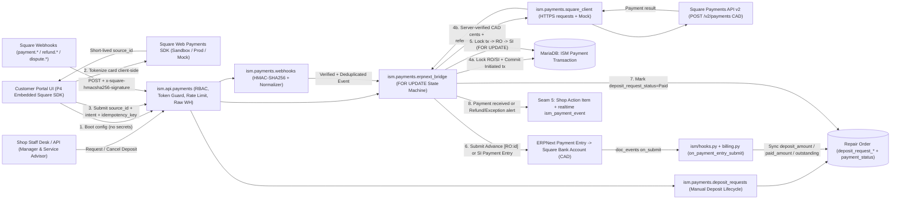
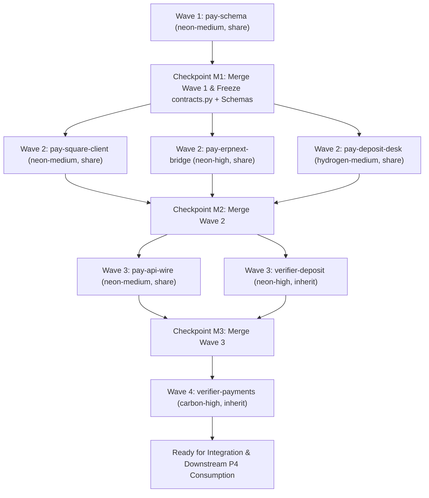

# Project 2: Payment Gateway & ERPNext Accounting Bridge (Square Web Payments SDK)

> **Document Purpose:** Standalone technical architecture, frozen cross-project contract specification, and single-`/swarm` execution runbook for **Project 2: Payment Gateway & ERPNext Accounting Bridge (Square Web Payments SDK)**. This document is self-contained and ready for direct execution via the Swarm plugin and isolated Frappe bench slots (`test-in-slot.ps1`).

| Metadata | Value |
| :--- | :--- |
| **Track / Project** | **Track A / Project 2** (Foundational Infrastructure) |
| **Prerequisites** | **None** — zero runtime dependencies on Projects 1, 3, 4, 5, or Track B (Project 6) |
| **Downstream Consumers** | **Project 4** (Expanded Customer Portal inline payments) and **Track B / Project 6** (Seam 3 canonical ERPNext billing truth & Seam 5 decoupled alerts) |
| **Governing Roadmap** | `[ROADMAP.md](./ROADMAP.md)` (locked product decisions from `../customer_portal_and_infra_roadmap.md` Sections 2, 4, 5, 6, 7, and 8) |
| **Recommended Session Entry** | Launch `/swarm` using your coordinator's default model inheritance (no model flags required), or optionally apply `/model-triage` active **Gemini 4** pinning (`Gemini 4 Neon (High)` or `Gemini 4 Carbon (High)` coordinator; leaf workers strictly `gemini-4-hydrogen-*`, `gemini-4-neon-*`, and `gemini-4-carbon-*` per Section 4). |

---

## 1. Strategic Objective & Locked Decisions

### Strategic Objective

Enable secure, PCI-minimized online **manual deposit payments** and **invoice balance payments** in **CAD** via the **embedded Square Web Payments SDK**, backed by a row-locked, idempotent accounting bridge that posts and reconciles every confirmed Square charge directly into ERPNext's **Square Bank Account** (`Payment Entry`) and keeps `Repair Order` billing totals synchronized through ISM's canonical billing engine.

This project delivers the complete backend payment ledger, Square REST/webhook gateway, manual staff deposit-request workflow, and ERPNext accounting bridge—plus clean, frozen Python and REST contracts consumed directly by Project 4's Customer Portal UI—without touching application code belonging to other tracks or adding external SDK packages to `ism-frappe/pyproject.toml`.

### Locked Decisions (Inherited from Governing Program Roadmap)

All product and architectural decisions below are locked and must not be reopened during implementation:

| Topic | Locked Decision |
| :--- | :--- |
| **Payment Gateway & UX Surface** | **Embedded Square Web Payments SDK** rendered inline in the Customer Portal (Project 4). The browser tokenizes card/wallet input via Square JS and submits only a short-lived payment token (`source_id`) to Frappe; raw PAN, CVV, and expiry data never touch ISM servers. |
| **Deposit Initiation Policy** | **Manual staff initiation only.** Shop staff (`ISM Manager`, `ISM Service Advisor`, `System Manager`) explicitly create or cancel a deposit request on a `Repair Order`. Quotes, quote approvals, and website self-serve bookings (Project 5) never auto-trigger deposit obligations. |
| **Currency & Authoritative Pricing** | Currency is strictly locked to **`CAD`** (integer cents computed with `Decimal` arithmetic). The backend always computes the payable amount server-side from the active manual deposit request or the submitted `Sales Invoice`'s `outstanding_amount`; client-submitted amounts are never trusted. |
| **ERPNext Accounting Model** | **Square is treated directly as an ERPNext Bank Account** (`Account.account_type == "Bank"`, `account_currency == "CAD"`), wired to a dedicated `Square` `Mode of Payment`. Every confirmed Square payment immediately creates and submits an ERPNext `Payment Entry` into that Square Bank Account (Customer Advance for deposits; `Sales Invoice` reference allocation for balances) and synchronizes `Repair Order` totals via existing ERPNext hooks. |
| **Concurrency & Idempotency** | Every charge attempt persists an `Initiated` ledger row with a unique Square-compliant `idempotency_key` (`<= 45` chars) before calling Square, passes `reference_id = tx.name` to Square for pre-response webhook correlation, and reconciles under strict `SELECT ... FOR UPDATE` row locking so simultaneous synchronous responses and Square webhook retries never double-post. |
| **Refund / Void / Failure Policy** | Square refund, void, dispute, or post-settlement failure webhooks update the `ISM Payment Transaction` ledger and emit a decoupled `Shop Action Item` manager alert (Seam 5) without silently cancelling or mutating submitted ERPNext `Payment Entry` or `Sales Invoice` records. |
| **Frappe Cloud & Dependency Discipline** | Pure HTTPS REST via `requests` and Python stdlib `hmac`/`hashlib`/`base64` (plus Frappe-bundled `cryptography` if needed)—zero new packages in `ism-frappe/pyproject.toml`. |
| **Hermetic Testability** | First-class **`Mock (Deterministic Test)`** environment mode in `ISM Settings` so all unit, integration, concurrency, webhook, and live `-Serve` browser smoke tests execute reliably offline with zero live Square API traffic or fees. |

### Explicit Non-Goals

- No storage of raw card numbers, CVV, expiration dates, or Square Card-on-File vaulting in Project 2.
- No automatic deposit requests on quote creation, quote approval, or Project 5 website bookings.
- No multi-currency payment processing (CAD only) and no automated ERPNext settlement batch fee-journal reconciliation in Project 2 (Square is booked gross to the Square Bank Account; merchant fee reconciliation remains standard accounting reconciliation on the Square Bank Account).
- No automatic programmatic cancellation of submitted ERPNext `Payment Entry` or `Sales Invoice` records triggered from external webhooks.
- No Customer Portal HTML/JS implementation in Project 2 (Project 4 consumes Project 2's frozen boot-config, summary, and charge contracts to render the inline Square Web Payments SDK form).

---

## 2. System Architecture & Codebase Anchor Audit

### End-to-End Architecture Diagram



### Codebase Anchor Audit

Direct audit of `ism-frappe` anchor files reveals exact integration invariants and constraints that govern Project 2's design:

| Anchor File | Audited Symbols & Exact Line References | Engineering Consequence for Project 2 |
| :--- | :--- | :--- |
| `ism-frappe/ism/ism/doctype/repair_order/billing.py` | `_resolve_mode_of_payment` (`L189–203`), `_resolve_paid_to_account` (`L206–225`), `_acquire_locked_ro_state` (`L228–261`), `_is_ro_deposit_remark` (`L264–270`), `_get_ro_deposit_payment_entries` (`L283–313`), `_create_and_submit_payment_entry` (`L316–365`), `_recompute_ro_payment_state` (`L411–497`), `_apply_ro_advances_to_invoice` (`L553–574`), `record_ro_deposit` (`L627–691`), `process_ro_payment_and_release` (`L694–1070`), `on_payment_entry_submit` (`L1119–1121`), `on_payment_entry_cancel` (`L1124–1126`) | **1. Deposit discovery tag:** `_get_ro_deposit_payment_entries` and `_apply_ro_advances_to_invoice` automatically discover and allocate any submitted Customer Receive `Payment Entry` containing `[RO:<ro_name>]` in `remarks`. Tagging Square deposit `Payment Entry` remarks with `[RO:<ro_name>] [SQ:<square_payment_id>]` guarantees seamless advance reconciliation during future `process_ro_payment_and_release` checkout with **zero modifications to `billing.py`**.<br>**2. No silent Cash fallback:** `_resolve_paid_to_account` falls back to `Cash - {abbr}` if no account mapping exists. `erpnext_bridge.py` must NOT use that fallback; it must strictly resolve a configured `Account` with `account_type == "Bank"` and `account_currency == "CAD"`.<br>**3. Guest permission boundary:** `_create_and_submit_payment_entry` calls `pe.insert()` / `pe.submit()` without `ignore_permissions=True`. Because customer portal payments and Square webhooks execute under `Guest`, `erpnext_bridge.py` must construct and submit the `Payment Entry` with `pe.flags.ignore_permissions = True` (leaving `skip_ro_payment_sync` `False` so `on_payment_entry_submit` updates RO totals atomically).<br>**4. Bank account references:** ERPNext requires `reference_no` and `reference_date` on `Bank`-account `Payment Entry` documents (`L346–348`). Setting `reference_no = square_payment_id` and `reference_date = posting_date` binds ERPNext Bank Reconciliation directly to Square's payment ID. |
| `ism-frappe/ism/ism/doctype/repair_order/repair_order.json` | `currency` default `CAD` (`L143–148`), `status` options (`L185–193`: `Checked In`, `Draft Estimate`, `Pending Authorization`, `Authorized - In Progress`, `Waiting on Parts`, `Work Completed`, `Billed / Paid`, `Closed / Released`, `Cancelled`), `tab_billing` `depends_on` (`L560`), `sec_payment` (`L566–615`: `sales_invoice`, `payment_status`, `deposit_amount`, `paid_amount`, `outstanding_amount`) | **Visibility catch:** `tab_billing` currently hides itself via `depends_on` until `Work Completed` or later (`L560`). Because advisors initiate manual deposit requests during `Draft Estimate`, `Pending Authorization`, or `Authorized - In Progress`, `tab_billing`'s `depends_on` must be widened to include `doc.deposit_request_status && doc.deposit_request_status !== 'None' || flt(doc.deposit_amount) > 0` (or place `sec_deposit_request` visibly in `tab_billing` with that updated expression) so staff can inspect deposit request status at any pre-invoicing stage. |
| `ism-frappe/ism/hooks.py` | `Sales Invoice.on_cancel` (`L166–168`), `Payment Entry.on_submit` & `on_cancel` (`L169–172`) | Submitting any Square `Payment Entry` with `remarks` containing `[RO:<name>]` (for deposits) or a `references` row pointing to `Sales Invoice` (for balances) automatically fires `billing.on_payment_entry_submit` -> `_recompute_ro_payment_state(ro_name)`. No new `doc_events` on `Payment Entry` or `Sales Invoice` are required, preserving clean `hooks.py` hygiene across tracks. |
| `ism-frappe/ism/ism/doctype/ism_settings/ism_settings.json` & `ism_settings.py` | Existing sections: `sb_approval_settings`, `sb_sms_settings`, `sb_scheduling`, `sb_capacity`, `sb_estimation`, `sb_pricing`; `ISMSettings.validate` (`L16–20`) | Project 2 adds exclusively `sb_square_payments` (plus `cb_square_payments`) and `_validate_square_settings()` in `ism_settings.py`. Zero overlap with P1, P3, P4, P5, or P6 sections (Seam 1). |
| `ism-frappe/ism/ism/doctype/shop_action_item/shop_action_item.json` & `shop_action_item.py` | `category` options (`L59`: `Shop Floor Discrepancy`, `Inventory / Parts`, `Reordering`, `Analytics Threshold`, `General`), `_VALID_SOURCES = ("Manual", "Agent", "Rule Snooze")` (`L10`), `dedup_key` upsert (`L117–138`), permission check (`L59`) | **Critical schema constraint:** Passing invalid `category` or `source` throws `frappe.ValidationError`, and `create_shop_action_item` checks `frappe.has_permission("Shop Action Item", "create")` which fails under `Guest` webhooks. Project 2's Seam 5 alert emitter must leave `shop_action_item.json` untouched (zero cross-track conflict) and upsert `Shop Action Item` records directly with `category="General"`, `source="Agent"`, deterministic `dedup_key`, and `ignore_permissions=True` (mirroring `_notify_shop_floor_approval` in `ism/api/approval.py` `L107–135`). |
| `ism-frappe/ism/setup_tasks/seed.py` & `taxes.py` | `_ISM_SETTINGS_FALSY_DEFAULTS` (`L54–76`), `setup_default_ism_settings` (`L97–117`); `setup_default_taxes_and_payments` (`taxes.py L231–290`) | `taxes.py` owns 13% HST and `Debit / Interac` seeding. Project 2 adds idempotent `ensure_square_bank_account_and_mop()` in `seed.py` (invoked alongside `setup_default_ism_settings()` from `setup.py` / `seed.py`) to create per-company CAD Bank Account `Square - <abbr>` (under `Bank Accounts - <abbr>`) and `Mode of Payment` `Square` (`type="Bank"`), leaving `taxes.py` untouched. |
| `ism-frappe/ism/ism/doctype/repair_order/repair_order.js` | `Billing` button group (`L1190–1201`: `Record Deposit` & `Checkout & Release`); `Navigation` button group (`L1304–1335`) | Adding `Request Online Deposit` / `Cancel Deposit Request` strictly under the `Billing` button group (`L1191–1196`) keeps edits tightly localized and non-overlapping with Project 6's `Navigation` button (`/board`). |
| `ism-frappe/ism/tests/test_billing_and_deposits.py`, `base.py`, `cleanup.py` | 6 comprehensive billing tests (`L68–472`); `_TEARDOWN_ORDER` (`base.py L31–58`); `_teardown_repair_order` (`base.py L310–329`) | Because Project 2 commits `Initiated` `ISM Payment Transaction` records before external HTTP calls, `base.py` must register `"ISM Payment Transaction": 1` in `_TEARDOWN_ORDER` and delete RO-linked payment transactions in `_teardown_repair_order` prior to cancelling `Payment Entry` and deleting `Repair Order`. `cleanup.py` adds a matching `_cleanup_payment_transactions` sweep. All 6 tests in `test_billing_and_deposits.py` remain mandatory regression gates. |

---

## 3. Locked Architectural, Security & Cross-Track Invariants

1. **Zero `development.localhost:8000` Contact & Bench Slot Isolation:**
   - Never run `sync-to-wsl.ps1`, `watch-sync.*`, `promote-to-main.ps1`, or raw `wsl` / `docker exec` commands targeting `frappe-bench` or `development.localhost` from any worktree or swarm worker.
   - Execute all Frappe migrations, tests, and live `-Serve` verification strictly via `powershell -ExecutionPolicy Bypass -File ism-frappe\scripts\test-in-slot.ps1`.
   - Never run parallel `test-in-slot.ps1` calls inside the same worktree; batch comma-separated `-Module` flags into a single call per worktree.

2. **Strict PCI-DSS Tokenization Scope & Secret Isolation:**
   - Raw cardholder data (`card_number`, `pan`, `cvv`, `cvc`, `exp_month`, `exp_year`, `card_data`) is **never** accepted, logged, or persisted by Frappe. `ism/api/payments.py` explicitly rejects requests containing prohibited card-field keys with `frappe.ValidationError`.
   - `square_access_token` and `square_webhook_signature_key` are `Password` fields on `ISM Settings`, read exclusively server-side via `settings.get_password(...)`, and **never** returned by `get_square_sdk_boot_config()`, API responses, exception tracebacks, or `webhook_audit_trace`.
   - Only non-sensitive display metadata (`card_brand`, `card_last4`, `square_receipt_url`, `square_receipt_number`) is persisted on `ISM Payment Transaction`.

3. **CAD-Only Server-Authoritative Amount & Square Bank Account Truth:**
   - Currency is enforced as `CAD` across `ISM Settings`, `Repair Order`, `Sales Invoice`, `Account.account_currency`, Square `amount_money.currency`, and Square response verification. Non-CAD records or gateway responses are rejected cleanly.
   - Dollar-to-cent conversion uses `Decimal` (`(Decimal(str(amount)).quantize(Decimal("0.01"), rounding=ROUND_HALF_UP) * 100)`), eliminating IEEE-754 float rounding bugs.
   - `submit_square_payment` and `execute_tokenized_payment` **never** accept a client-authoritative `amount`. They compute the exact payable amount server-side under row lock:
     - `Manual Deposit`: `Repair Order.deposit_request_amount` (only when `deposit_request_status == "Requested"`, `not ro.sales_invoice`, and `ro.status not in ("Billed / Paid", "Closed / Released", "Cancelled")`).
     - `Invoice Balance`: `Sales Invoice.outstanding_amount` (only when `ro.sales_invoice` points to a submitted `docstatus == 1` CAD `Sales Invoice` with `outstanding_amount > 0` and `ro.status != "Cancelled"`).
   - An optional `expected_amount_cents: int | None` parameter acts solely as a **stale-UI guard**: if provided by the portal UI and it differs from the server-computed cents, the server rejects with `ValidationError` ("Payable amount has changed; please refresh before paying") before calling Square.
   - Receiving ERPNext account resolution (`resolve_square_accounting_config(company)`) requires a leaf `Account` (`is_group == 0`, `disabled == 0`) with `account_type == "Bank"` and `account_currency == "CAD"`, verified in pre-flight before charging Square. Falling back to `Cash` is strictly forbidden.

4. **Row-Locked Concurrency, Pre-HTTP Crash Safety & Pre-Response Webhook Correlation:**
   - **Pre-HTTP Commit Pattern:** Before calling Square's `POST /v2/payments`, acquire `FOR UPDATE` on `Repair Order` (and `Sales Invoice` if applicable), verify no other `ISM Payment Transaction` for `(repair_order, payment_intent)` is currently in `("Initiated", "Pending")`, persist the new `ISM Payment Transaction` (`status="Initiated"`, unique `idempotency_key` `<= 45` chars), and call `frappe.db.commit()`. No database row lock is ever held across an outbound HTTPS request.
   - **Pre-Response Webhook Correlation:** Every `POST /v2/payments` request passes `reference_id = tx.name` (16 chars, within Square's 40-char limit). If Square delivers `payment.created` / `payment.updated` before Frappe finishes parsing the synchronous HTTP response, the webhook handler correlates via `square_payment_id` OR fallback `name = payment.reference_id` and backfills `square_payment_id` under lock.
   - **Canonical Lock Ordering (Deadlock Prevention):** Every reconciliation mutation acquires MariaDB `FOR UPDATE` locks in strict order: `ISM Payment Transaction` -> `Repair Order` -> `Sales Invoice` (when present).
   - **At-Most-Once Posting:** Inside the `ISM Payment Transaction` `FOR UPDATE` lock, if `tx.payment_entry` is already populated or `tx.status == "Posted"`, posting immediately short-circuits and returns the existing `payment_entry`. Simultaneous synchronous completion and webhook retries can never double-post.
   - **Webhook Deduplication & Signature Verification:** `square_webhook()` reads raw HTTP bytes (`frappe.request.get_data(as_text=False)`), computes `base64(HMAC-SHA256(signature_key, notification_url_bytes + raw_body_bytes))`, compares via `hmac.compare_digest` against `x-square-hmacsha256-signature` (returning HTTP `401` on failure), and deduplicates by Square `event_id` stored in `processed_webhook_event_ids` (returning HTTP `200` on duplicate replay or unrecognized `square_payment_id`).

5. **Accounting Immutability on Refunds, Voids, Disputes & Exceptions:**
   - Submitted ERPNext `Payment Entry` and `Sales Invoice` documents are **never** auto-cancelled or modified by Square webhooks.
   - On `refund.created` / `refund.updated` (`COMPLETED`), `payment.updated` (`CANCELED` / `FAILED` after post), `dispute.*`, or amount/overpayment mismatches, Project 2 updates `ISM Payment Transaction` (`status`, `refunded_amount`, `refund_ids_json`, `erpnext_sync_status="Manual Review Required"`, `webhook_audit_trace`) and emits a deduplicated `Critical` / `High` `Shop Action Item` for manager reconciliation.

6. **Frappe Cloud Compatibility & Zero Extra Dependencies:**
   - `ism-frappe/pyproject.toml` remains unchanged. All Square HTTP calls use `requests` with explicit `(connect, read)` timeouts (e.g. `(5, 25)` seconds) and zero retries on `POST /v2/payments` without the exact same `idempotency_key`.
   - `Mock (Deterministic Test)` mode executes 100% locally with deterministic token fixtures (`mock_tok_ok`, `mock_tok_decline`, `mock_tok_pending`, `mock_tok_timeout`, `mock_tok_mismatch`).

7. **Cross-Track Seam Alignment (Seams 1, 3, and 5):**
   - **Seam 1 (`ISM Settings`):** Exclusively adds `sb_square_payments` + `cb_square_payments` and `square_*` fields. Zero collisions with P1 (`sb_sms_settings`, `sb_otp_and_sessions`), P3 (`sb_customer_scheduling_policy`), P4 (`sb_customer_portal`), P5 (`sb_self_serve_booking`), or P6 (`sb_media_storage`, `sb_board_ai`, `sb_parts_pricing`).
   - **Seam 3 (ERPNext Billing Truth):** Both Shop OS `/board` (`RECORD_DEPOSIT`, `CHECKOUT_REPAIR_ORDER`) and Project 2 Square online payments write exclusively through ERPNext `Payment Entry` and `Repair Order` payment sync (`billing.py`). No shadow balance is maintained outside ERPNext.
   - **Seam 5 (Decoupled Floor Visibility):** Payment confirmations and refund/void/mismatch exceptions emit `Shop Action Item` (`category="General"`, `source="Agent"`, deduplicated `dedup_key`) and `frappe.publish_realtime("ism_payment_event", payload, after_commit=True)`. Project 2 imports **nothing** from `ism.board`, `ism.portal`, or `ism.comms`.

---

## 4. Swarm Plugin Execution Blueprint

### Hard Guardrails

- **Bench Slot Concurrency Ceiling:** Maximum **3 concurrent `workspace:"share"` authors** per wave (safely inside `slot-1`..`slot-5`).
- **Disjoint File Ownership:** No two workers in the same wave ever touch the same file. Merge checkpoints (`M1`, `M2`, `M3`) land and verify each wave before spawning the next.
- **Model Pinning Rules (When Using Optional `/model-triage`):**
  - Use **active Gemini 4 lineup ONLY**: `gemini-4-hydrogen-*`, `gemini-4-neon-*`, `gemini-4-carbon-*`.
  - **Banned models:** Never use `gemini-4-argon-*`, `Gemini 3.8 Flash`, `Claude`, `GPT-OSS`, `Model="flash"`, or `Orchestrator` on leaf workers.
  - Skip `Neon (Low)` and avoid `Hydrogen (High/XHigh)` for multi-turn repo coding.
  - **Cross-family verification mandatory:** `hydrogen-medium` author (`pay-deposit-desk`) is verified by `gemini-4-neon-high` (`verifier-deposit`); all `neon-*` authors (`pay-schema`, `pay-square-client`, `pay-erpnext-bridge`, `pay-api-wire`) are verified by `gemini-4-carbon-high` (`verifier-payments`).
- **In-Place Escalation:** If a worker stalls or fails verification twice, wait until it is `waiting` and upgrade its model in-place via `swarm{action:"model", name, model}`—never `kill` + `add`.
- **Land Before Kill:** Always merge each `workspace:"share"` worker's branch into the integration branch and confirm clean `git status` before calling `swarm{action:"kill", name}`.

### Coordinator Startup Protocol

1. Create or check out a dedicated integration branch (e.g., `git checkout -b feat/p2-payments-square-erpnext`) from canonical `main`. Never run `test-in-slot.ps1` against `development.localhost:8000`.
2. Name the swarm:
   ```text
   swarm{action:"title", title:"Square CAD payments and ERPNext bridge"}
   ```
3. *(Optional `/model-triage` mode)* Run `swarm{action:"models", all:true}` once to confirm active Gemini 4 IDs and quota headroom. (In default `/swarm` mode, omit `model` on `swarm{action:"add"}` so workers inherit the coordinator model.)
4. Spawn **Wave 1** (`pay-schema`) plus an optional `monitor` (`swarm_monitor` skill, `gemini-4-hydrogen-low`, `workspace:"inherit"`) if running unattended.
5. Immediately after spawning the first worker(s), write the Swarm UI Overview plan file to `<appData>/brain/<coordinator-conversation-id>/.system_generated/swarm/plan.json` (update only when adding workers or changing scope—never put status/blockers in `plan.json`):

```json
{
  "goal": {
    "title": "Build Square CAD payments and ERPNext bridge",
    "line": "Ship Square SDK charges, webhooks, manual deposits, and Bank Account reconciliation."
  },
  "tasks": {
    "pay-schema": "Define contracts, Payment Transaction DocType, settings, RO deposit fields, seeding",
    "pay-square-client": "Implement Square HTTPS client, Mock adapter, and HMAC webhook parser",
    "pay-erpnext-bridge": "Implement row-locked CAD charge flow, Square Bank PE posting, Seam 5 alerts",
    "pay-deposit-desk": "Implement manual deposit request lifecycle, summary builder, Desk RO buttons",
    "pay-api-wire": "Wire whitelisted payment/webhook APIs, rate limits, and E2E API tests",
    "verifier-deposit": "Cross-family audit of deposit request service and Desk JS",
    "verifier-payments": "Run batched slot test gate, ruff check, and live Mock smoke verification"
  },
  "threads": [
    {
      "id": "t-schema",
      "title": "Schema, Settings & Frozen Contracts",
      "goal": "Freeze CAD payment contracts, ledger DocType, RO fields, and Square Bank Account seeding.",
      "tasks": ["pay-schema"]
    },
    {
      "id": "t-gateway",
      "title": "Square Client & Webhook Security",
      "goal": "Deliver pure-requests Square API client, deterministic Mock harness, and HMAC verification.",
      "tasks": ["pay-square-client"]
    },
    {
      "id": "t-accounting",
      "title": "Deposits & ERPNext Bank Reconciliation",
      "goal": "Deliver manual deposit lifecycle, row-locked Square Bank PE posting, and Seam 5 exception alerts.",
      "tasks": ["pay-erpnext-bridge", "pay-deposit-desk", "verifier-deposit"]
    },
    {
      "id": "t-api-verify",
      "title": "API Surface & Full-Stack Financial Gate",
      "goal": "Expose portal/staff/webhook APIs and prove concurrency, PCI, and billing regression safety.",
      "tasks": ["pay-api-wire", "verifier-payments"]
    }
  ]
}
```

6. Enforce **Merge Checkpoints `M1` -> `M2` -> `M3`**: merge completed worker branches into the integration branch, confirm clean `git status` and frozen contracts, then spawn the next wave.
7. After **Wave 4 (`verifier-payments`)** passes all Exit KPIs, kill temporary workers (preserving merged commits on the integration branch) and report the final verification summary.

### Worker Roster & Pinning Table

Every worker name conforms strictly to `^[a-z0-9][a-z0-9_-]{0,23}$`:

| Worker | Wave | Role & Strict File Ownership | Optional `/model-triage` Model ID | Workspace | Depends On | Why This Model |
| :--- | :---: | :--- | :--- | :---: | :---: | :--- |
| `pay-schema` | 1 | `ism/payments/__init__.py`, `ism/payments/contracts.py`, `ISM Payment Transaction` DocType (`ism_payment_transaction.*`), `ism_settings.{json,py}`, `repair_order.json`, `setup_tasks/seed.py`, `tests/base.py`, `tests/cleanup.py`, `tests/test_payments_schema_and_requests.py` | `gemini-4-neon-medium` | `share` | — | Schema invariants, CAD Decimal helpers, Bank Account seeding, and frozen contract design |
| `pay-square-client` | 2 | `ism/payments/square_client.py`, `ism/payments/webhooks.py`, `tests/test_payments_square_client.py` | `gemini-4-neon-medium` | `share` | `M1` | Security-sensitive HMAC-SHA256 verification, Square v2 REST semantics, deterministic Mock fixtures |
| `pay-erpnext-bridge` | 2 | `ism/payments/erpnext_bridge.py`, `tests/test_payments_erpnext_bridge.py` | `gemini-4-neon-high` | `share` | `M1` | High-stakes financial concurrency (`FOR UPDATE` lock order), crash recovery, ERPNext `Payment Entry` posting & refund exception safety |
| `pay-deposit-desk` | 2 | `ism/payments/deposit_requests.py`, `ism/ism/doctype/repair_order/repair_order.js`, `tests/test_payments_deposit_requests.py` | `gemini-4-hydrogen-medium` | `share` | `M1` | Bounded CRUD/state transitions, summary projection, and localized Desk dialog buttons |
| `pay-api-wire` | 3 | `ism/api/payments.py`, `ism/payments/__init__.py` (final re-exports), `tests/test_payments_api_e2e.py` | `gemini-4-neon-medium` | `share` | `M2` | Auth boundary enforcement (RBAC + approval token + PCI scrub + raw webhook HTTP codes) |
| `verifier-deposit` | 3 | Read-only cross-family verification of `pay-deposit-desk` (`deposit_requests.py`, `repair_order.js`, `test_payments_deposit_requests.py`) | `gemini-4-neon-high` | `inherit` | `M2` | Cross-family Gemini 4 verifier for `hydrogen-medium` author |
| `verifier-payments` | 4 | Full-stack cross-family gate: batched `test-in-slot.ps1` (5 new + 5 regression suites), `ruff check`, live `-Serve` smoke check in Mock mode, PCI/HMAC/concurrency/Bank-Account audit | `gemini-4-carbon-high` | `inherit` | `M3` | Cross-family verifier for all `neon-*` authors + highest shell/WSL reliability for `test-in-slot.ps1` |
| `monitor` *(optional)* | 1–4 | Standard `swarm_monitor` stall watcher (only when running unattended) | `gemini-4-hydrogen-low` | `inherit` | — | Lightweight timer-based stall detection |

### Wave Dependency Graph



> **Zero-Conflict File Ownership Rule:** Within Wave 2, `pay-square-client`, `pay-erpnext-bridge`, and `pay-deposit-desk` edit strictly disjoint files (`square_client.py`+`webhooks.py` vs. `erpnext_bridge.py` vs. `deposit_requests.py`+`repair_order.js`) and separate test modules. `billing.py`, `hooks.py`, `taxes.py`, `shop_action_item.json`, and `pyproject.toml` are NOT modified by any worker.

### Self-Contained Per-Worker Brief Templates

#### Brief Template — Wave 1: `pay-schema`
> **Assignment:** Implement Wave 1 of `todo_snippets/roadmap/plan_p2_payments_square_erpnext.md` (Section 5, Wave 1).
> **Owned Files:** `[NEW] ism-frappe/ism/payments/__init__.py`, `[NEW] ism-frappe/ism/payments/contracts.py`, `[NEW] ism-frappe/ism/ism/doctype/ism_payment_transaction/{__init__.py,ism_payment_transaction.json,ism_payment_transaction.py}`, `[MODIFY] ism-frappe/ism/ism/doctype/ism_settings/{ism_settings.json,ism_settings.py}`, `[MODIFY] ism-frappe/ism/ism/doctype/repair_order/repair_order.json`, `[MODIFY] ism-frappe/ism/setup_tasks/seed.py`, `[MODIFY] ism-frappe/ism/tests/{base.py,cleanup.py}`, `[NEW] ism-frappe/ism/tests/test_payments_schema_and_requests.py`.
> **Forbidden Files:** Do NOT touch `billing.py`, `hooks.py`, `taxes.py`, `shop_action_item.*`, `repair_order.js`, `pyproject.toml`, or any non-`sb_square_payments` section of `ism_settings.json`. Never run commands targeting `development.localhost:8000`.
> **Done Looks Like:** All Section 5 Wave 1 schemas, CAD Decimal helpers, Square Bank Account + `Square` Mode of Payment seeding, and teardown hooks are implemented; `ruff check` passes with 0 errors; `powershell -ExecutionPolicy Bypass -File ism-frappe\scripts\test-in-slot.ps1 -Module "ism.tests.test_payments_schema_and_requests"` passes 100%. Post `@coordinator [done]` with commit hash, changed files, and test output.

#### Brief Template — Wave 2A: `pay-square-client`
> **Assignment:** Implement Wave 2A of `todo_snippets/roadmap/plan_p2_payments_square_erpnext.md` (Section 5, Wave 2A) against frozen `ism/payments/contracts.py`.
> **Owned Files:** `[NEW] ism-frappe/ism/payments/square_client.py`, `[NEW] ism-frappe/ism/payments/webhooks.py`, `[NEW] ism-frappe/ism/tests/test_payments_square_client.py`.
> **Forbidden Files:** Do NOT modify `contracts.py`, `erpnext_bridge.py`, `deposit_requests.py`, `repair_order.js`, `api/payments.py`, `pyproject.toml`, or any DocType JSON. Never touch `development.localhost:8000`.
> **Done Looks Like:** Pure `requests` Square Payments API v2 client (`create_payment`, `get_payment`), secret-free `get_sdk_boot_config()`, deterministic `MockSquareClient` covering all 5 mock tokens, constant-time HMAC-SHA256 webhook verifier over `notification_url_bytes + raw_body_bytes`, and event normalizer pass `ruff check` and `powershell -ExecutionPolicy Bypass -File ism-frappe\scripts\test-in-slot.ps1 -Module "ism.tests.test_payments_square_client"`. Post `@coordinator [done]` with commit hash and test summary.

#### Brief Template — Wave 2B: `pay-erpnext-bridge`
> **Assignment:** Implement Wave 2B of `todo_snippets/roadmap/plan_p2_payments_square_erpnext.md` (Section 5, Wave 2B) against frozen `ism/payments/contracts.py`. Import `square_client` and `webhooks` by their frozen Section 5 function signatures (or accept injectable client for unit isolation).
> **Owned Files:** `[NEW] ism-frappe/ism/payments/erpnext_bridge.py`, `[NEW] ism-frappe/ism/tests/test_payments_erpnext_bridge.py`.
> **Forbidden Files:** Do NOT modify `billing.py`, `hooks.py`, `contracts.py`, `square_client.py`, `webhooks.py`, `deposit_requests.py`, `shop_action_item.*`, or `api/payments.py`. Never touch `development.localhost:8000`.
> **Done Looks Like:** Strict CAD + Square Bank Account resolution (zero Cash fallback), pre-HTTP `Initiated` commit with `reference_id=tx.name`, canonical `FOR UPDATE` lock order (`ISM Payment Transaction` -> `Repair Order` -> `Sales Invoice`), Guest-safe `Payment Entry` posting (`[RO:<name>] [SQ:<id>]` advance & SI allocation), sync-vs-webhook race idempotency, webhook `event_id` dedup, and refund/void/exception Seam 5 `Shop Action Item` emission without cancelling submitted accounting docs. Verify with `ruff check` and `powershell -ExecutionPolicy Bypass -File ism-frappe\scripts\test-in-slot.ps1 -Module "ism.tests.test_payments_erpnext_bridge,ism.tests.test_billing_and_deposits"`. Post `@coordinator [done]` with commit hash and test summary.

#### Brief Template — Wave 2C: `pay-deposit-desk`
> **Assignment:** Implement Wave 2C of `todo_snippets/roadmap/plan_p2_payments_square_erpnext.md` (Section 5, Wave 2C) against frozen `ism/payments/contracts.py`.
> **Owned Files:** `[NEW] ism-frappe/ism/payments/deposit_requests.py`, `[MODIFY] ism-frappe/ism/ism/doctype/repair_order/repair_order.js`, `[NEW] ism-frappe/ism/tests/test_payments_deposit_requests.py`.
> **Forbidden Files:** Do NOT modify `contracts.py`, `repair_order.json`, `square_client.py`, `erpnext_bridge.py`, `api/payments.py`, or the `Navigation` button group in `repair_order.js`. Never touch `development.localhost:8000`.
> **Done Looks Like:** Manual deposit request creation/cancellation with RBAC (`ISM Manager`/`ISM Service Advisor`/`System Manager` only), in-flight charge lock check, `get_ro_payment_state(ro_name)` canonical summary builder, `list_ro_payment_transactions(ro_name)`, and Desk `Billing` group actions pass `ruff check` and `powershell -ExecutionPolicy Bypass -File ism-frappe\scripts\test-in-slot.ps1 -Module "ism.tests.test_payments_deposit_requests"`. Post `@coordinator [done]` with commit hash and test summary.

#### Brief Template — Wave 3A: `pay-api-wire`
> **Assignment:** Implement Wave 3A of `todo_snippets/roadmap/plan_p2_payments_square_erpnext.md` (Section 5, Wave 3) on top of merged `M2`.
> **Owned Files:** `[NEW] ism-frappe/ism/api/payments.py`, `[MODIFY] ism-frappe/ism/payments/__init__.py`, `[NEW] ism-frappe/ism/tests/test_payments_api_e2e.py`.
> **Forbidden Files:** Do NOT modify `billing.py`, `hooks.py`, `ism_settings.json`, or `repair_order.json`. Never touch `development.localhost:8000`.
> **Done Looks Like:** All whitelisted endpoints (`request_ro_deposit`, `cancel_ro_deposit_request`, `get_ro_payment_ledger`, `get_square_sdk_boot_config`, `get_ro_payment_summary`, `submit_square_payment`, `square_webhook`), PCI raw-card field rejection, Redis guest rate limits, approval-token + staff auth verification, raw-body HMAC HTTP status codes (`401`/`400`/`200`), and package re-exports pass `ruff check` and `powershell -ExecutionPolicy Bypass -File ism-frappe\scripts\test-in-slot.ps1 -Module "ism.tests.test_payments_api_e2e"`. Post `@coordinator [done]` with commit hash and test summary.

#### Brief Template — Wave 3B: `verifier-deposit`
> **Assignment:** Read-only cross-family verification (`gemini-4-neon-high`) of Wave 2C (`pay-deposit-desk`) after `M2`.
> **Scope:** Audit `ism/payments/deposit_requests.py`, `ism/ism/doctype/repair_order/repair_order.js`, and `ism/tests/test_payments_deposit_requests.py` against Section 3 invariants and Section 5 Wave 2C specs (RBAC, no auto-deposits, pre-estimate vs estimate cap, active-charge cancellation lock, non-overlapping `Billing` UI buttons, Seam 3 accuracy).
> **Owned Files:** None (read-only `workspace:"inherit"`).
> **Done Looks Like:** Post `@coordinator [done]` with explicit PASS/FAIL findings citing `file:line`; if defects exist, @mention `@pay-deposit-desk` or `@coordinator` with exact remediation steps.

#### Brief Template — Wave 4: `verifier-payments`
> **Assignment:** Final full-stack cross-family verification (`gemini-4-carbon-high`) of Project 2 after `M3` per Section 6.
> **Scope:** Run the single batched `test-in-slot.ps1` command across all 5 new `test_payments_*` suites and 5 core regression suites (`test_billing_and_deposits`, `test_auth_and_roles`, `test_approval_and_inspection`, `test_agent_facade`, `test_pricing_and_discounts`); run `ruff check`; perform the live `-Serve start` / `-Serve stop` Mock-mode smoke walkthrough; audit PCI redaction, CAD enforcement, Square Bank Account strictness, `FOR UPDATE` race safety, and Seam 1/3/5 compliance.
> **Owned Files:** None (read-only `workspace:"inherit"`).
> **Done Looks Like:** Every Exit KPI in Section 6 is verified green with raw evidence. Post `@coordinator [done]` with the KPI scorecard and exact command outputs.

---

## 5. Detailed Wave-by-Wave Implementation Specification

### Wave 1 — Schema, Settings, Seeding & Frozen Contracts (`pay-schema`)

#### 1. `[NEW] ism-frappe/ism/payments/contracts.py` (Frozen at Checkpoint M1)

Defines all shared constants, state enums, CAD integer-cent conversion helpers, Square API/SDK URL tables, idempotency validators, and TypedDict contracts consumed by Waves 2–3 and Project 4:

- **Constants:**
  - `SQUARE_CURRENCY = "CAD"`
  - `SQUARE_API_VERSION = "2025-01-23"`
  - `SQUARE_IDEMPOTENCY_KEY_MAX_LEN = 45`
  - `SQUARE_ENV_DISABLED = "Disabled"`
  - `SQUARE_ENV_SANDBOX = "Sandbox"`
  - `SQUARE_ENV_PRODUCTION = "Production"`
  - `SQUARE_ENV_MOCK = "Mock (Deterministic Test)"`
  - `SQUARE_ENVIRONMENTS = (SQUARE_ENV_DISABLED, SQUARE_ENV_SANDBOX, SQUARE_ENV_PRODUCTION, SQUARE_ENV_MOCK)`
  - `SQUARE_API_BASE_URLS = {SQUARE_ENV_SANDBOX: "https://connect.squareupsandbox.com", SQUARE_ENV_PRODUCTION: "https://connect.squareup.com"}`
  - `SQUARE_SDK_SCRIPT_URLS = {SQUARE_ENV_SANDBOX: "https://sandbox.web.squarecdn.com/v1/square.js", SQUARE_ENV_PRODUCTION: "https://web.squarecdn.com/v1/square.js"}`
  - `SQUARE_DEFAULT_MOP = "Square"`
  - `SQUARE_DEFAULT_BANK_ACCOUNT_LABEL = "Square"`
  - `INTENT_MANUAL_DEPOSIT = "Manual Deposit"`
  - `INTENT_INVOICE_BALANCE = "Invoice Balance"`
  - `PAYMENT_INTENTS = (INTENT_MANUAL_DEPOSIT, INTENT_INVOICE_BALANCE)`
  - `TX_STATUS_INITIATED = "Initiated"`, `TX_STATUS_PENDING = "Pending"`, `TX_STATUS_COMPLETED = "Completed"`, `TX_STATUS_POSTED = "Posted"`, `TX_STATUS_FAILED = "Failed"`, `TX_STATUS_VOIDED = "Voided"`, `TX_STATUS_PARTIALLY_REFUNDED = "Partially Refunded"`, `TX_STATUS_REFUNDED = "Refunded"`, `TX_STATUS_RECONCILIATION_ERROR = "Reconciliation Error"`
  - `IN_FLIGHT_TX_STATUSES = (TX_STATUS_INITIATED, TX_STATUS_PENDING)`
  - `DEPOSIT_REQ_NONE = "None"`, `DEPOSIT_REQ_REQUESTED = "Requested"`, `DEPOSIT_REQ_PAID = "Paid"`, `DEPOSIT_REQ_CANCELLED = "Cancelled"`
  - `STAFF_PAYMENT_ROLES = frozenset({"System Manager", "ISM Manager", "ISM Service Advisor"})`
  - `PROHIBITED_PCI_FIELD_NAMES = frozenset({"card_number", "pan", "cvv", "cvc", "security_code", "exp_month", "exp_year", "expiry", "expiration_date", "card_data"})`
  - `WEBHOOK_SUPPORTED_EVENTS = frozenset({"payment.created", "payment.updated", "refund.created", "refund.updated", "dispute.created", "dispute.state.updated"})`
- **Pure Utility Functions (Exact Signatures):**
  ```python
  def cad_to_cents(amount: float | int | str | Decimal) -> int: ...
  def cents_to_cad(cents: int) -> float: ...
  def normalize_idempotency_key(raw_key: str | None) -> str: ...
  def assert_cad_currency(currency: str | None, context: str = "Payment") -> str: ...
  def assert_no_raw_card_fields(payload: dict[str, Any]) -> None: ...
  def build_square_deposit_remark(ro_name: str, square_payment_id: str) -> str:
      # Returns: f"Square online deposit for Repair Order {ro_name} [RO:{ro_name}] [SQ:{square_payment_id}]"
  def build_square_invoice_remark(ro_name: str, si_name: str, square_payment_id: str) -> str:
      # Returns: f"Square online invoice payment for {si_name} [RO:{ro_name}] [SQ:{square_payment_id}]"
  ```
- **TypedDict Contracts:** `SquareSdkBootConfig`, `PaymentStateSummary`, `SquareChargeResult`, `WebhookEventNormalized`, `SquareAccountingConfig`.

#### 2. `[NEW]` DocType: `ISM Payment Transaction` (`ism_payment_transaction`)

Create `ism-frappe/ism/ism/doctype/ism_payment_transaction/{__init__.py,ism_payment_transaction.json,ism_payment_transaction.py}` with `engine: "InnoDB"`, `autoname: "naming_series:"`, `is_submittable: 0`, `track_changes: 1`, `module: "ISM"`:

| Fieldname | Fieldtype | Options / Default | Constraints & Purpose |
| :--- | :--- | :--- | :--- |
| `naming_series` | `Select` | `PAYTX-.YYYY.-.#####` | `reqd: 1` (also passed to Square as `reference_id` for pre-response webhook correlation) |
| `repair_order` | `Link` | `Repair Order` | `reqd: 1`, `search_index: 1`, `in_standard_filter: 1` |
| `sales_invoice` | `Link` | `Sales Invoice` | `search_index: 1` (populated for `Invoice Balance`) |
| `customer` | `Link` | `Customer` | `reqd: 1`, `search_index: 1` |
| `company` | `Link` | `Company` | `reqd: 1` |
| `payment_intent` | `Select` | `Manual Deposit\nInvoice Balance` | `reqd: 1`, `in_list_view: 1`, `in_standard_filter: 1` |
| `status` | `Select` | `Initiated\nPending\nCompleted\nPosted\nFailed\nVoided\nPartially Refunded\nRefunded\nReconciliation Error` | Default `Initiated`, `reqd: 1`, `in_list_view: 1`, `in_standard_filter: 1`, `search_index: 1` |
| `currency` | `Link` | `Currency` (Default `CAD`) | `reqd: 1`, `read_only: 1` (validated `== "CAD"`) |
| `amount` | `Currency` | — | `reqd: 1`, `in_list_view: 1` (server-verified CAD amount) |
| `amount_cents` | `Int` | — | `reqd: 1`, `read_only: 1` (`cad_to_cents(amount)`) |
| `refunded_amount` | `Currency` | Default `0` | `read_only: 1` |
| `square_environment` | `Select` | `Sandbox\nProduction\nMock (Deterministic Test)` | `reqd: 1`, `read_only: 1` |
| `idempotency_key` | `Data` | — | `reqd: 1`, `unique: 1`, `search_index: 1` (max 45 chars) |
| `square_payment_id` | `Data` | — | `unique: 1`, `search_index: 1` (nullable until Square responds) |
| `square_order_id` | `Data` | — | `read_only: 1` |
| `square_location_id` | `Data` | — | `read_only: 1` |
| `square_status` | `Data` | — | `read_only: 1` (raw Square status string) |
| `square_receipt_url` | `Data` | — | `read_only: 1` |
| `square_receipt_number` | `Data` | — | `read_only: 1` |
| `card_brand` | `Data` | — | `read_only: 1` (PCI-safe brand label) |
| `card_last4` | `Data` | — | `read_only: 1` (last 4 digits only) |
| `payment_entry` | `Link` | `Payment Entry` | `read_only: 1`, `search_index: 1` |
| `paid_to_account` | `Link` | `Account` | `read_only: 1` (exact Square Bank Account credited) |
| `posted_at` | `Datetime` | — | `read_only: 1` |
| `erpnext_sync_status` | `Select` | `Not Posted\nPosted\nManual Review Required` | Default `Not Posted`, `read_only: 1` |
| `error_message` | `Small Text` | — | `read_only: 1` (sanitized failure/exception summary) |
| `initiated_by` | `Data` | — | `read_only: 1` (`Customer Portal` or staff username) |
| `client_ip` | `Data` | — | `read_only: 1` |
| `last_webhook_event_id` | `Data` | — | `read_only: 1`, `search_index: 1` |
| `last_webhook_event_type` | `Data` | — | `read_only: 1` |
| `processed_webhook_event_ids` | `Long Text` | Default `[]` | `read_only: 1` (JSON array of deduplicated Square `event_id`s) |
| `refund_ids_json` | `Long Text` | Default `[]` | `read_only: 1` (JSON array of `{refund_id, amount_cents, status, updated_at}`) |
| `webhook_audit_trace` | `Long Text` | Default `[]` | `read_only: 1` (bounded JSON array of sanitized transition/webhook entries, capped at 50 entries) |

- **Permissions:** `System Manager` & `ISM Manager` (`read`, `write`, `create`, `report`, `export`, `print`; `delete: 0` in production permissions to preserve ledger immutability), `ISM Service Advisor` (`read`, `report`, `print`), `ISM Technician` (no row = denied), `Guest` (no row = denied).
- **Controller (`ism_payment_transaction.py`):**
  - Enforces `currency == "CAD"`, `amount > 0`, `amount_cents == cad_to_cents(amount)`, `len(idempotency_key) <= 45`, `card_last4` either empty or 4 digits, and blocks deleting a record with `payment_entry` linked unless `frappe.flags.in_test` or `force=True` teardown.
  - Exposes helper method `append_audit_entry(source, event_type, summary, event_id=None, status_before=None, status_after=None)` keeping `webhook_audit_trace` cleanly bounded and stripped of secrets.

#### 3. `[MODIFY] ism-frappe/ism/ism/doctype/ism_settings/{ism_settings.json,ism_settings.py}`

Append a single disjoint section `sb_square_payments` at the end of `field_order` and `fields` (preserving all existing sections intact):

| Fieldname | Fieldtype | Options / Default | Notes |
| :--- | :--- | :--- | :--- |
| `sb_square_payments` | `Section Break` | Label: `Square Online Payments (CAD)` | Frozen P2 namespace (Seam 1) |
| `square_environment` | `Select` | `Disabled\nSandbox\nProduction\nMock (Deterministic Test)` | Default `Disabled` |
| `square_application_id` | `Data` | — | Public client SDK Application ID (`sandbox-sq0idb-...` / `sq0idp-...`) |
| `square_location_id` | `Data` | — | Public client SDK & Payments API Location ID |
| `square_currency` | `Link` | `Currency` (Default `CAD`) | `read_only: 1` — locked to `CAD` |
| `cb_square_payments` | `Column Break` | — | 2-column Desk layout |
| `square_access_token` | `Password` | — | Server-only Bearer token (never exposed to browser) |
| `square_webhook_signature_key` | `Password` | — | Server-only HMAC-SHA256 signing key |
| `square_webhook_notification_url` | `Data` | — | Exact HTTPS webhook URL registered in Square Developer Dashboard |
| `square_mode_of_payment` | `Link` | `Mode of Payment` | Default seeded to `Square` |
| `square_bank_account` | `Link` | `Account` | ERPNext Square Bank Account (`account_type == "Bank"`, `is_group == 0`, `account_currency == "CAD"`) |

- **`ISMSettings._validate_square_settings()` in `ism_settings.py`:**
  - Always coerce empty `square_environment` to `"Disabled"` and empty `square_currency` to `"CAD"`; reject any `square_currency != "CAD"`.
  - When `square_bank_account` is set, verify `Account` exists, `is_group == 0`, `account_type == "Bank"`, and (if `account_currency` is set) `account_currency == "CAD"`.
  - When `square_environment in ("Sandbox", "Production")`, require `square_application_id`, `square_location_id`, `square_access_token`, and `square_mode_of_payment` (and if `square_webhook_notification_url` is set, verify it starts with `https://` in `Production`).
  - When `square_environment == "Mock (Deterministic Test)"`, allow empty live credentials so tests and `-Serve` previews run offline cleanly while still validating `square_bank_account` / `square_currency == "CAD"` if supplied.

#### 4. `[MODIFY] ism-frappe/ism/ism/doctype/repair_order/repair_order.json`

Add section `sec_deposit_request` ("Online Deposit Request") inside `tab_billing` right after `outstanding_amount`, using strictly `deposit_request_*` fieldnames:
- `sec_deposit_request` (`Section Break`, Label: `Online Deposit Request`)
- `deposit_request_status` (`Select`: `None\nRequested\nPaid\nCancelled`, Default `None`, `read_only: 1`, `allow_on_submit: 1`, `search_index: 1`)
- `deposit_request_amount` (`Currency`, Default `0`, `read_only: 1`, `allow_on_submit: 1`)
- `deposit_request_note` (`Small Text`, `read_only: 1`, `allow_on_submit: 1`)
- `cb_deposit_request` (`Column Break`)
- `deposit_request_requested_by` (`Link`: `User`, `read_only: 1`, `allow_on_submit: 1`)
- `deposit_request_requested_at` (`Datetime`, `read_only: 1`, `allow_on_submit: 1`)
- `deposit_request_paid_at` (`Datetime`, `read_only: 1`, `allow_on_submit: 1`)
- `deposit_request_transaction` (`Link`: `ISM Payment Transaction`, `read_only: 1`, `allow_on_submit: 1`)
- Update `tab_billing.depends_on` to:
  `"eval:in_list(['Work Completed', 'Billed / Paid', 'Closed / Released', 'Cancelled'], doc.status) || doc.vehicle_location == 'Completed / Parked in Lot' || doc.vehicle_released || (doc.deposit_request_status && doc.deposit_request_status !== 'None') || flt(doc.deposit_amount) > 0"`

#### 5. `[MODIFY] ism-frappe/ism/setup_tasks/seed.py` & `tests/{base.py,cleanup.py}`

- In `seed.py`:
  - Add `("square_environment", "Disabled")` and `("square_currency", "CAD")` to `_ISM_SETTINGS_FALSY_DEFAULTS`.
  - Add idempotent `ensure_square_bank_account_and_mop()` (called inside `setup_default_ism_settings()`):
    - For each non-group `Company`, locate `"Bank Accounts - <abbr>"` (or `Account` with `account_name="Bank Accounts"` / `is_group=1, account_type="Bank"`). Create leaf `Account` `Square` (`account_type="Bank"`, `account_currency="CAD"`, `is_group=0`) if missing.
    - Ensure `Mode of Payment` `"Square"` (`type="Bank"`, `enabled=1`) exists and maps each company to its `Square - <abbr>` Bank Account in `Mode of Payment Account`.
    - Populate `ISM Settings.square_mode_of_payment = "Square"` and `ISM Settings.square_bank_account = <default company's Square Bank Account>` only when currently blank (never overwriting operator customizations).
- In `tests/base.py` & `tests/cleanup.py`:
  - Add `"ISM Payment Transaction": 1` to `_TEARDOWN_ORDER` (shifting or co-ranking before `Payment Entry: 2`).
  - Update `_teardown_repair_order` to delete referencing `ISM Payment Transaction` rows cleanly before cancelling `Sales Invoice` / `Payment Entry`.
  - Add `_cleanup_payment_transactions(test_customers, test_ros, log, errors)` to `tests/cleanup.py`.

---

### Wave 2A — Square Payments API Adapter & Webhook HMAC Security (`pay-square-client`)

#### 1. `[NEW] ism-frappe/ism/payments/square_client.py`

Pure HTTPS `requests` adapter + deterministic offline Mock harness:

```python
def get_square_settings_snapshot() -> dict[str, Any]:
    """Read ISM Settings Square config (with get_password for secrets) for internal server use only."""

def get_sdk_boot_config() -> SquareSdkBootConfig:
    """Return strictly non-secret Square Web Payments SDK boot parameters for portal/frontend clients.
    Keys: enabled (bool), environment (str), mode ('disabled'|'sandbox'|'production'|'mock'),
    application_id (str|None), location_id (str|None), currency ('CAD'), sdk_url (str|None).
    NEVER includes access token or webhook signature key.
    """

class SquareApiError(Exception):
    """Structured Square gateway error with code, category, detail, status_code, and retryable flag."""

class SquareClient:
    def create_payment(
        self,
        *,
        source_id: str,
        amount_cents: int,
        idempotency_key: str,
        reference_id: str,
        note: str,
        buyer_email_address: str | None = None,
    ) -> dict[str, Any]:
        """Execute POST /v2/payments in CAD with autocomplete=True and explicit (5, 25) timeout."""

    def get_payment(self, square_payment_id: str) -> dict[str, Any]:
        """Fetch GET /v2/payments/{payment_id} for reconciliation/re-verification."""

class MockSquareClient(SquareClient):
    """Deterministic offline Square adapter enabled when square_environment == 'Mock (Deterministic Test)'.
    Deterministic source_id fixtures:
      - 'mock_tok_ok' (or any 'mock_tok_ok_*'): returns COMPLETED payment with VISA **** 4242, deterministic sq_mock_<hash16> ID
      - 'mock_tok_pending': returns PENDING payment (settled later via webhook replay in tests)
      - 'mock_tok_decline': raises SquareApiError(code='CARD_DECLINED', retryable=False, status_code=402)
      - 'mock_tok_timeout': raises requests.Timeout (simulates network drop after/during charge)
      - 'mock_tok_mismatch': returns COMPLETED payment with amount_money.amount = amount_cents - 100 (tests mismatch guard)
    Idempotency memory: repeated create_payment calls with the same idempotency_key return the exact same Square payment payload.
    """

def get_square_client(settings_snapshot: dict[str, Any] | None = None) -> SquareClient:
    """Factory returning MockSquareClient or live HTTPS SquareClient; raises ValidationError if Disabled."""
```

- **Request Payload Construction (`POST /v2/payments`):**
  - Enforces `currency == "CAD"`, `amount_cents > 0`, `len(idempotency_key) <= 45`, `len(reference_id) <= 40`.
  - Sets headers `Authorization: Bearer <token>`, `Square-Version: 2025-01-23`, `Content-Type: application/json`.
  - Body: `{"source_id": source_id, "idempotency_key": idempotency_key, "amount_money": {"amount": amount_cents, "currency": "CAD"}, "location_id": location_id, "autocomplete": True, "reference_id": reference_id, "note": note[:500]}` (plus optional `buyer_email_address`).
  - Redacts `source_id` and `Authorization` header from all debug/error logs.

#### 2. `[NEW] ism-frappe/ism/payments/webhooks.py`

Constant-time HMAC-SHA256 verification and Square webhook payload normalization:

```python
def compute_square_webhook_signature(
    notification_url: str,
    raw_body: bytes,
    signature_key: str,
) -> str:
    """Compute canonical Square HMAC-SHA256 base64 signature over (notification_url_utf8 + raw_body)."""

def verify_square_webhook_signature(
    raw_body: bytes,
    signature_header: str | None,
    notification_url: str | None = None,
    signature_key: str | None = None,
) -> bool:
    """Constant-time hmac.compare_digest check against x-square-hmacsha256-signature.
    Returns False (never raises silently to True) on missing key, missing URL, missing header, or mismatch.
    """

def parse_square_webhook_event(raw_body: bytes) -> WebhookEventNormalized:
    """Decode Square JSON envelope into normalized dict:
    event_id, event_type, merchant_id, created_at,
    square_payment_id, reference_id, payment_status,
    amount_cents, currency, receipt_url, receipt_number,
    card_brand, card_last4,
    refund_id, refund_status, refund_amount_cents,
    dispute_id, dispute_state, sanitized_summary.
    """
```

- Handles `payment.created`, `payment.updated`, `refund.created`, `refund.updated`, `dispute.created`, `dispute.state.updated`, and gracefully tags unknown event types as `ignored` without crashing.
- Never includes raw request headers, tokens, or PII inside `sanitized_summary`.

---

### Wave 2B — Row-Locked Immediate ERPNext Bank Reconciliation Bridge (`pay-erpnext-bridge`)

#### `[NEW] ism-frappe/ism/payments/erpnext_bridge.py`

Core transactional state machine and ERPNext accounting engine:

```python
def resolve_square_accounting_config(company: str) -> SquareAccountingConfig:
    """Resolve verified CAD Square Bank Account & Mode of Payment for `company`.
    Priority:
      1. ISM Settings.square_bank_account if it belongs to `company`
      2. Mode of Payment Account for (ISM Settings.square_mode_of_payment, company)
    Strictly asserts Account exists, is_group=0, disabled=0, account_type='Bank', account_currency='CAD'.
    NEVER falls back to Cash. Raises frappe.ValidationError on misconfiguration.
    """

def execute_tokenized_payment(
    repair_order: str,
    payment_intent: str,
    source_id: str,
    *,
    idempotency_key: str | None = None,
    expected_amount_cents: int | None = None,
    buyer_email: str | None = None,
    initiated_by: str = "Customer Portal",
    client_ip: str | None = None,
    square_client: SquareClient | None = None,
) -> SquareChargeResult:
    """Canonical server-side CAD payment execution entry point (consumed by ism.api.payments AND Project 4 Portal).
    Step 1 (Short Locked DB Tx):
      - Lock Repair Order (FOR UPDATE), plus Sales Invoice (FOR UPDATE) if payment_intent == 'Invoice Balance'.
      - Verify CAD currency, Square enabled, and resolve_square_accounting_config(ro.company) pre-flight.
      - Compute authoritative server amount_cents:
          * Manual Deposit: ro.deposit_request_amount (requires deposit_request_status == 'Requested', no sales_invoice, RO not Closed/Billed/Cancelled)
          * Invoice Balance: si.outstanding_amount (requires submitted CAD Sales Invoice with outstanding_amount > 0, RO not Cancelled)
      - If expected_amount_cents is provided and != authoritative_cents -> throw ValidationError (stale UI guard).
      - Check existing ISM Payment Transaction by idempotency_key (if match -> validate same RO/intent and return existing result idempotently).
      - Check any other IN_FLIGHT_TX_STATUSES row for (repair_order, payment_intent) -> reject concurrent duplicate attempt.
      - Insert ISM Payment Transaction(status='Initiated') and frappe.db.commit() BEFORE network call.
    Step 2 (External HTTPS Call — zero DB locks held):
      - Call square_client.create_payment(source_id=source_id, amount_cents=tx.amount_cents,
        idempotency_key=tx.idempotency_key, reference_id=tx.name, note=...).
      - Handle SquareApiError -> lock tx FOR UPDATE, mark Failed, commit, raise structured ValidationError.
      - Handle requests.RequestException/Timeout -> lock tx FOR UPDATE, mark Pending, commit, return pending SquareChargeResult.
    Step 3 (Row-Locked Reconciliation & Immediate Bank Posting):
      - Call reconcile_and_post_square_payment(tx.name, payment_payload, source='sync_api').
    """

def reconcile_and_post_square_payment(
    tx_name: str,
    square_payment: dict[str, Any],
    *,
    source: str = "sync_api",
    webhook_event_id: str | None = None,
    webhook_event_type: str | None = None,
) -> SquareChargeResult:
    """Idempotent row-locked reconciliation & immediate ERPNext Square Bank Account posting.
    Lock Order: 1. ISM Payment Transaction (FOR UPDATE) -> 2. Repair Order (FOR UPDATE) -> 3. Sales Invoice (FOR UPDATE if linked).
    - If webhook_event_id already in tx.processed_webhook_event_ids -> no-op return.
    - Backfill square_payment_id, square_status, card_brand, card_last4, receipt_url/number.
    - If square_payment status == 'COMPLETED':
        * If tx.payment_entry already set or tx.status == 'Posted' -> idempotent no-op return!
        * Verify returned amount_money.currency == 'CAD' and amount_money.amount == tx.amount_cents.
          On mismatch -> mark Reconciliation Error + Manual Review Required + Critical Shop Action Item; DO NOT post wrong amount.
        * Create & submit ERPNext Payment Entry (Guest-safe via pe.flags.ignore_permissions=True):
            - payment_type='Receive', party_type='Customer', party=ro.customer, company=ro.company
            - mode_of_payment=acct_cfg.mode_of_payment, paid_to=acct_cfg.bank_account
            - paid_amount=amount, received_amount=amount
            - reference_no=square_payment_id, reference_date=nowdate()
            - Manual Deposit: remarks=build_square_deposit_remark(ro.name, square_payment_id) (unallocated Customer Advance)
            - Invoice Balance: verify current si.outstanding_amount; if amount <= si.outstanding_amount + 0.01,
              append Sales Invoice reference allocating min(amount, si.outstanding_amount) and
              remarks=build_square_invoice_remark(ro.name, si.name, square_payment_id).
              If amount > si.outstanding_amount + 0.01 (concurrent counter payment race), allocate remaining si_outstanding,
              leave excess unallocated (or flag Reconciliation Error if si_outstanding == 0), set erpnext_sync_status='Manual Review Required',
              and emit Critical Shop Action Item for manager refund reconciliation!
            - Leave skip_ro_payment_sync=False so hooks.py -> billing.on_payment_entry_submit updates RO deposit_amount/paid_amount/outstanding_amount/payment_status atomically!
        * Update tx: payment_entry=pe.name, paid_to_account=acct_cfg.bank_account, status='Posted',
          erpnext_sync_status='Posted' (unless overpayment review flagged), posted_at=now_datetime().
        * If Manual Deposit: update Repair Order deposit_request_status='Paid', deposit_request_paid_at=now_datetime(),
          deposit_request_transaction=tx.name.
        * Emit Seam 5 Shop Action Item (Medium: online payment received) + frappe.publish_realtime('ism_payment_event', ..., after_commit=True).
    - If square_payment status in ('CANCELED', 'FAILED'):
        * If tx.payment_entry is NOT set: transition tx to Voided / Failed cleanly.
        * If tx.payment_entry IS already posted: DO NOT cancel submitted Payment Entry; set erpnext_sync_status='Manual Review Required'
          and emit Critical Shop Action Item ('Square Payment Voided/Failed After ERPNext Posting').
    """

def process_square_webhook_event(event: WebhookEventNormalized) -> dict[str, Any]:
    """Dispatch verified Square webhook event by square_payment_id (or fallback reference_id = tx.name).
    - Unknown payment -> return {'status': 'ignored', 'reason': 'untracked_payment'} (HTTP 200).
    - payment.created / payment.updated -> delegates to reconcile_and_post_square_payment(..., source='webhook').
    - refund.created / refund.updated -> lock tx FOR UPDATE, dedup event_id, upsert refund_id into refund_ids_json,
      recompute refunded_amount from COMPLETED refunds, set status='Partially Refunded' or 'Refunded',
      set erpnext_sync_status='Manual Review Required', DO NOT cancel submitted Payment Entry/Sales Invoice,
      and emit High/Critical Seam 5 Shop Action Item + publish_realtime('ism_payment_event').
    - dispute.created / dispute.state.updated -> lock tx FOR UPDATE, dedup event_id, append audit trace,
      set erpnext_sync_status='Manual Review Required', emit Critical Seam 5 Shop Action Item.
    """
```

- **Seam 5 Alert Helper (`_emit_payment_alert` inside `erpnext_bridge.py`):**
  - Upserts `Shop Action Item` directly via `frappe.get_doc` / `insert(ignore_permissions=True)` with `category="General"`, `source="Agent"`, `reference_doctype="Repair Order"`, `reference_name=ro_name`, `dedup_key=f"square:{kind}:{square_payment_id or tx_name}"`.
  - Emits `frappe.publish_realtime("ism_payment_event", {...}, after_commit=True)` with sanitized fields (`repair_order`, `transaction`, `payment_intent`, `status`, `amount`, `currency`, `payment_entry`, `event_kind`).

---

### Wave 2C — Manual Deposit Request Lifecycle & Desk Actions (`pay-deposit-desk`)

#### 1. `[NEW] ism-frappe/ism/payments/deposit_requests.py`

```python
def create_deposit_request(
    ro_name: str,
    amount: float | int | str,
    note: str | None = None,
) -> dict[str, Any]:
    """Staff-only (ISM Manager, ISM Service Advisor, System Manager) manual deposit request initiation.
    - Acquires FOR UPDATE lock on Repair Order.
    - Rejects if ro.sales_invoice exists or ro.status in ('Billed / Paid', 'Closed / Released', 'Cancelled').
    - Strictly validates CAD amount > 0 (rejects bool/NaN/<=0). If ro.grand_total > 0, rejects amount > max(0, ro.grand_total - ro.paid_amount) + 0.01.
    - Rejects if any ISM Payment Transaction for (ro_name, 'Manual Deposit') is in IN_FLIGHT_TX_STATUSES.
    - Sets deposit_request_status='Requested', deposit_request_amount=flt(amount, 2), deposit_request_note=clean_note,
      deposit_request_requested_by=frappe.session.user, deposit_request_requested_at=now_datetime(), deposit_request_transaction=None.
    - Publishes realtime 'ism_payment_event' (after_commit=True) and returns get_ro_payment_state(ro_name).
    """

def cancel_deposit_request(
    ro_name: str,
    reason: str | None = None,
) -> dict[str, Any]:
    """Staff-only cancellation of an active ('Requested') manual deposit request.
    - Acquires FOR UPDATE lock on Repair Order.
    - Rejects if deposit_request_status != 'Requested' or if any Manual Deposit transaction is currently in IN_FLIGHT_TX_STATUSES.
    - Sets deposit_request_status='Cancelled', deposit_request_amount=0.0, appends audit comment on RO.
    - Returns get_ro_payment_state(ro_name).
    """

def get_ro_payment_state(ro_name: str) -> PaymentStateSummary:
    """Canonical PaymentStateSummary projection (consumed by Project 4 Customer Portal & staff views).
    Computes exact payable state strictly from Repair Order + submitted Sales Invoice + ISM Payment Transaction:
      - repair_order, currency ('CAD'), payment_status ('Unpaid'|'Partially Paid'|'Paid')
      - grand_total, deposit_amount, paid_amount, outstanding_amount
      - sales_invoice (name|None), invoice_submitted (bool), invoice_grand_total, invoice_outstanding_amount
      - deposit_request: {status, amount, amount_cents, note, requested_at, paid_at, transaction}
      - payable_intent ('Manual Deposit'|'Invoice Balance'|None)
      - payable_amount (float), payable_amount_cents (int)
      - has_in_flight_payment (bool)
      - portal_payment_badge ('Manual Deposit Requested'|'Deposit Paid'|'Balance Due'|'Paid in Full'|'No Payment Due')
      - online_payments_enabled (bool — True when Square environment != Disabled and valid CAD Bank Account exists)
      - transactions: sanitized list of recent non-sensitive receipts (name, payment_intent, status, amount, card_brand, card_last4, receipt_url, posted_at)
    """

def list_ro_payment_transactions(ro_name: str) -> list[dict[str, Any]]:
    """Staff-only detailed ledger list for Repair Order Desk / advisor review (excluding secrets)."""
```

#### 2. `[MODIFY] ism-frappe/ism/ism/doctype/repair_order/repair_order.js`

Localized, additive edits inside the existing `// 2. Billing Actions` block (`L1190–1201`) only:
- When `!frm.doc.sales_invoice && !CLOSED_RO_STATUSES.includes(status)`:
  - Show **`Request Online Deposit`** button under `__("Billing")` (when `deposit_request_status !== "Requested"`) opening a dialog (`amount`, optional `note`) calling `ism.api.payments.request_ro_deposit`.
  - Show **`Cancel Deposit Request`** button under `__("Billing")` (when `deposit_request_status === "Requested"`) with confirmation calling `ism.api.payments.cancel_ro_deposit_request`.
- Do NOT touch `setup_navigation_buttons` (`L1304–1335`) so Track B (`board-frontend`) merges cleanly with zero conflicts.

---

### Wave 3 — Whitelisted API Layer, Security Guards & E2E Wiring (`pay-api-wire`)

#### 1. `[NEW] ism-frappe/ism/api/payments.py`

Exposes the thin, strictly permission-guarded Frappe REST surface:

```python
@frappe.whitelist()
def request_ro_deposit(repair_order: str, amount: float | int | str, note: str | None = None) -> dict[str, Any]:
    """Staff-only (ISM Manager, ISM Service Advisor, System Manager) endpoint to initiate manual deposit request."""

@frappe.whitelist()
def cancel_ro_deposit_request(repair_order: str, reason: str | None = None) -> dict[str, Any]:
    """Staff-only endpoint to cancel an unpaid manual deposit request."""

@frappe.whitelist()
def get_ro_payment_ledger(repair_order: str) -> dict[str, Any]:
    """Staff-only endpoint returning get_ro_payment_state(ro) + list_ro_payment_transactions(ro)."""

@frappe.whitelist(allow_guest=True)
def get_square_sdk_boot_config() -> dict[str, Any]:
    """Public guest-safe endpoint returning non-secret Square Web Payments SDK boot parameters (CAD)."""

@frappe.whitelist(allow_guest=True)
def get_ro_payment_summary(repair_order: str, approval_token: str | None = None) -> dict[str, Any]:
    """Return PaymentStateSummary after authenticating either staff RO read permission OR valid RO approval_token.
    On invalid/missing guest token -> throws PermissionError with zero PII disclosure (rate-limited via Redis).
    """

@frappe.whitelist(allow_guest=True, methods=["POST"])
def submit_square_payment(
    repair_order: str,
    payment_intent: str,
    source_id: str,
    idempotency_key: str | None = None,
    expected_amount_cents: int | None = None,
    approval_token: str | None = None,
    buyer_email: str | None = None,
    **kwargs,
) -> dict[str, Any]:
    """Public/staff tokenized CAD charge endpoint.
    1. Immediately calls assert_no_raw_card_fields(kwargs) and rejects any client-supplied `amount` override.
    2. Enforces Redis per-IP and per-RO rate limits on guest calls.
    3. Authenticates caller: verified staff (RO write permission) OR valid non-expired RO approval_token
       matching `repair_order` (constant-time hmac.compare_digest).
       (Note: Project 4 cookie-authenticated portal routes call ism.payments.execute_tokenized_payment directly
       after validating the persistent customer session cookie.)
    4. Delegates to ism.payments.erpnext_bridge.execute_tokenized_payment(...) and returns sanitized SquareChargeResult.
    """

@frappe.whitelist(allow_guest=True, methods=["POST"])
def square_webhook() -> dict[str, Any]:
    """Square webhook receiver.
    1. Reads exact raw HTTP bytes via frappe.request.get_data(as_text=False) (never re-serializes form_dict).
    2. Extracts x-square-hmacsha256-signature header and calls verify_square_webhook_signature(...).
       - Invalid/missing signature -> sets frappe.local.response['http_status_code'] = 401 and returns {'status': 'unauthorized'}.
    3. Parses JSON via parse_square_webhook_event(raw_body).
       - Malformed JSON -> http_status_code = 400 and returns {'status': 'invalid_payload'}.
    4. Calls process_square_webhook_event(event) and returns HTTP 200 JSON (processed, duplicate_ignored, or ignored).
    """
```

#### 2. `[MODIFY] ism-frappe/ism/payments/__init__.py`

Re-exports the frozen public Python contract facade for Project 4 and other ISM modules:

| Exported Symbol | Module Path | Primary Consumers |
| :--- | :--- | :--- |
| `get_sdk_boot_config()` | `ism.payments` (`square_client.py`) | Project 4 Portal page/API, `ism.api.payments` |
| `get_ro_payment_state(ro_name)` | `ism.payments` (`deposit_requests.py`) | Project 4 Portal summary, `ism.api.payments`, Shop OS `/board` (future) |
| `execute_tokenized_payment(...)` | `ism.payments` (`erpnext_bridge.py`) | Project 4 Dual-Auth Portal checkout API, `ism.api.payments` |
| `create_deposit_request(ro_name, amount, note=None)` | `ism.payments` (`deposit_requests.py`) | Desk RO form, `ism.api.payments`, Shop OS `/board` (future) |
| `cancel_deposit_request(ro_name, reason=None)` | `ism.payments` (`deposit_requests.py`) | Desk RO form, `ism.api.payments` |
| `process_square_webhook_event(event)` | `ism.payments` (`erpnext_bridge.py`) | `ism.api.payments.square_webhook` |
| `verify_square_webhook_signature(...)` | `ism.payments` (`webhooks.py`) | `ism.api.payments.square_webhook` |
| `resolve_square_accounting_config(company)` | `ism.payments` (`erpnext_bridge.py`) | Pre-flight diagnostics & tests |

---

## 6. Verification Plan, Batched `test-in-slot.ps1` Gates & Exit KPIs

### Wave 3 Cross-Family Verification Gate (`verifier-deposit`, `gemini-4-neon-high`)

- Review `ism-frappe/ism/payments/deposit_requests.py`, `ism-frappe/ism/ism/doctype/repair_order/repair_order.js`, and `ism-frappe/ism/tests/test_payments_deposit_requests.py`.
- Confirm:
  - `ISM Technician` and `Guest` receive `frappe.PermissionError` on `create_deposit_request` and `cancel_deposit_request`.
  - Newly created `Repair Order` records default to `deposit_request_status == "None"` (zero auto-triggered deposits).
  - Pre-estimate deposit requests (`grand_total == 0`) are permitted while estimate-exceeding requests (`grand_total > 0` and `amount > grand_total - paid_amount`) are rejected.
  - Cancelling a deposit request while an `Initiated`/`Pending` transaction exists is blocked.
  - `repair_order.js` edits are strictly inside the `Billing` button group (zero conflict with `Navigation`).

### Wave 4 Full-Stack Verification Gate (`verifier-payments`, `gemini-4-carbon-high`)

#### 1. Batched Frappe Migration + All New & Regression Suites (Single Slot Invocation)

```powershell
powershell -ExecutionPolicy Bypass -File ism-frappe\scripts\test-in-slot.ps1 -Module "ism.tests.test_payments_schema_and_requests,ism.tests.test_payments_square_client,ism.tests.test_payments_erpnext_bridge,ism.tests.test_payments_deposit_requests,ism.tests.test_payments_api_e2e,ism.tests.test_billing_and_deposits,ism.tests.test_auth_and_roles,ism.tests.test_approval_and_inspection,ism.tests.test_agent_facade,ism.tests.test_pricing_and_discounts"
```

**Mandatory Automated Test Coverage Inside the 5 New Suites:**
- `test_payments_schema_and_requests`: `ISM Settings` `sb_square_payments` defaults & CAD/Bank-Account validation; `ensure_square_bank_account_and_mop()` idempotent seeding of CAD `Square - <abbr>` Bank Account and `Square` Mode of Payment; `ISM Payment Transaction` validation & unique `idempotency_key` / `square_payment_id`; `Repair Order` `deposit_request_*` defaults (`None`).
- `test_payments_square_client`: `get_sdk_boot_config()` omits `square_access_token` and `square_webhook_signature_key` across all environments; `cad_to_cents` Decimal edge cases (`19.99 -> 1999`, `0.10 + 0.20 -> 30`); `MockSquareClient` deterministic fixtures (`mock_tok_ok`, `mock_tok_decline`, `mock_tok_pending`, `mock_tok_timeout`, `mock_tok_mismatch`) and idempotency replay; live `requests.post` payload/header unit assertions (mocked transport); HMAC-SHA256 valid signature, tampered body, wrong notification URL, wrong key, and missing header rejections.
- `test_payments_erpnext_bridge`:
  - **Deposit -> Checkout Advance Reconciliation:** Online Square `Manual Deposit` (executed as `Guest`!) creates submitted ERPNext `Payment Entry` credited to CAD Square Bank Account (`account_type == "Bank"`) with `[RO:<name>]` remark and `reference_no == square_payment_id`, updates `Repair Order.deposit_amount` / `paid_amount` / `payment_status` & `deposit_request_status == "Paid"`, and is automatically reconciled onto `Sales Invoice.advances` during subsequent `process_ro_payment_and_release`.
  - **Invoice Balance Online Settlement:** Submitted unpaid `Sales Invoice` (`outstanding_amount > 0`) paid online as `Guest` creates submitted ERPNext `Payment Entry` into Square Bank Account allocated against the `Sales Invoice`, zeroes `Sales Invoice.outstanding_amount`, and syncs `Repair Order.payment_status = "Paid"`.
  - **Strict Square Bank Account Enforcement:** Misconfigured/missing Bank Account or Cash-type account fails pre-flight before charging Square.
  - **Concurrency & Replay Proof:**
    1. Sync-vs-Webhook race: webhook reconciles `tx` first -> subsequent sync completion sees `tx.payment_entry` and creates **0** extra `Payment Entry` docs.
    2. Webhook-after-Sync replay: sync posts PE -> duplicate `payment.updated` webhook with new or same `event_id` creates **0** extra `Payment Entry` docs.
    3. Pre-response webhook correlation: `tx` saved as `Initiated` with `square_payment_id=None`, webhook arrives referencing `reference_id=tx.name` -> backfills `square_payment_id` and posts exactly **1** PE.
    4. Concurrent duplicate charge guard: second attempt with a different `idempotency_key` while first is `Initiated`/`Pending` is rejected cleanly.
    5. Stale-UI `expected_amount_cents` mismatch is rejected before calling Square.
  - **Refund / Void / Failure / Mismatch Seam 5 Exceptions:** `refund.updated` (`COMPLETED`) transitions `ISM Payment Transaction` to `Partially Refunded` / `Refunded`, leaves submitted `Payment Entry` & `Sales Invoice` intact (`docstatus == 1`), and creates deduplicated `Shop Action Item` (`category="General"`, `source="Agent"`, `reference_doctype="Repair Order"`). Same immutability & alert proof for `payment.updated` (`CANCELED` after post), `dispute.created`, and `mock_tok_mismatch`.
- `test_payments_deposit_requests`: Staff RBAC enforcement (`ISM Manager`/`ISM Service Advisor` pass; `ISM Technician`/`Guest` denied), estimate cap vs pre-estimate allowance, active in-flight lock blocking cancel/overwrite, `get_ro_payment_state` badge transitions (`No Payment Due` -> `Manual Deposit Requested` -> `Deposit Paid` -> `Balance Due` -> `Paid in Full`).
- `test_payments_api_e2e`: Full HTTP/whitelisted API verification including raw card field rejection (`card_number`/`cvv`), guest approval-token validation & cross-RO IDOR rejection, Redis rate-limit enforcement, `square_webhook()` HTTP `401` (bad HMAC), HTTP `400` (bad JSON), and HTTP `200` (valid, duplicate `event_id`, untracked payment ID).

#### 2. Static Lint Gate (`ruff`)

```powershell
ruff check ism-frappe/ism/payments ism-frappe/ism/api/payments.py ism-frappe/ism/ism/doctype/ism_payment_transaction ism-frappe/ism/ism/doctype/ism_settings/ism_settings.py ism-frappe/ism/setup_tasks/seed.py ism-frappe/ism/tests/base.py ism-frappe/ism/tests/cleanup.py ism-frappe/ism/tests/test_payments_*.py
```

#### 3. Live Isolated Bench Smoke Verification (`-Serve`)

```powershell
powershell -ExecutionPolicy Bypass -File ism-frappe\scripts\test-in-slot.ps1 -Serve start
```

Verify against the leased isolated slot URL (e.g., `http://wt<N>.localhost:800<N>`) with `ISM Settings.square_environment = "Mock (Deterministic Test)"`:
1. Confirm `GET /api/method/ism.api.payments.get_square_sdk_boot_config` returns `enabled: true`, `currency: "CAD"`, `mode: "mock"`, and zero secret keys.
2. Open a `Repair Order` in Desk as Manager/Advisor -> verify `Billing -> Request Online Deposit` creates a CAD deposit request and reveals `Online Deposit Request` fields in `Billing & Release` tab.
3. Submit a guest `POST /api/method/ism.api.payments.submit_square_payment` with `source_id: "mock_tok_ok"` and valid RO `approval_token` -> verify `ISM Payment Transaction` is `Posted`, ERPNext `Payment Entry` is submitted against the CAD `Square` Bank Account, and `Repair Order` reflects updated `deposit_amount` and `deposit_request_status == "Paid"`.
4. Send a signed `POST /api/method/ism.api.payments.square_webhook` (`refund.updated` with valid `x-square-hmacsha256-signature`) -> verify HTTP `200`, `ISM Payment Transaction` updated to `Refunded`, submitted `Payment Entry` untouched (`docstatus == 1`), and Manager `Shop Action Item` created.
5. Send an unsigned / tampered webhook -> verify HTTP `401`.
6. Stop the isolated server cleanly:

```powershell
powershell -ExecutionPolicy Bypass -File ism-frappe\scripts\test-in-slot.ps1 -Serve stop
```

### Exit KPIs (All Must Be Green Before Cutover)

| KPI | Target |
| :--- | :--- |
| New `test_payments_*` suites (5 modules) in `test-in-slot.ps1` | **100% pass rate** |
| Core regression suites (`test_billing_and_deposits`, `test_auth_and_roles`, `test_approval_and_inspection`, `test_agent_facade`, `test_pricing_and_discounts`) | **100% pass rate** |
| `ruff check` across all new/modified Python files | **0 errors** |
| `ism-frappe/pyproject.toml` dependency additions | **0 new packages** |
| Secret/PCI leakage (tokens, keys, raw PAN/CVV in responses/logs/traces) | **0 leaks** |
| Duplicate ERPNext `Payment Entry` creation under sync/webhook race & replay | **0 duplicates** |
| Non-Bank (`Cash`) fallback on Square payments | **0 occurrences** |
| Auto-cancelled submitted ERPNext `Payment Entry` / `Sales Invoice` on refund/void webhook | **0 occurrences** |
| Contact with canonical `development.localhost:8000` or stray files in `git status` | **0** |

---

## 7. Execution Progress Checklist

### Wave 1 — Schema, Settings, Seeding & Frozen Contracts
- [ ] **1A (`pay-schema`):** `ism/payments/contracts.py`, `ISM Payment Transaction` DocType, `ISM Settings` (`sb_square_payments` + validation), `Repair Order` (`deposit_request_*` + `tab_billing` visibility), `setup_tasks/seed.py` (CAD Square Bank Account & Mode of Payment seeding), `tests/{base.py,cleanup.py}`, `tests/test_payments_schema_and_requests.py`
- [ ] **Checkpoint M1:** Merge Wave 1 -> integration branch & freeze `ism/payments/contracts.py` and DocType schemas

### Wave 2 — Gateway, ERPNext Accounting Bridge & Manual Deposits (3 Parallel Authors)
- [ ] **2A (`pay-square-client`):** `ism/payments/square_client.py` (HTTPS v2 client + `get_sdk_boot_config` + `MockSquareClient`), `ism/payments/webhooks.py` (HMAC-SHA256 + event normalizer), `tests/test_payments_square_client.py`
- [ ] **2B (`pay-erpnext-bridge`):** `ism/payments/erpnext_bridge.py` (strict CAD Square Bank Account resolution, pre-HTTP `Initiated` commit, `FOR UPDATE` reconciliation, deposit advance & SI `Payment Entry` posting, Seam 5 `Shop Action Item` & realtime alerts), `tests/test_payments_erpnext_bridge.py`
- [ ] **2C (`pay-deposit-desk`):** `ism/payments/deposit_requests.py` (manual deposit request lifecycle + `get_ro_payment_state` summary builder), `repair_order.js` (`Billing` menu buttons), `tests/test_payments_deposit_requests.py`
- [ ] **Checkpoint M2:** Merge Wave 2 -> integration branch

### Wave 3 — API Surface & Cross-Family Deposit Audit
- [ ] **3A (`pay-api-wire`):** `ism/api/payments.py` (staff, portal-consumable, and raw-body HMAC webhook endpoints + PCI/rate-limit guards), `ism/payments/__init__.py` contract re-exports, `tests/test_payments_api_e2e.py`
- [ ] **3B (`verifier-deposit`):** Cross-family audit (`gemini-4-neon-high`) of Wave 2C (`pay-deposit-desk`)
- [ ] **Checkpoint M3:** Merge Wave 3 -> integration branch

### Wave 4 — Final Full-Stack Cross-Family Verification Gate
- [ ] **4A (`verifier-payments`):** Single batched `test-in-slot.ps1` run (all 5 new + 5 regression suites), `ruff check`, live `-Serve` Mock-mode walkthrough (`-Serve start` / `-Serve stop`), PCI/HMAC/concurrency/Seam 1-3-5 audit
- [ ] **Done:** Kill temporary swarm workers, confirm clean `git status`, publish verified exported contracts for Project 4 Customer Portal cutover
