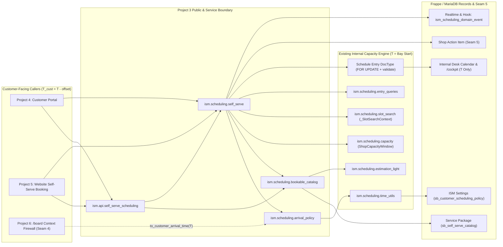
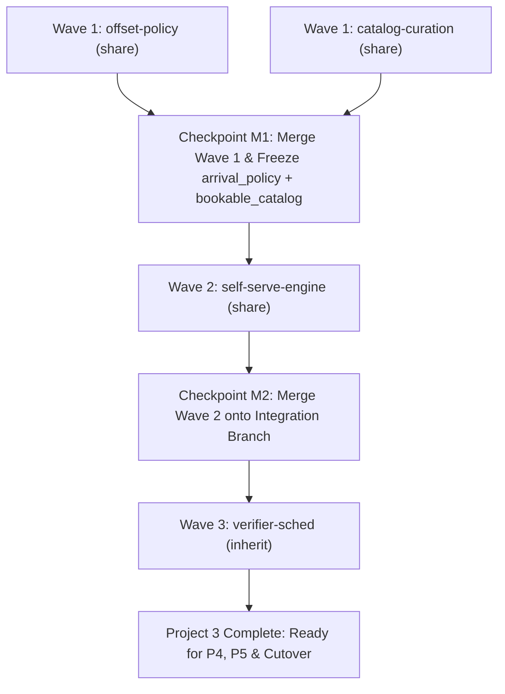

# Project 3: Scheduling Policy, Arrival Offset & Predictable Catalog Foundations

> **Program Track:** Track A — Infrastructure Foundation (Project 3 of 6)  
> **Prerequisites:** None (ships independently in Stage A alongside Projects 1, 2, and Track B Project 6; zero runtime dependency on Projects 1, 2, 4, 5, or 6)  
> **Governing Roadmap:** [ROADMAP.md](./ROADMAP.md) (derived from `customer_portal_and_infra_roadmap.md`)  
> **Recommended Session Entry:** Launch `/swarm` using default model inheritance (omit `model` on `swarm{action:"add"}` so every worker runs on your coordinator's active model). If you invoke `/model-triage` for explicit quota arbitrage, pin active **Gemini 4** tiers only (`gemini-4-hydrogen-*`, `gemini-4-neon-*`, `gemini-4-carbon-*`) using the roster table in Section 4.

---

## 1. Strategic Objective & Locked Decisions

Project 3 establishes the authoritative scheduling policy, time-translation, and predictable service catalog layer that enables **Project 4 (Expanded Customer Portal)** and **Project 5 (Website Self-Serve Booking)** to expose live appointment management and online booking without disturbing internal bay/technician capacity math or leaking shop internals. It also supplies the single source of truth consumed by **Project 6 (Shop OS `/board` Context Firewall)** on Seam 4 so every customer-facing communication quotes the exact same drop-off time.

### Locked Product & Architectural Decisions

The following decisions from `customer_portal_and_infra_roadmap.md` Sections 2, 4, 5, and 8 are **locked** and non-negotiable:

1. **Silent Earlier Arrival Offset (Default 15 Minutes, Applied Uniformly Including Opening Slot):**
   - Shop settings define a configurable earlier arrival offset (`customer_arrival_offset_minutes`, default `15`, allowed range `0..120`).
   - Every capacity slot's **Internal Capacity Start (`T`)** maps deterministically to **Customer Arrival / Drop-Off Time (`T_cust = T - offset`)**.
   - **Critical Opening-Slot Rule:** This offset applies **uniformly to every slot including the opening slot of the day** (e.g., an `08:00` internal bay/tech slot presents to the customer as a `07:45` appointment/drop-off time). The engine must **never** drop, hide, or shift the `08:00` internal capacity slot, and internal bay/technician duration spans remain anchored strictly to `T = 08:00`.
   - **Zero Buffer Disclosure:** Never mention "arrive 15 minutes early", "grace period", "leeway", or "buffer" in any customer-facing string, API response, slot payload, SMS, or email. On customer surfaces, `07:45` is simply their appointment time.
2. **Internal vs. Customer Time Separation (Seam 4):**
   - Internal Desk calendars (`ism/api/scheduling_views.py`), bay/tech capacity checks (`ism/scheduling/capacity.py`, `slot_search.py`), `Schedule Entry` database columns (`scheduled_time`, `completion_time`), and Project 6 `/cockpit` swimlanes **always** operate strictly on Internal Capacity Start `T`.
   - Customer Portal (P4), Website Self-Serve Booking (P5), outbound confirmation SMS/emails, and Project 6 `/board` Context Firewall **always** resolve customer-facing drop-off times through `ism.scheduling.arrival_policy` (`T - offset`).
3. **Predictable Curated Self-Serve Service Catalog:**
   - Only `Service Package` records explicitly opted in (`allow_self_serve_booking = 1`) are exposed for public website self-booking.
   - Packages are filtered by vehicle model and model year (supporting both explicit year bounds and existing Tesla `applicable_generation` text), compute required shop duration and required equipment tags behind the scenes, and render customer-safe title, plain-language summary, and transparent price or estimate range (`Exact Price`, `Starting At`, `Estimate Range`, `Contact for Quote`) with zero leakage of Tesla correction codes, hourly labor rates, supplier costs, or internal part codes.
4. **Self-Serve Rescheduling Guardrails & Hard Lifecycle Locks:**
   - Configurable reschedule cutoff window (`reschedule_cutoff_hours`, default `24` hours measured before the customer's scheduled arrival time `T_cust`) and maximum reschedule count (`max_self_reschedules`, default `2`).
   - Hard lifecycle locks forbid self-rescheduling once the `Schedule Entry` leaves `Scheduled` / `Confirmed` (i.e., `Draft`, `In Progress`, `Completed`, `No Show`, `Cancelled`) **or** once a linked `Repair Order` has reached `Checked In`, `Authorized - In Progress`, `Waiting on Parts`, `Work Completed`, `Billed / Paid`, `Closed / Released`, or `Cancelled` (or has `picked_up_at` / `vehicle_released` set).
5. **Atomic Slot-Swap & Concurrency-Safe Re-Allocation:**
   - Self-serve rescheduling validates bay capacity, equipment tag compatibility, technician pool capacity, break windows, and holidays under canonical row locks (`SELECT ... FOR UPDATE`) inside a database `SAVEPOINT`. The customer's original slot is released **only** when the replacement slot validates and commits cleanly; any conflict or exception rolls back cleanly to the savepoint without losing the original booking.
6. **Provisional Intake Normalization & Decoupled Shop Alerts (Seam 5):**
   - Website self-serve bookings normalize provisional customer contact and vehicle details onto `Schedule Entry` (`provisional_*`, `booking_source`, `waiter_preference`, `booked_packages_json`) so service advisors convert them seamlessly into Repair Orders upon arrival via existing `create_repair_order_from_schedule_entry`.
   - Customer booking and reschedule events emit decoupled `Shop Action Item` records plus a Frappe realtime/hookable domain event (`ism_scheduling_domain_event` / `ism_scheduling_domain_events`) with zero hard dependency on Shop OS DocTypes.
7. **Zero Upfront Booking Deposit & Hosted Frappe Compatibility:**
   - Self-serve bookings carry no upfront deposit requirement (Project 2 handles manual staff-initiated deposits separately). All code remains 100% Frappe Cloud compatible with zero new third-party packages in `ism-frappe/pyproject.toml`.

---

## 2. System Architecture & Codebase Anchor Audit

### Architecture & Dual-Time Data Flow



### Real Codebase Anchor Audit

Every design choice in this plan is grounded in an audit of the live `ism-frappe` codebase:

| Anchor File | Audited Reality & Key Findings | Project 3 Integration Impact |
| :--- | :--- | :--- |
| [time_utils.py](file:///d:/ism/ism-frappe/ism/scheduling/time_utils.py) | `DEFAULT_SHOP_SETTINGS` (lines 12–23) and cached `get_shop_settings()` (lines 193–242) load `ISM Settings` into Redis key `ism:shop_settings` (bypassed in `frappe.flags.in_test`). `hooks.py` (line 148) already binds `ISM Settings.on_update` to `invalidate_shop_settings_cache`. `calculate_working_span()` (lines 334–451) clamps `curr_time < op_start` to `op_start`, skips `[break_start, break_end)` (`12:00`–`12:30`), and handles multi-day spans and holidays. | Extend `DEFAULT_SHOP_SETTINGS` and `get_shop_settings()` to include the 7 new `sb_customer_scheduling_policy` fields so `arrival_policy.py` and `self_serve.py` get automatic Redis caching and instant invalidation with **zero edits to `hooks.py`**. Crucially, `calculate_working_span()` clamps times `< op_start` up to `op_start` — confirming `Schedule Entry.scheduled_time` **must** always store Internal Capacity Start `T` (e.g., `08:00:00`), never `07:45:00`! |
| [capacity.py](file:///d:/ism/ism-frappe/ism/scheduling/capacity.py) | `NON_BLOCKING_ENTRY_STATUSES = ("Cancelled", "Completed", "No Show")` (line 20). `ShopCapacityWindow` (lines 87–372) batch-loads bays, equipment tags, active technicians, leaves, holidays, and blocking entries. `slots_for_date()` (lines 278–366) enforces `eff_end <= op_end` (same-day completion), skips `[bs_td, be_td)`, and prefers single-purpose bays via `resolve_candidate_bays()` (lines 61–84). **Gap found:** `ShopCapacityWindow.__init__` does not yet accept `exclude_entry: Optional[str] = None`. | Add optional backward-compatible `exclude_entry: Optional[str] = None` to `ShopCapacityWindow.__init__` and `_load_blocking_entries()` so self-reschedule slot lookups exclude the customer's own current `Schedule Entry` (enabling overlapping shifts such as `09:00` → `09:30`). |
| [slot_search.py](file:///d:/ism/ism-frappe/ism/scheduling/slot_search.py) | `_SlotSearchContext` (lines 30–413), `search_day_slots()` (lines 416–435), and `find_next_available_slot_batch()` (lines 438–475) evaluate multi-day bay/tech spans via `fetch_blocking_entries()`. **Gap found:** `_SlotSearchContext.__init__` does not yet pass `exclude_entry` through to `fetch_blocking_entries()` (even though `entry_queries.fetch_blocking_entries` already supports `exclude_entry` on line 165!). | Add optional backward-compatible `exclude_entry: Optional[str] = None` to `_SlotSearchContext.__init__`, `search_day_slots`, and `find_next_available_slot_batch`, passing it directly to `fetch_blocking_entries(..., exclude_entry=self.exclude_entry)`. |
| [entry_queries.py](file:///d:/ism/ism-frappe/ism/scheduling/entry_queries.py) | `fetch_blocking_entries()` (lines 157–210) and `find_conflicting_bay_entries()` (lines 213–242) already support `exclude_entry`, `service_bays`, and `build_holiday_checker()`. | Reused directly by `self_serve.py` for row-locked conflict checks during atomic slot-swap and provisional booking commit. Zero modifications needed. |
| [estimation_light.py](file:///d:/ism/ism-frappe/ism/scheduling/estimation_light.py) | Pure-Python zero-`scipy` log-normal `estimate_duration()` and Fenton-Wilkinson `estimate_total_duration()` (lines 128–240). | Reused by `bookable_catalog.py` to compute behind-the-scenes duration for multi-package bookings when explicit `self_serve_duration_minutes` overrides are not set. Zero modifications needed. |
| [ism/api/scheduling.py](file:///d:/ism/ism-frappe/ism/api/scheduling.py) | Contains 27 staff-facing scheduling functions including `allocate_schedule_entry()` (lines 781–1046) and `create_repair_order_from_schedule_entry()` (lines 1141–1248). `_resolve_provisional_vehicle_for_entry()` (lines 1082–1138) matches `provisional_vehicle_info` tokens against a customer's `Repair Vehicle` `model_year`, `model`, `vin`, and `license_plate`. | Keep `ism/api/scheduling.py` **untouched** to avoid conflicts with other tracks. Compose canonical `provisional_vehicle_info` strings in `self_serve.py` (e.g., `"2023 Model 3 (5YJ3E1EA1PF000001)"`) so existing advisor RO conversion works out-of-the-box. Place all new endpoints in `ism/api/self_serve_scheduling.py`. |
| [schedule_entry.json](file:///d:/ism/ism-frappe/ism/ism/doctype/schedule_entry/schedule_entry.json) & [schedule_entry.py](file:///d:/ism/ism-frappe/ism/ism/doctype/schedule_entry/schedule_entry.py) | Already defines `provisional_customer_name`, `provisional_phone`, `provisional_email`, `provisional_vehicle_info`, `items_summary`, `notes`, and `status` (`Draft`, `Scheduled`, `Confirmed`, `In Progress`, `Completed`, `No Show`, `Cancelled`). `ScheduleEntry.validate()` runs `validate_bay_availability()` (locks `Service Bay` `FOR UPDATE` lines 291–298) then `validate_technician_pool()` (locks active technician `Employee` rows `ORDER BY name FOR UPDATE` lines 345–354). `on_update()` automatically syncs linked `Repair Order.schedule_entries` and publishes `ism_calendar_update`. | Extend `Schedule Entry` with `booking_source`, `waiter_preference`, `reschedule_count`, `last_rescheduled_at`, `booked_packages_json`, `provisional_vehicle_model`, `provisional_vehicle_year`, and `provisional_vin_or_plate`. Match `ScheduleEntry`'s canonical lock order (`Schedule Entry` → `Service Bay ORDER BY name` → `Employee ORDER BY name`) inside `self_serve.py` to guarantee deadlock freedom. |
| [service_package.json](file:///d:/ism/ism-frappe/ism/ism/doctype/service_package/service_package.json) & [service_package.py](file:///d:/ism/ism-frappe/ism/ism/doctype/service_package/service_package.py) | Has `package_name`, `applicable_model` (`Model 3`, `Model Y`, `Model S`, `Model X`, `Cybertruck`, `Roadster`, `All Models`), `applicable_generation` (free text like `"Model 3 Jun 2017 - Dec 2023"`), `standard_labor_hours`, `hourly_rate`, `service_rate`, `is_flat_rate`, `is_mobile_capable`, `is_symmetrical`, `items` (`Service Package Item` with `is_default`, `qty`, `rate`, `side`), and internal fields (`correction_code`, `rh_correction_code`, `tesla_manual_url`, `doc_guid`). Currently has **no** equipment tags field (`catalog.py` line 27 notes this explicitly). | Add section `sb_self_serve_catalog` with frozen self-serve curation fields (`allow_self_serve_booking`, `customer_title`, `customer_summary`, `customer_price_display_mode`, `customer_estimate_min`, `customer_estimate_max`, `self_serve_sort_order`) plus optional `applicable_year_from`, `applicable_year_to`, `self_serve_duration_minutes`, and `self_serve_required_tags` (CSV validated against `Equipment Tag` in `ServicePackage.validate()`). |
| [ism_settings.json](file:///d:/ism/ism-frappe/ism/ism/doctype/ism_settings/ism_settings.json) & [seed.py](file:///d:/ism/ism-frappe/ism/setup_tasks/seed.py) | Existing sections: `sb_approval_settings`, `sb_sms_settings`, `sb_scheduling`, `sb_capacity`, `sb_estimation`, `sb_pricing`. `seed.py` distinguishes `_ISM_SETTINGS_FALSY_DEFAULTS` (overwrites `0`/empty) from `_ISM_SETTINGS_NONE_DEFAULTS` (lines 78–81, preserves explicit `0`). | Add disjoint section `sb_customer_scheduling_policy` at the bottom of `ism_settings.json`. Register zero-capable integers (`customer_arrival_offset_minutes`, `reschedule_cutoff_hours`, `max_self_reschedules`, `self_serve_min_lead_time_minutes`, `enable_waiter_preference`) strictly in `_ISM_SETTINGS_NONE_DEFAULTS` so explicit `0` settings survive `bench migrate`. |
| [shop_action_item.json](file:///d:/ism/ism-frappe/ism/ism/doctype/shop_action_item/shop_action_item.json) & [shop_action_item.py](file:///d:/ism/ism-frappe/ism/ism/doctype/shop_action_item/shop_action_item.py) | Already exists in `ism-frappe`! Accepts `category` (`General`, etc.), `priority` (`Low`/`Medium`/`High`/`Critical`), `status` (`Open`), `source` (`Manual`/`Agent`/`Rule Snooze`), `reference_doctype`, `reference_name`, `dedup_key`, `reported_by`, and `details`. | Reuse existing `Shop Action Item` directly via server-side insert (`category="General"`, `source="Agent"`, deterministic `dedup_key`, `reference_doctype="Schedule Entry"`) with **zero edits** to `shop_action_item.{json,py}` (Seam 5 conflict-free). |
| [repair_order.json](file:///d:/ism/ism-frappe/ism/ism/doctype/repair_order/repair_order.json) | Exact `status` options (line 190): `Checked In`, `Draft Estimate`, `Pending Authorization`, `Authorized - In Progress`, `Waiting on Parts`, `Work Completed`, `Billed / Paid`, `Closed / Released`, `Cancelled`. Tracks `picked_up_at` and `vehicle_released`. | Lock self-reschedule on any linked RO whose status is NOT in `("Draft Estimate", "Pending Authorization")` OR where `picked_up_at` is set OR `vehicle_released == 1`. |
| [test_scheduling_capacity.py](file:///d:/ism/ism-frappe/ism/tests/test_scheduling_capacity.py) & [test_ro_scheduling_e2e.py](file:///d:/ism/ism-frappe/ism/tests/test_ro_scheduling_e2e.py) | Inherit `ISMTestCase` (`ism/tests/base.py`) with Golden Layer 1 `SimManifest` (`main_lift`, `alignment`, `hv_diagnostics`, `tire_quick`, `offline` bays; `marcus`, `elena`, `inactive_tech` techs; canonical `Service Package` records). | Follow the exact `ISMTestCase` + `self.get_manifest()` + `_set_ism_settings()` pattern in all 3 new test suites, and run both existing suites as mandatory regression gates. |

---

## 3. Locked Architectural, Security & Cross-Track Invariants

1. **Zero `development.localhost:8000` Contact (Strict Bench Isolation):**
   - Never run `sync-to-wsl.ps1`, `watch-sync.*`, `promote-to-main.ps1`, or raw `wsl` / `docker exec` commands targeting `frappe-bench` or `development.localhost` from any worktree or swarm worker.
   - Execute all Frappe migrations and test suites strictly via `powershell -ExecutionPolicy Bypass -File ism-frappe\scripts\test-in-slot.ps1`.
   - Never run parallel `test-in-slot.ps1` calls inside the same worktree; batch comma-separated `-Module` arguments into a single invocation.
2. **Frappe Cloud & Zero-Dependency Discipline:**
   - Pure Python standard library (`datetime`, `json`, `math`, `re`) + Frappe ORM / `frappe.qb`. Zero additions to `ism-frappe/pyproject.toml`.
3. **Opening-Slot `08:00` → `07:45` & Uniform Offset Invariant:**
   - For default `operating_hours_start = 08:00:00` and `customer_arrival_offset_minutes = 15`:
     - Internal capacity engine generates and stores `08:00:00` (and `08:30:00`, ..., `11:30:00`, `12:30:00`, ...).
     - Customer-facing slot payloads and notifications render `07:45` / `7:45 AM` (and `08:15`, ..., `11:15`, `12:15`, ...).
     - `to_internal_slot_start(to_customer_arrival_time(t)) == normalize_time(t)` holds bijectively for every valid operating-hours slot `t`.
     - Setting `customer_arrival_offset_minutes = 0` acts as a clean identity transform (`08:00` → `08:00`).
     - No customer-facing payload or string ever includes words like `"buffer"`, `"leeway"`, `"early"`, `"grace"`, or raw `internal_start_time` / `offset_minutes`.
4. **Strict Separation of Internal vs. Customer Scheduling Truth (Seam 4):**
   - `Schedule Entry.scheduled_time` and `completion_time` **always** persist Internal Capacity Start `T` and internal working-span completion time.
   - Existing `ism/api/scheduling.py`, `ism/api/scheduling_views.py`, `ism/api/agent_scheduling.py`, and Project 6 `/cockpit` swimlanes remain 100% anchored to `T`.
   - Public self-serve APIs (`get_self_serve_slots`) accept and return **only** customer arrival times (`customer_arrival_time` / `customer_arrival_hhmm` / `display_time`) and strip `available_bay_ids`, `available_technician_ids`, `service_bay`, `bottleneck`, `available_bays`, `available_technicians`, `conflict_entry`, and raw internal `start_time`.
5. **Public Guest Security & Zero Unauthenticated Mutation Surface:**
   - Only read-only, zero-PII catalog and sanitized slot endpoints (`get_bookable_packages`, `get_self_serve_slots`) carry `@frappe.whitelist(allow_guest=True)`.
   - `get_self_serve_slots` enforces `package_ids` validation for `Guest` callers (rejecting arbitrary client-supplied `duration_minutes` or `required_tags` probing) and caps `days_ahead` to `min(requested, self_serve_horizon_days, 60)`.
   - Mutation endpoints in `ism/api/self_serve_scheduling.py` (`execute_self_serve_reschedule`, `submit_provisional_booking`) and appointment-specific reads (`get_reschedule_policy_and_slots`) require authenticated Frappe permissions (`allow_guest=False`). Projects 4 and 5 invoke the underlying `ism.scheduling.self_serve.*` Python services server-side **only after** verifying Project 1's signed persistent session cookie / Telnyx SMS OTP challenge and customer ownership.
   - Provisional website bookings never leak or return matched internal `Customer` / `Repair Vehicle` master IDs to unauthenticated guests.
6. **Deadlock-Free Atomic Slot-Swap & Concurrency Safety:**
   - Every mutating self-serve operation acquires row locks in the strict canonical order:
     1. Target `Schedule Entry` (`FOR UPDATE`, on reschedule only)
     2. Active candidate `Service Bay` rows (`WHERE is_active = 1 ORDER BY name ASC FOR UPDATE`)
     3. Active technician `Employee` rows (`WHERE designation = %s AND status = 'Active' ORDER BY name ASC FOR UPDATE`, when `enable_technician_capacity == 1`)
   - Reschedule mutations execute inside an explicit `frappe.db.savepoint(...)`. If new bay/tech validation, break check, holiday check, or `ScheduleEntry.save()` fails, the savepoint rolls back so the original slot remains intact and never released prematurely.
7. **Disjoint Cross-Project Namespaces (Seam 1 & Seam 5):**
   - `ISM Settings` touches **only** `sb_customer_scheduling_policy` (never touching P1 `sb_sms_settings` / `sb_otp_and_sessions`, P2 `sb_square_payments`, P4 `sb_customer_portal`, P5 `sb_self_serve_booking`, or P6 `sb_media_storage` / `sb_board_ai` / `sb_parts_pricing`).
   - Seam 5 notifications write to existing `Shop Action Item` and emit `ism_scheduling_domain_event` / optional `frappe.get_hooks("ism_scheduling_domain_events")` callbacks inside an error-isolated guard; Project 3 never imports any Shop OS, Portal, Payments, or Comms DocType as a hard dependency.

---

## 4. Swarm Plugin Execution Blueprint

### Hard Guardrails
- **Workspace concurrency ceiling:** Maximum `3` concurrent `workspace:"share"` authors per wave (Project 3 uses 2 authors in Wave 1 and 1 author in Wave 2 — comfortably inside `slot-1`..`slot-5`).
- **Strict disjoint file ownership:** No two workers in the same wave edit the same file.
- **Model selection:** Default `/swarm` behavior omits `model` on `swarm{action:"add"}` so workers inherit the coordinator's model. When executing with `/model-triage` active, use **active Gemini 4 tiers ONLY** (`gemini-4-hydrogen-*`, `gemini-4-neon-*`, `gemini-4-carbon-*`); never use `gemini-4-argon-*`, `Gemini 3.8 Flash`, `Claude`, `GPT-OSS`, `Neon (Low)`, `Hydrogen (High/XHigh)`, or leaf `Orchestrator`.
- **Cross-family verification (when `/model-triage` is active):** `hydrogen-*` authors verified by `gemini-4-neon-high` or `gemini-4-carbon-high`; `neon-*` authors verified by `gemini-4-carbon-high`.
- **In-place escalation:** If any worker stalls or fails verification twice, wait until its state is `waiting` and upgrade via `swarm{action:"model", name, model}` — never `kill` + `add` just to change models.
- **Land work before `kill`:** Merge every `workspace:"share"` worker branch into the integration branch at each Merge Checkpoint (`M1`, `M2`) before killing workers; never delete unmerged work.

### Coordinator Startup Protocol
1. Confirm clean integration branch off `main` (never run slot tests on canonical `development.localhost`).
2. *(Only if `/model-triage` is active)* Run `swarm{action:"models", all:true}` once to verify active Gemini 4 IDs and quotas.
3. Name the swarm:
   ```text
   swarm{action:"title", title:"Scheduling policy, arrival offset and catalog"}
   ```
4. Spawn `monitor` (if `swarm_monitor` skill is available) and **Wave 1** (`offset-policy` and `catalog-curation`, both `workspace:"share"`).
5. Write the Swarm UI Overview plan file to `<appData>/brain/<conversation-id>/.system_generated/swarm/plan.json` (deliverable workers only; `monitor` stays out of `plan.json`):
   ```json
   {
     "goal": {
       "title": "Scheduling offset policy and predictable catalog",
       "line": "Add silent arrival offset, curated packages, and atomic self-serve scheduling."
     },
     "tasks": {
       "offset-policy": "ISM Settings policy and arrival_policy time conversions",
       "catalog-curation": "Service Package self-serve fields and bookable_catalog",
       "self-serve-engine": "Schedule Entry extensions, atomic swap, and self-serve API",
       "verifier-sched": "Batched slot regression, concurrency, and zero-leak gate"
     },
     "threads": [
       {
         "id": "t-foundations",
         "title": "Offset policy & predictable catalog",
         "goal": "Freeze arrival-time conversions and public package catalog contracts.",
         "tasks": ["offset-policy", "catalog-curation"]
       },
       {
         "id": "t-self-serve",
         "title": "Self-serve reschedule & provisional booking",
         "goal": "Ship row-locked slot swaps, lifecycle locks, and Seam 5 events.",
         "tasks": ["self-serve-engine"]
       },
       {
         "id": "t-verify",
         "title": "Capacity parity & regression verification",
         "goal": "Prove all new and legacy scheduling suites pass cleanly in-slot.",
         "tasks": ["verifier-sched"]
       }
     ]
   }
   ```
6. At **Checkpoint `M1`**, merge `offset-policy` and `catalog-curation` branches onto the integration branch, verify clean `git status` and frozen contracts in `arrival_policy.py` and `bookable_catalog.py`, then launch **Wave 2** (`self-serve-engine`).
7. At **Checkpoint `M2`**, merge `self-serve-engine` onto the integration branch, then launch **Wave 3** (`verifier-sched`, `workspace:"inherit"`).
8. After `verifier-sched` posts `@coordinator [done]` with all KPIs green, kill temporary workers (`offset-policy`, `catalog-curation`, `self-serve-engine`, `verifier-sched`) and report final readiness to the user.

### Worker Roster & Pinning Table

> **Default vs. `/model-triage` Note:** By default, omit `model` on `swarm{action:"add"}` so every worker inherits the coordinator's model. Use the **Optional `/model-triage` Model ID** column only when explicit Gemini 4 quota arbitrage is requested. All worker names conform strictly to `^[a-z0-9][a-z0-9_-]{0,23}$`.

| Worker Name | Wave | Role & Strict File Ownership | Workspace | Optional `/model-triage` Model ID | Depends On | Why This Tier |
| :--- | :---: | :--- | :---: | :--- | :---: | :--- |
| `offset-policy` | 1 | `ism_settings.json` (`sb_customer_scheduling_policy`), `seed.py`, `time_utils.py`, `arrival_policy.py`, `test_arrival_offset_policy.py` | `share` | `gemini-4-neon-medium` | — | Subtle opening-slot `08:00 -> 07:45`, midnight bounds, cache invalidation, and zero-value seed edge cases |
| `catalog-curation` | 1 | `service_package.{json,py,js}`, `bookable_catalog.py`, `test_bookable_catalog.py` | `share` | `gemini-4-hydrogen-medium` | — | Self-contained DocType extension, model/year filtering, price formatting, and Fenton-Wilkinson duration wrapper |
| `self-serve-engine` | 2 | `schedule_entry.{json,py,js}`, `capacity.py` (`exclude_entry`), `slot_search.py` (`exclude_entry`), `self_serve.py`, `api/self_serve_scheduling.py`, `test_self_serve_scheduling.py` | `share` | `gemini-4-neon-high` | `M1` | Concurrency-critical `FOR UPDATE` + `SAVEPOINT` atomic slot swap, lifecycle/cutoff guards, guest security, Seam 5 events |
| `verifier-sched` | 3 | Read-only cross-family verification: batched `test-in-slot.ps1` (new + legacy suites), `ruff check`, opening-slot/break/holiday/race audit, zero-leak & lock-order audit | `inherit` | `gemini-4-carbon-high` | `M2` | Cross-family verifier for both `neon-*` and `hydrogen-*` authors + strongest PowerShell/WSL reliability for `test-in-slot.ps1` |
| `monitor` *(optional)* | 1–3 | Standard `swarm_monitor` stall watcher (only when running unattended) | `inherit` | `gemini-4-hydrogen-low` | — | Lightweight timer-based stall detection |

### Wave Dependency Graph



### Self-Contained Per-Worker Brief Templates

#### Brief Template — `offset-policy` (Wave 1, `workspace:"share"`)
> You own ONLY these files:
> - `[MODIFY]` `ism-frappe/ism/ism/doctype/ism_settings/ism_settings.json`
> - `[MODIFY]` `ism-frappe/ism/setup_tasks/seed.py`
> - `[MODIFY]` `ism-frappe/ism/scheduling/time_utils.py`
> - `[NEW]` `ism-frappe/ism/scheduling/arrival_policy.py`
> - `[NEW]` `ism-frappe/ism/tests/test_arrival_offset_policy.py`
>
> **Forbidden:** Do NOT edit `service_package.*`, `schedule_entry.*`, `capacity.py`, `slot_search.py`, `hooks.py`, `ism/api/scheduling.py`, or any `ISM Settings` section outside `sb_customer_scheduling_policy`. Never touch `development.localhost:8000` or run `sync-to-wsl.ps1`.
>
> **Requirements:** Implement Section 5 (Wave 1A) of `todo_snippets/roadmap/plan_p3_scheduling_offset_catalog.md`: add `sb_customer_scheduling_policy` to `ISM Settings`, seed zero-capable numeric defaults via `_ISM_SETTINGS_NONE_DEFAULTS` in `seed.py`, extend `DEFAULT_SHOP_SETTINGS` & `get_shop_settings()` in `time_utils.py`, and implement `arrival_policy.py` with the exact exported signatures and opening-slot `08:00 -> 07:45` uniform offset invariant (zero buffer/leeway wording, public slot sanitizer stripping bay/tech/internal fields).
>
> **Verification & Done:** Run `ruff check` on all owned Python files and run `powershell -ExecutionPolicy Bypass -File ism-frappe\scripts\test-in-slot.ps1 -Module "ism.tests.test_arrival_offset_policy,ism.ism.doctype.ism_settings.test_ism_settings"`. Commit on your share branch and post `@coordinator [done]` with test results and exact exported signatures.

#### Brief Template — `catalog-curation` (Wave 1, `workspace:"share"`)
> You own ONLY these files:
> - `[MODIFY]` `ism-frappe/ism/ism/doctype/service_package/service_package.json`
> - `[MODIFY]` `ism-frappe/ism/ism/doctype/service_package/service_package.py`
> - `[MODIFY]` `ism-frappe/ism/ism/doctype/service_package/service_package.js`
> - `[NEW]` `ism-frappe/ism/scheduling/bookable_catalog.py`
> - `[NEW]` `ism-frappe/ism/tests/test_bookable_catalog.py`
>
> **Forbidden:** Do NOT edit `ism_settings.json`, `seed.py`, `time_utils.py`, `schedule_entry.*`, `capacity.py`, `slot_search.py`, or `ism/api/scheduling.py`. Never touch `development.localhost:8000`.
>
> **Requirements:** Implement Section 5 (Wave 1B) of `todo_snippets/roadmap/plan_p3_scheduling_offset_catalog.md`: add section `sb_self_serve_catalog` to `Service Package`, enforce field validation in `ServicePackage.validate()` and form UX toggles in `service_package.js`, and implement `bookable_catalog.py` (`list_bookable_packages`, `compute_packages_booking_requirements`, model + year filtering with `applicable_generation` fallback, customer-safe price display formatting, and Fenton-Wilkinson duration estimation via `ism.scheduling.estimation_light`). Ensure zero leakage of `correction_code`, `hourly_rate`, `tesla_manual_url`, `doc_guid`, or internal part codes/costs.
>
> **Verification & Done:** Run `ruff check` on all owned Python files and run `powershell -ExecutionPolicy Bypass -File ism-frappe\scripts\test-in-slot.ps1 -Module "ism.tests.test_bookable_catalog"`. Commit on your share branch and post `@coordinator [done]` with test results and exact exported signatures.

#### Brief Template — `self-serve-engine` (Wave 2, `workspace:"share"`, after `M1`)
> Wave 1 (`offset-policy` `#<seq1>`, `catalog-curation` `#<seq2>`) is merged on your base branch. You own ONLY these files:
> - `[MODIFY]` `ism-frappe/ism/ism/doctype/schedule_entry/schedule_entry.json`
> - `[MODIFY]` `ism-frappe/ism/ism/doctype/schedule_entry/schedule_entry.py`
> - `[MODIFY]` `ism-frappe/ism/ism/doctype/schedule_entry/schedule_entry.js`
> - `[MODIFY]` `ism-frappe/ism/scheduling/capacity.py` (surgical `exclude_entry: Optional[str] = None` support only)
> - `[MODIFY]` `ism-frappe/ism/scheduling/slot_search.py` (surgical `exclude_entry: Optional[str] = None` support only)
> - `[NEW]` `ism-frappe/ism/scheduling/self_serve.py`
> - `[NEW]` `ism-frappe/ism/api/self_serve_scheduling.py`
> - `[NEW]` `ism-frappe/ism/tests/test_self_serve_scheduling.py`
>
> **Forbidden:** Do NOT edit `ism/api/scheduling.py`, `ism/api/scheduling_views.py`, `ism_settings.json`, `service_package.*`, `shop_action_item.*`, or `hooks.py`. Never touch `development.localhost:8000`.
>
> **Requirements:** Implement Section 5 (Wave 2) of `todo_snippets/roadmap/plan_p3_scheduling_offset_catalog.md`: extend `Schedule Entry`, wire optional `exclude_entry` through `ShopCapacityWindow` and `_SlotSearchContext`, implement `self_serve.py` (reschedule eligibility, hard RO + SE lifecycle locks, cutoff window vs. customer arrival time, `FOR UPDATE` + `SAVEPOINT` atomic slot swap matching `ScheduleEntry` lock order, provisional intake normalization, provisional booking commit, and Seam 5 `Shop Action Item` + `ism_scheduling_domain_event` / hook emission), and implement `ism/api/self_serve_scheduling.py` with strict guest-vs-authenticated permission boundaries.
>
> **Verification & Done:** Run `ruff check` on all owned Python files and run `powershell -ExecutionPolicy Bypass -File ism-frappe\scripts\test-in-slot.ps1 -Module "ism.tests.test_self_serve_scheduling,ism.tests.test_scheduling_capacity,ism.tests.test_ro_scheduling_e2e"`. Commit on your share branch and post `@coordinator [done]` with test results and exported contracts.

#### Brief Template — `verifier-sched` (Wave 3, `workspace:"inherit"`, after `M2`)
> Wave 2 (`self-serve-engine` `#<seq3>`) is merged onto the integration branch. You are the read-only cross-family verification gate. Do NOT modify application code; if you find defects, post exact file:line findings to the owning author (`@offset-policy`, `@catalog-curation`, or `@self-serve-engine`) or `@coordinator`.
>
> **Checklist:**
> 1. Run the full batched `test-in-slot.ps1` acceptance command from Section 6 of `todo_snippets/roadmap/plan_p3_scheduling_offset_catalog.md` (all 3 new suites + 5 regression suites in ONE command).
> 2. Run `ruff check` across all new and modified Python files.
> 3. Audit code against Section 3 invariants: opening-slot `08:00 -> 07:45` parity, zero buffer wording in customer strings, zero internal field leaks in guest endpoints, canonical `FOR UPDATE` lock ordering + `SAVEPOINT` rollback on swap failure, zero modifications to `ism/api/scheduling.py` or non-P3 `ISM Settings` sections, and zero contact with `development.localhost:8000`.
>
> Post `@coordinator [done]` with the exact command outputs and KPI pass/fail summary.

---

## 5. Detailed Wave-by-Wave Implementation Specification

### Wave 1A — Arrival Offset & Dual-Time Policy Contract (`offset-policy`)

#### 1. `[MODIFY] ism-frappe/ism/ism/doctype/ism_settings/ism_settings.json`
Append one strictly disjoint section **`sb_customer_scheduling_policy`** after `sb_pricing` (zero collision with P1, P2, P4, P5, or P6 sections):

| Fieldname | Fieldtype | Default | Options / Constraints | Purpose |
| :--- | :--- | :--- | :--- | :--- |
| `sb_customer_scheduling_policy` | `Section Break` | — | Label: `Customer Scheduling & Self-Serve Policy` | Disjoint Project 3 settings section (Seam 1) |
| `customer_arrival_offset_minutes` | `Int` | `15` | Range `0..120` | Silent earlier arrival offset applied uniformly to every slot including opening slot (`08:00` → `07:45`); `0` disables offset |
| `reschedule_cutoff_hours` | `Int` | `24` | `>= 0` | Minimum hours before customer arrival time (`T_cust`) required to allow self-serve rescheduling |
| `max_self_reschedules` | `Int` | `2` | `>= 0` | Max customer self-reschedules permitted per `Schedule Entry` (`0` disables self-rescheduling) |
| `cb_customer_scheduling_policy` | `Column Break` | — | — | Two-column Desk layout |
| `self_serve_default_entry_type` | `Link` | `Diagnostic` | Options: `Schedule Entry Type` | Default entry type for website provisional bookings (must have `requires_repair_order = 0`) |
| `self_serve_min_lead_time_minutes` | `Int` | `120` | `>= 0` | Minimum lead time in minutes from current shop time before target customer arrival time |
| `self_serve_horizon_days` | `Int` | `30` | `1..180` | Max days ahead exposed for self-serve booking and rescheduling |
| `enable_waiter_preference` | `Check` | `1` | `0` or `1` | Enables collecting `Drop-Off` vs. `Waiter` preference during self-serve booking |

#### 2. `[MODIFY] ism-frappe/ism/setup_tasks/seed.py`
- Add to `_ISM_SETTINGS_NONE_DEFAULTS` (preserving explicit `0` overrides across migrations):
  - `("customer_arrival_offset_minutes", 15)`
  - `("reschedule_cutoff_hours", 24)`
  - `("max_self_reschedules", 2)`
  - `("self_serve_min_lead_time_minutes", 120)`
  - `("enable_waiter_preference", 1)`
- Add to `_ISM_SETTINGS_FALSY_DEFAULTS`:
  - `("self_serve_default_entry_type", "Diagnostic")`
  - `("self_serve_horizon_days", 30)`

#### 3. `[MODIFY] ism-frappe/ism/scheduling/time_utils.py`
- Extend `DEFAULT_SHOP_SETTINGS` with all 7 new keys and defaults above.
- Extend `get_shop_settings()` to hydrate those 7 keys from `ISM Settings` cleanly:
  - Use `getattr(doc, fieldname, None) is not None` for zero-capable integer/check fields (`customer_arrival_offset_minutes`, `reschedule_cutoff_hours`, `max_self_reschedules`, `self_serve_min_lead_time_minutes`, `enable_waiter_preference`), clamping negative values safely to `0` (`customer_arrival_offset_minutes` capped at `120`).
  - Keep existing Redis key `SHOP_SETTINGS_CACHE_KEY` (`ism:shop_settings`) so existing `hooks.py` `ISM Settings.on_update` invalidation covers the new policy fields automatically.

#### 4. `[NEW] ism-frappe/ism/scheduling/arrival_policy.py`
Single source of truth for **Seam 4** dual-time translation across P3, P4, P5, SMS/Email notifications, and P6 `/board` Context Firewall:

```python
DEFAULT_ARRIVAL_OFFSET_MINUTES: int = 15
MAX_ARRIVAL_OFFSET_MINUTES: int = 120

def get_arrival_offset_minutes() -> int:
    """Return validated non-negative earlier arrival offset in minutes from cached ISM Settings (default 15)."""

def to_customer_arrival_time(
    internal_start: Union[str, time, timedelta],
    offset_minutes: Optional[int] = None,
) -> str:
    """Convert Internal Capacity Start (T) to Customer Arrival Time (T - offset) as 'HH:MM:SS'.
    Applies uniformly to every slot including opening slot (e.g. '08:00:00' -> '07:45:00').
    Raises frappe.ValidationError if offset is out of [0, 120] or T - offset crosses below 00:00:00."""

def to_internal_slot_start(
    customer_arrival: Union[str, time, timedelta],
    offset_minutes: Optional[int] = None,
) -> str:
    """Convert Customer Arrival Time (T_cust) back to Internal Capacity Start (T_cust + offset) as 'HH:MM:SS'.
    Exact inverse of to_customer_arrival_time (e.g. '07:45:00' -> '08:00:00').
    Raises frappe.ValidationError if T_cust + offset >= 24:00:00."""

def to_customer_arrival_datetime(
    scheduled_date: Union[str, date, datetime],
    internal_start: Union[str, time, timedelta],
    offset_minutes: Optional[int] = None,
) -> datetime:
    """Return date-aware customer arrival datetime = combine(scheduled_date, internal_start) - timedelta(minutes=offset)."""

def to_internal_slot_datetime(
    customer_date: Union[str, date, datetime],
    customer_arrival: Union[str, time, timedelta],
    offset_minutes: Optional[int] = None,
) -> datetime:
    """Return date-aware internal capacity start datetime = combine(customer_date, customer_arrival) + timedelta(minutes=offset)."""

def format_customer_arrival_time(
    internal_start: Union[str, time, timedelta],
    offset_minutes: Optional[int] = None,
    *,
    use_12h: bool = True,
) -> str:
    """Format customer arrival time as clean clock string ('7:45 AM' or '07:45') with ZERO buffer/leeway text."""

def format_customer_appointment_display(
    scheduled_date: Union[str, date, datetime],
    internal_start: Union[str, time, timedelta],
    offset_minutes: Optional[int] = None,
    *,
    use_12h: bool = True,
) -> Dict[str, Any]:
    """Return customer-safe appointment time dict:
    {
      'appointment_date': 'YYYY-MM-DD',
      'customer_arrival_time': 'HH:MM:SS',
      'customer_arrival_hhmm': 'HH:MM',
      'display_time': '7:45 AM',
      'display_date': 'Mon, Nov 23, 2026',
      'display_datetime': 'Mon, Nov 23, 2026 at 7:45 AM',
    }
    Strictly omits internal_start_time and offset_minutes."""

def to_public_slot_projection(
    scheduled_date: Union[str, date, datetime],
    internal_slot: Dict[str, Any],
    offset_minutes: Optional[int] = None,
    *,
    use_12h: bool = True,
) -> Dict[str, Any]:
    """Project an internal capacity slot dict into a strictly sanitized public customer slot dict:
    {
      'date': 'YYYY-MM-DD',
      'customer_arrival_time': 'HH:MM:SS',
      'customer_arrival_hhmm': 'HH:MM',
      'display_time': '7:45 AM',
    }
    Physically strips start_time, available_bays, available_bay_ids, available_technicians,
    available_technician_ids, service_bay, bottleneck, conflict_entry, and effective_capacity."""
```

**Boundary Rules:**
- Reject booleans (`isinstance(offset_minutes, bool)`) and negative or `> 120` offsets with `frappe.ValidationError`.
- Opening slot (`08:00:00` with offset `15`) → `"07:45:00"`, `"07:45"`, `"7:45 AM"`; inverse → `"08:00:00"`.
- Post-lunch slot (`12:30:00` with offset `15`) → `"12:15:00"`, `"12:15"`, `"12:15 PM"`; inverse → `"12:30:00"`.
- Offset `0` → exact identity (`"08:00:00"` → `"08:00:00"`, `"8:00 AM"`).
- `12:00` / `00:00` 12-hour formatting handled accurately (`12:00 PM`, `12:15 PM`, `12:30 AM` without platform-specific `%-I` Windows incompatibilities — use integer arithmetic `hour % 12 or 12`).

#### 5. `[NEW] ism-frappe/ism/tests/test_arrival_offset_policy.py`
`ISMTestCase` unit and settings-integration tests covering:
- Opening slot `08:00` → `07:45` and exact round-trip inverse `07:45` → `08:00`.
- Post-lunch `12:30` → `12:15`, noon formatting (`12:00 PM`, `12:15 PM`), offset `0` identity, custom offset `20` and `30`, invalid negative / boolean / `>120` offset errors, midnight underflow/overflow `ValidationError`.
- `seed.setup_default_ism_settings()` preserving an explicit `customer_arrival_offset_minutes = 0` and `max_self_reschedules = 0` across re-seeding.
- `to_public_slot_projection()` asserting exact allowlisted keys and zero leakage of bay IDs, tech IDs, internal `start_time`, or `"buffer"` / `"leeway"` / `"early"` words.

---

### Wave 1B — Predictable Service Package Catalog Curation (`catalog-curation`)

#### 1. `[MODIFY] ism-frappe/ism/ism/doctype/service_package/service_package.json`
Add section **`sb_self_serve_catalog`** (placed before `sb_items`):

| Fieldname | Fieldtype | Default | Options / Visibility | Purpose |
| :--- | :--- | :--- | :--- | :--- |
| `sb_self_serve_catalog` | `Section Break` | — | Label: `Self-Serve Customer Booking Catalog` | Predictable online booking controls |
| `allow_self_serve_booking` | `Check` | `0` | `in_list_view: 1`, `in_standard_filter: 1`, `search_index: 1` | Explicit opt-in flag; only checked packages appear on public booking page |
| `self_serve_sort_order` | `Int` | `100` | `depends_on: eval:doc.allow_self_serve_booking` | Display sort priority (ascending) |
| `customer_title` | `Data` | — | `depends_on: eval:doc.allow_self_serve_booking` | Plain-language customer service name (falls back to `package_name`) |
| `customer_summary` | `Small Text` | — | `depends_on: eval:doc.allow_self_serve_booking` | Plain-language summary of what is included |
| `applicable_year_from` | `Int` | `0` | `depends_on: eval:doc.allow_self_serve_booking` | Optional inclusive lower model-year bound (`0` = fallback to `applicable_generation` or any year) |
| `applicable_year_to` | `Int` | `0` | `depends_on: eval:doc.allow_self_serve_booking` | Optional inclusive upper model-year bound (`0` = open upper bound) |
| `cb_self_serve_pricing` | `Column Break` | — | — | Two-column Desk layout |
| `customer_price_display_mode` | `Select` | `Exact Price` | Options: `Exact Price\nStarting At\nEstimate Range\nContact for Quote`; `depends_on: eval:doc.allow_self_serve_booking` | Controls transparent price presentation |
| `customer_estimate_min` | `Currency` | `0` | `depends_on: eval:doc.allow_self_serve_booking && in_list(['Exact Price','Starting At','Estimate Range'], doc.customer_price_display_mode)` | Fixed price, starting-at floor, or range minimum (CAD) |
| `customer_estimate_max` | `Currency` | `0` | `depends_on: eval:doc.allow_self_serve_booking && doc.customer_price_display_mode == 'Estimate Range'` | Range ceiling (CAD) |
| `self_serve_duration_minutes` | `Int` | `0` | `depends_on: eval:doc.allow_self_serve_booking` | Optional fixed predictable duration override in minutes (`0` = compute from `standard_labor_hours` via `estimation_light`) |
| `self_serve_required_tags` | `Data` | — | `depends_on: eval:doc.allow_self_serve_booking` | Optional CSV of `Equipment Tag` names (e.g., `Lift, Alignment Rack`) for bay capacity gating |

#### 2. `[MODIFY] ism-frappe/ism/ism/doctype/service_package/service_package.py` & `service_package.js`
- **`ServicePackage.validate()`:**
  - Trim `customer_title`, `customer_summary`, and `self_serve_required_tags`.
  - Validate `customer_estimate_min >= 0`, `customer_estimate_max >= 0`, `self_serve_duration_minutes >= 0`.
  - When `allow_self_serve_booking == 1`:
    - If `customer_price_display_mode == "Estimate Range"` and both `customer_estimate_min` and `customer_estimate_max` are positive, enforce `customer_estimate_max >= customer_estimate_min`.
    - If `applicable_year_from` is non-zero, enforce `2008 <= applicable_year_from <= 2100`; same for `applicable_year_to`; if both non-zero, enforce `applicable_year_from <= applicable_year_to`.
    - If `self_serve_required_tags` is set and `Equipment Tag` DocType exists, parse via `parse_required_tags()`, verify every tag exists in `Equipment Tag`, and normalize to canonical `", ".join(...)`.
- **`service_package.js`:**
  - Add clean description guidance when `allow_self_serve_booking` or `customer_price_display_mode` changes (keeping existing Tesla import and flat-rate handlers untouched).

#### 3. `[NEW] ism-frappe/ism/scheduling/bookable_catalog.py`
Public predictable catalog query and server-side duration/equipment requirement calculator:

```python
ALLOWED_PRICE_DISPLAY_MODES: Tuple[str, ...] = (
    "Exact Price",
    "Starting At",
    "Estimate Range",
    "Contact for Quote",
)
MAX_PACKAGES_PER_BOOKING: int = 10

def normalize_vehicle_model(vehicle_model: Optional[str]) -> Optional[str]:
    """Normalize vehicle model inputs (e.g. 'tesla model 3' -> 'Model 3', 'model y' -> 'Model Y')."""

def parse_generation_year_bounds(applicable_generation: Optional[str]) -> Tuple[Optional[int], Optional[int]]:
    """Extract (min_year, max_year) from Tesla generation strings like 'Model 3 Jun 2017 - Dec 2023'
    or 'Model Y Jan 2020 - Present' (open upper bound -> None)."""

def is_package_eligible_for_vehicle(
    pkg: Dict[str, Any],
    vehicle_model: Optional[str] = None,
    vehicle_year: Optional[int] = None,
) -> bool:
    """Return True iff pkg matches vehicle_model (exact or 'All Models'/blank) and vehicle_year
    (explicit applicable_year_from/to if set, else parsed applicable_generation bounds)."""

def format_package_price_display(
    pkg: Dict[str, Any],
    *,
    items_subtotal: float = 0.0,
    default_labor_rate: float = 140.0,
    currency: str = "CAD",
) -> Dict[str, Any]:
    """Compute customer-facing price display dict:
    {'price_display_mode', 'currency', 'price_min', 'price_max', 'price_display_label'}.
    Falls back to package service_rate (or FRT * rate) + default parts subtotal when explicit estimate_min is 0,
    and degrades cleanly to 'Contact for Quote' if no price can be computed."""

def list_bookable_packages(
    *,
    vehicle_model: Optional[str] = None,
    vehicle_year: Optional[int] = None,
    search: Optional[str] = None,
) -> List[Dict[str, Any]]:
    """Return sorted customer-safe catalog cards for Service Packages with allow_self_serve_booking = 1.
    Each item contains ONLY:
    {
      'package_id', 'title', 'summary', 'applicable_model',
      'is_mobile_capable', 'sort_order',
      'price_display_mode', 'currency', 'price_min', 'price_max', 'price_display_label',
    }
    Strictly omits correction_code, rh_correction_code, hourly_rate, tesla_manual_url,
    doc_guid, internal item_codes, supplier costs, and internal duration estimation parameters."""

def compute_packages_booking_requirements(
    package_ids: Union[str, Sequence[str]],
    *,
    vehicle_model: Optional[str] = None,
    vehicle_year: Optional[int] = None,
) -> Dict[str, Any]:
    """Server-side resolver validating all package_ids exist, have allow_self_serve_booking = 1,
    and match vehicle_model/vehicle_year (capped at MAX_PACKAGES_PER_BOOKING).
    Computes:
    - duration_minutes (int >= 15): deterministic sum of self_serve_duration_minutes overrides PLUS
      Fenton-Wilkinson estimate_total_duration() over FRT-derived packages + buffer_padding_minutes.
    - required_tags (List[str]): deduplicated sorted union of self_serve_required_tags across packages.
    - items_summary (str): clean bullet list for Schedule Entry.items_summary.
    - booked_packages_snapshot (List[Dict[str, Any]]): JSON-serializable customer snapshot for
      Schedule Entry.booked_packages_json.
    - packages (List[Dict[str, Any]]): public catalog cards."""
```

#### 4. `[NEW] ism-frappe/ism/tests/test_bookable_catalog.py`
`ISMTestCase` suite covering:
- Non-bookable (`allow_self_serve_booking = 0`) packages never returned by `list_bookable_packages()` and rejected by `compute_packages_booking_requirements()`.
- Model filtering (`Model 3` includes `Model 3` + `All Models`, excludes `Model Y`; case-insensitive `"tesla model 3"` normalization).
- Year filtering via explicit `applicable_year_from`/`applicable_year_to` AND fallback parsing of `"Model 3 Jun 2017 - Dec 2023"` and `"Model Y Jan 2020 - Present"`.
- All 4 `customer_price_display_mode` formats (`Exact Price`, `Starting At`, `Estimate Range`, `Contact for Quote`), fallback pricing from `service_rate` + default parts, and validation rejection of `estimate_max < estimate_min`.
- Multi-package duration calculation (deterministic override vs. Fenton-Wilkinson log-normal summation) and union of `self_serve_required_tags` + validation rejection of unknown Equipment Tags.
- Zero internal field leakage assertion on every returned catalog card.

---

### Merge Checkpoint `M1`
Coordinator merges `offset-policy` and `catalog-curation` onto the integration branch, confirms clean `git status`, and verifies that `ism/scheduling/arrival_policy.py` and `ism/scheduling/bookable_catalog.py` match the exact frozen contracts before spawning Wave 2.

---

### Wave 2 — Self-Serve Reschedule, Provisional Booking Engine & API (`self-serve-engine`)

#### 1. `[MODIFY] ism-frappe/ism/ism/doctype/schedule_entry/schedule_entry.json`, `schedule_entry.py`, & `schedule_entry.js`
Add section **`section_break_self_serve`** (placed before `section_break_notes`):

| Fieldname | Fieldtype | Default | Options / Constraints | Purpose |
| :--- | :--- | :--- | :--- | :--- |
| `section_break_self_serve` | `Section Break` | — | Label: `Booking Origin & Self-Serve Metadata` | Self-serve booking & reschedule tracking |
| `booking_source` | `Select` | `Staff / Desk` | `Staff / Desk\nWebsite Self-Serve\nCustomer Portal\nShop OS Intake\nAgent / API`; `in_standard_filter: 1`, `search_index: 1` | Distinguishes booking intake channel |
| `waiter_preference` | `Select` | `Drop-Off` | `Drop-Off\nWaiter\nNot Specified` | Customer drop-off vs. waiting preference |
| `reschedule_count` | `Int` | `0` | `read_only: 1` | Count of completed customer self-reschedules |
| `cb_self_serve_meta` | `Column Break` | — | — | Two-column layout |
| `last_rescheduled_at` | `Datetime` | — | `read_only: 1` | Audit timestamp of most recent self-reschedule |
| `provisional_vehicle_model` | `Data` | — | `depends_on: eval:!doc.repair_vehicle` | Normalized model from self-serve intake |
| `provisional_vehicle_year` | `Int` | — | `depends_on: eval:!doc.repair_vehicle` | Normalized year from self-serve intake |
| `provisional_vin_or_plate` | `Data` | — | `depends_on: eval:!doc.repair_vehicle` | Normalized VIN or license plate from self-serve intake |
| `booked_packages_json` | `Long Text` | — | `read_only: 1` | Structured JSON snapshot of booked predictable packages for advisor RO conversion |

- In `schedule_entry.py`:
  - Trim provisional text fields cleanly in `before_save()` (`provisional_customer_name`, `provisional_phone`, `provisional_email`, `provisional_vehicle_info`, `provisional_vehicle_model`, `provisional_vin_or_plate`) — preserving 100% compatibility with `test_tier2_whitespace_in_provisional_details_on_schedule_entry`.
  - In `get_display_vehicle()`, if `provisional_vehicle_info` is empty but `provisional_vehicle_year`/`provisional_vehicle_model` are set, synthesize a clean fallback display label.
  - Ensure `reschedule_count` defaults to `0` and cannot be negative.
- In `schedule_entry.js`:
  - Toggle `provisional_vehicle_model`, `provisional_vehicle_year`, and `provisional_vin_or_plate` visibility alongside `provisional_vehicle_info` when `repair_vehicle` is empty.

#### 2. `[MODIFY] ism-frappe/ism/scheduling/capacity.py` & `ism-frappe/ism/scheduling/slot_search.py`
Surgical, 100% backward-compatible `exclude_entry` pass-through so self-reschedule slot lookups do not falsely collide with the appointment being moved:
- `ShopCapacityWindow.__init__(..., exclude_entry: Optional[str] = None)`: store `self.exclude_entry = exclude_entry`; in `_load_blocking_entries()`, append `.where(se.name != self.exclude_entry)` when `self.exclude_entry` is set.
- `_SlotSearchContext.__init__(..., exclude_entry: Optional[str] = None)`: store `self.exclude_entry = exclude_entry`; in `_load_entries()`, pass `exclude_entry=self.exclude_entry` to `fetch_blocking_entries(...)`.
- `search_day_slots(..., exclude_entry: Optional[str] = None)` and `find_next_available_slot_batch(..., exclude_entry: Optional[str] = None)`: forward `exclude_entry` into `_SlotSearchContext`.

#### 3. `[NEW] ism-frappe/ism/scheduling/self_serve.py`
Core domain engine for self-serve slot discovery, reschedule policy enforcement, deadlock-free atomic slot swapping, provisional intake normalization, provisional booking creation, and Seam 5 event emission:

```python
ALLOWED_RESCHEDULE_ENTRY_STATUSES: Tuple[str, ...] = ("Scheduled", "Confirmed")
ALLOWED_RESCHEDULE_RO_STATUSES: Tuple[str, ...] = ("Draft Estimate", "Pending Authorization")
LOCKED_RO_STATUSES: FrozenSet[str] = frozenset({
    "Checked In",
    "Authorized - In Progress",
    "Waiting on Parts",
    "Work Completed",
    "Billed / Paid",
    "Closed / Released",
    "Cancelled",
})
VALID_BOOKING_SOURCES: Tuple[str, ...] = (
    "Staff / Desk",
    "Website Self-Serve",
    "Customer Portal",
    "Shop OS Intake",
    "Agent / API",
)
VALID_WAITER_PREFERENCES: Tuple[str, ...] = ("Drop-Off", "Waiter", "Not Specified")

def get_self_serve_policy() -> Dict[str, Any]:
    """Return cached self-serve policy snapshot from get_shop_settings()."""

def evaluate_reschedule_eligibility(
    schedule_entry: Union[str, Any],
    *,
    now_dt: Optional[datetime] = None,
) -> Dict[str, Any]:
    """Evaluate hard lifecycle locks, reschedule count cap, and cutoff window (measured against T_cust).
    Returns:
    {
      'allowed': bool,
      'reason_code': Optional[str],  # None | 'locked_schedule_status' | 'locked_repair_order_status'
                                     # | 'self_reschedule_disabled' | 'max_reschedules_reached' | 'cutoff_window_passed'
      'reason_message': Optional[str],
      'reschedule_count': int,
      'max_self_reschedules': int,
      'remaining_reschedules': int,
      'cutoff_hours': int,
      'cutoff_deadline': str,        # ISO datetime
      'current_appointment': Dict[str, Any],  # format_customer_appointment_display() output (T_cust only)
    }"""

def find_self_serve_slots(
    *,
    package_ids: Optional[Sequence[str]] = None,
    duration_minutes: Optional[int] = None,
    required_tags: Optional[Sequence[str]] = None,
    start_date: Optional[str] = None,
    days_ahead: int = 7,
    vehicle_model: Optional[str] = None,
    vehicle_year: Optional[int] = None,
    exclude_entry: Optional[str] = None,
    max_slots_per_day: Optional[int] = None,
    now_dt: Optional[datetime] = None,
) -> Dict[str, Any]:
    """Search live bay + technician capacity using ShopCapacityWindow(skip_holidays=True, exclude_entry=exclude_entry)
    so predictable appointments complete same-day within operating hours and skip holidays & lunch breaks.
    Filters slots against self_serve_min_lead_time_minutes and self_serve_horizon_days (measured against T_cust).
    Returns strictly sanitized customer-facing dates/slots via to_public_slot_projection():
    {
      'start_date': 'YYYY-MM-DD',
      'end_date': 'YYYY-MM-DD',
      'horizon_days': int,
      'days': [{'date': 'YYYY-MM-DD', 'slots': [{'date', 'customer_arrival_time', 'customer_arrival_hhmm', 'display_time'}]}],
      'total_slots': int,
    }"""

def reschedule_self_serve_appointment(
    schedule_entry: str,
    target_date: str,
    customer_arrival_time: str,
    *,
    reason: Optional[str] = None,
    now_dt: Optional[datetime] = None,
    emit_notification: bool = True,
) -> Dict[str, Any]:
    """Atomically swap an existing Schedule Entry to a new customer arrival slot.
    Execution sequence:
    1. Translate customer_arrival_time -> internal_start_time = to_internal_slot_start(customer_arrival_time).
    2. Validate target date/time: non-holiday, within horizon, >= min_lead_time, on operating grid, not in break window, fits within operating hours (same-day completion for non-multiday).
    3. Acquire canonical locks:
       a) SELECT ... FROM `tabSchedule Entry` WHERE name = %s FOR UPDATE
       b) Re-run evaluate_reschedule_eligibility() INSIDE the lock (prevents TOCTOU races)
       c) Reject no-op move to identical (scheduled_date, scheduled_time) with reason_code='same_slot'
       d) Lock active Service Bay rows ORDER BY name ASC FOR UPDATE
       e) Lock active technician Employee rows ORDER BY name ASC FOR UPDATE (if enable_technician_capacity)
    4. Start frappe.db.savepoint(sp):
       a) Verify bay + equipment tags + tech pool availability excluding se.name.
          Prefer keeping se.service_bay if active, tag-compatible, and free; else earliest-fit capable bay.
          If se.assigned_technician is on leave or conflicted at the new time, clear assigned_technician cleanly (pool capacity already verified).
       b) Mutate se in-place: scheduled_date, scheduled_time=internal_start_time, service_bay,
          assigned_technician, reschedule_count += 1, last_rescheduled_at = now_dt, optional note audit.
       c) se.save(ignore_permissions=True) (runs full ScheduleEntry.validate() + RO child table sync).
       d) On ANY exception: frappe.db.rollback(save_point=sp) and raise/return structured conflict — old slot is NEVER lost.
    5. After save succeeds, invoke emit_scheduling_domain_event('self_serve_appointment_rescheduled', ...).
    Returns customer-safe confirmation dict containing schedule_entry, previous_appointment, appointment (T_cust only),
    reschedule_count, and remaining_reschedules (zero bay/tech/internal-time fields)."""

def normalize_provisional_intake(
    *,
    customer_name: str,
    phone: str,
    email: Optional[str] = None,
    vehicle_model: Optional[str] = None,
    vehicle_year: Optional[int] = None,
    vin_or_plate: Optional[str] = None,
    notes: Optional[str] = None,
    waiter_preference: Optional[str] = None,
) -> Dict[str, Any]:
    """Normalize and validate provisional customer & vehicle intake payloads.
    - Trims & collapses whitespace on customer_name (required, 2..140 chars).
    - Normalizes phone to E.164 (softly delegates to `ism.comms.contracts.normalize_phone_e164` via guarded `try/except ImportError` when P1 is present, else built-in `+1`/E.164 normalizer).
    - Validates optional email format & lowercases.
    - Normalizes vehicle_model (normalize_vehicle_model), vehicle_year (int 2008..2100), uppercase vin_or_plate.
    - Synthesizes canonical provisional_vehicle_info string compatible with create_repair_order_from_schedule_entry.
    - Enforces waiter_preference against VALID_WAITER_PREFERENCES and ISM Settings.enable_waiter_preference."""

def create_provisional_booking(
    *,
    package_ids: Sequence[str],
    target_date: str,
    customer_arrival_time: str,
    customer_name: str,
    phone: str,
    email: Optional[str] = None,
    vehicle_model: Optional[str] = None,
    vehicle_year: Optional[int] = None,
    vin_or_plate: Optional[str] = None,
    notes: Optional[str] = None,
    waiter_preference: Optional[str] = None,
    booking_source: str = "Website Self-Serve",
    customer: Optional[str] = None,
    repair_vehicle: Optional[str] = None,
    now_dt: Optional[datetime] = None,
    emit_notification: bool = True,
) -> Dict[str, Any]:
    """Atomically commit a provisional Schedule Entry for predictable self-serve packages.
    1. Validate intake (normalize_provisional_intake) and packages (compute_packages_booking_requirements).
    2. Validate default entry_type has requires_repair_order == 0.
    3. Translate customer_arrival_time -> internal_start_time = to_internal_slot_start(customer_arrival_time).
    4. Validate target slot against holiday, horizon, min lead time, operating grid, lunch break, and same-day completion.
    5. Acquire canonical locks (active Service Bay ORDER BY name FOR UPDATE -> active Employee ORDER BY name FOR UPDATE)
       inside a savepoint, pick earliest-fit capable bay matching package required_tags, verify tech pool capacity,
       and insert Schedule Entry (status='Scheduled', booking_source, waiter_preference, provisional_* fields,
       items_summary, booked_packages_json).
    6. Emit decoupled Seam 5 event ('self_serve_booking_created').
    Returns customer-safe confirmation payload (booking_reference=se.name, appointment=format_customer_appointment_display,
    packages, waiter_preference, vehicle_display) with zero internal bay/tech/internal-time fields."""

def emit_scheduling_domain_event(
    event_type: str,
    payload: Dict[str, Any],
    *,
    create_action_item: bool = True,
) -> Optional[str]:
    """Seam 5 decoupled notification emitter (never raises to caller; logs errors cleanly):
    1. Optionally creates/updates a deduplicated Shop Action Item (category='General', source='Agent',
       priority='Medium', reference_doctype='Schedule Entry', reference_name=payload['schedule_entry'],
       dedup_key=deterministic key, reported_by='Administrator') showing BOTH customer drop-off time
       and internal bay start time for staff clarity.
    2. Publishes frappe.publish_realtime('ism_scheduling_domain_event', event_envelope, after_commit=True).
    3. Iterates optional frappe.get_hooks('ism_scheduling_domain_events') callables (so Project 6 Shop OS
       can project into SHOP:INTAKE or RO:<id> threads without any hard import from Project 3)."""
```

#### 4. `[NEW] ism-frappe/ism/api/self_serve_scheduling.py`
Clean, conflict-free API module (leaves `ism/api/scheduling.py` untouched):

| Endpoint | Access | Delegates To | Security Rules |
| :--- | :--- | :--- | :--- |
| `get_bookable_packages(vehicle_model=None, vehicle_year=None, search=None)` | `@frappe.whitelist(allow_guest=True)` | `bookable_catalog.list_bookable_packages` | Read-only zero-PII curated catalog + non-sensitive policy flags (`enable_waiter_preference`, `horizon_days`, `currency`). |
| `get_self_serve_slots(package_ids=None, start_date=None, days_ahead=7, vehicle_model=None, vehicle_year=None, max_slots_per_day=None)` | `@frappe.whitelist(allow_guest=True)` | `self_serve.find_self_serve_slots` | Requires non-empty `package_ids` (all `allow_self_serve_booking=1`); caps `days_ahead <= min(self_serve_horizon_days, 60)`; returns **only** `to_public_slot_projection()` fields. |
| `get_reschedule_policy_and_slots(schedule_entry, start_date=None, days_ahead=7, max_slots_per_day=None)` | `@frappe.whitelist()` *(authenticated only)* | `evaluate_reschedule_eligibility` + `find_self_serve_slots(..., exclude_entry=schedule_entry)` | Enforces `frappe.has_permission("Schedule Entry", "read", doc=schedule_entry, throw=True)`. |
| `execute_self_serve_reschedule(schedule_entry, target_date, customer_arrival_time, reason=None)` | `@frappe.whitelist()` *(authenticated only)* | `self_serve.reschedule_self_serve_appointment` | Enforces `frappe.has_permission("Schedule Entry", "write", doc=schedule_entry, throw=True)`. *(P4 calls `self_serve.reschedule_self_serve_appointment` server-side after P1 cookie/OTP + ownership check.)* |
| `submit_provisional_booking(package_ids, target_date, customer_arrival_time, customer_name, phone, email=None, vehicle_model=None, vehicle_year=None, vin_or_plate=None, notes=None, waiter_preference=None)` | `@frappe.whitelist()` *(authenticated only)* | `self_serve.create_provisional_booking` | Enforces `frappe.has_permission("Schedule Entry", "create", throw=True)`. *(P5 exposes the public guest OTP-gated wrapper calling `self_serve.create_provisional_booking` after verifying Telnyx SMS OTP.)* |

#### 5. `[NEW] ism-frappe/ism/tests/test_self_serve_scheduling.py`
Comprehensive `ISMTestCase` boundary, lifecycle, concurrency, and security suite:
- **Opening-slot parity:** With `operating_hours_start = 08:00:00` and `customer_arrival_offset_minutes = 15`, `find_self_serve_slots()` returns `07:45` as the first slot; booking `07:45` commits `Schedule Entry.scheduled_time == 08:00:00`, `completion_time` anchored to `08:00:00`, and returns `07:45` in customer confirmation.
- **Lunch break & holiday boundaries:** Submitting `customer_arrival_time = "11:45"` (which maps to internal `12:00` inside `[12:00, 12:30)`) is rejected; submitting `"12:15"` (maps to internal `12:30` post-lunch) succeeds; configured ERPNext `Holiday` dates return zero slots and reject direct booking/reschedule calls.
- **Lead-time & horizon enforcement:** Slots closer than `self_serve_min_lead_time_minutes` or beyond `self_serve_horizon_days` are omitted and rejected on submit.
- **Reschedule policy & hard lifecycle locks:**
  - Cutoff window (`24h` before `T_cust`): allowed at `T_cust - 24h01m`, blocked (`cutoff_window_passed`) at `T_cust - 23h59m`.
  - Max reschedules (`2`): 1st and 2nd succeed (`reschedule_count` increments `0 -> 1 -> 2`), 3rd blocked (`max_reschedules_reached`).
  - Overlapping shift reschedule (`SE-1` at `09:00`–`10:00` shifted to `09:30`–`10:30` when only 1 bay is free): succeeds because `exclude_entry` excludes `SE-1` itself!
  - Hard locks: blocked for `Schedule Entry.status` in `("Draft", "In Progress", "Completed", "No Show", "Cancelled")`, and blocked when linked `Repair Order.status` is in `LOCKED_RO_STATUSES` (`Checked In`, `Authorized - In Progress`, `Waiting on Parts`, `Work Completed`, `Billed / Paid`, `Closed / Released`, `Cancelled`) or `picked_up_at` is set; allowed for pre-arrival `Draft Estimate` / `Pending Authorization` ROs.
- **Atomic rollback on swap failure:** When target bay/tech capacity is full (or target time falls in break/holiday/off-grid), `reschedule_self_serve_appointment()` fails cleanly AND reloads the DB row confirming `scheduled_date`, `scheduled_time`, `service_bay`, and `reschedule_count` remain 100% unchanged.
- **Concurrent slot-contention race proof:** Simulate last-available bay/tech slot race (two competing booking/reschedule attempts targeting the final open `07:45` / `08:00` slot) verifying deterministic serialized locking (`FOR UPDATE`), exactly one succeeds, the second fails cleanly with capacity conflict, and zero double-booked overlapping `Schedule Entry` rows exist.
- **Provisional intake normalization & RO conversion:** Book via `create_provisional_booking()`, assert normalized `provisional_*` fields, `booking_source="Website Self-Serve"`, `booked_packages_json`, `items_summary`, Seam 5 `Shop Action Item` creation with `dedup_key`, and clean advisor conversion via `ism.api.scheduling.create_repair_order_from_schedule_entry` once matched to a Customer/Vehicle.
- **Security & zero-leak assertions:** Verify `Guest` calls to `get_bookable_packages` and `get_self_serve_slots` succeed with zero internal fields (`start_time`, `service_bay`, `available_bay_ids`, `available_technicians`, `correction_code`, `hourly_rate`), while `Guest` calls to `execute_self_serve_reschedule`, `submit_provisional_booking`, and `get_reschedule_policy_and_slots` throw `frappe.PermissionError`.

---

## 6. Verification Plan, Batched `test-in-slot.ps1` Gates & Exit KPIs

### Wave 3 Acceptance Gate (`verifier-sched`)

1. **Batched Frappe Migration + All New & Scheduling Regression Suites (single isolated slot invocation):**
   ```powershell
   powershell -ExecutionPolicy Bypass -File ism-frappe\scripts\test-in-slot.ps1 -Module "ism.tests.test_arrival_offset_policy,ism.tests.test_bookable_catalog,ism.tests.test_self_serve_scheduling,ism.tests.test_scheduling_capacity,ism.tests.test_ro_scheduling_e2e,ism.tests.test_estimation_math,ism.ism.doctype.schedule_entry.test_schedule_entry,ism.ism.doctype.ism_settings.test_ism_settings"
   ```
2. **Static Lint Check (`ruff`):**
   ```powershell
   ruff check ism-frappe/ism/scheduling/arrival_policy.py ism-frappe/ism/scheduling/bookable_catalog.py ism-frappe/ism/scheduling/self_serve.py ism-frappe/ism/scheduling/time_utils.py ism-frappe/ism/scheduling/capacity.py ism-frappe/ism/scheduling/slot_search.py ism-frappe/ism/api/self_serve_scheduling.py ism-frappe/ism/ism/doctype/service_package/service_package.py ism-frappe/ism/ism/doctype/schedule_entry/schedule_entry.py ism-frappe/ism/setup_tasks/seed.py ism-frappe/ism/tests/test_arrival_offset_policy.py ism-frappe/ism/tests/test_bookable_catalog.py ism-frappe/ism/tests/test_self_serve_scheduling.py
   ```
3. **Contract & Isolation Audit (Read-Only Checks):**
   - Confirm `git diff --name-only` contains **zero** edits to `ism/api/scheduling.py`, `ism/api/scheduling_views.py`, `ism/hooks.py`, `ism/ism/doctype/shop_action_item/*`, or non-P3 `ISM Settings` sections.
   - Verify no customer-facing string in `arrival_policy.py`, `bookable_catalog.py`, `self_serve.py`, or `api/self_serve_scheduling.py` contains `"buffer"`, `"leeway"`, `"grace period"`, or `"arrive early"`.
   - Confirm slot telemetry via `powershell -ExecutionPolicy Bypass -File ism-frappe\scripts\provision-bench-slots.ps1 -Status -History 5` shows zero canonical bench contact.

### Exit KPIs (All Must Be Green Before Cutover to Projects 4 & 5)

| KPI | Target | Verification Method |
| :--- | :---: | :--- |
| New P3 test suites (`test_arrival_offset_policy`, `test_bookable_catalog`, `test_self_serve_scheduling`) | `100%` pass | Batched `test-in-slot.ps1` |
| Legacy scheduling & settings regression (`test_scheduling_capacity`, `test_ro_scheduling_e2e`, `test_estimation_math`, `test_schedule_entry`, `test_ism_settings`) | `100%` pass | Batched `test-in-slot.ps1` |
| Static lint (`ruff check` across all new/modified Python files) | `0` errors | `ruff check` CLI |
| Opening-slot `08:00` → `07:45` parity & round-trip inversion | `100%` exact | Automated boundary tests |
| Internal-data & buffer-wording leaks in public APIs (`get_bookable_packages`, `get_self_serve_slots`) | `0` leaks | Negative key & regex assertions |
| Atomic slot-swap rollback integrity & race double-booking count | `0` lost slots, `0` double bookings | Rollback + contention tests |
| Unauthenticated `Guest` bypasses on mutation endpoints | `0` bypasses | `frappe.PermissionError` assertions |
| Stray files / canonical `development.localhost:8000` contact | `0` | `git status` + slot isolation |

---

## 7. Execution Progress Checklist

### Wave 1 — Policy & Catalog Foundations (Parallel)
- [ ] **1A (`offset-policy`):** `ism_settings.json` (`sb_customer_scheduling_policy`), `seed.py` (`_ISM_SETTINGS_NONE_DEFAULTS`), `time_utils.py` (`DEFAULT_SHOP_SETTINGS` + `get_shop_settings`), `arrival_policy.py`, `test_arrival_offset_policy.py`
- [ ] **1B (`catalog-curation`):** `service_package.{json,py,js}` (`sb_self_serve_catalog`), `bookable_catalog.py`, `test_bookable_catalog.py`
- [ ] **Checkpoint M1:** Merge Wave 1 branches onto integration branch; confirm clean `git status` and freeze `arrival_policy.py` & `bookable_catalog.py` contracts

### Wave 2 — Self-Serve Reschedule, Provisional Booking & API
- [ ] **2A (`self-serve-engine`):** `schedule_entry.{json,py,js}`, `capacity.py` (`exclude_entry`), `slot_search.py` (`exclude_entry`), `self_serve.py` (eligibility, hard locks, `FOR UPDATE` + `SAVEPOINT` atomic swap, provisional intake & commit, Seam 5 emitter), `api/self_serve_scheduling.py`, `test_self_serve_scheduling.py`
- [ ] **Checkpoint M2:** Merge Wave 2 branch onto integration branch

### Wave 3 — Cross-Family Parity & Regression Gate
- [ ] **3A (`verifier-sched`):** Batched `test-in-slot.ps1` across all 8 suites (3 new + 5 regression), `ruff check`, opening-slot/break/holiday/race audit, zero-leak & Seam 1/4/5 boundary audit
- [ ] **Done:** Kill temporary swarm workers (`offset-policy`, `catalog-curation`, `self-serve-engine`, `verifier-sched`), verify clean `git status`, and publish frozen Project 3 contracts for Projects 4 & 5
