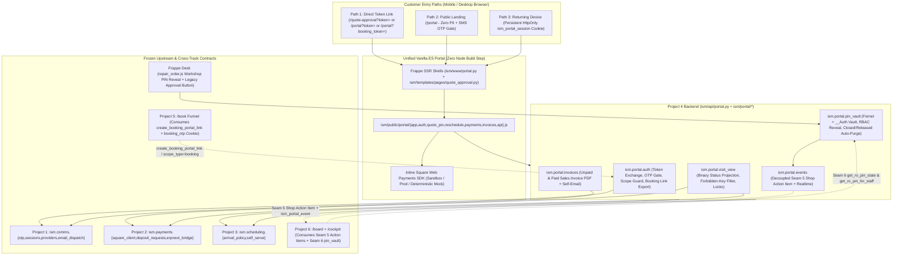
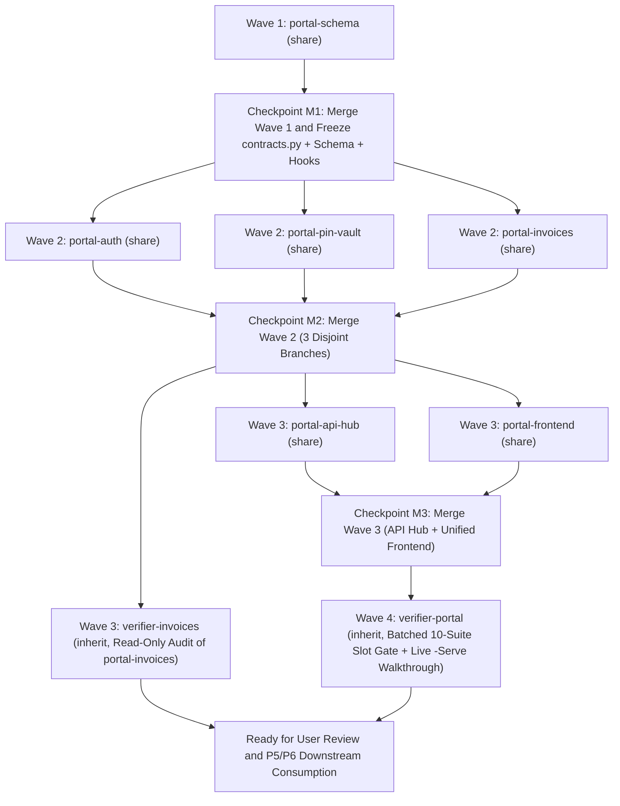

# Project 4: Expanded Customer Portal (Dual-Auth Visit Hub) — Technical & Swarm Implementation Plan

> **Document Purpose:** Standalone technical architecture, frozen cross-project contract specification, and single-`/swarm` execution runbook for **Project 4: Expanded Customer Portal (Dual-Auth Visit Hub)**. This document is self-contained and ready for direct execution via the Swarm plugin and isolated Frappe bench slots (`test-in-slot.ps1`).

| Metadata | Value |
| :--- | :--- |
| **Track / Project** | **Track A / Project 4** (Customer-Facing Product Surface) |
| **Prerequisites** | **Projects 1** ([`plan_p1_comms_telnyx_otp.md`](./plan_p1_comms_telnyx_otp.md)), **2** ([`plan_p2_payments_square_erpnext.md`](./plan_p2_payments_square_erpnext.md)), and **3** ([`plan_p3_scheduling_offset_catalog.md`](./plan_p3_scheduling_offset_catalog.md)) complete |
| **Downstream / Cross-Track Consumers** | **Project 5** ([`plan_p5_website_self_serve_booking.md`](./plan_p5_website_self_serve_booking.md) — booking portal link & `scope_type="booking"` cookie handoff) and **Track B / Project 6** ([`plan_p6_shop_os_frontend.md`](./plan_p6_shop_os_frontend.md) — Seam 5 decoupled `Shop Action Item` alerts & Seam 6 `pin_vault` staff reveal) |
| **Governing Roadmap** | [`ROADMAP.md`](./ROADMAP.md) (locked product decisions originally established in `customer_portal_and_infra_roadmap.md` Sections 2, 4, 5, 6, 7, and 8) |
| **Recommended Session Entry** | Launch `/swarm` using your coordinator's default model inheritance (omit `model` on `swarm{action:"add"}`), or optionally apply `/model-triage` active **Gemini 4** tier pinning (`gemini-4-hydrogen-*`, `gemini-4-neon-*`, and `gemini-4-carbon-*` only; cross-family verification mandatory per Section 4). |

---

## 1. Strategic Objective & Locked Decisions

### Strategic Objective

Upgrade ISM's existing single-purpose, login-free quote signature route (`/quote-approval`) into a cohesive, mobile-first **Expanded Customer Portal (Dual-Auth Visit Hub)** served natively from Frappe at `/portal` (with full backward compatibility for `/quote-approval?token=...`). The upgraded portal delivers zero-friction front-desk quote reviews via shop-sent tokenized links, strict zero-PII public entry gated behind Telnyx SMS OTP, persistent returning-device cookie sessions with explicit sign-out revocation, Ontario-compliant per-service quote authorization, an always-prompt encrypted PIN-to-Drive workflow with automatic `Closed / Released` erasure, strictly binary repair status banners, self-serve appointment rescheduling using Project 3's silent earlier drop-off offset, inline CAD deposit and invoice balance payments via Project 2's embedded Square Web Payments SDK, and self-serve PDF invoice download and rate-limited self-email (unlocking immediately even for unpaid submitted `Sales Invoice` records).

### Locked Product & Architectural Decisions

All decisions below are locked by the governing program roadmap and must not be reopened during execution:

| Topic | Locked Decision |
| :--- | :--- |
| **Dual-Path Auth + Persistent Cookie (`ism_portal_session`)** | **Path 1 (Shop-Sent Direct Link — Zero OTP Friction):** Valid `/quote-approval?token=...`, `/portal?token=...`, or `/portal?booking_token=...` opens immediately with **zero OTP prompt**, exchanges into a persistent `HttpOnly`, `Secure`, `SameSite=Lax`, HMAC-signed + DB-backed `ism_portal_session` cookie (Project 1), and strips the raw token from browser history via `history.replaceState`.<br>**Path 2 (Public Entry / Cross-Device Re-Entry — SMS OTP Gate):** Opening `/portal` without a valid tokenized link or active cookie renders ONLY non-sensitive shop branding + mobile phone SMS OTP prompt, returning **zero PII** (no names, vehicles, appointments, quotes, balances, or invoices) until Telnyx SMS OTP succeeds (**zero email OTP fallback**). Verification issues the same persistent `ism_portal_session` cookie.<br>**Path 3 (Returning Device Continuity):** Returning visits auto-restore the visit hub via `ism_portal_session`, with an explicit **"Sign out on this device"** button that revokes the session server-side and clears the cookie. |
| **Lifecycle Action Locks** | When a `Repair Order` transitions to `Closed / Released` (or `Cancelled`), mutating visit actions (quote authorization, PIN-to-Drive submission/updates, appointment rescheduling, manual deposits) lock automatically server-side and in the UI. Read-only visit summary, payment receipt history, and submitted `Sales Invoice` PDF download/self-email remain accessible (and unpaid submitted `Sales Invoice` balance payment remains payable on non-cancelled orders per Project 2). |
| **Quote Authorization + Always-Prompt PIN-to-Drive** | Retains full per-service Approve/Decline selection, Ontario part disclosures (`part_source`, `part_condition`, `warranty_period`, `oem_part_number`), legal disclaimer, touch/mouse PNG signature capture, and SHA-256 immutable audit trail. Immediately after quote approval, **always prompts** for the vehicle's 4-digit **PIN-to-Drive** with a prominent 1-tap **"No PIN-to-Drive enabled"** opt-out. Stored encrypted at rest via Frappe-bundled `cryptography.fernet` + Frappe `Password` (`__Auth`), write-only/masked (`••••`) to the customer after entry (updatable only before work starts in bay), role-gated and audited for internal staff reveal (Desk `repair_order.js` + Project 6 `/board` Seam 6), and **automatically purged strictly when the Repair Order reaches `Closed / Released`**. |
| **Binary Repair Status ONLY** | Strictly **NO** ETA, **NO** countdown timers, **NO** `progress_percent`, and **NO** mid-work per-service completion checklist on the customer portal. Only three customer-facing states: **Scheduled** (with Project 3's silent earlier drop-off time), **Being Worked On**, and **Done & Ready for Pickup** (showing pickup hours + payment/invoice actions), plus **Cancelled** for cancelled visits. |
| **Appointment Management & Self-Serve Rescheduling** | Displays appointment date and drop-off time strictly from Project 3's `format_customer_appointment_display` (`08:00` internal capacity -> `07:45` customer drop-off, zero buffer wording). Self-rescheduling validates cutoff/cap/lifecycle guards via Project 3 and dispatches an updated confirmation SMS via Project 1 displaying only the customer drop-off time. |
| **Inline Square Deposits & Balance Payments (CAD)** | Renders Project 2's **embedded Square Web Payments SDK** directly inline inside `/portal` for active manual deposit requests and unpaid submitted `Sales Invoice` balances in **CAD**, never accepting client-supplied amounts or raw card fields, and immediately reflecting ERPNext Square Bank Account reconciliation. |
| **Invoice PDF Download & Self-Email (Including UNPAID)** | Unlocks immediately once a submitted `Sales Invoice` (`docstatus == 1`) is linked to the Repair Order — **including unpaid invoices** (rendered alongside the inline Square balance payment form). Supports direct PDF download and rate-limited self-email via Project 1's `dispatch_transactional_email`. |
| **Frontend Architecture & Zero New Dependencies** | Served directly from Frappe (`ism/www/portal.{py,html}`, upgraded `ism/templates/pages/quote_approval.{py,html}`, vanilla ES modules + CSS under `ism/public/portal/`). **Zero** Node/Vite build step and **zero** new Python packages in `ism-frappe/pyproject.toml` (uses Frappe-bundled `cryptography.fernet` + standard library). |

### Explicit Non-Goals

- No customer username/password registration or email OTP fallback.
- No live ETA, estimated completion timestamp, bay/technician assignment display, or mid-job task completion progress checklist on customer views.
- No automatic deposit triggering on quote approval (deposits remain manually initiated by shop staff per Project 2).
- No direct contact with canonical `development.localhost:8000`; all migrations, automated suites, and live `-Serve` checks run exclusively inside isolated `test-in-slot.ps1` bench slots.

---

## 2. System Architecture & Codebase Anchor Audit

### System Architecture



### Concrete Codebase Anchor Audit (`ism-frappe`)

Every file listed below was audited directly in the repository before freezing this plan:

| Audited Codebase Anchor | Verified Current State | Exact Impact on Project 4 Design |
| :--- | :--- | :--- |
| `ism-frappe/ism/templates/pages/quote_approval.py` (`L9-28`) & `quote_approval.html` (`L1-634`) | Reads `frappe.form_dict.get("token")`, validates type safety, calls `get_public_quote_approval(token)`, sets `context.token` and `context.approval_data`, and renders inline Bootstrap/Jinja quote approval + signature canvas (`submit_public_quote_approval`). | `test_approval_and_inspection.py` (`L175-180`, `L577-614`) directly invokes `get_context`, renders `get_response_content("quote_approval")`, asserts `ro.name` appears in HTML, and asserts neither rendered HTML nor `quote_approval.html` source contains `"signature_image"`, `"/private/files/"`, or `"<img"`. Project 4 upgrades `quote_approval.{py,html}` to exchange valid tokens into `ism_portal_session` (zero OTP) and mount the unified portal UI while strictly preserving `context.token`, `context.approval_data`, SSR `ro.name`, and zero `"signature_image"`/`"<img"` compliance. |
| `ism-frappe/ism/api/approval.py` (`L15-718`) | Implements per-IP/per-token Redis rate limits (`_enforce_portal_rate_limit`), `get_or_create_approval_token`, `send_approval_request`, `get_public_quote_approval`, raster signature validation (`_validate_signature_data`), `submit_customer_approval`, `submit_public_quote_approval`, `_notify_shop_floor_approval`, and `_serialize_portal_services` (with batched Ontario part disclosure enrichment). Already upgraded in Project 1 (`#7`) for Telnyx `dispatch_sms` and `dispatch_transactional_email`. | Keep all existing public signatures and payloads 100% backward compatible. Add reusable internal helper `authorize_ro_for_portal(ro_doc, approvals, signer_name, signature_data, client_ip, user_agent)` shared by both legacy token-based `submit_customer_approval` and session-cookie-based `ism.api.portal.submit_portal_quote_approval` (enforcing lifecycle lock on `Closed / Released`/`Cancelled`, returning `pin_prompt_required`, and delegating alerts cleanly through `ism.portal.events` while preserving `ism_ro_approval_updated` + `Shop Action Item` dedup tested in `L716-792`). |
| `ism-frappe/ism/ism/doctype/repair_order/authorization.py` (`L333-504`) | `issue_approval_token` generates 256-bit `approval_token` + expiry; `authorize_repair_order_jobs` records per-row `Approved`/`Declined`, snapshots `authorized_amount`, saves private signature `File`, appends `Repair Order Approval Log`, computes `audit_hash`, and calls `ro._update_parts_waiting_status()`. | **Critical lifecycle discovery (`fulfillment.py` `L141-156`):** Immediately upon customer quote approval, `ro._update_parts_waiting_status()` transitions `ro.status` to `"Authorized - In Progress"` whenever stock is available — **before** a technician picks up the vehicle (`ro.picked_up_at` is still `None` and `ro.vehicle_location == "In Customer Lot"`). Therefore, customer PIN-to-Drive initial submission and pre-work updates MUST gate on `not ro.picked_up_at` and `ro.status not in ("Work Completed", "Billed / Paid", "Closed / Released", "Cancelled")` rather than blocking `"Authorized - In Progress"`. |
| `ism-frappe/ism/ism/doctype/repair_order/repair_order.json`, `repair_order.py`, & `billing.py` (`L1034-1056`) | `Repair Order` statuses: `Checked In`, `Draft Estimate`, `Pending Authorization`, `Authorized - In Progress`, `Waiting on Parts`, `Work Completed`, `Billed / Paid`, `Closed / Released`, `Cancelled`. `billing.py::process_ro_payment_and_release` sets `ro.sales_invoice = si.name`, `ro.vehicle_released = 1`, `ro.status = "Closed / Released"` (`L1042`), and calls `ro.save()` (`L1052`). `Repair Order` has `permlevel 0` read/write for `ISM Technician`/`Advisor`/`Manager` and `permlevel 1` read-only for `ISM Technician`. | Add strictly disjoint `sec_pin_to_drive` (`pin_to_drive_*` fields) inside `tab_workshop` below `sec_bay` (zero collision with P2's `sec_deposit_request` in `tab_billing`). Register `doc_events["Repair Order"]["on_update"]` (using list syntax for clean multi-app/P6 merge) to auto-purge PIN ciphertext on `Closed / Released` (and `Cancelled`), plus a daily reconciliation sweep and defensive purge inside `get_ro_pin_for_staff`. |
| `ism-frappe/ism/ism/doctype/repair_order/repair_order.js` (`L1080-1351`) | Refresh triggers `update_tab_visibility`, `setup_fast_action_bar` (`Actions`, `Billing`, `Workshop` button groups), and `setup_navigation_buttons` (`Navigation` group). Project 2 adds buttons strictly inside `Billing`; Project 6 adds `"Open Shop Board"` strictly inside `Navigation`. | Add an isolated helper `setup_pin_to_drive_controls(frm)` triggered from `refresh(frm)`, adding `"🔐 Reveal PIN-to-Drive"` strictly inside the `Workshop` button group when `pin_to_drive_status === "Provided"` and status is active — zero merge overlap with P2 (`Billing`) or P6 (`Navigation`). |
| `ism-frappe/ism/hooks.py` (`L137-173`) | `website_route_rules` currently contains only `{"from_route": "/quote-approval", "to_route": "quote_approval"}`. `doc_events` has no `Repair Order` handler yet (Project 6 adds one if installed). | Add `{"from_route": "/portal", "to_route": "portal"}` to `website_route_rules`, add list-form `"Repair Order": {"on_update": ["ism.portal.pin_vault.on_repair_order_update_purge_pin"]}` to `doc_events`, and register `"ism.portal.pin_vault.purge_stale_closed_ro_pins"` under `scheduler_events["daily"]`. |
| `ism-frappe/ism/ism/doctype/schedule_entry/schedule_entry.json` & `ism_settings.json` + `setup_tasks/seed.py` | `Schedule Entry` carries `customer`, `repair_order`, `provisional_customer_name`, `provisional_phone`, `provisional_email` (plus Project 3's `section_break_self_serve`). `ISM Settings` initializes defaults declaratively via `_ISM_SETTINGS_FALSY_DEFAULTS` and `_ISM_SETTINGS_NONE_DEFAULTS` in `seed.py`. | Add disjoint `section_break_portal_link` (`portal_booking_token_hash`, `portal_booking_token_expires_at`) on `Schedule Entry` and disjoint `sb_customer_portal` on `ISM Settings` + declarative seeding in `seed.py` (including auto-seeded Fernet `portal_pin_encryption_key`). |
| `ism-frappe/ism/ism/doctype/shop_action_item/shop_action_item.py` (`L10-154`) | `_VALID_SOURCES = ("Manual", "Agent", "Rule Snooze")`; supports `dedup_key`, `category`, `priority`, `reference_doctype`, `reference_name`, `details`, `source`. | `ism.portal.events` inserts/updates `Shop Action Item` records using strictly `category="General"`, `source="Agent"`, and scoped `dedup_key` values (`portal:pin:<ro>`, etc.), aligning 100% with Project 6 Seam 5 projection without importing `ism.board`. |
| `ism-frappe/ism/ism/print_format/repair_order_invoice/` & `test_repair_order.py` (`L1718-1760`) | Existing `Automotive Repair Invoice` print format targets `Repair Order`; ERPNext provides standard `Sales Invoice` print formats rendered via `frappe.get_print("Sales Invoice", si_name, print_format=..., as_pdf=True)`. | `ism.portal.invoices` generates official PDF bytes for the linked submitted `Sales Invoice` (`docstatus == 1`) using configurable `ISM Settings.portal_invoice_print_format` (default `"Standard"` with safe fallback), allowing both unpaid and paid downloads and rate-limited self-email attachments. |

### Frozen Upstream Dependencies Verified Against Wave 1 Plans (`#6`, `#7`, `#8`, `#10`)

- **Project 1 (`ism.comms`, `#7`):**
  - `ism.comms.otp`: `request_sms_otp(phone, *, purpose="portal_login", client_ip=None, user_agent=None, context_ref_doctype=None, context_ref_name=None)`, `verify_sms_otp(challenge_id, code, *, phone=None, purpose=None, client_ip=None, consume=True)`, `get_last_mock_otp(phone_e164)` (Mock mode only).
  - `ism.comms.sessions`: `issue_portal_session(...)`, `verify_portal_session(cookie_value=None, *, touch=True, required_scope_type=None)`, `rotate_portal_session(...)`, `revoke_portal_session(...)`, `clear_portal_session_cookie()` on `ism_portal_session`.
  - `ism.comms.email_dispatch`: `dispatch_transactional_email(*, recipient, subject, html_body, email_type="transactional", reference_doctype=None, reference_name=None, attachments=None, client_ip=None, bypass_rate_limit=False, delayed=False)`.
  - `ism.comms.providers`: `send_sms(request: SMSDispatchRequest, ...)` and `ism.api.sms.dispatch_sms(...)`.
  - `ism.comms.contracts`: `normalize_phone_e164`, `mask_phone_e164`, `get_client_ip`, `SMSDispatchRequest`.
- **Project 2 (`ism.payments`, `#10`):**
  - `ism.payments.square_client.get_sdk_boot_config()`
  - `ism.payments.deposit_requests.get_ro_payment_state(ro_name)`
  - `ism.payments.erpnext_bridge.execute_tokenized_payment(repair_order, payment_intent, source_id, *, idempotency_key=None, expected_amount_cents=None, buyer_email=None, initiated_by="Customer Portal", client_ip=None, square_client=None)`
  - `ism.payments.contracts.assert_no_raw_card_fields(payload)`
- **Project 3 (`ism.scheduling`, `#8`):**
  - `ism.scheduling.arrival_policy.format_customer_appointment_display(scheduled_date, internal_start, offset_minutes=None, *, use_12h=True)`
  - `ism.scheduling.self_serve.evaluate_reschedule_eligibility(schedule_entry, *, now_dt=None)`
  - `ism.scheduling.self_serve.find_self_serve_slots(*, package_ids=None, duration_minutes=None, required_tags=None, start_date=None, days_ahead=7, vehicle_model=None, vehicle_year=None, exclude_entry=None, max_slots_per_day=None, now_dt=None)`
  - `ism.scheduling.self_serve.reschedule_self_serve_appointment(schedule_entry, target_date, customer_arrival_time, *, reason=None, now_dt=None, emit_notification=True)`

---

## 3. Locked Architectural, Security & Cross-Track Invariants

Every worker and verifier must treat the following 10 invariants as hard pass/fail merge gates:

1. **Bench Isolation & Zero Canonical Contact:** Zero commands targeting canonical `development.localhost:8000`, `sync-to-wsl.ps1`, `watch-sync.*`, or `promote-to-main.ps1`. All migrations, tests, and live `-Serve` checks run exclusively through `scripts\test-in-slot.ps1`.
2. **Zero Pre-OTP PII Leakage & Anti-Enumeration (Path 2):**
   - Unauthenticated `GET /portal` and every `allow_guest=True` portal endpoint return **zero** customer names, phone numbers, email addresses, VINs, license plates, vehicle models, RO IDs, schedule dates, quotes, balances, or invoices before either a valid direct token exchange (Path 1) or verified SMS OTP (Path 2) or valid `ism_portal_session` cookie (Path 3).
   - `request_login_otp` is strictly **SMS-only** (rejects email addresses; zero email OTP fallback). For mobile numbers not found on any `Customer`, `Contact`, or `Schedule Entry`, it consumes the same per-IP rate-limit bucket, sends **zero** SMS (preventing Telnyx SMS pumping), and returns a uniform opaque challenge response so attackers cannot enumerate customer phone numbers.
3. **Strict Scope Isolation & Anti-IDOR Enforcement:**
   - Every portal visit read and write endpoint resolves `session = require_portal_session()` and enforces `assert_session_owns_ro(session, ro_name)` or `assert_session_owns_schedule_entry(session, se_name)`.
   - `scope_type="repair_order"` (from RO direct links) grants access strictly to `session.repair_order` and its directly linked `Schedule Entry` rows — never sibling ROs on the same customer account.
   - `scope_type="booking"` (from P5 `booking_otp` or `/portal?booking_token=...`) grants access strictly to `session.schedule_entry` and its converted `se.repair_order` (when present).
   - `scope_type="customer"` (from SMS OTP login) grants access to all ROs and `Schedule Entry` rows belonging to verified matched `Customer` records and/or `provisional_phone == session.phone_e164`.
   - Unauthorized access attempts always raise `frappe.PermissionError` with uniform generic wording (zero existence oracle).
   - All mutating endpoints require `methods=["POST"]` and Frappe's CSRF token (`X-Frappe-CSRF-Token`).
4. **Raw Token Hygiene:**
   - Opening `/quote-approval?token=...`, `/portal?token=...`, or `/portal?booking_token=...` exchanges the token into the `HttpOnly`, `Secure`, `SameSite=Lax` `ism_portal_session` cookie immediately on the server and strips `token` / `booking_token` from the URL bar on mount via `window.history.replaceState`.
   - `Schedule Entry.portal_booking_token_hash` stores only `SHA-256(raw_token)` — never the raw booking token.
   - Neither API JSON nor SSR HTML ever echoes `approval_token`, `portal_booking_token_hash`, `cookie_value`, `signature_image`, or `/private/files/` paths.
5. **PIN-to-Drive Encryption, Access Control & `Closed / Released` Auto-Purge Invariant:**
   - PIN-to-Drive is strictly 4 numeric digits (`^\d{4}$`), wrapped in an RO-bound authenticated JSON envelope (`{"v": 1, "ro": ro_name, "pin": pin}`), encrypted with `cryptography.fernet.Fernet(ISM Settings.portal_pin_encryption_key)`, and stored in `Repair Order.pin_to_drive_encrypted` (`fieldtype="Password"`, `hidden=1`, `read_only=1`, `no_copy=1`, `print_hide=1`, `report_hide=1`) via `set_encrypted_password`.
   - Never returned to customers after submission (write-only masked `••••`), never logged in Frappe Error Log / `Comment` / `Shop Action Item` / realtime payloads, and never serialized by `frappe.desk.form.load.getdoc`.
   - Staff reveal (`get_ro_pin_for_staff`) is strictly restricted to `ISM Technician`, `ISM Service Advisor`, `ISM Manager`, `System Manager` (plus `Repair Order` read permission), records an audited RO `Comment` + counter update on every read, and raises `frappe.PermissionError` for Guest/unauthorized roles or closed/cancelled ROs.
   - **Auto-Purge Guarantee:** Transitioning a `Repair Order` to `Closed / Released` (or `Cancelled`) immediately executes `remove_encrypted_password("Repair Order", ro_name, fieldname="pin_to_drive_encrypted")` (leaving `0` rows in `__Auth`), clears the field, sets `pin_to_drive_status = "Purged"` (when previously `"Provided"`) + `pin_to_drive_purged_at`, and appends an audit `Comment`.
6. **Binary Repair Status Only (Zero ETA / Zero Mid-Work Progress Invariant):**
   - Portal visit payloads and UI strictly emit only `scheduled`, `being_worked_on`, `ready_for_pickup` (or `cancelled`).
   - Recursive forbidden-key assertion enforces absence of `eta`, `estimated_completion`, `completion_date`, `completion_time`, `countdown`, `progress_percent`, `is_completed`, `completed_at`, `completed_by`, `service_bay`, `assigned_technician`, `internal_start`, `arrival_offset_minutes`, `buffer_minutes`, `signature_image`, `pin_to_drive_encrypted`, and `approval_token`.
7. **Unpaid & Paid Invoice Self-Service Invariant:**
   - PDF download and rate-limited self-email unlock as soon as `ro.sales_invoice` references a submitted `Sales Invoice` (`docstatus == 1`), **even while `outstanding_amount > 0` (unpaid)**, alongside the inline Square balance payment card.
   - PDF download streams with `Content-Disposition: attachment`, `Cache-Control: private, no-store, max-age=0`, and `X-Content-Type-Options: nosniff`; self-email routes strictly through Project 1's `dispatch_transactional_email(..., bypass_rate_limit=False)`.
8. **Authoritative Server-Side Pricing & PCI Minimization (Square):**
   - Portal payment endpoint rejects any raw card fields (`assert_no_raw_card_fields`), never trusts client amounts, and delegates exclusively to Project 2's `execute_tokenized_payment` in `CAD` (immediate ERPNext Square Bank Account reconciliation).
9. **Backward Compatibility for Existing Portal Contracts & Tests:**
   - `ism.api.approval.{get_or_create_approval_token, send_approval_request, get_public_quote_approval, submit_customer_approval, submit_public_quote_approval}`, `ism.templates.pages.quote_approval.{get_context, quote_approval.html}`, `ism_ro_approval_updated` realtime event, and existing `test_approval_and_inspection` / `test_auth_and_roles` / `test_billing_and_deposits` suites must pass with zero regressions.
10. **Cross-Track 6-Seam Alignment (Track A <-> Track B Project 6):**
    - **Seam 1 (`ISM Settings`):** Project 4 adds `sb_customer_portal` ONLY (zero overlap with P1–P3, P5, or P6).
    - **Seam 2 (Outbound SMS):** Reschedule confirmations call Project 1's `send_sms` / `dispatch_sms`, inheriting Telnyx audit and opt-out enforcement automatically.
    - **Seam 3 (ERPNext Billing Truth):** Portal reads and writes payment state solely through Project 2 (`get_ro_payment_state`, `execute_tokenized_payment`) and ERPNext `Sales Invoice`/`Payment Entry` truth.
    - **Seam 4 (Dual-Time Arrival Offset):** Every displayed and SMS-sent appointment time comes exclusively from Project 3's `format_customer_appointment_display` (`08:00` -> `07:45`, zero buffer wording).
    - **Seam 5 (Shop Floor Visibility):** `ism.portal.events` creates decoupled `Shop Action Item` records (`category="General"`, `source="Agent"`) and emits `ism_portal_event` realtime events with **zero** import of `ism.board`.
    - **Seam 6 (Technician PIN-to-Drive Access):** `ism.portal.pin_vault` exports frozen `get_ro_pin_state(repair_order)` and `get_ro_pin_for_staff(repair_order)` consumed directly by Desk (`repair_order.js`) and softly imported by Project 6 (`ism/api/board.py::reveal_ro_pin`).

---

## 4. Swarm Plugin Execution Blueprint

### Hard Guardrails

- **Bench Slot & Concurrency Ceiling:** Maximum `3` concurrent `workspace:"share"` authors per wave (staying safely within `slot-1`..`slot-5`). Never launch parallel `test-in-slot.ps1` calls inside the same worktree; batch comma-separated `-Module` lists into a single invocation.
- **Disjoint File Ownership:** No two workers in the same wave edit the same file. Every worker brief below explicitly enumerates owned files and forbidden files.
- **Model Selection Rule:**
  - **Default `/swarm` behavior (`native_swarm`):** Omit `model` on `swarm{action:"add"}` so every worker inherits the coordinator's active model.
  - **Optional `/model-triage` behavior (when the user explicitly requests Gemini 4 tier pinning):** Call `swarm{action:"models", all:true}` once; restrict strictly to active Gemini 4 models (`gemini-4-hydrogen-*`, `gemini-4-neon-*`, `gemini-4-carbon-*`); never use `gemini-4-argon-*`, `Gemini 3.8 Flash`, `Claude`, `GPT-OSS`, `flash`, `Neon (Low)`, `Hydrogen (High/XHigh)`, or leaf `Orchestrator`; enforce **cross-family verification** (`hydrogen-medium` authors verified by `gemini-4-neon-high`; `neon-medium`/`neon-high` authors verified by `gemini-4-carbon-high`).
- **In-Place Model Escalation / Quota Recovery:** If a worker stalls, fails verification twice, or hits quota exhaustion, wait until `waiting` and switch models in-place via `swarm{action:"model", name, model}` — never `kill` + `add` (and never reuse killed names).
- **Merge Before `kill`:** Always merge or cherry-pick completed `share` worker branches into the integration branch and confirm clean `git status` **before** calling `swarm{action:"kill", name}` (since `kill` permanently deletes the worker's share workspace).
- **Addressing & Wakeup Hygiene:** Use `@name` only as a wakeup doorbell for the next actor (never as a CC). Cite earlier board reports by `#seq`. Prefix final deliverables with `[done]` (e.g., `@coordinator [done] ...`).

### Coordinator Startup Protocol

1. Confirm clean feature/integration branch (e.g., `git checkout -b feat/p4-customer-portal-expansion`) with Projects 1, 2, and 3 already merged; never run slot tests against canonical `main` or `development.localhost:8000`.
2. Name the swarm immediately:
   ```text
   swarm{"action": "title", "title": "P4 dual-auth customer portal hub"}
   ```
3. *(Only if `/model-triage` pinning was requested)* Call `swarm{"action": "models", "all": true}` once to verify active Gemini 4 IDs and quotas.
4. Spawn `monitor` (only if `swarm_monitor` is in the coordinator's skill list; never assign tasks to `monitor`) and spawn **Wave 1** (`portal-schema`, `workspace:"share"`).
5. Write the `swarm_pane` overview plan file at `<appData>/brain/<coordinator-conversation-id>/.system_generated/swarm/plan.json` using the ready-to-write JSON block below (updating it only when adding new wave workers or shifting scope — never storing status or blockers inside `plan.json`):

```json
{
  "goal": {
    "title": "Build Dual-Auth Customer Portal Visit Hub",
    "line": "Ship zero-OTP links, SMS OTP gate, PIN vault, reschedule, Square, invoices."
  },
  "tasks": {
    "portal-schema": "Freeze contracts, settings, RO PIN fields, token schema, and hooks",
    "portal-auth": "Build dual-path auth, non-enumerating OTP gate, scope guard, and booking links",
    "portal-pin-vault": "Build encrypted PIN vault, Closed/Released auto-purge, events, and Desk reveal",
    "portal-invoices": "Build unpaid and paid Sales Invoice PDF streaming and self-email",
    "portal-api-hub": "Build binary visit view, portal REST API, and approval backward compat",
    "portal-frontend": "Build mobile-first /portal and /quote-approval vanilla ES frontend",
    "verifier-invoices": "Audit invoice PDF streaming, rate limits, and unpaid unlock contract",
    "verifier-portal": "Run batched 10-suite slot gate, security audit, and live browser walkthrough"
  },
  "threads": [
    {
      "id": "t-foundation",
      "title": "Schema, contracts, and lifecycle hooks",
      "goal": "Freeze portal contracts, disjoint settings, RO PIN schema, and purge hooks.",
      "tasks": ["portal-schema"]
    },
    {
      "id": "t-core-services",
      "title": "Dual-path auth, PIN vault, and invoices",
      "goal": "Deliver zero-OTP/SMS-OTP sessions, encrypted auto-purging PINs, and unpaid PDFs.",
      "tasks": ["portal-auth", "portal-pin-vault", "portal-invoices"]
    },
    {
      "id": "t-hub-frontend",
      "title": "Unified visit API and mobile-first UI",
      "goal": "Deliver binary-status visit hub, Square inline payments, reschedule, and /portal UI.",
      "tasks": ["portal-api-hub", "portal-frontend"]
    },
    {
      "id": "t-verification",
      "title": "Cross-family security and slot verification",
      "goal": "Prove zero PII leaks, IDOR isolation, PIN purge, and green batched slot gates.",
      "tasks": ["verifier-invoices", "verifier-portal"]
    }
  ]
}
```

6. Execute Merge Checkpoints **`M1`**, **`M2`**, and **`M3`**: merge finished `share` branches cleanly into the integration branch, verify frozen contracts and clean `git status`, kill merged authors to free workspace slots, and spawn the next wave citing prior `#seq` reports.
7. After Wave 4 (`verifier-portal`) and Wave 3 (`verifier-invoices`) confirm all KPIs green, kill remaining temporary workers, post one unaddressed `[done] Project 4 Expanded Customer Portal verified on integration branch` line (so `monitor` quiets), and report the verification summary to the user.

### Worker Roster & Pinning Table

All 9 roster names strictly conform to `^[a-z0-9][a-z0-9_-]{0,23}$` (longest name: `verifier-invoices` = 17 chars). Leave `model` omitted by default for `/swarm` model inheritance, or apply the `/model-triage` Model ID column when explicit tier pinning is requested:

| Worker | Wave | Role & Strict File Ownership | Workspace | `/model-triage` Model ID *(Default: Inherit)* | Depends On | Why This Assignment |
| :--- | :---: | :--- | :---: | :--- | :---: | :--- |
| `portal-schema` | 1 | `ism/portal/contracts.py`, initial `ism/portal/__init__.py`, `ism_settings.{json,py}` (`sb_customer_portal` ONLY), `setup_tasks/seed.py`, `repair_order.json` (`sec_pin_to_drive` / `pin_to_drive_*` ONLY), `schedule_entry.json` (`section_break_portal_link` ONLY), `hooks.py`, `tests/test_portal_schema_and_contracts.py` | `share` | `gemini-4-neon-medium` | — | Schema invariants, disjoint settings/DocType fields, Fernet key seeding, lifecycle hook wiring |
| `portal-auth` | 2 | `ism/portal/auth.py` (Path 1 direct link exchange, `create_booking_portal_link`, Path 2 non-enumerating SMS OTP login, Path 3 cookie restore & sign-out, phone->Customer/SE resolver, scope & lifecycle lock guards), `tests/test_portal_auth_and_sessions.py` | `share` | `gemini-4-neon-high` | `M1` | Security-critical dual-path auth, anti-enumeration, strict scope isolation, anti-IDOR guards |
| `portal-pin-vault` | 2 | `ism/portal/pin_vault.py` (Fernet + `__Auth` vault, `get_ro_pin_state`, `get_ro_pin_for_staff`, `Closed / Released` auto-purge), `ism/portal/events.py` (Seam 5 decoupled `Shop Action Item` + realtime), `repair_order.js` (`Workshop` PIN reveal button ONLY), `tests/test_portal_pin_vault.py` | `share` | `gemini-4-neon-high` | `M1` | Cryptographic Fernet/Password lifecycle, RBAC + audited reveal, guaranteed purge on release |
| `portal-invoices` | 2 | `ism/portal/invoices.py` (unpaid & paid submitted `Sales Invoice` PDF byte streaming + P1 rate-limited self-email), `tests/test_portal_invoices.py` | `share` | `gemini-4-hydrogen-medium` | `M1` | Bounded 2-file PDF render + transactional email wrapper following frozen P1 contract |
| `portal-api-hub` | 3 | `ism/portal/visit_view.py` (binary status projection, forbidden-key hygiene, payment/reschedule/invoice assembly), final `ism/portal/__init__.py`, `ism/api/portal.py`, backward-compatible wiring in `ism/api/approval.py`, `tests/test_portal_visit_hub_and_features.py` | `share` | `gemini-4-neon-high` | `M2` | End-to-end API orchestration across P1/P2/P3/P4 contracts, binary-status & IDOR enforcement |
| `portal-frontend` | 3 | `ism/www/portal.{py,html}`, upgraded `ism/templates/pages/quote_approval.{py,html}`, `ism/public/portal/{portal.css,api.js,auth.js,quote_pin.js,reschedule.js,payments.js,invoices.js,app.js}`, `tests/test_portal_pages_and_ssr.py` | `share` | `gemini-4-neon-medium` | `M2` | Mobile-first vanilla ES dual-auth SPA, inline Square SDK + mock widget, zero-PII SSR, history cleanup |
| `verifier-invoices` | 3 | Cross-family read-only review of `portal-invoices` (`ism/portal/invoices.py`, `test_portal_invoices.py`): unpaid unlock, attachment/header safety, rate-limit propagation | `inherit` | `gemini-4-neon-high` | `M2` | Cross-family verifier for `hydrogen-medium` author; zero slot contention |
| `verifier-portal` | 4 | Cross-family full-stack gate for all `neon-*` authors: single batched 10-suite `test-in-slot.ps1` run, `ruff check`, static JS check, zero-PII / IDOR / binary-status / PIN-purge / Seam 1–6 audit, live `-Serve` browser walkthrough | `inherit` | `gemini-4-carbon-high` | `M3` | Cross-family verifier for `neon-medium`/`neon-high` authors + strongest shell/browser reliability |
| `monitor` *(optional)* | 1–4 | Standard `swarm_monitor` stall watcher (add only if `swarm_monitor` skill is available) | `inherit` | `gemini-4-hydrogen-low` | — | Lightweight timer-based stall recovery |

### Wave Dependency Graph



> **Zero-Conflict File Ownership Guarantee:**
> - **Wave 1 (`portal-schema`):** Sole editor of `contracts.py`, `ism_settings.{json,py}`, `seed.py`, `repair_order.json`, `schedule_entry.json`, and `hooks.py`.
> - **Wave 2 (3 parallel `share` authors):** `portal-auth` owns `auth.py`; `portal-pin-vault` owns `pin_vault.py`, `events.py`, and `repair_order.js` (`Workshop` section only); `portal-invoices` owns `invoices.py`. Zero shared files.
> - **Wave 3 (2 parallel `share` authors + 1 `inherit` verifier):** `portal-api-hub` owns `visit_view.py`, final `__init__.py`, `api/portal.py`, `api/approval.py`; `portal-frontend` owns `www/portal.*`, `templates/pages/quote_approval.*`, and `public/portal/*` (importing only frozen `contracts.py`, `auth.py`, and existing `api/approval.get_public_quote_approval`). Zero shared files.
> - **Wave 4 (`verifier-portal`):** Read-only (`inherit`); never edits files directly — posts defects by `@name` to the owning author if any gate fails.

### Self-Contained Per-Worker Brief Templates

#### Wave 1 — `portal-schema`
> You own **Wave 1** of Project 4 (`todo_snippets/roadmap/plan_p4_customer_portal_expansion.md` Sections 3 and 5 Wave 1).
> **Owned Files:** `[NEW] ism-frappe/ism/portal/__init__.py`, `[NEW] ism-frappe/ism/portal/contracts.py`, `[MODIFY] ism-frappe/ism/ism/doctype/ism_settings/ism_settings.json`, `[MODIFY] ism-frappe/ism/ism/doctype/ism_settings/ism_settings.py`, `[MODIFY] ism-frappe/ism/setup_tasks/seed.py`, `[MODIFY] ism-frappe/ism/ism/doctype/repair_order/repair_order.json`, `[MODIFY] ism-frappe/ism/ism/doctype/schedule_entry/schedule_entry.json`, `[MODIFY] ism-frappe/ism/hooks.py`, `[NEW] ism-frappe/ism/tests/test_portal_schema_and_contracts.py`.
> **Forbidden Files:** Do NOT touch `auth.py`, `pin_vault.py`, `invoices.py`, `visit_view.py`, `api/portal.py`, `api/approval.py`, `repair_order.js`, `billing.py`, or any `ISM Settings` section other than `sb_customer_portal`. Never touch `development.localhost:8000`.
> **Done Looks Like:** All schema fields migrate cleanly, `setup_default_ism_settings()` idempotently seeds `sb_customer_portal` + Fernet `portal_pin_encryption_key`, `contracts.py` exports every frozen symbol/constant, `hooks.py` adds `/portal` route + list-form `Repair Order` `on_update` PIN purge hook + daily sweep, `ruff check` passes, and `powershell -ExecutionPolicy Bypass -File scripts\test-in-slot.ps1 -Module "ism.tests.test_portal_schema_and_contracts,ism.ism.doctype.ism_settings.test_ism_settings,ism.tests.test_auth_and_roles"` is 100% green. Commit in your workspace and post `@coordinator [done]` with commit hash and frozen symbol summary.

#### Wave 2 — `portal-auth`
> You own **Wave 2A** of Project 4 (`todo_snippets/roadmap/plan_p4_customer_portal_expansion.md` Sections 3 and 5 Wave 2A; Wave 1 frozen in `#<w1_seq>`).
> **Owned Files:** `[NEW] ism-frappe/ism/portal/auth.py`, `[NEW] ism-frappe/ism/tests/test_portal_auth_and_sessions.py`.
> **Forbidden Files:** Do NOT touch `contracts.py`, `pin_vault.py`, `events.py`, `invoices.py`, `visit_view.py`, `api/*`, `repair_order.*`, or `ism_settings.*`. Never touch `development.localhost:8000`.
> **Done Looks Like:** Path 1 direct RO & booking token exchanges set persistent `ism_portal_session` with zero OTP; `create_booking_portal_link(schedule_entry) -> str` stores only `SHA-256` hash on `Schedule Entry`; Path 2 SMS OTP login is strictly SMS-only (zero email fallback) and non-enumerating for unknown phones; Path 3 cookie restore & sign-out revoke server-side; `assert_session_owns_ro` and `assert_session_owns_schedule_entry` enforce strict scope isolation (`customer`, `repair_order`, `booking` including converted RO); `ruff check` + `powershell -ExecutionPolicy Bypass -File scripts\test-in-slot.ps1 -Module "ism.tests.test_portal_auth_and_sessions"` pass 100%. Commit and post `@coordinator [done]` with commit hash and exported signatures.

#### Wave 2 — `portal-pin-vault`
> You own **Wave 2B** of Project 4 (`todo_snippets/roadmap/plan_p4_customer_portal_expansion.md` Sections 3 and 5 Wave 2B; Wave 1 frozen in `#<w1_seq>`).
> **Owned Files:** `[NEW] ism-frappe/ism/portal/pin_vault.py`, `[NEW] ism-frappe/ism/portal/events.py`, `[MODIFY] ism-frappe/ism/ism/doctype/repair_order/repair_order.js` (isolated `setup_pin_to_drive_controls` under `Workshop` group ONLY), `[NEW] ism-frappe/ism/tests/test_portal_pin_vault.py`.
> **Forbidden Files:** Do NOT touch `auth.py`, `invoices.py`, `visit_view.py`, `api/*`, `repair_order.json`, `billing.py`, or the `Billing`/`Navigation` button groups in `repair_order.js`. Never touch `development.localhost:8000` or import `ism.board`.
> **Done Looks Like:** Fernet + Frappe `Password` (`__Auth`) RO-bound encryption works for 4-digit PINs (preserving leading zeros); opt-out clears any stored ciphertext; `get_ro_pin_state` returns non-sensitive metadata for Desk and P6 Seam 6; `get_ro_pin_for_staff` enforces role RBAC + active RO status + audited `Comment` & counters; `Closed / Released` (including via `process_payment_and_release`) auto-purges `__Auth` row to `0` remaining rows; `events.py` emits decoupled `Shop Action Item` (`category="General"`, `source="Agent"`) + `ism_portal_event`; `ruff check` + `powershell -ExecutionPolicy Bypass -File scripts\test-in-slot.ps1 -Module "ism.tests.test_portal_pin_vault"` pass 100%. Commit and post `@coordinator [done]`.

#### Wave 2 — `portal-invoices`
> You own **Wave 2C** of Project 4 (`todo_snippets/roadmap/plan_p4_customer_portal_expansion.md` Sections 3 and 5 Wave 2C; Wave 1 frozen in `#<w1_seq>`).
> **Owned Files:** `[NEW] ism-frappe/ism/portal/invoices.py`, `[NEW] ism-frappe/ism/tests/test_portal_invoices.py`.
> **Forbidden Files:** Do NOT touch `auth.py`, `pin_vault.py`, `events.py`, `visit_view.py`, `api/*`, `billing.py`, or `ism_settings.*`. Never touch `development.localhost:8000`.
> **Done Looks Like:** `get_ro_invoice_summary`, `render_sales_invoice_pdf`, and `email_sales_invoice_copy` unlock immediately for ANY submitted `Sales Invoice` (`docstatus == 1`) linked to the RO — including UNPAID invoices (`outstanding_amount > 0`); reject draft/cancelled/unlinked invoices; stream valid PDF bytes with safe attachment/no-store headers; delegate self-email strictly through P1 `dispatch_transactional_email(..., bypass_rate_limit=False)` with PDF attachment and rate-limit propagation; `ruff check` + `powershell -ExecutionPolicy Bypass -File scripts\test-in-slot.ps1 -Module "ism.tests.test_portal_invoices"` pass 100%. Commit and post `@coordinator [done]`.

#### Wave 3 — `portal-api-hub`
> You own **Wave 3A** of Project 4 (`todo_snippets/roadmap/plan_p4_customer_portal_expansion.md` Sections 3 and 5 Wave 3A; Wave 2 frozen in `#<w2a_seq>`, `#<w2b_seq>`, `#<w2c_seq>`).
> **Owned Files:** `[NEW] ism-frappe/ism/portal/visit_view.py`, `[MODIFY] ism-frappe/ism/portal/__init__.py` (final public facade), `[NEW] ism-frappe/ism/api/portal.py`, `[MODIFY] ism-frappe/ism/api/approval.py`, `[NEW] ism-frappe/ism/tests/test_portal_visit_hub_and_features.py`.
> **Forbidden Files:** Do NOT touch `www/portal.*`, `templates/pages/quote_approval.*`, `public/portal/*`, `billing.py`, `ism/payments/*`, `ism/scheduling/*`, or `ism/comms/*`. Never touch `development.localhost:8000`.
> **Done Looks Like:** `visit_view.py` projects strictly binary repair status (`scheduled` / `being_worked_on` / `ready_for_pickup` / `cancelled`) with zero forbidden ETA/progress/bay/tech/internal-time/secret keys; `api/portal.py` implements all endpoints in Section 5 Wave 3A with strict scope/IDOR/CSRF/POST/rate-limit/lifecycle-lock checks, P3 reschedule + P1 confirmation SMS (silent drop-off time only), P2 inline Square payment execution (`assert_no_raw_card_fields`), and unpaid/paid PDF download & self-email; `api/approval.py` preserves 100% legacy compatibility; `ruff check` + `powershell -ExecutionPolicy Bypass -File scripts\test-in-slot.ps1 -Module "ism.tests.test_portal_visit_hub_and_features,ism.tests.test_approval_and_inspection"` pass 100%. Commit and post `@coordinator [done]`.

#### Wave 3 — `portal-frontend`
> You own **Wave 3B** of Project 4 (`todo_snippets/roadmap/plan_p4_customer_portal_expansion.md` Sections 3 and 5 Wave 3B; Wave 2 frozen in `#<w2a_seq>`, `#<w2b_seq>`, `#<w2c_seq>`).
> **Owned Files:** `[NEW] ism-frappe/ism/www/portal.py`, `[NEW] ism-frappe/ism/www/portal.html`, `[MODIFY] ism-frappe/ism/templates/pages/quote_approval.py`, `[MODIFY] ism-frappe/ism/templates/pages/quote_approval.html`, `[NEW] ism-frappe/ism/public/portal/{portal.css,api.js,auth.js,quote_pin.js,reschedule.js,payments.js,invoices.js,app.js}`, `[NEW] ism-frappe/ism/tests/test_portal_pages_and_ssr.py`.
> **Forbidden Files:** Do NOT touch `ism/portal/*.py`, `ism/api/*`, `repair_order.*`, `hooks.py`, or add any Node/npm build pipeline. Never touch `development.localhost:8000`.
> **Done Looks Like:** Vanilla ES modules + mobile-first CSS implement Path 1 direct-link zero-OTP entry + immediate `history.replaceState` token stripping, Path 2 zero-PII landing + SMS-only OTP prompt, Path 3 cookie auto-restore + explicit "Sign out on this device", binary status banner, full Ontario quote approval + immediate always-prompt PIN-to-Drive modal with 1-tap opt-out + masked write-only display, self-serve reschedule picker (silent offset times), inline Square Web Payments SDK (+ offline Mock test card widget), and unpaid/paid PDF download & self-email; `quote_approval.html` contains ZERO `"signature_image"` and ZERO `" You are the read-only cross-family verifier for Wave 2C (`portal-invoices`, `hydrogen-medium`). Do NOT edit any files.
> Audit `ism-frappe/ism/portal/invoices.py` and `ism-frappe/ism/tests/test_portal_invoices.py` against Section 3 Invariant 7 and Section 5 Wave 2C: verify unpaid submitted `Sales Invoice` unlock, draft/cancelled rejection, customer ownership check, PDF attachment/no-store headers, CRLF/header-injection rejection, strict delegation to `ism.comms.email_dispatch.dispatch_transactional_email(..., bypass_rate_limit=False)`, and absence of raw tokens or PINs in email HTML. Report defects directly to `@portal-invoices` (with file:line citations) or post `@coordinator [done]` once clean.

#### Wave 4 — `verifier-portal` (Read-Only Cross-Family Full-Stack Gate)
> You are the read-only cross-family final verifier for Project 4 (`todo_snippets/roadmap/plan_p4_customer_portal_expansion.md` Sections 3 and 6). Do NOT edit any files.
> Execute the full Section 6 verification gate on the merged integration branch:
> 1. Single batched `test-in-slot.ps1` run across all 6 new portal test suites + 4 regression suites (`test_approval_and_inspection`, `test_auth_and_roles`, `test_billing_and_deposits`, `test_ism_settings`).
> 2. `ruff check` on all changed/new Python files and JS syntax verification (`node --check` or equivalent) across `ism/public/portal/*.js`.
> 3. Security, PII-leak, IDOR, binary-status forbidden-key, PIN Fernet + `__Auth` purge, and Seam 1–6 audit.
> 4. Live `-Serve` browser/HTTP walkthrough in an isolated slot (`wt1..wt5.localhost`, Mock SMS + Mock Square) proving all 9 walkthrough checks in Section 6.
> If any failure occurs, report exact `file:line` and repro to the responsible author by `@name`; once all Exit KPIs are 100% green, post `@coordinator [done]` with full command evidence.

---

## 5. Detailed Wave-by-Wave Implementation Specification

### Wave 1 — Frozen Contracts, Disjoint Schema, Seed Defaults & Hooks (`portal-schema`)

#### 1. `[NEW] ism-frappe/ism/portal/contracts.py` & Initial `[NEW] ism-frappe/ism/portal/__init__.py`

Defines all immutable constants, enums, TypedDicts/dataclasses, and shared pure validators consumed across Waves 2–3 and downstream Projects 5 and 6:

```python
PORTAL_STATUS_SCHEDULED: str = "scheduled"
PORTAL_STATUS_BEING_WORKED_ON: str = "being_worked_on"
PORTAL_STATUS_READY_FOR_PICKUP: str = "ready_for_pickup"
PORTAL_STATUS_CANCELLED: str = "cancelled"

PORTAL_STATUS_LABELS: dict[str, str] = {
    PORTAL_STATUS_SCHEDULED: "Scheduled",
    PORTAL_STATUS_BEING_WORKED_ON: "Being Worked On",
    PORTAL_STATUS_READY_FOR_PICKUP: "Done & Ready for Pickup",
    PORTAL_STATUS_CANCELLED: "Cancelled",
}

PIN_STATUS_NOT_PROMPTED: str = "Not Prompted"
PIN_STATUS_PROVIDED: str = "Provided"
PIN_STATUS_OPTED_OUT: str = "Opted Out"
PIN_STATUS_PURGED: str = "Purged"
PIN_VALID_STATUSES: tuple[str, ...] = (
    PIN_STATUS_NOT_PROMPTED,
    PIN_STATUS_PROVIDED,
    PIN_STATUS_OPTED_OUT,
    PIN_STATUS_PURGED,
)

PIN_STAFF_ALLOWED_ROLES: frozenset[str] = frozenset({
    "ISM Technician",
    "ISM Service Advisor",
    "ISM Manager",
    "System Manager",
})
PIN_AUTO_MASK_SECONDS: int = 15

RO_CLOSED_LOCKED_STATUSES: frozenset[str] = frozenset({"Closed / Released", "Cancelled"})
RO_PIN_PURGE_STATUSES: frozenset[str] = frozenset({"Closed / Released", "Cancelled"})
RO_PIN_MUTATION_LOCKED_STATUSES: frozenset[str] = frozenset({
    "Work Completed",
    "Billed / Paid",
    "Closed / Released",
    "Cancelled",
})

PORTAL_FORBIDDEN_PAYLOAD_KEYS: frozenset[str] = frozenset({
    "eta",
    "estimated_completion",
    "completion_date",
    "completion_time",
    "expected_completion",
    "countdown",
    "remaining_minutes",
    "progress_percent",
    "is_completed",
    "completed_at",
    "completed_by",
    "total_bay_time_hours",
    "bay_time_logs",
    "service_bay",
    "assigned_technician",
    "picked_up_by",
    "parked_by",
    "internal_start",
    "internal_start_time",
    "arrival_offset_minutes",
    "offset_minutes",
    "buffer_minutes",
    "leeway",
    "signature_image",
    "pin_to_drive_encrypted",
    "pin_to_drive_plain",
    "approval_token",
    "portal_booking_token_hash",
    "cookie_value",
    "correction_code",
    "hourly_rate",
    "tesla_manual_url",
    "valuation_rate",
    "cost_price",
})
```

- Pure helpers in `contracts.py`:
  - `validate_pin_format(raw_pin: Any) -> str`: enforces `isinstance(raw_pin, str)` and `^\d{4}$` after stripping surrounding whitespace; preserves leading zeros (`"0427"`); raises `frappe.ValidationError` otherwise.
  - `mask_email_address(email: str | None) -> str | None`: masks `"driver@example.com"` -> `"d***r@example.com"` for safe UI confirmation copy.
  - `hash_portal_token(raw_token: str) -> str`: canonical `hashlib.sha256(raw_token.strip().encode("utf-8")).hexdigest()`.
  - `find_forbidden_portal_keys(payload: Any, *, prefix: str = "") -> list[str]`: recursive sanitizer check used by both unit tests and defensive assertions.

#### 2. `[MODIFY] ism-frappe/ism/ism/doctype/ism_settings/ism_settings.json`, `ism_settings.py`, & `ism/setup_tasks/seed.py`

Add strictly ONE disjoint section **`sb_customer_portal`** (Seam 1 — zero overlap with `sb_approval_settings`, P1 `sb_sms_settings`/`sb_otp_and_sessions`, P2 `sb_square_payments`, P3 `sb_customer_scheduling_policy`, P5 `sb_self_serve_booking`, or P6 `sb_media_storage`/`sb_board_ai`/`sb_parts_pricing`):

| Fieldname | Fieldtype | Default | Constraints / Purpose |
| :--- | :--- | :--- | :--- |
| `sb_customer_portal` | `Section Break` | — | Label: `Customer Portal Settings` |
| `enable_customer_portal` | `Check` | `1` | Master toggle for public `/portal` hub (`_ISM_SETTINGS_NONE_DEFAULTS`) |
| `portal_brand_name` | `Data` | `""` | Optional shop display name override on portal header (falls back to `Company.company_name`) |
| `portal_support_phone` | `Data` | `""` | Optional support phone shown on zero-PII landing & pickup banners (falls back to `Company.phone_no`) |
| `portal_pickup_hours_text` | `Small Text` | `""` | Pickup hours displayed strictly on **Done & Ready for Pickup** banner (falls back to formatted operating hours) |
| `cb_customer_portal` | `Column Break` | — | Two-column layout |
| `portal_booking_token_ttl_days` | `Int` | `30` | Valid `1..180`; TTL for P5 booking direct links (`/portal?booking_token=...`) (`_ISM_SETTINGS_FALSY_DEFAULTS`) |
| `portal_invoice_print_format` | `Data` | `Standard` | Print Format name for `Sales Invoice` PDF generation (`_ISM_SETTINGS_FALSY_DEFAULTS`) |
| `portal_pin_encryption_key` | `Password` | Auto-seeded | 32-byte URL-safe base64 Fernet key generated via `Fernet.generate_key().decode("ascii")`; `read_only: 1`, `no_copy: 1` |
| `portal_pin_prompt_disclaimer` | `Small Text` | Auto-seeded | Customer-facing privacy statement shown in post-approval PIN-to-Drive prompt (`_ISM_SETTINGS_FALSY_DEFAULTS`) |

- In `ism_settings.py`: add `_validate_customer_portal_parameters(self)` enforcing `1 <= cint(portal_booking_token_ttl_days) <= 180` when set.
- In `seed.py`:
  - Add `portal_booking_token_ttl_days`, `portal_invoice_print_format`, and `portal_pin_prompt_disclaimer` to `_ISM_SETTINGS_FALSY_DEFAULTS`; add `enable_customer_portal` to `_ISM_SETTINGS_NONE_DEFAULTS`.
  - In `setup_default_ism_settings()`, if `not settings.get_password("portal_pin_encryption_key", raise_exception=False)`, generate `Fernet.generate_key().decode("ascii")` and assign `settings.portal_pin_encryption_key` idempotently.

#### 3. `[MODIFY] ism-frappe/ism/ism/doctype/repair_order/repair_order.json`

Add strictly ONE disjoint section **`sec_pin_to_drive`** inside `tab_workshop` (immediately below `sec_bay` and before `sec_schedule_allocations` — zero overlap with P2's `sec_deposit_request` in `tab_billing`):

| Fieldname | Fieldtype | Default | Flags / Options | Purpose |
| :--- | :--- | :--- | :--- | :--- |
| `sec_pin_to_drive` | `Section Break` | — | Label: `Vehicle PIN-to-Drive (Ephemeral)`, `collapsible: 1` | Ephemeral encrypted PIN lifecycle metadata |
| `pin_to_drive_status` | `Select` | `Not Prompted` | Options: `Not Prompted\nProvided\nOpted Out\nPurged`; `read_only: 1`, `allow_on_submit: 1`, `in_standard_filter: 1` | Non-sensitive PIN state for Desk & P6 `/board` Seam 6 |
| `pin_to_drive_encrypted` | `Password` | — | `hidden: 1`, `read_only: 1`, `no_copy: 1`, `print_hide: 1`, `report_hide: 1`, `allow_on_submit: 1` | Stores Fernet-encrypted RO-bound PIN envelope in `__Auth` only |
| `pin_to_drive_submitted_at` | `Datetime` | — | `read_only: 1`, `allow_on_submit: 1` | Initial customer PIN entry timestamp |
| `pin_to_drive_updated_at` | `Datetime` | — | `read_only: 1`, `allow_on_submit: 1` | Most recent pre-work PIN update timestamp |
| `cb_pin_to_drive` | `Column Break` | — | — | Two-column layout |
| `pin_to_drive_opted_out_at` | `Datetime` | — | `read_only: 1`, `allow_on_submit: 1` | Timestamp when customer tapped "No PIN-to-Drive enabled" |
| `pin_to_drive_purged_at` | `Datetime` | — | `read_only: 1`, `allow_on_submit: 1` | Timestamp of automatic purge on `Closed / Released` |
| `pin_to_drive_last_viewed_by` | `Link` (`User`) | — | `read_only: 1`, `allow_on_submit: 1` | Audit user of latest staff reveal |
| `pin_to_drive_last_viewed_at` | `Datetime` | — | `read_only: 1`, `allow_on_submit: 1` | Audit timestamp of latest staff reveal |
| `pin_to_drive_view_count` | `Int` | `0` | `read_only: 1`, `allow_on_submit: 1` | Total staff reveal count during active RO lifecycle |

#### 4. `[MODIFY] ism-frappe/ism/ism/doctype/schedule_entry/schedule_entry.json`

Add strictly ONE disjoint section **`section_break_portal_link`** placed after Project 3's `section_break_self_serve` and before `section_break_notes`:

| Fieldname | Fieldtype | Flags | Purpose |
| :--- | :--- | :--- | :--- |
| `section_break_portal_link` | `Section Break` | Label: `Customer Portal Access`, `collapsible: 1` | Disjoint booking direct-link token metadata |
| `portal_booking_token_hash` | `Data` | `length: 64`, `hidden: 1`, `read_only: 1`, `no_copy: 1`, `search_index: 1` | `SHA-256(raw_booking_token)` ONLY (never raw token) |
| `portal_booking_token_expires_at` | `Datetime` | `read_only: 1`, `no_copy: 1` | Expiry timestamp for `/portal?booking_token=...` |

#### 5. `[MODIFY] ism-frappe/ism/hooks.py`

- Extend `website_route_rules`:
  ```python
  website_route_rules = [
      {"from_route": "/quote-approval", "to_route": "quote_approval"},
      {"from_route": "/portal", "to_route": "portal"},
  ]
  ```
- Extend `doc_events` using list syntax for conflict-free composition with Project 6:
  ```python
  "Repair Order": {
      "on_update": [
          "ism.portal.pin_vault.on_repair_order_update_purge_pin",
      ],
  },
  ```
- Extend `scheduler_events["daily"]` (preserving P1's existing cleanup jobs):
  ```python
  "ism.portal.pin_vault.purge_stale_closed_ro_pins",
  ```

#### 6. `[NEW] ism-frappe/ism/tests/test_portal_schema_and_contracts.py`
Tests: all `sb_customer_portal` fields & Fernet key seeding, `Repair Order.pin_to_drive_*` fieldtypes/flags (`Password` + `hidden` + `print_hide` + `report_hide` + `no_copy`), `Schedule Entry.portal_booking_token_*` fields, `validate_pin_format` (preserves `"0042"`, rejects 3/5 digits, alpha, int, None), `find_forbidden_portal_keys` recursive detection, and `ISM Settings` TTL validation.

---

### Merge Checkpoint `M1`
Coordinator merges `portal-schema` onto the integration branch, confirms clean `git status` and frozen contracts (`ism/portal/contracts.py`), kills `portal-schema`, and spawns Wave 2 (3 parallel `share` authors) citing `#<w1_seq>`.

---

### Wave 2A — Dual-Path Authentication, Booking Links & Scope Guards (`portal-auth`)

#### 1. `[NEW] ism-frappe/ism/portal/auth.py`

Implements all three authentication paths, P5's exported booking portal link generator, phone-to-subject resolution, and anti-IDOR scope enforcement:

```python
def create_booking_portal_link(schedule_entry: str) -> str:
    """FROZEN EXPORT FOR PROJECT 5 (plan_p5_website_self_serve_booking.md).
    Generates a 256-bit cryptographically random token for `schedule_entry`, persists ONLY
    SHA-256(token) + expiry (portal_booking_token_ttl_days) on `Schedule Entry` under FOR UPDATE lock,
    and returns `<site_url>/portal?booking_token=<raw_token>`.
    """

def get_public_portal_branding() -> dict[str, Any]:
    """Return strictly non-sensitive public branding for Path 2 unauthenticated landing:
    portal_enabled, company_name, support_phone, pickup_hours_text, otp_code_length,
    otp_resend_cooldown_seconds. Contains ZERO customer, vehicle, RO, or schedule PII.
    """

def resolve_customer_phone_e164(customer: str | None = None, *, contact_person: str | None = None, fallback_phone: str | None = None) -> str | None:
    """Resolve and E.164-normalize a customer's mobile phone from Customer.mobile_no, Contact.mobile_no/phone,
    or provisional fallback_phone via ism.comms.contracts.normalize_phone_e164 (returns None if invalid/absent).
    """

def resolve_subjects_for_phone(phone_e164: str) -> dict[str, list[str]]:
    """Find all Customer IDs and provisional Schedule Entry IDs matching `phone_e164`.
    Matches normalized E.164 across Customer.mobile_no, Dynamic-Link Contact (mobile_no, phone, Contact Phone),
    and Schedule Entry.provisional_phone by comparing last-10-digit SQL candidates through normalize_phone_e164()
    in Python so formatted numbers like '(416) 555-0199' match '+14165550199' reliably with zero false positives.
    """

def exchange_ro_approval_token(
    raw_token: str,
    *,
    client_ip: str | None = None,
    user_agent: str | None = None,
    set_response_cookie: bool = True,
) -> dict[str, Any]:
    """Path 1 (Zero OTP Friction): Validate Repair Order.approval_token + expiry (rate-limited per IP/token).
    Issues persistent `ism_portal_session` via ism.comms.sessions.issue_portal_session(
        auth_method='magic_link', scope_type='repair_order', customer=ro.customer,
        phone_e164=resolved_phone, repair_order=ro.name, source_magic_token=raw_token,
        client_ip=..., user_agent=..., set_response_cookie=set_response_cookie
    ). Returns {'valid': True, 'session': session_info, 'repair_order': ro.name} or
    {'valid': False, 'error': generic_message} with zero PII on invalid/expired token.
    """

def exchange_booking_token(
    raw_token: str,
    *,
    client_ip: str | None = None,
    user_agent: str | None = None,
    set_response_cookie: bool = True,
) -> dict[str, Any]:
    """Path 1 (Zero OTP Friction for P5 booking links): Hash raw_token -> lookup Schedule Entry by
    portal_booking_token_hash (rate-limited per IP/token), verify non-expired & non-deleted.
    Issues persistent `ism_portal_session` via issue_portal_session(
        auth_method='magic_link', scope_type='booking', customer=se.customer,
        phone_e164=resolved_phone, repair_order=se.repair_order, schedule_entry=se.name,
        source_magic_token=raw_token, ...
    ).
    """

def request_portal_login_otp(
    raw_phone: str,
    *,
    client_ip: str | None = None,
    user_agent: str | None = None,
) -> dict[str, Any]:
    """Path 2 (Public Entry / Cross-Device Re-Entry — SMS ONLY, ZERO Email Fallback):
    1. Rejects non-string or email-like input; normalizes phone via normalize_phone_e164 (throws ValidationError on bad phone syntax).
    2. Enforces per-IP hourly Redis rate limit.
    3. Checks resolve_subjects_for_phone(phone_e164):
       - If at least one Customer or Schedule Entry matches -> delegates to
         ism.comms.otp.request_sms_otp(phone_e164, purpose='portal_login', client_ip=..., user_agent=...).
       - If NO subject matches -> stores an opaque synthetic marker in Redis (`ism:portal:noop_otp:<id>`, TTL=otp_ttl_seconds),
         sends ZERO SMS (prevents Telnyx SMS pumping), and returns the identical uniform success shape
         (challenge_id, phone_masked, expires_in_seconds, resend_available_in_seconds) so customer phone existence cannot be enumerated!
    """

def verify_portal_login_otp(
    challenge_id: str,
    code: str,
    *,
    raw_phone: str | None = None,
    client_ip: str | None = None,
    user_agent: str | None = None,
    upgrade_existing_session: bool = False,
    set_response_cookie: bool = True,
) -> dict[str, Any]:
    """Verify SMS OTP via ism.comms.otp.verify_sms_otp(challenge_id, code, phone=phone_e164, purpose='portal_login', consume=True).
    - If challenge_id matches a synthetic noop marker -> returns uniform generic 'Invalid or expired verification code' failure.
    - On verification success: resolves matched customers/bookings for phone_e164;
      if upgrade_existing_session and an active cookie exists -> rotates via rotate_portal_session(..., scope_type='customer', ...),
      else issues persistent cookie via issue_portal_session(auth_method='sms_otp', scope_type='customer', customer=primary_customer, phone_e164=phone_e164, ...).
    """

def get_active_portal_session(*, touch: bool = True) -> PortalSessionInfo | None:
    """Path 3 (Returning Device Continuity): Wrapper around ism.comms.sessions.verify_portal_session(touch=touch)."""

def require_portal_session(*, touch: bool = True) -> PortalSessionInfo:
    """Resolve active session or raise frappe.AuthenticationError('Please sign in to access the Customer Portal.')."""

def sign_out_portal_session(*, reason: str = "Customer signed out on device") -> dict[str, Any]:
    """Revoke active session server-side via ism.comms.sessions.revoke_portal_session(..., clear_response_cookie=True)."""

def list_accessible_visit_keys(session: PortalSessionInfo) -> dict[str, list[str]]:
    """Compute authoritative {'repair_orders': [...], 'schedule_entries': [...]} strictly allowed for `session.scope_type`:
    - scope_type == 'repair_order': ONLY [session.repair_order] + Schedule Entries where repair_order == session.repair_order.
    - scope_type == 'booking': ONLY [session.schedule_entry] + converted [se.repair_order] if se.repair_order is set.
    - scope_type == 'customer': All ROs for matched Customer IDs (from session.customer + resolve_subjects_for_phone(session.phone_e164))
      + all Schedule Entries linked to those Customers, those ROs, or matching provisional_phone == session.phone_e164.
    """

def assert_session_owns_ro(session: PortalSessionInfo, repair_order: str) -> None:
    """Enforce RO membership in list_accessible_visit_keys(session); raise uniform frappe.PermissionError on mismatch."""

def assert_session_owns_schedule_entry(session: PortalSessionInfo, schedule_entry: str) -> None:
    """Enforce Schedule Entry membership in list_accessible_visit_keys(session); raise uniform frappe.PermissionError on mismatch."""

def is_ro_mutating_locked(ro_status: str | None) -> bool:
    """Return True when ro_status in RO_CLOSED_LOCKED_STATUSES ('Closed / Released', 'Cancelled')."""
```

#### 2. `[NEW] ism-frappe/ism/tests/test_portal_auth_and_sessions.py`
Covers: Path 1 RO direct link zero-OTP cookie issuance + expired/invalid token rejection; `create_booking_portal_link` raw-token non-storage (`portal_booking_token_hash != raw_token`) + zero-OTP exchange + auto-following converted `se.repair_order`; Path 2 SMS-only OTP happy path (Mock Telnyx) + email-address rejection + unknown-phone anti-enumeration (zero SMS dispatched, uniform response, verify fails generically); Path 3 returning cookie restore + `sign_out_portal_session` immediate server-side revocation; strict IDOR tests proving `scope_type="repair_order"` cannot read/mutate sibling ROs on the same customer, `scope_type="booking"` cannot read other bookings, and `scope_type="customer"` cannot access Customer B's RO/SE; formatted phone matching `(416) 555-0199` <-> `+14165550199`.

---

### Wave 2B — Encrypted PIN-to-Drive Vault, Auto-Purge, Seam 5 Events & Desk Reveal (`portal-pin-vault`)

#### 1. `[NEW] ism-frappe/ism/portal/pin_vault.py`

Implements the Fernet + `__Auth` encrypted PIN vault, customer submission/update/opt-out lifecycle, Seam 6 staff exports, and automatic `Closed / Released` purge:

```python
def _get_pin_fernet() -> Fernet:
    """Read ISM Settings.portal_pin_encryption_key via get_password(); lazily generate & persist a valid Fernet key
    if absent in fresh test contexts; never falls back to a hardcoded secret."""

def get_ro_pin_state(repair_order: str) -> dict[str, Any]:
    """FROZEN EXPORT FOR DESK & PROJECT 6 (/board Seam 6).
    Returns strictly non-sensitive metadata (never reads or decrypts __Auth):
    {
      'repair_order': str,
      'pin_feature_installed': True,
      'status': 'Not Prompted' | 'Provided' | 'Opted Out' | 'Purged',
      'has_pin': bool,               # True iff status == 'Provided' and RO not Closed/Released/Cancelled
      'can_reveal': bool,            # True iff has_pin and caller has PIN_STAFF_ALLOWED_ROLES + RO read perm
      'submitted_at': str | None,
      'updated_at': str | None,
      'opted_out_at': str | None,
      'purged_at': str | None,
      'last_viewed_by': str | None,
      'last_viewed_at': str | None,
      'view_count': int,
    }
    """

def get_ro_pin_customer_state(ro_doc) -> dict[str, Any]:
    """Customer-safe projection for /portal visit hub (NEVER returns plaintext PIN!):
    {
      'status': 'Not Prompted' | 'Provided' | 'Opted Out' | 'Purged',
      'masked_display': '••••' | None,
      'prompt_required': bool,       # True when approval_status in ('Approved','Partially Approved') and status == 'Not Prompted' and active RO
      'can_submit': bool,            # True when status == 'Not Prompted' and ro.status not in RO_PIN_MUTATION_LOCKED_STATUSES
      'can_update': bool,            # True when not ro.picked_up_at and ro.vehicle_location != 'In Bay / Being Serviced' and ro.status not in RO_PIN_MUTATION_LOCKED_STATUSES
      'submitted_at': str | None,
      'updated_at': str | None,
      'opted_out_at': str | None,
      'purged_at': str | None,
      'disclaimer': str,
    }
    """

def submit_ro_pin(repair_order: str, raw_pin: str, *, actor_label: str = "Customer Portal") -> dict[str, Any]:
    """Validate 4-digit PIN (validate_pin_format), lock RO FOR UPDATE, enforce active pre-work lifecycle rules:
    - Reject if ro.status in RO_PIN_MUTATION_LOCKED_STATUSES ('Work Completed', 'Billed / Paid', 'Closed / Released', 'Cancelled').
    - If updating an existing Provided/Opted Out status, reject if ro.picked_up_at is set or ro.vehicle_location == 'In Bay / Being Serviced'.
    - Encrypt envelope {'v': 1, 'ro': ro.name, 'pin': pin} with _get_pin_fernet() and persist via
      set_encrypted_password('Repair Order', ro.name, ciphertext, fieldname='pin_to_drive_encrypted').
    - Update pin_to_drive_status='Provided', pin_to_drive_submitted_at (if first) / pin_to_drive_updated_at,
      clear pin_to_drive_opted_out_at and pin_to_drive_purged_at.
    - Emit Seam 5 notification via ism.portal.events.emit_portal_pin_submitted_event(ro.name, 'Provided') (ZERO PIN digits!).
    - Return customer-safe get_ro_pin_customer_state(ro).
    """

def opt_out_ro_pin(repair_order: str, *, actor_label: str = "Customer Portal") -> dict[str, Any]:
    """1-tap 'No PIN-to-Drive enabled' opt-out:
    - Lock RO FOR UPDATE; enforce active lifecycle rules (same as submit_ro_pin).
    - Immediately call remove_encrypted_password('Repair Order', ro.name, fieldname='pin_to_drive_encrypted') so no prior ciphertext lingers.
    - Set pin_to_drive_status='Opted Out', pin_to_drive_opted_out_at=now_datetime(), pin_to_drive_encrypted=None.
    - Emit Seam 5 event (status='Opted Out').
    - Return customer-safe get_ro_pin_customer_state(ro).
    """

def get_ro_pin_for_staff(repair_order: str, *, channel: str = "Desk") -> dict[str, Any]:
    """FROZEN EXPORT FOR DESK & PROJECT 6 (/board Seam 6).
    1. Reject Guest or any user lacking PIN_STAFF_ALLOWED_ROLES ('ISM Technician', 'ISM Service Advisor',
       'ISM Manager', 'System Manager', or Administrator) OR lacking Repair Order read permission -> raise frappe.PermissionError.
    2. Lock RO row FOR UPDATE. If ro.status in RO_PIN_PURGE_STATUSES ('Closed / Released', 'Cancelled'):
       defensively purge any residual __Auth row and raise frappe.PermissionError('PIN-to-Drive has been purged...').
    3. If ro.pin_to_drive_status != 'Provided': return {'available': False, 'pin_feature_installed': True,
       'repair_order': ro.name, 'status': ro.pin_to_drive_status or 'Not Prompted', 'pin': None}.
    4. Read ciphertext via get_decrypted_password('Repair Order', ro.name, fieldname='pin_to_drive_encrypted', raise_exception=False),
       decrypt via _get_pin_fernet(), verify payload['ro'] == ro.name.
    5. Atomically update pin_to_drive_last_viewed_by, pin_to_drive_last_viewed_at, pin_to_drive_view_count += 1,
       and insert audited Comment on Repair Order (strictly omitting PIN digits!).
    6. Return {'available': True, 'pin_feature_installed': True, 'repair_order': ro.name, 'status': 'Provided',
       'pin': pin, 'auto_mask_seconds': 15, 'viewed_by': user, 'viewed_at': str(ts), 'view_count': count}.
    """

def purge_ro_pin(repair_order: str, *, reason: str = "Closed / Released") -> bool:
    """Idempotently remove __Auth ciphertext for Repair Order and transition Provided -> Purged:
    - Executes remove_encrypted_password('Repair Order', ro_name, fieldname='pin_to_drive_encrypted').
    - Clears tabRepair Order.pin_to_drive_encrypted = None.
    - If prior pin_to_drive_status == 'Provided': sets pin_to_drive_status='Purged', pin_to_drive_purged_at=now_datetime(),
      appends non-sensitive audit Comment, and publishes ism_portal_event('pin_purged').
    - Returns True if a Provided PIN was purged.
    """

def on_repair_order_update_purge_pin(doc, method=None) -> None:
    """Repair Order.on_update doc_event hook: whenever doc.status in RO_PIN_PURGE_STATUSES ('Closed / Released', 'Cancelled'),
    invokes purge_ro_pin(doc.name, reason=doc.status)."""

def purge_stale_closed_ro_pins() -> int:
    """Daily scheduler safety net: finds any RO in ('Closed / Released', 'Cancelled') with pin_to_drive_status == 'Provided'
    or residual __Auth row for fieldname='pin_to_drive_encrypted' and purges each cleanly."""
```

- Also expose a thin authenticated Desk endpoint right in `pin_vault.py` (`@frappe.whitelist() def reveal_ro_pin_desk(repair_order: str) -> dict`) calling `get_ro_pin_for_staff(repair_order, channel="Desk")` so `repair_order.js` works independently even before Wave 3 (`api/portal.py`) merges!

#### 2. `[NEW] ism-frappe/ism/portal/events.py`

Decoupled Seam 5 shop floor notifications (zero import of `ism.board`):
- `emit_portal_quote_approved_event(ro_doc, normalized_approvals: dict[str, str], signer_name: str) -> None`:
  - Preserves exact legacy `frappe.publish_realtime("ism_ro_approval_updated", ..., after_commit=True)` AND additionally emits `frappe.publish_realtime("ism_portal_event", {"event_type": "quote_approved", "repair_order": ro_doc.name, "approval_status": ro_doc.approval_status, "order_status": ro_doc.status}, after_commit=True)`.
  - Creates/updates deduplicated `Shop Action Item` (`reference_doctype="Repair Order"`, `reference_name=ro_doc.name`, `category="General"`, `source="Agent"`, `priority="High"` if any declined else `"Medium"`) matching existing dedup behavior in `test_approval_and_inspection.py` (`L716-792`).
- `emit_portal_pin_submitted_event(ro_name: str, pin_status: str) -> None`:
  - Upserts `Shop Action Item` (`category="General"`, `source="Agent"`, `priority="Low"`, `reference_doctype="Repair Order"`, `reference_name=ro_name`, `dedup_key=f"portal:pin:{ro_name}"`, title `"Customer Provided Vehicle PIN-to-Drive for <ro>"` or `"Customer Opted Out of PIN-to-Drive for <ro>"` — **NEVER** includes PIN digits!) and emits `frappe.publish_realtime("ism_portal_event", {"event_type": "pin_updated", "repair_order": ro_name, "pin_status": pin_status}, after_commit=True)`.
- `emit_portal_reschedule_event(schedule_entry: str, repair_order: str | None, previous_appointment: dict, new_appointment: dict) -> None`:
  - Publishes `frappe.publish_realtime("ism_portal_event", {"event_type": "appointment_rescheduled", "schedule_entry": schedule_entry, "repair_order": repair_order, "appointment": new_appointment}, after_commit=True)`. (Does NOT duplicate the `Shop Action Item` already created by Project 3's `reschedule_self_serve_appointment` via `emit_scheduling_domain_event`.)

#### 3. `[MODIFY] ism-frappe/ism/ism/doctype/repair_order/repair_order.js`

Isolated, additive edits ONLY (zero changes inside `Billing` or `Navigation` button groups):
- Trigger `frm.trigger("setup_pin_to_drive_controls");` inside `refresh(frm)`.
- Add `setup_pin_to_drive_controls(frm)`:
  - When `!frm.is_new()` and `frm.doc.pin_to_drive_status === "Provided"` and `!CLOSED_RO_STATUSES.includes(frm.doc.status)`:
    - Adds `"🔐 Reveal PIN-to-Drive"` inside the `__("Workshop")` button group.
    - Clicking invokes `frappe.call({ method: "ism.portal.pin_vault.reveal_ro_pin_desk", args: { repair_order: frm.doc.name } })`.
    - Displays a clean modal showing the 4-digit PIN in large monospace digits with a live **15-second auto-mask/close countdown** (`clearTimeout` on hide; zero `localStorage`/`sessionStorage` persistence) and refreshes the audit counter fields cleanly.

#### 4. `[NEW] ism-frappe/ism/tests/test_portal_pin_vault.py`
Covers: 4-digit PIN encryption preserving leading zero `"0427"`, raw PIN absent from `tabRepair Order` SQL row & `doc.as_dict()`, cross-RO ciphertext transplant detection, customer write-only masked projection, pre-work update allowed while `Authorized - In Progress` with `picked_up_at=None` and blocked once `pick_up_vehicle()` runs, opt-out immediately deleting prior `__Auth` ciphertext, staff RBAC (allowed for `ISM Technician`, `ISM Service Advisor`, `ISM Manager`, `System Manager`; `PermissionError` for `Guest` & `Sales User`), audited `Comment` & `view_count` increments without PIN digits, **end-to-end auto-purge proof** via both direct status save AND `process_payment_and_release()` asserting `0` rows in `__Auth`, `pin_to_drive_status == "Purged"`, and subsequent `get_ro_pin_for_staff` raising `PermissionError`, plus Seam 5 `Shop Action Item` emission with zero PIN leakage.

---

### Wave 2C — Unpaid & Paid Invoice PDF Download & Self-Email (`portal-invoices`)

#### 1. `[NEW] ism-frappe/ism/portal/invoices.py`

```python
def get_ro_invoice_summary(ro_doc) -> dict[str, Any]:
    """Build customer-safe invoice metadata from ro_doc.sales_invoice.
    Unlocks as soon as Sales Invoice exists with docstatus == 1 — INCLUDING UNPAID invoices!
    Returns:
    {
      'available': bool,
      'sales_invoice': str | None,
      'posting_date': str | None,
      'due_date': str | None,
      'currency': 'CAD',
      'grand_total': float,
      'paid_amount': float,
      'outstanding_amount': float,
      'is_paid': bool,
      'payment_badge': 'Paid' | 'Partially Paid' | 'Unpaid' | None,
      'default_email_masked': str | None,
      'has_default_email': bool,
      'download_url': str | None,    # '/api/method/ism.api.portal.download_invoice_pdf?repair_order=<ro>'
    }
    """

def render_sales_invoice_pdf(repair_order: str) -> tuple[str, bytes]:
    """Verify ro.sales_invoice exists with docstatus == 1 and matching customer.
    Resolves print_format from ISM Settings.portal_invoice_print_format (falling back to 'Standard' if missing).
    Returns (filename='Invoice-<si_name>.pdf', pdf_bytes) via internal _generate_invoice_pdf_bytes(si_name, print_format)
    using frappe.get_print('Sales Invoice', si_name, print_format=print_format, as_pdf=True) under scoped
    ignore_print_permissions=True. Raises frappe.DoesNotExistError / frappe.ValidationError if unlinked/draft/cancelled.
    """

def email_sales_invoice_copy(
    repair_order: str,
    *,
    recipient_email: str | None = None,
    client_ip: str | None = None,
) -> dict[str, Any]:
    """Render official PDF (unpaid or paid) and email via Project 1's
    ism.comms.email_dispatch.dispatch_transactional_email(
        recipient=target_email,
        subject=f'Invoice {si_name} — {shop_name}',
        html_body=rendered_html,  # clearly states Unpaid/Balance Due or Paid in Full + <site_url>/portal (zero tokens/PINs!)
        email_type='portal_invoice',
        reference_doctype='Sales Invoice',
        reference_name=si_name,
        attachments=[{'fname': filename, 'fcontent': pdf_bytes}],
        client_ip=client_ip,
        bypass_rate_limit=False,
    ).
    Returns {'success', 'sales_invoice', 'recipient_masked', 'rate_limited', 'retry_after_seconds', 'error_code', 'message'}.
    """
```

#### 2. `[NEW] ism-frappe/ism/tests/test_portal_invoices.py`
Covers: no invoice / draft (`docstatus=0`) / cancelled (`docstatus=2`) rejected cleanly; submitted **UNPAID** `Sales Invoice` (`outstanding_amount > 0`) immediately unlocks `get_ro_invoice_summary`, `render_sales_invoice_pdf`, and `email_sales_invoice_copy`; submitted **PAID** `Sales Invoice` unlocks cleanly; default customer email resolution vs explicit override; CRLF/invalid email rejection; strict propagation of Project 1 `dispatch_transactional_email` per-recipient & per-IP rate limits (`rate_limited=True`, `retry_after_seconds > 0`); zero raw tokens or PINs in email body.

---

### Merge Checkpoint `M2`
Coordinator merges `portal-auth`, `portal-pin-vault`, and `portal-invoices` onto the integration branch, confirms clean `git status`, kills the 3 finished Wave 2 authors, and spawns Wave 3 (`portal-api-hub`, `portal-frontend`, and read-only `verifier-invoices`) citing `#<w2a_seq>`, `#<w2b_seq>`, `#<w2c_seq>`.

---

### Wave 3A — Binary Visit Hub Projection, Portal REST API & Approval Wiring (`portal-api-hub`)

#### 1. `[NEW] ism-frappe/ism/portal/visit_view.py`

Projects internal Repair Orders and Schedule Entries into strictly sanitized, customer-safe visit payloads:

- **`derive_binary_visit_status(*, ro_doc=None, schedule_entry_doc=None) -> dict[str, Any]`:**
  - Exact deterministic mapping:
    - Cancelled (`ro.status == "Cancelled"` or (`not ro` and `se.status in ("Cancelled", "No Show")`)) -> `code = "cancelled"`, `label = "Cancelled"`.
    - Ready for pickup (`ro.status in ("Work Completed", "Billed / Paid", "Closed / Released")`) -> `code = "ready_for_pickup"`, `label = "Done & Ready for Pickup"`, `vehicle_released = bool(ro.vehicle_released)`, `pickup_hours = resolved_pickup_hours`.
    - Scheduled (`(not ro and se.status in ("Scheduled", "Confirmed"))` OR `(ro.status in ("Draft Estimate", "Pending Authorization") and active_scheduled_entry and not ro.picked_up_at and not ro.vehicle_released)`) -> `code = "scheduled"`, `label = "Scheduled"`, `appointment = format_customer_appointment_display(se.scheduled_date, se.scheduled_time)`.
    - Being worked on (all remaining active states: `Checked In`, `Authorized - In Progress`, `Waiting on Parts`, active in-shop `Draft Estimate`/`Pending Authorization` without future drop-off, or `se.status == "In Progress"`) -> `code = "being_worked_on"`, `label = "Being Worked On"`.
  - **Zero** ETA, countdown, `progress_percent`, per-service `is_completed`, bay, technician, or internal start time!
- **`build_portal_hub_payload(session: PortalSessionInfo, *, active_ro: str | None = None, active_schedule_entry: str | None = None) -> dict[str, Any]`:**
  - Lists all visits accessible under `list_accessible_visit_keys(session)` (ordered newest/most-active first), plus full detail payload for the selected active visit:
    - `session`: `{auth_method, scope_type, phone_masked, can_upgrade_to_account_view}` (zero `cookie_value`!).
    - `shop`: `{company_name, support_phone, pickup_hours_text}`.
    - `visits`: compact switcher cards (`visit_key`, `kind` `"repair_order"|"booking"`, `repair_order`, `schedule_entry`, `vehicle_label`, `status_code`, `status_label`, `action_required_badges`).
    - `active_visit`:
      - `visit_key`, `repair_order` (or `None`), `schedule_entry` (or `None`), `is_read_only` (`True` on `Closed / Released` / `Cancelled`).
      - `status`: output of `derive_binary_visit_status(...)`.
      - `vehicle`: `{model_year, manufacturer, model, license_plate, vin}` (or provisional vehicle label for unconverted P5 bookings).
      - `appointment`: `{schedule_entry, display, eligibility}` (strictly P3 `format_customer_appointment_display` + `evaluate_reschedule_eligibility`; zero bay/tech/buffer fields!).
      - `quote`: Ontario-compliant services list (`_serialize_portal_services` stripped of any forbidden internal keys), totals (`net_total`, `tax_rate`, `tax_total`, `grand_total`), `disclaimer_text`, `cost_tolerance_percentage`, `cost_tolerance_flat_amount`, `has_pending_services`, `can_authorize` (`not is_read_only and has_pending_services`), `already_submitted`, `approval_logs` (zero `signature_image`!), `audit_hash`.
      - `pin_to_drive`: output of `get_ro_pin_customer_state(ro_doc)`.
      - `payment`: `{sdk_config: get_sdk_boot_config(), state: get_ro_payment_state(ro_doc.name)}` (when RO exists; `None` for unconverted provisional bookings).
      - `invoice`: output of `get_ro_invoice_summary(ro_doc)` (when RO exists; unlocks immediately for unpaid submitted `Sales Invoice`!).

#### 2. `[NEW] ism-frappe/ism/api/portal.py`

Whitelisted guest-capable REST surface (every authenticated portal action validates `ism_portal_session` cookie + strict scope ownership + CSRF on `POST`):

| Endpoint | HTTP Method | Auth / Rate Limit | Contract & Behavior |
| :--- | :---: | :--- | :--- |
| `get_portal_bootstrap` | `GET` | `allow_guest=True` | Returns `{"authenticated": False, "shop": ...}` when unauthenticated (ZERO PII!) or `{"authenticated": True, "hub": build_portal_hub_payload(session)}` when `ism_portal_session` is active. |
| `exchange_portal_link` | `POST` | `allow_guest=True`, per-IP/token RL | Accepts `token` (RO) or `booking_token` (SE), sets `ism_portal_session` cookie with zero OTP, returns `{"valid": True, "hub": ...}` or uniform generic error. |
| `request_login_otp` | `POST` | `allow_guest=True`, per-IP/phone RL | Path 2 SMS-only OTP request (`phone`). Non-enumerating; zero email fallback. |
| `verify_login_otp` | `POST` | `allow_guest=True`, per-IP/challenge RL | Verifies SMS OTP (`challenge_id`, `code`, optional `phone`, optional `upgrade_existing_session`), sets persistent `ism_portal_session` cookie, returns `{"verified": True, "hub": ...}`. |
| `sign_out` | `POST` | `allow_guest=True` | Revokes active `ism_portal_session` server-side and clears cookie (`sign_out_portal_session()`). |
| `get_portal_hub` | `GET` | `ism_portal_session` required | Returns full `build_portal_hub_payload(session, active_ro=..., active_schedule_entry=...)` after validating requested active target belongs to session scope. |
| `submit_portal_quote_approval` | `POST` | `ism_portal_session` + RO scope | Validates `not is_ro_mutating_locked(ro.status)`, delegates to shared `authorize_ro_for_portal(...)`, returns `{"success": True, "approval_status", "order_status", "audit_hash", "pin_prompt_required": bool, "hub": ...}`. |
| `submit_pin_to_drive` | `POST` | `ism_portal_session` + RO scope | Validates RO scope + 4-digit PIN -> calls `pin_vault.submit_ro_pin(...)` -> returns customer-safe masked `pin_to_drive` state (NEVER echoes PIN!). |
| `opt_out_pin_to_drive` | `POST` | `ism_portal_session` + RO scope | Validates RO scope -> calls `pin_vault.opt_out_ro_pin(...)` -> returns customer-safe `pin_to_drive` state. |
| `get_reschedule_options` | `GET` | `ism_portal_session` + SE scope | Validates SE ownership -> calls P3 `evaluate_reschedule_eligibility(se)` + `find_self_serve_slots(..., exclude_entry=se)` -> returns sanitized customer drop-off slots ONLY. |
| `reschedule_appointment` | `POST` | `ism_portal_session` + SE scope | Validates SE ownership -> calls P3 `reschedule_self_serve_appointment(...)` -> sends updated confirmation SMS via P1 `dispatch_sms` (displaying ONLY P3 customer drop-off time, zero buffer wording!) + emits Seam 5 realtime -> returns confirmation + refreshed `hub`. |
| `submit_portal_payment` | `POST` | `ism_portal_session` + RO scope | Enforces `assert_no_raw_card_fields`, validates RO ownership, calls P2 `execute_tokenized_payment(repair_order=..., payment_intent=..., source_id=..., idempotency_key=..., expected_amount_cents=..., buyer_email=..., initiated_by="Customer Portal", client_ip=...)` -> returns charge result + refreshed `payment` & `invoice` state. |
| `download_invoice_pdf` | `GET` | `ism_portal_session` + RO scope | Validates RO ownership -> calls `render_sales_invoice_pdf(repair_order)` (works for BOTH unpaid & paid submitted `Sales Invoice`!) -> streams PDF with `Content-Disposition: attachment; filename="Invoice-<si>.pdf"`, `Cache-Control: private, no-store, max-age=0`, `X-Content-Type-Options: nosniff`. |
| `email_invoice_copy` | `POST` | `ism_portal_session` + RO scope | Validates RO ownership -> calls `email_sales_invoice_copy(repair_order, recipient_email=..., client_ip=...)` (rate-limited via P1) -> returns structured confirmation or rate-limit countdown. |
| `reveal_ro_pin` | `POST` | Authenticated Staff Only (`allow_guest=False`) | Convenience staff endpoint delegating to `ism.portal.pin_vault.get_ro_pin_for_staff(repair_order, channel="Desk")` alongside `pin_vault.reveal_ro_pin_desk`. |

#### 3. `[MODIFY] ism-frappe/ism/api/approval.py` & `[MODIFY] ism-frappe/ism/portal/__init__.py`

- In `ism/api/approval.py`:
  - Extract shared helper `authorize_ro_for_portal(ro_doc, approvals, signer_name, signature_data, client_ip, user_agent)` enforcing lifecycle lock (`Closed / Released` / `Cancelled` -> `frappe.ValidationError`) and calling `ism.portal.events.emit_portal_quote_approved_event(...)`.
  - Keep `get_public_quote_approval`, `submit_customer_approval`, and `submit_public_quote_approval` 100% backward compatible (adding `"pin_prompt_required": bool(...)` to the return dict cleanly without removing or renaming any existing key).
- In `ism/portal/__init__.py`:
  - Re-export frozen public facade: `create_booking_portal_link`, `get_ro_pin_state`, `get_ro_pin_for_staff`, `purge_ro_pin`, `submit_ro_pin`, `opt_out_ro_pin`, `get_ro_invoice_summary`, `render_sales_invoice_pdf`, `email_sales_invoice_copy`, `build_portal_hub_payload`, `derive_binary_visit_status`.

#### 4. `[NEW] ism-frappe/ism/tests/test_portal_visit_hub_and_features.py`
Covers:
- Binary status projection across EVERY `Repair Order` & `Schedule Entry` status + recursive `find_forbidden_portal_keys` assertion (`0` forbidden keys across entire hub payload!).
- Unauthenticated `get_portal_bootstrap` zero-PII proof; authenticated hub assembly across `repair_order`, `booking` (pre- & post-RO conversion), and `customer` scopes.
- End-to-end portal quote approval -> `pin_prompt_required=True` -> PIN submission -> masked view -> reschedule via P3 (proving `08:00` -> `07:45` silent offset in response & Mock SMS outbox, zero buffer wording!) -> inline Mock Square manual deposit & Sales Invoice balance payment -> immediate ERPNext Square Bank Account `Payment Entry` reconciliation -> unpaid & paid PDF download headers/bytes + rate-limited self-email.
- Strict lifecycle action locks on `Closed / Released` (authorize/PIN/reschedule blocked; invoice PDF download & self-email remain accessible!) and cross-customer IDOR rejection on every endpoint.

---

### Wave 3B — Unified Mobile-First Customer Portal Frontend & `/quote-approval` Upgrade (`portal-frontend`)

#### 1. `[NEW] ism-frappe/ism/www/portal.py` & `[NEW] ism-frappe/ism/www/portal.html`

- `portal.py::get_context(context)`:
  - Sets `context.no_cache = 1`, `context.show_sidebar = False`, `context.title = _("Customer Portal")`, `context.csrf_token = frappe.sessions.get_csrf_token()`.
  - Safely extracts optional `token` and `booking_token` strings from `frappe.form_dict` (ignoring non-string injection payloads).
  - **Path 1:** If `token` -> calls `exchange_ro_approval_token(token, set_response_cookie=True)`. Else if `booking_token` -> calls `exchange_booking_token(booking_token, set_response_cookie=True)`. If valid -> sets `authenticated=True`, `should_strip_query_token=True`, `active_ro`/`active_schedule_entry`. If invalid/expired -> sets `authenticated=False`, `token_error=_("This link is invalid or has expired. Sign in below with your mobile phone number.")`, `should_strip_query_token=True` (still ZERO PII!).
  - **Path 3:** Else checks `get_active_portal_session(touch=True)` -> if active, sets `authenticated=True`.
  - **Path 2:** Else sets `authenticated=False` with ONLY `get_public_portal_branding()` in `context.portal_boot`.
- `portal.html`:
  - Extends `templates/web.html`, loads `/assets/ism/portal/portal.css` and `<script type="module" src="/assets/ism/portal/app.js"></script>`, mounts `<div id="ism-portal-root" data-portal-boot='{{ portal_boot | tojson }}'></div>` and `<meta name="ism-csrf-token" content="{{ csrf_token }}">`, with zero raw tokens, zero `signature_image`, and zero PII in unauthenticated SSR HTML.

#### 2. `[MODIFY] ism-frappe/ism/templates/pages/quote_approval.py` & `quote_approval.html`

- `quote_approval.py::get_context(context)`:
  - Preserves existing `context.token` (`""` on non-string input) and `context.approval_data = get_public_quote_approval(token)` so all legacy tests (`test_approval_and_inspection.py` `L171-188`, `L577-614`) continue passing identically.
  - When `approval_data.get("valid")` is `True`, immediately calls `exchange_ro_approval_token(token, set_response_cookie=True)` so opening `/quote-approval?token=...` establishes the persistent `ism_portal_session` cookie automatically (zero OTP!).
  - Populates `context.portal_boot` (`authenticated=True`, `initial_section="quote"`, `active_ro=approval_data["repair_order"]["name"]`, `should_strip_query_token=True`, `csrf_token=frappe.sessions.get_csrf_token()` — strictly omitting `token`, `signature_image`, and `/private/files/`).
- `quote_approval.html`:
  - Strictly contains **ZERO** `"signature_image"` substrings and **ZERO** `" Request SMS Code -> resend cooldown timer -> 6-digit SMS OTP verification (ZERO email OTP option); persistent top-bar **"Sign out on this device"** button; optional "View all visits on your phone" OTP scope upgrade modal for direct-link visitors. |
| `quote_pin.js` | Ontario-compliant per-service Approve/Decline cards (OEM/Aftermarket, New/Used/Reconditioned, warranty, supplement badge, tolerance notice, disclaimer checkbox, HTML5 touch/mouse signature canvas -> PNG data URI, SHA-256 audit history) + **Immediate Post-Approval Always-Prompt PIN-to-Drive modal/card** with 4-digit PIN entry, 1-tap **"No PIN-to-Drive enabled"** opt-out, masked write-only state (`••••`), and pre-work "Update PIN" control. |
| `reschedule.js` | Appointment card displaying P3 silent earlier drop-off time (`display_date`, `display_time`; zero buffer copy) + self-serve reschedule modal/drawer (date selector + live available drop-off slot pills -> atomic confirm -> toast + hub refresh; clean lock notice when ineligible). |
| `payments.js` | Payment summary card (`Manual Deposit Requested`, `Deposit Paid`, `Balance Due`, `Paid in Full`) + **Embedded Square Web Payments SDK** inline card widget (dynamically loads `sdk_config.sdk_url` in `sandbox`/`production` and tokenizes via `payments.card().tokenize()`; renders offline deterministic Mock Card widget in `mock` mode with zero external network calls) + per-attempt UUID idempotency key + receipt history list. |
| `invoices.js` | Unlocks immediately when `invoice.available === true` (**including UNPAID invoices** — clearly badged `Unpaid` alongside balance due) with **"Download PDF Invoice"** direct link and **"Email Copy to Myself"** form showing rate-limit countdown feedback. |
| `app.js` | Portal bootstrap controller: strips `?token`/`?booking_token` on boot, routes between Path 2 OTP gate and authenticated Visit Hub (multi-visit switcher + active visit modules + `Closed / Released` read-only banner). |

#### 4. `[NEW] ism-frappe/ism/tests/test_portal_pages_and_ssr.py`
Covers:
- Unauthenticated `GET /portal` SSR (`get_response_content("portal")`): asserts `200`-equivalent render, branding present, **ZERO** seeded customer name/phone/VIN/RO/schedule/invoice strings in HTML.
- Path 1 `GET /portal?token=...` and `GET /portal?booking_token=...`: asserts valid token sets `ism_portal_session` cookie with zero OTP and invalid token renders generic error with zero PII.
- Path 3 `GET /portal` with valid cookie: auto-restores authenticated boot state.
- Upgraded `GET /quote-approval?token=...`: asserts `ro.name` in SSR HTML, persistent cookie set, zero `"signature_image"`, zero `"/private/files/"`, zero `".localhost:800<N>/portal` in a fresh incognito context -> confirm ONLY shop branding + SMS OTP phone prompt appear (inspect page HTML + network response for ZERO customer/vehicle/RO/invoice PII and zero email OTP option).
   2. **Path 1 Direct Tokenized Link (Zero OTP Friction) + URL Stripping:** Open `/quote-approval?token=<valid>` (and `/portal?booking_token=<valid>`) -> confirm immediate Visit Hub load with **zero OTP prompt**, `Set-Cookie: ism_portal_session=...; HttpOnly; SameSite=Lax`, and `?token=` stripped cleanly from browser address bar via `history.replaceState`.
   3. **Path 3 Returning Device Continuity & Sign-Out Revocation:** Reload `/portal` without query params -> confirm Visit Hub auto-restores cleanly; click **"Sign out on this device"** -> confirm cookie cleared, server session marked `Revoked`, and reload returns to the zero-PII OTP gate.
   4. **Path 2 SMS OTP Sign-In:** Enter customer mobile phone -> retrieve deterministic code via Mock SMS (`get_last_mock_otp`) -> verify -> confirm persistent cookie issued and Visit Hub unlocks.
   5. **Quote Approval -> Always-Prompt PIN-to-Drive + Opt-Out:** Approve a service with digital signature -> confirm PIN-to-Drive prompt appears immediately with 1-tap **"No PIN-to-Drive enabled"** opt-out -> submit 4-digit PIN `"0427"` -> confirm customer view shows masked `••••` only -> verify staff reveal via Desk (`reveal_ro_pin_desk`) returns `"0427"` with 15-second auto-mask + RO audit `Comment`.
   6. **Binary Repair Status Only:** Verify active RO displays strictly **Scheduled** (`08:00` capacity -> **`07:45`** drop-off, zero buffer wording), **Being Worked On**, or **Done & Ready for Pickup** (with pickup hours) — zero ETA, zero countdowns, zero mid-work service checkmarks.
   7. **Self-Serve Reschedule:** Pick a new open drop-off slot -> confirm atomic slot move + updated Mock SMS confirmation displaying ONLY the silent earlier drop-off time.
   8. **Inline Square Web Payments SDK (Mock Mode):** Trigger a staff manual deposit request -> pay inline via Mock Square widget (`mock_tok_ok`) -> confirm immediate `Deposit Paid` badge & ERPNext Square Bank Account `Payment Entry`; then generate an **UNPAID** submitted `Sales Invoice` -> verify **unpaid PDF downloads immediately** (`%PDF-` + attachment/no-store headers) AND self-email dispatches with PDF attachment -> pay remaining invoice balance inline via Mock Square -> confirm `Paid in Full`.
   9. **Lifecycle Lock & `Closed / Released` PIN Auto-Purge:** Complete checkout/release (`Closed / Released`) -> verify `Repair Order` `__Auth` PIN ciphertext count is `0`, `pin_to_drive_status == "Purged"`, `get_ro_pin_for_staff` raises `PermissionError`, mutating portal actions are locked, and invoice PDF download/self-email remain accessible.
   10. **Stop Isolated Slot Preview:** Tear down the preview server cleanly once all 9 checks pass (`powershell -ExecutionPolicy Bypass -File scripts\test-in-slot.ps1 -Serve stop`).

### Exit KPIs (All Must Be Green Before Cutover)

| KPI | Target | Verification Source |
| :--- | :---: | :--- |
| **Batched Slot Test Pass Rate** | `100%` (10/10 suites, `0` failures/errors) | Wave 4 `test-in-slot.ps1` |
| **Pre-OTP PII & Enumeration Leakage** | `0` leaked fields; `0` SMS sent to unknown numbers | `test_portal_auth_and_sessions`, `test_portal_pages_and_ssr`, live `-Serve` |
| **Cross-Customer / Cross-Scope IDOR Attempts Blocked** | `100%` rejected (`PermissionError`) | `test_portal_auth_and_sessions`, `test_portal_visit_hub_and_features` |
| **Binary-Status Forbidden Keys Present** | `0` forbidden keys across entire visit JSON/HTML | `test_portal_visit_hub_and_features` recursive scan |
| **PIN-to-Drive Auto-Purge on `Closed / Released`** | `0` residual `__Auth` rows; `100%` staff reveal blocked post-release | `test_portal_pin_vault`, live `-Serve` |
| **Unpaid Submitted `Sales Invoice` PDF & Self-Email** | `100%` unlocked immediately with P1 rate-limit enforcement | `test_portal_invoices`, `verifier-invoices`, live `-Serve` |
| **Legacy Regression & Seam 1–6 Parity** | `0` regressions on `test_approval_and_inspection`, `test_auth_and_roles`, `test_billing_and_deposits`, `test_ism_settings`; `0` imports of `ism.board` | Wave 4 batched gate + grep audit |
| **Dependency & Build Discipline** | `0` new `pyproject.toml` deps; `0` Node build artifacts; `0` `development.localhost:8000` contact | `git diff` + slot telemetry |

---

## 7. Execution Progress Checklist

### Wave 1 — Frozen Contracts, Disjoint Schema & Hooks
- [ ] **`portal-schema`:** `ism/portal/{__init__,contracts}.py`, `ISM Settings` (`sb_customer_portal` + Fernet key seed), `Repair Order` (`sec_pin_to_drive` / `pin_to_drive_*`), `Schedule Entry` (`section_break_portal_link`), `hooks.py` (`/portal` route + `Repair Order.on_update` PIN purge + daily sweep), `tests/test_portal_schema_and_contracts.py`
- [ ] **Merge Checkpoint `M1`:** Merge `portal-schema`, confirm clean `git status` and frozen `contracts.py`, kill `portal-schema`

### Wave 2 — Core Portal Domain Services (3 Parallel `share` Authors)
- [ ] **`portal-auth`:** `ism/portal/auth.py` (Paths 1–3, `create_booking_portal_link`, non-enumerating SMS OTP, phone resolver, strict scope guards), `tests/test_portal_auth_and_sessions.py`
- [ ] **`portal-pin-vault`:** `ism/portal/pin_vault.py` (Fernet + `__Auth`, Seam 6 exports, `Closed / Released` auto-purge), `ism/portal/events.py` (Seam 5 decoupled alerts), `repair_order.js` (`Workshop` PIN reveal button), `tests/test_portal_pin_vault.py`
- [ ] **`portal-invoices`:** `ism/portal/invoices.py` (unpaid & paid `Sales Invoice` PDF download + P1 rate-limited self-email), `tests/test_portal_invoices.py`
- [ ] **Merge Checkpoint `M2`:** Merge Wave 2 branches, confirm clean `git status`, kill finished Wave 2 authors

### Wave 3 — Visit Hub API, Unified Frontend & Auxiliary Verification
- [ ] **`portal-api-hub`:** `ism/portal/visit_view.py`, final `ism/portal/__init__.py`, `ism/api/portal.py`, backward-compatible `ism/api/approval.py`, `tests/test_portal_visit_hub_and_features.py`
- [ ] **`portal-frontend`:** `ism/www/portal.{py,html}`, upgraded `ism/templates/pages/quote_approval.{py,html}`, `ism/public/portal/*` (vanilla ES modules + CSS), `tests/test_portal_pages_and_ssr.py`
- [ ] **`verifier-invoices`:** Read-only cross-family audit of `portal-invoices` complete with zero open defects
- [ ] **Merge Checkpoint `M3`:** Merge Wave 3 branches, verify full API/UI contract alignment, kill finished Wave 3 authors

### Wave 4 — Full-Stack Cross-Family Verification & Closeout
- [ ] **`verifier-portal`:** Batched 10-suite `test-in-slot.ps1` green, `ruff check` + JS syntax checks green, zero-PII/IDOR/binary-status/PIN-purge/Seam 1–6 audits passed, live `-Serve` 9-step browser walkthrough verified
- [ ] **Closeout:** All temporary workers cleaned up, final `[done]` posted, branch ready for user review and P5/P6 consumption
