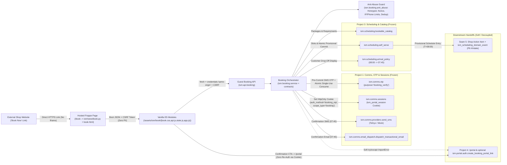
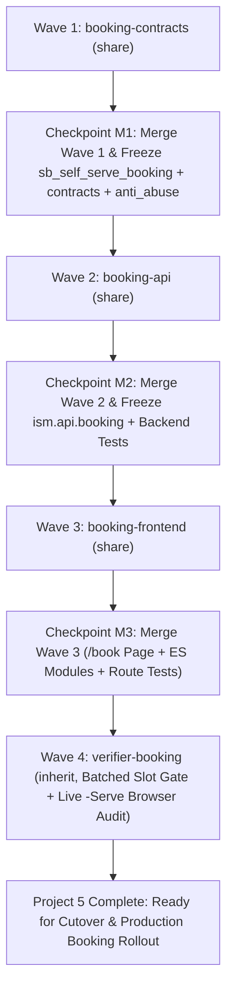

# Project 5: Website Self-Serve Booking Workflow ("Book Now" Funnel) — Technical & Swarm Implementation Plan

| Metadata | Value |
| :--- | :--- |
| **Program Track / Project** | Track A / Project 5 (`P5`) |
| **Prerequisites** | Projects **1** ([`plan_p1_comms_telnyx_otp.md`](./plan_p1_comms_telnyx_otp.md)) and **3** ([`plan_p3_scheduling_offset_catalog.md`](./plan_p3_scheduling_offset_catalog.md)) complete. **Zero dependency on Project 2** (no upfront booking deposit; deposits are manually initiated later on Repair Orders). Aligned with Project **4** ([`plan_p4_customer_portal_expansion.md`](./plan_p4_customer_portal_expansion.md)) for post-booking `/portal` handoff (ships cleanly even before P4 via guarded soft import and auto-upgrades when P4 lands). |
| **Governing Roadmap** | [`ROADMAP.md`](./ROADMAP.md) (derived from `customer_portal_and_infra_roadmap.md`) |
| **Target Repository** | `ism-frappe` (`ism` Frappe v16 / ERPNext v16 app, Python `>=3.14`, zero new PyPI dependencies, zero Node build step) |
| **Recommended Session Entry** | Launch `/swarm` on a fresh feature branch (e.g., `feat/p5-website-self-serve-booking`). By default, follow `native_swarm` rules and omit `model` on `swarm{action:"add"}` so every worker inherits the coordinator's active model. If the user explicitly requests `/model-triage` quota arbitrage, pin the active Gemini 4 tiers listed in Section 4 (`gemini-4-hydrogen-*`, `gemini-4-neon-*`, `gemini-4-carbon-*` only, with mandatory cross-family verification). |

---

## 1. Strategic Objective & Locked Decisions

Deliver a public, mobile-first **"Book Now"** self-serve appointment funnel hosted directly on the ISM Frappe site at **`/book`** (linked directly from the shop's external marketing website button) so prospective and returning customers can select their vehicle, choose one or more curated predictable service packages, pick a live capacity-backed drop-off time, verify their mobile phone via Telnyx SMS OTP before locking shop capacity, receive a clean confirmation SMS/email, and step straight into the Customer Portal (`/portal`) with zero re-authentication.

### Locked Product & Architectural Decisions

All decisions below from `customer_portal_and_infra_roadmap.md` Sections 2, 4, 5, and 8 are **locked** and must not be reopened during execution:

1. **Direct Hosted Frappe Route (`/book`) — Strictly NO Embeddable Iframe Mode:**
   - The external shop website links its "Book Now" CTA directly to `https://<ism-site>/book`.
   - Do **not** implement an iframe embed mode, `postMessage` resize bridge, or third-party cookie workarounds. Enforce `X-Frame-Options: DENY` and `Content-Security-Policy: frame-ancestors 'none'` on `/book` as defense-in-depth against clickjacking.
2. **Zero Node Build Step & Zero Extra Dependencies:**
   - Serve `/book` via Frappe's native `www/` page controller (`ism/www/book.py` + `ism/www/book.html`) and vanilla ES modules + CSS under `ism/public/book/` (`/assets/ism/book/*`).
   - Add **zero** entries to `ism-frappe/pyproject.toml`, **zero** npm/Vite pipelines, and **zero** external CDN runtime dependencies.
3. **Predictable Curated Catalog Only & Live Capacity Backing (Project 3):**
   - Expose strictly `Service Package` records marked `allow_self_serve_booking = 1` via `ism.scheduling.bookable_catalog.list_bookable_packages(...)`, filtered by vehicle model and model year.
   - Compute required shop duration and equipment tags strictly server-side via `compute_packages_booking_requirements(...)` and query open slots via `ism.scheduling.self_serve.find_self_serve_slots(...)`.
4. **Silent Earlier Arrival Offset Everywhere (Project 3 / Seam 4):**
   - Every slot chip, summary card, API payload, confirmation SMS, and confirmation email derives its date and time exclusively from Project 3's `ism.scheduling.arrival_policy.format_customer_appointment_display(...)` / `to_public_slot_projection(...)`.
   - With default `operating_hours_start = 08:00:00` and `customer_arrival_offset_minutes = 15`, an `08:00` internal bay/technician capacity slot is presented everywhere as **`7:45 AM` (`07:45`)** — while `Schedule Entry.scheduled_time` stores **`08:00:00`**.
   - Never expose internal bay IDs, technician names, raw internal start times, or buffer/leeway/early-arrival wording.
5. **Pre-Commit Telnyx SMS OTP Anti-Bot Gate (Project 1 — Zero Email OTP Fallback):**
   - No `Schedule Entry` is ever created until the customer proves possession of their mobile number via `ism.comms.otp.request_sms_otp(..., purpose="booking_verify")` + `verify_sms_otp(..., consume=False)` + atomic `consume_verified_otp_challenge(...)`.
   - Strictly SMS-only OTP (no email OTP fallback). Layered with honeypot trap, HMAC-signed form-fill timing nonce, atomic Redis per-IP hourly caps, Redis + MariaDB daily per-phone caps, active duplicate-booking checks, and double-click idempotency protection.
6. **Zero Upfront Booking Deposit (No Project 2 Dependency):**
   - Self-serve website bookings never request or capture a deposit or credit card. Deposits remain manually initiated by shop staff on Repair Orders (Project 2).
7. **Seamless Persistent-Cookie Portal Handoff & Soft Direct Link Upgrade (Project 1 + Project 4):**
   - Immediately upon committing the provisional `Schedule Entry`, promote the verified OTP into Project 1's persistent signed HttpOnly/Secure session cookie (`ism_portal_session`) via `issue_portal_session(auth_method="booking_otp", scope_type="booking", ...)` so clicking **"Manage Your Appointment"** on the confirmation screen navigates directly to `/portal` with **zero re-authentication**.
   - For confirmation SMS and email direct links (cross-device / future return access), softly import `ism.portal.auth.create_booking_portal_link(schedule_entry)` inside `try/except ImportError`, falling back cleanly to `<site_url>/portal` if Project 4 is not yet deployed.
8. **Safe Default-Off Feature Flag & Disjoint `ISM Settings` Section (Seam 1):**
   - Add strictly disjoint section `sb_self_serve_booking` on `ISM Settings` with `enable_self_serve_booking` defaulting to `0` (`Off`) until the shop finishes curating predictable packages and configures Telnyx SMS.
   - Reuse Project 3's `self_serve_horizon_days`, `self_serve_min_lead_time_minutes`, and `enable_waiter_preference` via `get_self_serve_policy()` — **never** duplicate those fields inside `sb_self_serve_booking`.

---

## 2. System Architecture & Codebase Anchor Audit

### System Architecture & End-to-End Funnel Data Flow



### Real Codebase Anchor Audit (`ism-frappe`) & Frozen Dependency Verification

Every architectural decision below is grounded in direct inspection of live `ism-frappe` files and finalized Wave 1 plans (`#7`, `#8`, `#11`):

| Anchor File / Dependency | Audited Findings | Required P5 Handling |
| :--- | :--- | :--- |
| [hooks.py](file:///d:/ism/ism-frappe/ism/hooks.py) | Lines 139–141 define `website_route_rules = [{"from_route": "/quote-approval", "to_route": "quote_approval"}]`. Line 148 already hooks `ISM Settings.on_update` -> `ism.scheduling.time_utils.invalidate_shop_settings_cache`. | Append `{"from_route": "/book", "to_route": "book"}` to `website_route_rules` in Wave 1 (`booking-contracts`). Leave all other `doc_events`, `scheduler_events`, and `website_route_rules` untouched. |
| [quote_approval.py](file:///d:/ism/ism-frappe/ism/templates/pages/quote_approval.py) & [quote_approval.html](file:///d:/ism/ism-frappe/ism/templates/pages/quote_approval.html) | `quote_approval.py` (28 lines) establishes ISM's guest page pattern: `context.no_cache = 1`, `context.show_sidebar = False`, defensive `try/except` with `frappe.log_error`, and clean error fallback. `quote_approval.html` (634 lines) sets ISM's visual palette (`#1a202c` slate header, `#38a169` confirmation green, `#e2e8f0` borders, `#f7fafc` soft panels, `800px` centered card container) and parses Frappe `_server_messages` defensively (lines 613–626). | Place `/book` under `ism/www/book.{py,html}` with vanilla ES modules under `ism/public/book/` (matching Frappe v16's zero-build pattern used by P4 `/portal` and P6 `/board`+`/cockpit`). Inherit ISM's clean slate/emerald visual language, `context.no_cache = 1`, `context.show_sidebar = False`, CSRF token bootstrapping, and defensive Frappe `_server_messages` error parsing. |
| [ism_settings.json](file:///d:/ism/ism-frappe/ism/ism/doctype/ism_settings/ism_settings.json) & [ism_settings.py](file:///d:/ism/ism-frappe/ism/ism/doctype/ism_settings/ism_settings.py) | Single DocType (`issingle: 1`) with existing sections `sb_approval_settings`, `sb_sms_settings`, `sb_scheduling`, `sb_capacity`, `sb_estimation`, `sb_pricing` (plus P1 `sb_otp_and_sessions`, P2 `sb_square_payments`, P3 `sb_customer_scheduling_policy`, P4 `sb_customer_portal`, P6 `sb_media_storage`/`sb_board_ai`/`sb_parts_pricing`). `ISMSettings.validate()` delegates to per-section `_validate_*()` methods. | Append strictly disjoint section `sb_self_serve_booking` (8 fields + column break) with zero duplication of P3's `sb_customer_scheduling_policy` fields (`self_serve_horizon_days`, `self_serve_min_lead_time_minutes`, `enable_waiter_preference`). Add `_validate_self_serve_booking_settings()` in `ism_settings.py`. |
| [seed.py](file:///d:/ism/ism-frappe/ism/setup_tasks/seed.py) | Lines 54–81 distinguish `_ISM_SETTINGS_FALSY_DEFAULTS` (fills blank/0) from `_ISM_SETTINGS_NONE_DEFAULTS` (preserves explicit `0` across `bench migrate`). | Register zero-capable `Check` flags (`enable_self_serve_booking=0`, `self_serve_require_email=0`, `self_serve_honeypot_enabled=1`) in `_ISM_SETTINGS_NONE_DEFAULTS`, and positive strings/ints (`self_serve_booking_title`, `self_serve_booking_intro`, `self_serve_max_packages_per_booking=5`, `self_serve_booking_ip_rate_limit_per_hour=15`, `self_serve_booking_phone_rate_limit_per_day=3`) in `_ISM_SETTINGS_FALSY_DEFAULTS`. |
| [approval.py](file:///d:/ism/ism-frappe/ism/api/approval.py) & [_validation.py](file:///d:/ism/ism-frappe/ism/api/_validation.py) | `approval.py` L555–560 reads shop branding via `Company` (`company_name`, `phone_no`, `email`). `_validation.py` provides `require_str`, `optional_str`, `require_int`, `optional_int` rejecting booleans/containers. | Reuse `ism.api._validation` helpers in `ism/api/booking.py` and resolve shop branding cleanly from ERPNext's default `Company` (`frappe.defaults.get_global_default("company")` or first `Company` record) for `/book` header, disabled banner, and confirmation SMS/email. |
| [service_package.json](file:///d:/ism/ism-frappe/ism/ism/doctype/service_package/service_package.json) | Line 42 locks `applicable_model` options to `Model 3`, `Model Y`, `Model S`, `Model X`, `Cybertruck`, `Roadster`, `All Models`. | Mirror the exact 6 customer-selectable vehicle models (`Model 3`, `Model Y`, `Model S`, `Model X`, `Cybertruck`, `Roadster`) in `ism/booking/contracts.py::ALLOWED_VEHICLE_MODELS` so Step 1 vehicle selection always aligns with P3 catalog filters (`All Models` packages automatically match every vehicle). |
| [ism/www/](file:///d:/ism/ism-frappe/ism/) & [ism/public/](file:///d:/ism/ism-frappe/ism/public/) | `ism/www/` does not yet exist; `ism/public/` contains only `.gitkeep`. | Wave 3 (`booking-frontend`) creates `ism/www/book.py`, `ism/www/book.html`, and `ism/public/book/{book.css,api.js,state.js,app.js}`. Do **not** create `ism/www/__init__.py` (Frappe's website router discovers `www/*.html` without it, avoiding any merge collision with P4 `/portal` or P6 `/board`+`/cockpit`). |
| [pyproject.toml](file:///d:/ism/ism-frappe/pyproject.toml) | `dependencies = []`, Python `>=3.14`, Ruff rules `F, E, W, I, UP, B, RUF`, `indent-style = "tab"`, `line-length = 110`. | Add **zero** external dependencies; follow tab indentation and clean Ruff compliance across all Python modules. |
| **Project 1 Frozen Contracts** ([`plan_p1_comms_telnyx_otp.md`](./plan_p1_comms_telnyx_otp.md)) | Exports `normalize_phone_e164`, `mask_phone_e164`, `get_client_ip`, `get_sms_unconfigured_reason`, `send_sms(SMSDispatchRequest)` (with `message_type="Booking Confirmation"`), `request_sms_otp(..., purpose="booking_verify")`, `verify_sms_otp(..., consume=False)`, `consume_verified_otp_challenge(...)`, `get_last_mock_otp`, `issue_portal_session(auth_method="booking_otp", scope_type="booking", ...)`, `verify_portal_session`, and `dispatch_transactional_email`. Note: `Customer Portal Session.source_otp_challenge` is a `Link` to `Portal OTP Challenge` (`name`, not `challenge_id`). | Consume exact P1 signatures. Always resolve `Portal OTP Challenge.name` via `challenge_id` before passing `source_otp_challenge` to `issue_portal_session(...)` so Frappe's `Link` field validates cleanly. |
| **Project 3 Frozen Contracts** ([`plan_p3_scheduling_offset_catalog.md`](./plan_p3_scheduling_offset_catalog.md)) | Exports `list_bookable_packages`, `compute_packages_booking_requirements`, `get_self_serve_policy`, `find_self_serve_slots`, `normalize_provisional_intake`, `create_provisional_booking(..., booking_source="Website Self-Serve", emit_notification=True)`, `format_customer_appointment_display`, `to_internal_slot_start`. | Consume exact P3 contracts server-side after P5 anti-abuse & P1 OTP checks. Never call P3's staff-only `submit_provisional_booking` API from Guest; invoke `ism.scheduling.self_serve.create_provisional_booking(...)` directly from `ism.booking.service`. |
| **Project 4 Frozen Handoff** (Board `#11`) | Public route `/portal` restores `scope_type="booking"` sessions set by `booking_otp` with zero re-auth and exports `ism.portal.auth.create_booking_portal_link(schedule_entry) -> str` (`/portal?booking_token=<token>`). | Confirm screen links directly to `/portal` (relying on `ism_portal_session` HttpOnly cookie). Confirmation SMS/email calls `resolve_booking_portal_link(schedule_entry)` which softly imports `ism.portal.auth.create_booking_portal_link` via `try/except ImportError` and normalizes relative paths to full URLs via `frappe.utils.get_url(...)`, falling back cleanly to `frappe.utils.get_url("/portal")`. |

---

## 3. Locked Architectural, Security & Cross-Track Invariants

1. **Zero `development.localhost:8000` Contact (Strict Bench Isolation):**
   - Never run `sync-to-wsl.ps1`, `watch-sync.*`, `promote-to-main.ps1`, or raw `wsl`/`docker exec` targeting `frappe-bench` or `development.localhost`.
   - Execute all migrations, unit/integration suites, and live `-Serve` browser walkthroughs exclusively via `powershell -ExecutionPolicy Bypass -File scripts\test-in-slot.ps1`.
   - Never fire parallel `test-in-slot.ps1` calls inside the same worktree; batch comma-separated `-Module` flags into a single invocation.
2. **Direct Hosted Frappe Route (`/book`) — Zero Iframe Mode & Anti-Clickjacking:**
   - `/book` is served directly by Frappe (`ism/www/book.py` + `ism/www/book.html`) and linked directly from the external shop website's "Book Now" button.
   - `/book` sets `X-Frame-Options: DENY` and `Content-Security-Policy: frame-ancestors 'none'` so the booking funnel cannot be clickjacked inside a third-party iframe.
   - Zero Node/Vite build step: `ism/public/book/{book.css,api.js,state.js,app.js}` are native browser ES modules + CSS served directly from `/assets/ism/book/`.
3. **Zero Disclosure of Shop Internals, Buffer Mechanics, or Master IDs:**
   - No guest endpoint, HTML boot payload, confirmation screen, confirmation SMS, or confirmation email may EVER contain:
     - `service_bay`, `available_bay_ids`, `assigned_technician`, `available_technicians`, `bottleneck`, `effective_capacity`, `internal_start_time`, `start_time`, `offset_minutes`, `customer_arrival_offset_minutes`, `correction_code`, `hourly_rate`, or internal `item_code`/supplier costs.
     - Matched internal `Customer` or `Repair Vehicle` master document IDs (internal resolution for `issue_portal_session(customer=...)` stays strictly server-side and is never serialized into guest API JSON).
     - Any buffer/leeway wording (`"buffer"`, `"leeway"`, `"grace period"`, `"arrive early"`, `"15 minutes early"`).
     - Raw `cookie_value` or raw OTP codes in any HTTP JSON body, HTML output, or audit log.
4. **Strict Pre-Commit SMS OTP Gate & Deadlock-Free Single-Use Consumption:**
   - Zero `Schedule Entry` rows may be inserted unless a `Portal OTP Challenge` with `purpose="booking_verify"` and matching E.164 `phone_e164` has been cryptographically verified via P1 `verify_sms_otp(..., consume=False)` and atomically consumed via `consume_verified_otp_challenge(...)`.
   - **Canonical Lock Hierarchy (Deadlock-Free):** `Portal OTP Challenge` (`FOR UPDATE` inside `consume_verified_otp_challenge`) -> `Service Bay` (`ORDER BY name ASC FOR UPDATE` inside P3 `create_provisional_booking`) -> `Employee` (`ORDER BY name ASC FOR UPDATE` inside P3 `create_provisional_booking`). Because no other code path locks `Service Bay`/`Employee` before `Portal OTP Challenge`, lock ordering is strictly acyclic.
   - **Slot-Conflict Recovery Without Re-Sending SMS:** `verify_sms_otp(..., consume=False)` commits `status="Verified"` before entering `frappe.db.savepoint("p5_booking_commit")`. Inside the savepoint, `consume_verified_otp_challenge` locks and stamps `consumed_at`, then `create_provisional_booking` reserves capacity. If the chosen slot was taken seconds earlier (`SLOT_UNAVAILABLE`), rolling back the savepoint restores `consumed_at = NULL` while preserving `status = "Verified"` so the customer can immediately pick another slot and finish without burning a second SMS — while concurrent requests serialize on `Portal OTP Challenge FOR UPDATE` so at most ONE booking can ever commit per OTP challenge!
5. **Layered Anti-Abuse Protection (Honeypot, Timing Nonce, Atomic Rate Limits, Duplicate & Idempotency Guards):**
   - **Honeypot Trap:** When `self_serve_honeypot_enabled == 1`, any non-empty decoy field (`website_url`) fails cleanly (`BOT_DETECTED`, HTTP `400`) before touching Redis SMS quotas or DB writes.
   - **Signed Form-Fill Timing Nonce:** `get_booking_boot_config()` issues an HMAC-SHA256-signed `form_nonce` (`v1.<issued_ts>.<rand>.<sig>` signed with `portal_session_signing_secret` + domain separator `b":booking-nonce-v1"`). `request_booking_otp` verifies the nonce signature, rejects instant bot submissions (`elapsed < 2s` -> `SUBMISSION_TOO_FAST`, HTTP `400`), and rejects stale nonces (`elapsed > 4h` -> `FORM_EXPIRED`, HTTP `400`).
   - **Atomic Redis Per-IP & Per-Phone Quotas:** Atomic `INCR` + `EXPIRE` enforces per-IP read quotas (`60/hour`), per-IP booking write/OTP quotas (`self_serve_booking_ip_rate_limit_per_hour`, default `15/hour`), and per-phone daily booking caps (`self_serve_booking_phone_rate_limit_per_day`, default `3/day` backed by BOTH Redis and authoritative MariaDB 24-hour count of `Website Self-Serve` `Schedule Entry` rows). Exceeded quotas return HTTP `429` (`RATE_LIMITED`).
   - **Duplicate-Booking Guard:** Blocks a phone from creating a second active (`Scheduled`/`Confirmed`) provisional booking on the same `target_date` with an overlapping time or identical `(target_date, internal_start_time)`, returning HTTP `409` (`DUPLICATE_BOOKING`) with a helpful prompt to manage their existing appointment at `/portal`.
   - **Double-Click Idempotency:** Optional client-generated `idempotency_key` deduplicates accidental mobile double-taps for `(idempotency_key, phone_e164, challenge_id)` over a 10-minute Redis TTL.
   - **Safe Feature Toggle & Unconfigured SMS Fail-Closed:** When `enable_self_serve_booking == 0`, `/book` renders a clean branded unavailable state and all booking endpoints return HTTP `503` (`BOOKING_DISABLED`). When `enable_self_serve_booking == 1` but P1's `get_sms_unconfigured_reason()` returns a reason (`sms_gateway_provider == "Disabled"`), `initiate_booking_otp` and `verify_and_commit_booking` fail closed (`SMS_UNCONFIGURED`, HTTP `503`) so unverified bookings can never sneak through.
6. **Cross-Track Seam Invariants (Seams 1, 4, 5 & P4 Cookie Handoff):**
   - **Seam 1 (`ISM Settings`):** P5 touches ONLY `sb_self_serve_booking`. Zero collisions with P1 (`sb_sms_settings`, `sb_otp_and_sessions`), P2 (`sb_square_payments`), P3 (`sb_customer_scheduling_policy`), P4 (`sb_customer_portal`), or P6 (`sb_media_storage`, `sb_board_ai`, `sb_parts_pricing`). Zero duplication of P3 policy fields.
   - **Seam 4 (Dual-Time Parity):** Every P5 customer-facing time is sourced from P3's `arrival_policy` (`T_cust = T - offset`), while internal `Schedule Entry.scheduled_time` remains `T` for Desk and P6 `/cockpit`.
   - **Seam 5 (Shop Floor Visibility):** P3's `create_provisional_booking(..., booking_source="Website Self-Serve", emit_notification=True)` automatically creates a deduplicated `Shop Action Item` and publishes `ism_scheduling_domain_event` — surfaced automatically onto P6 `/board` `#Intake` when Shop OS is installed, with zero hard import of Shop OS DocTypes in P5.
   - **P4 Handoff Contract:** `confirm_self_serve_booking` sets `ism_portal_session` (`auth_method="booking_otp"`, `scope_type="booking"`, `schedule_entry=...`, `phone_e164=...`, `customer=matched_customer_or_None`) with `HttpOnly`, `Secure`, `SameSite=Lax`, `Path=/`, and frontend `api.js` always sends `credentials: "same-origin"` so the browser stores the cookie and enters `/portal` authenticated with zero re-prompt.

---

## 4. Swarm Plugin Execution Blueprint

### Hard Guardrails
- **Workspace Concurrency Ceiling:** Maximum `3` concurrent `workspace:"share"` authors per wave (Project 5 uses 1 focused author per implementation wave across Waves 1–3 so each wave builds and tests directly against merged upstream contracts — zero merge friction and minimal slot usage inside `slot-1`..`slot-5`).
- **Strict Disjoint File Ownership:** Every worker brief explicitly enumerates owned files and forbidden files. No two concurrent workers ever edit the same file.
- **Model Selection Rule:**
  - **Default `/swarm` behavior (`native_swarm`):** Omit `model` on `swarm{action:"add"}` so every worker inherits the coordinator's active model.
  - **Optional `/model-triage` behavior (only when user requests Gemini 4 tier arbitrage):** Run `swarm{action:"models", all:true}` once, restrict strictly to active Gemini 4 tiers (`gemini-4-hydrogen-*`, `gemini-4-neon-*`, `gemini-4-carbon-*`; never `argon-*`, `Gemini 3.8 Flash`, `Claude`, `GPT-OSS`, `Neon (Low)`, `Hydrogen (High/XHigh)`, or leaf `Orchestrator`), and enforce **cross-family verification** (`neon-medium` and `neon-high` authors verified by `gemini-4-carbon-high`).
- **In-Place Model Escalation:** If a worker stalls or fails verification twice, wait until its state is `waiting` and upgrade in-place with `swarm{action:"model", name, model}` — never `kill` + `add` to switch models.
- **Merge Before `kill`:** Always merge each `workspace:"share"` worker's commits onto the integration branch and confirm clean `git status` BEFORE calling `swarm{action:"kill", name}` (since `kill` permanently deletes the share workspace).

### Coordinator Startup Protocol
1. Confirm Prerequisites **P1** and **P3** are present on the base branch and create a clean feature/integration branch (e.g., `git checkout -b feat/p5-website-self-serve-booking`), never mutating canonical `main` directly during active swarm merges.
2. *(Only if `/model-triage` is active)* Run `swarm{"action": "models", "all": true}` once to confirm active Gemini 4 model IDs and available quota.
3. Name the swarm immediately:
   ```text
   swarm{"action": "title", "title": "P5 Website Self-Serve Booking Funnel"}
   ```
4. Spawn `monitor` (optional, only if `swarm_monitor` is in the skill list; never include `monitor` in `plan.json` or assign tasks to it) and spawn **Wave 1** (`booking-contracts`, `workspace:"share"`).
5. Write the Swarm UI Overview plan file to `<appData>/brain/<coordinator-conversation-id>/.system_generated/swarm/plan.json` (deliverable workers only):
   ```json
   {
     "goal": {
       "title": "Website Self-Serve Booking Funnel",
       "line": "Deliver /book route, anti-abuse OTP commit API, and /portal cookie handoff."
     },
     "tasks": {
       "booking-contracts": "Add ISM Settings section, /book route rule, contracts, and anti-abuse guards",
       "booking-api": "Build booking service, guest OTP-commit API, and funnel abuse tests",
       "booking-frontend": "Build mobile-first /book page and vanilla ES module 5-step wizard",
       "verifier-booking": "Run batched slot tests, ruff check, and live /book browser walkthrough"
     },
     "threads": [
       {
         "id": "t-foundations",
         "title": "Settings, contracts, and anti-abuse guards",
         "goal": "Freeze sb_self_serve_booking settings, /book route, and abuse guards.",
         "tasks": ["booking-contracts"]
       },
       {
         "id": "t-api",
         "title": "Guest booking API and OTP commit flow",
         "goal": "Wire P1 OTP/sessions, P3 slots/booking, confirmations, and P4 handoff.",
         "tasks": ["booking-api"]
       },
       {
         "id": "t-frontend",
         "title": "Hosted /book mobile-first frontend",
         "goal": "Ship zero-build vanilla ES module 5-step wizard and route tests.",
         "tasks": ["booking-frontend"]
       },
       {
         "id": "t-verify",
         "title": "Full-stack slot and live browser gate",
         "goal": "Prove offset parity, abuse throttling, and seamless /portal handoff.",
         "tasks": ["verifier-booking"]
       }
     ]
   }
   ```
6. Execute Merge Checkpoints **`M1`** (after Wave 1), **`M2`** (after Wave 2), and **`M3`** (after Wave 3): merge each finished `share` worker branch onto the integration branch, verify clean `git status` and frozen contracts, kill the landed `share` worker, and spawn the next wave.
7. After **Wave 4** (`verifier-booking`) posts `@coordinator [done]` with all batched tests, `ruff check`, live `-Serve` browser checks, and Exit KPIs green, kill temporary workers, post a final unaddressed `[done] <summary>` line so `monitor` quiets, and present the readiness report to the user.

### Worker Roster & Pinning Table

> **Default vs. `/model-triage` Note:** Leave `model` omitted on `swarm{action:"add"}` by default (`native_swarm` inheritance). Apply the **Optional `/model-triage` Model ID** column only when explicit Gemini 4 quota arbitrage is requested. All worker names conform strictly to `^[a-z0-9][a-z0-9_-]{0,23}$`.

| Worker Name | Wave | Role & Strict File Ownership | Workspace | Optional `/model-triage` Model ID | Depends On | Why This Assignment |
| :--- | :---: | :--- | :---: | :--- | :---: | :--- |
| `booking-contracts` | 1 | `ism_settings.{json,py,test_ism_settings.py}`, `seed.py`, `hooks.py` (`/book`), `ism/booking/__init__.py` (initial), `ism/booking/contracts.py`, `ism/booking/anti_abuse.py` | `share` | `gemini-4-neon-medium` | — | Disjoint Seam 1 settings, HMAC timing nonce, atomic Redis + DB rate limits, duplicate-booking & idempotency guards |
| `booking-api` | 2 | `ism/booking/service.py`, final `ism/booking/__init__.py`, `ism/api/booking.py`, `ism/tests/test_booking_funnel_and_abuse.py` | `share` | `gemini-4-neon-high` | `M1` | Security-critical pre-commit OTP gate, savepoint/single-use race semantics, P1 cookie promotion, P3 offset parity, soft P4 handoff, comprehensive abuse tests |
| `booking-frontend` | 3 | `ism/www/book.py`, `ism/www/book.html`, `ism/public/book/{book.css,api.js,state.js,app.js}`, append `TestBookingHostedRoute` to `ism/tests/test_booking_funnel_and_abuse.py` | `share` | `gemini-4-neon-medium` | `M2` | Mobile-first 5-step vanilla ES module wizard, XSS-safe DOM rendering, CSRF + `same-origin` cookie handoff, OTP countdown & slot-conflict recovery UX |
| `verifier-booking` | 4 | Read-only cross-family verification gate: single batched `test-in-slot.ps1` (P5 + P1/P3/settings regression), `ruff check`, live `-Serve` browser walkthrough on `/book` -> `/portal`, security & Seam 1/4/5 audit | `inherit` | `gemini-4-carbon-high` | `M3` | Strict cross-family verifier for all `neon-*` authors + highest PowerShell/WSL & live browser verification reliability |
| `monitor` *(optional)* | 1–4 | Standard `swarm_monitor` stall watcher (omit if `swarm_monitor` skill absent) | `inherit` | `gemini-4-hydrogen-low` | — | Lightweight timer-based stall detection |

### Wave Dependency Graph



### Self-Contained Per-Worker Brief Templates

#### Wave 1 — `booking-contracts` (`workspace:"share"`)
> You own **Wave 1** of Project 5 (`todo_snippets/roadmap/plan_p5_website_self_serve_booking.md` Section 5, Wave 1).
> **Owned files (create/modify ONLY these):**
> - `[MODIFY]` `ism-frappe/ism/ism/doctype/ism_settings/ism_settings.json`
> - `[MODIFY]` `ism-frappe/ism/ism/doctype/ism_settings/ism_settings.py`
> - `[MODIFY]` `ism-frappe/ism/ism/doctype/ism_settings/test_ism_settings.py`
> - `[MODIFY]` `ism-frappe/ism/setup_tasks/seed.py`
> - `[MODIFY]` `ism-frappe/ism/hooks.py`
> - `[NEW]` `ism-frappe/ism/booking/__init__.py` (initial stub exporting `contracts` and `anti_abuse`)
> - `[NEW]` `ism-frappe/ism/booking/contracts.py`
> - `[NEW]` `ism-frappe/ism/booking/anti_abuse.py`
> **Forbidden files:** Do NOT edit any `ISM Settings` section outside `sb_self_serve_booking`, do NOT duplicate P3 fields (`self_serve_horizon_days`, `self_serve_min_lead_time_minutes`, `enable_waiter_preference`), and do NOT touch `ism/comms/*`, `ism/scheduling/*`, `ism/api/scheduling.py`, `ism/www/*`, `ism/public/*`, or `pyproject.toml`. Never contact `development.localhost:8000`.
> **Requirements:** Implement Section 5 Wave 1 verbatim: disjoint `sb_self_serve_booking` schema & validation bounds, zero-preserving `seed.py` defaults, `{"from_route": "/book", "to_route": "book"}` in `hooks.py`, frozen `contracts.py` (including guarded soft P4 `resolve_booking_portal_link`), and `anti_abuse.py` (honeypot, HMAC-signed timing nonce, atomic Redis IP limits, Redis + MariaDB daily phone cap, active duplicate-booking guard, idempotency cache, `clear_booking_rate_limits`).
> **Verification & Done:** Run `ruff check` on all owned Python files and run `powershell -ExecutionPolicy Bypass -File scripts\test-in-slot.ps1 -Module "ism.ism.doctype.ism_settings.test_ism_settings"`. Commit cleanly on your share branch and post `@coordinator [done]` with commit SHA, exact exported symbols, and test/ruff output.

#### Wave 2 — `booking-api` (`workspace:"share"`, after `M1`)
> Wave 1 (`booking-contracts`, `#<M1-seq>`) is merged on your base branch. You own **Wave 2** of Project 5 (`todo_snippets/roadmap/plan_p5_website_self_serve_booking.md` Section 5, Wave 2).
> **Owned files (create/modify ONLY these):**
> - `[NEW]` `ism-frappe/ism/booking/service.py`
> - `[MODIFY]` `ism-frappe/ism/booking/__init__.py` (final public exports)
> - `[NEW]` `ism-frappe/ism/api/booking.py`
> - `[NEW]` `ism-frappe/ism/tests/test_booking_funnel_and_abuse.py`
> **Forbidden files:** Do NOT edit `ism_settings.*`, `seed.py`, `hooks.py`, `ism/comms/*`, `ism/scheduling/*`, `ism/www/*`, `ism/public/*`, or `pyproject.toml`. Never contact `development.localhost:8000`.
> **Requirements:** Implement Section 5 Wave 2 verbatim: `service.py` orchestrating P3 `bookable_catalog`/`self_serve`/`arrival_policy`, P1 `otp`/`sessions`/`providers`/`email_dispatch`, Wave 1 `anti_abuse`, savepoint-wrapped single-use OTP consume + provisional commit (preserving verified OTP on `SLOT_UNAVAILABLE` while blocking concurrent double-consume), `ism_portal_session` cookie promotion (`auth_method="booking_otp"`, `scope_type="booking"`, resolving `Portal OTP Challenge.name` for `source_otp_challenge`), non-fatal confirmation SMS/email strictly showing P3 customer arrival time (zero buffer/bay/tech wording) with soft P4 `create_booking_portal_link` fallback, all 5 guest endpoints in `ism/api/booking.py`, and full backend/abuse/race/handoff coverage in `test_booking_funnel_and_abuse.py`.
> **Verification & Done:** Run `ruff check` on all owned Python files and run `powershell -ExecutionPolicy Bypass -File scripts\test-in-slot.ps1 -Module "ism.tests.test_booking_funnel_and_abuse"`. Commit cleanly on your share branch and post `@coordinator [done]` with commit SHA, exact API endpoint contracts, and test/ruff output.

#### Wave 3 — `booking-frontend` (`workspace:"share"`, after `M2`)
> Wave 2 (`booking-api`, `#<M2-seq>`) is merged on your base branch. You own **Wave 3** of Project 5 (`todo_snippets/roadmap/plan_p5_website_self_serve_booking.md` Section 5, Wave 3).
> **Owned files (create/modify ONLY these):**
> - `[NEW]` `ism-frappe/ism/www/book.py`
> - `[NEW]` `ism-frappe/ism/www/book.html`
> - `[NEW]` `ism-frappe/ism/public/book/book.css`
> - `[NEW]` `ism-frappe/ism/public/book/api.js`
> - `[NEW]` `ism-frappe/ism/public/book/state.js`
> - `[NEW]` `ism-frappe/ism/public/book/app.js`
> - `[MODIFY]` `ism-frappe/ism/tests/test_booking_funnel_and_abuse.py` (append `TestBookingHostedRoute` class ONLY; do NOT modify Wave 2 test classes)
> **Forbidden files:** Do NOT edit `ism/booking/*`, `ism/api/booking.py`, `ism_settings.*`, `hooks.py`, `ism/www/portal.*`, `ism/templates/pages/quote_approval.*`, or `pyproject.toml`. Do NOT create `ism/www/__init__.py` or introduce any Node build tool. Never contact `development.localhost:8000`.
> **Requirements:** Implement Section 5 Wave 3 verbatim: hosted Frappe route `/book` (`no_cache=1`, `show_sidebar=False`, `X-Frame-Options: DENY`, `Content-Security-Policy: frame-ancestors 'none'`, zero-PII boot JSON, CSRF token), mobile-first responsive CSS, vanilla ES modules (`api.js` with `credentials: "same-origin"` & `X-Frappe-CSRF-Token`, `state.js` 5-step FSM with zero `localStorage` PII, XSS-safe `app.js` using `textContent`/`createElement`), 5-step flow (Vehicle -> Predictable Packages -> Arrival Slot Picker -> Customer Info & SMS OTP with slot-conflict recovery -> Confirmation + `/portal` CTA), and `TestBookingHostedRoute` tests.
> **Verification & Done:** Run `ruff check ism-frappe/ism/www/book.py ism-frappe/ism/tests/test_booking_funnel_and_abuse.py` and `powershell -ExecutionPolicy Bypass -File scripts\test-in-slot.ps1 -Module "ism.tests.test_booking_funnel_and_abuse"`. Commit cleanly on your share branch and post `@coordinator [done]` with commit SHA and test/lint output.

#### Wave 4 — `verifier-booking` (`workspace:"inherit"`, after `M3`)
> Wave 3 (`booking-frontend`, `#<M3-seq>`) is merged onto the integration branch. You are the read-only cross-family verification gate (`todo_snippets/roadmap/plan_p5_website_self_serve_booking.md` Section 6). Do NOT edit application files; if you uncover defects, report exact `file:line` findings directly to `@booking-contracts`, `@booking-api`, or `@booking-frontend` (or `@coordinator`).
> **Checklist:**
> 1. Run the single batched `test-in-slot.ps1` acceptance command from Section 6 covering `test_booking_funnel_and_abuse`, `test_ism_settings`, and P1/P3 regression suites.
> 2. Run `ruff check` across all new and modified Python files (`0` errors).
> 3. Run the isolated `-Serve` live browser walkthrough on the leased slot URL (`http://wtN.localhost:800N/book`, NEVER `development.localhost:8000`) proving: disabled-state gate, mobile + desktop 5-step booking, `08:00` -> `07:45` opening-slot parity across UI/DB/SMS/email with zero buffer/bay/tech disclosure, honeypot/rate-limit/duplicate throttling, `X-Frame-Options: DENY` header, and seamless `ism_portal_session` HttpOnly cookie handoff to `/portal`. Stop `-Serve` cleanly afterward.
> 4. Audit all Exit KPIs (Seam 1/4/5 isolation, zero extra deps in `pyproject.toml`, zero Node artifacts, clean `git status`, zero `development.localhost:8000` contact).
> **Done:** Post `@coordinator [done]` with exact pass counts, live browser findings, and full KPI sign-off.

---

## 5. Detailed Wave-by-Wave Implementation Specification

### Wave 1 — Settings, Route Rule, Frozen Contracts & Anti-Abuse Engine (`booking-contracts`)

#### 1. `[MODIFY]` `ism-frappe/ism/ism/doctype/ism_settings/ism_settings.json`
Append one strictly disjoint section **`sb_self_serve_booking`** after P3's `sb_customer_scheduling_policy` (zero collision with P1, P2, P3, P4, or P6 sections, and zero duplication of P3's `self_serve_horizon_days`, `self_serve_min_lead_time_minutes`, or `enable_waiter_preference`):

| Fieldname | Fieldtype | Default | Options / Constraints | Purpose |
| :--- | :--- | :--- | :--- | :--- |
| `sb_self_serve_booking` | `Section Break` | — | Label: `Website Self-Serve Booking Funnel` | Disjoint Project 5 settings section (Seam 1) |
| `enable_self_serve_booking` | `Check` | `0` | `0` or `1` | Master feature flag for `/book` and guest booking endpoints (safe default off) |
| `self_serve_booking_title` | `Data` | `Book Your Service Appointment` | Max 140 chars | Customer-facing hero title on `/book` |
| `self_serve_booking_intro` | `Small Text` | `Select your vehicle and service package to view live drop-off times and book online.` | Plain text | Customer-facing intro subtitle on `/book` (zero buffer wording) |
| `self_serve_max_packages_per_booking` | `Int` | `5` | Range `1..10` | Max predictable `Service Package` items selectable in one booking (bounded by P3 `MAX_PACKAGES_PER_BOOKING = 10`) |
| `cb_self_serve_booking` | `Column Break` | — | — | Two-column Desk layout |
| `self_serve_require_email` | `Check` | `0` | `0` or `1` | When checked, requires valid customer email before OTP/commit |
| `self_serve_booking_ip_rate_limit_per_hour` | `Int` | `15` | Range `1..500` | Max booking OTP/commit requests per client IP per hour |
| `self_serve_booking_phone_rate_limit_per_day` | `Int` | `3` | Range `1..20` | Max self-serve bookings per normalized E.164 phone per rolling 24 hours |
| `self_serve_honeypot_enabled` | `Check` | `1` | `0` or `1` | Enables anti-bot hidden decoy field & signed form-fill timing nonce |

#### 2. `[MODIFY]` `ism-frappe/ism/ism/doctype/ism_settings/ism_settings.py` & `test_ism_settings.py`
- In `ISMSettings.validate()`, call `self._validate_self_serve_booking_settings()`:
  - Enforce `1 <= self_serve_max_packages_per_booking <= 10` (if set).
  - Enforce `1 <= self_serve_booking_ip_rate_limit_per_hour <= 500` (if set).
  - Enforce `1 <= self_serve_booking_phone_rate_limit_per_day <= 20` (if set).
  - Trim `self_serve_booking_title` and `self_serve_booking_intro` cleanly.
- In `test_ism_settings.py`, append tests asserting all 8 `sb_self_serve_booking` defaults, validation rejections (`max_packages=0`, `max_packages=11`, `ip_rate_limit=0`, `phone_rate_limit=0`), and `setup_default_ism_settings()` preserving explicit `enable_self_serve_booking=0` and `self_serve_honeypot_enabled=0` across re-seeding.

#### 3. `[MODIFY]` `ism-frappe/ism/setup_tasks/seed.py` & `ism-frappe/ism/hooks.py`
- **`seed.py`:**
  - Append to `_ISM_SETTINGS_NONE_DEFAULTS`:
    - `("enable_self_serve_booking", 0)`
    - `("self_serve_require_email", 0)`
    - `("self_serve_honeypot_enabled", 1)`
  - Append to `_ISM_SETTINGS_FALSY_DEFAULTS`:
    - `("self_serve_booking_title", "Book Your Service Appointment")`
    - `("self_serve_booking_intro", "Select your vehicle and service package to view live drop-off times and book online.")`
    - `("self_serve_max_packages_per_booking", 5)`
    - `("self_serve_booking_ip_rate_limit_per_hour", 15)`
    - `("self_serve_booking_phone_rate_limit_per_day", 3)`
- **`hooks.py`:**
  - Append `{"from_route": "/book", "to_route": "book"}` to `website_route_rules` (preserving `/quote-approval` and any routes added by other tracks).

#### 4. `[NEW]` `ism-frappe/ism/booking/contracts.py` & initial `ism-frappe/ism/booking/__init__.py`
Defines frozen constants, typed structures, cached settings reader, shop branding helper, and soft P4 link handoff:

```python
BOOKING_ROUTE: str = "/book"
PORTAL_ROUTE: str = "/portal"
BOOKING_OTP_PURPOSE: str = "booking_verify"
BOOKING_SESSION_AUTH_METHOD: str = "booking_otp"
BOOKING_SESSION_SCOPE_TYPE: str = "booking"
BOOKING_SOURCE: str = "Website Self-Serve"

ALLOWED_VEHICLE_MODELS: tuple[str, ...] = (
	"Model 3",
	"Model Y",
	"Model S",
	"Model X",
	"Cybertruck",
	"Roadster",
)
VEHICLE_MIN_YEAR: int = 2008
MIN_FORM_FILL_SECONDS: int = 2
MAX_FORM_NONCE_AGE_SECONDS: int = 4 * 3600
BOOKING_READ_IP_RATE_LIMIT_PER_HOUR: int = 60
BOOKING_IDEMPOTENCY_TTL_SECONDS: int = 600
HONEYPOT_FIELD_NAME: str = "website_url"

# Canonical structured error codes returned by ism.booking & ism.api.booking
ERR_BOOKING_DISABLED: str = "BOOKING_DISABLED"
ERR_SMS_UNCONFIGURED: str = "SMS_UNCONFIGURED"
ERR_BOT_DETECTED: str = "BOT_DETECTED"
ERR_SUBMISSION_TOO_FAST: str = "SUBMISSION_TOO_FAST"
ERR_FORM_EXPIRED: str = "FORM_EXPIRED"
ERR_RATE_LIMITED: str = "RATE_LIMITED"
ERR_PHONE_DAILY_LIMIT: str = "PHONE_DAILY_LIMIT"
ERR_DUPLICATE_BOOKING: str = "DUPLICATE_BOOKING"
ERR_SLOT_UNAVAILABLE: str = "SLOT_UNAVAILABLE"
ERR_EMAIL_REQUIRED: str = "EMAIL_REQUIRED"
ERR_MAX_PACKAGES_EXCEEDED: str = "MAX_PACKAGES_EXCEEDED"
```

- **Frozen Dataclasses (each implementing `.to_dict() -> dict`):**
  - `BookingConfigSnapshot`: `enable_self_serve_booking: bool`, `title: str`, `intro: str`, `max_packages_per_booking: int`, `require_email: bool`, `ip_rate_limit_per_hour: int`, `phone_rate_limit_per_day: int`, `honeypot_enabled: bool`.
  - `BookingAntiAbuseResult`: `allowed: bool`, `error_code: str | None = None`, `error: str | None = None`, `http_status: int = 200`, `retry_after_seconds: int = 0`.
  - `BookingConfirmationPayload`: `success: bool`, `booking_reference: str`, `appointment: dict`, `packages: list[dict]`, `vehicle_display: str`, `waiter_preference: str`, `portal_handoff: dict`, `notifications: dict`, `shop: dict`.
- **Frozen Helper Functions:**
  - `get_booking_settings() -> BookingConfigSnapshot`: Reads `sb_self_serve_booking` fields from `ISM Settings` with safe bounds (`1 <= max_packages <= 10`, etc.).
  - `is_booking_enabled() -> tuple[bool, str | None]`: Returns `(True, None)` only when `enable_self_serve_booking == 1`; otherwise `(False, ERR_BOOKING_DISABLED)`.
  - `get_shop_branding() -> dict`: Resolves default ERPNext `Company` (`company_name`, `phone_no`, `email`) safely without throwing if unset; never returns internal accounting fields.
  - `resolve_booking_portal_link(schedule_entry: str) -> tuple[str, bool]`:
    - Softly imports `ism.portal.auth.create_booking_portal_link`:
      ```python
      try:
          from ism.portal.auth import create_booking_portal_link
      except ImportError:
          return frappe.utils.get_url(PORTAL_ROUTE), False
      ```
    - Invokes `raw_link = create_booking_portal_link(schedule_entry)`. Supports `str` (canonical P4 contract) and defensively extracts `url`/`portal_url` if a dict is returned. Converts relative paths (`"/portal?booking_token=..."`) via `frappe.utils.get_url(raw_link)`. Logs any unexpected non-`ImportError` exception via `frappe.log_error` and degrades cleanly to `(frappe.utils.get_url(PORTAL_ROUTE), False)` so confirmation SMS/email never fails even if P4 is absent or misconfigured.

#### 5. `[NEW]` `ism-frappe/ism/booking/anti_abuse.py`
Layered guest protection module consumed exclusively by `ism.booking.service`:

- **Signed Form-Fill Timing Nonce:**
  - `issue_booking_form_nonce(*, now_ts: int | None = None) -> str`: Generates `payload = f"v1.{int(now_ts or time.time())}.{secrets.token_urlsafe(12)}"`, signs with HMAC-SHA256 using `ISM Settings.portal_session_signing_secret` + domain separator `b":booking-nonce-v1"`, returns `f"{payload}.{sig_b64url}"`.
  - `verify_booking_form_nonce(nonce: str | None, *, now_ts: int | None = None, min_elapsed_seconds: int = MIN_FORM_FILL_SECONDS) -> BookingAntiAbuseResult`:
    - Verifies 4-part `"v1"` format and constant-time HMAC via `hmac.compare_digest`.
    - Rejects missing/tampered nonce (`BOT_DETECTED`, HTTP `400`), `elapsed < min_elapsed_seconds` (`SUBMISSION_TOO_FAST`, HTTP `400`), or `elapsed > MAX_FORM_NONCE_AGE_SECONDS` (`FORM_EXPIRED`, HTTP `400`).
- **Honeypot & Nonce Guard:**
  - `validate_honeypot_and_nonce(*, honeypot_value: str | None = None, form_nonce: str | None = None, settings: BookingConfigSnapshot | None = None, now_ts: int | None = None) -> BookingAntiAbuseResult`:
    - No-ops (`allowed=True`) when `settings.honeypot_enabled` is `False`.
    - Rejects any non-whitespace `honeypot_value` with `BookingAntiAbuseResult(allowed=False, error_code=ERR_BOT_DETECTED, http_status=400, error="Unable to process request.")`.
    - Validates `form_nonce` via `verify_booking_form_nonce(...)`.
- **Atomic Redis Per-IP Rate Limiter:**
  - `enforce_booking_ip_rate_limit(bucket: str, *, client_ip: str, limit: int, window_seconds: int = 3600) -> BookingAntiAbuseResult`:
    - Uses Redis key `ism:booking:rl:ip:{bucket}:{client_ip}` with atomic `incr` + `expire` (only on count `== 1`).
    - Returns `BookingAntiAbuseResult(allowed=False, error_code=ERR_RATE_LIMITED, http_status=429, retry_after_seconds=ttl, error="Too many booking requests from this network. Please wait and try again.")` when `current > limit`.
- **Per-Phone Daily Cap + Duplicate-Booking Guard:**
  - `check_phone_daily_limit_and_duplicate(*, phone_e164: str, target_date: str, internal_start_time: str | None = None, settings: BookingConfigSnapshot | None = None, now_dt: datetime | None = None) -> BookingAntiAbuseResult`:
    1. **Daily Cap (Authoritative MariaDB + Redis):** Counts `Schedule Entry` rows where `booking_source == "Website Self-Serve"`, `provisional_phone == phone_e164`, `status != "Cancelled"`, and `creation >= now_dt - 24h` (and checks Redis counter `ism:booking:rl:phone_day:{sha256(phone_e164)[:24]}`). If `max(db_count, redis_count) >= settings.phone_rate_limit_per_day`, returns `BookingAntiAbuseResult(allowed=False, error_code=ERR_PHONE_DAILY_LIMIT, http_status=429, error="You have reached the daily online booking limit for this phone number. Please call the shop or manage your appointments in the Customer Portal.")`.
    2. **Same-Day Duplicate Guard:** Queries `Schedule Entry` where `provisional_phone == phone_e164`, `scheduled_date == target_date`, and `status in ("Scheduled", "Confirmed")`. If an active entry already exists on that date (same start time or any active provisional self-serve appointment on the same date), returns `BookingAntiAbuseResult(allowed=False, error_code=ERR_DUPLICATE_BOOKING, http_status=409, error="You already have an active appointment scheduled on this date. Please visit the Customer Portal to view or reschedule it.")`. (Never leaks the existing `Schedule Entry` ID, vehicle, or time to an unverified caller!)
  - `record_phone_daily_booking(phone_e164: str) -> None`: Atomically increments Redis `ism:booking:rl:phone_day:{phone_hash}` (`TTL = 86400`) immediately after commit.
- **Double-Click Idempotency Helper:**
  - `get_idempotent_booking_result(idempotency_key: str | None, *, phone_e164: str, challenge_id: str) -> dict | None` and `store_idempotent_booking_result(idempotency_key: str | None, *, phone_e164: str, challenge_id: str, payload: dict) -> None` using Redis key `ism:booking:idem:{sha256(f"{idempotency_key}:{phone_e164}:{challenge_id}")[:32]}` (`TTL = 600s`).
- **Test Reset Helper:**
  - `clear_booking_rate_limits() -> None`: Deletes `ism:booking:*` cache keys cleanly for hermetic test isolation.

---

### Merge Checkpoint `M1`
Coordinator merges `booking-contracts` onto the integration branch, confirms clean `git status` and green `test_ism_settings`, freezes `sb_self_serve_booking`, `ism/booking/contracts.py`, and `ism/booking/anti_abuse.py`, kills `booking-contracts`, and launches Wave 2.

---

### Wave 2 — Booking Orchestrator Service, Guest REST API & Full Backend/Abuse Tests (`booking-api`)

#### 1. `[NEW]` `ism-frappe/ism/booking/service.py` & final `ism-frappe/ism/booking/__init__.py`
Orchestrates P1 (`ism.comms`), P3 (`ism.scheduling`), Wave 1 (`contracts`, `anti_abuse`), and soft P4 portal link handoff:

- **`get_booking_boot_config(*, client_ip: str | None = None, now_ts: int | None = None) -> dict`:**
  - Reads `get_booking_settings()`, P3 `get_self_serve_policy()`, `get_shop_branding()`, and P1 `get_sms_unconfigured_reason()`.
  - Computes `sms_ready = (get_sms_unconfigured_reason() is None)`.
  - Computes `enabled = bool(booking_settings.enable_self_serve_booking and sms_ready)` and `disabled_reason` (`ERR_BOOKING_DISABLED` if toggle off; `ERR_SMS_UNCONFIGURED` if toggle on but SMS provider disabled).
  - Issues fresh `form_nonce = issue_booking_form_nonce(now_ts=now_ts)` when `enabled` is `True`.
  - Returns strictly sanitized customer-safe boot dictionary:
    ```python
    {
        "enabled": enabled,
        "disabled_reason": disabled_reason,
        "title": booking_settings.title,
        "intro": booking_settings.intro,
        "shop": branding,  # {"company_name", "phone_no", "email"}
        "policy": {
            "max_packages_per_booking": booking_settings.max_packages_per_booking,
            "require_email": booking_settings.require_email,
            "enable_waiter_preference": bool(p3_policy["enable_waiter_preference"]),
            "horizon_days": int(p3_policy["self_serve_horizon_days"]),
            "min_lead_time_minutes": int(p3_policy["self_serve_min_lead_time_minutes"]),
            "currency": "CAD",
        },
        "vehicle_models": list(ALLOWED_VEHICLE_MODELS),
        "vehicle_year_min": VEHICLE_MIN_YEAR,
        "vehicle_year_max": now_datetime().year + 1,
        "honeypot_enabled": booking_settings.honeypot_enabled,
        "honeypot_field": HONEYPOT_FIELD_NAME,
        "form_nonce": form_nonce,
        "portal_url": PORTAL_ROUTE,
    }
    ```
  - **Zero** `customer_arrival_offset_minutes`, zero bay/tech info, zero PII!
- **`get_public_booking_packages(*, vehicle_model: str | None = None, vehicle_year: int | None = None, search: str | None = None, client_ip: str | None = None) -> dict`:**
  - Guards `is_booking_enabled()` (503) and `enforce_booking_ip_rate_limit("read", client_ip=ip, limit=60)` (429).
  - Calls P3 `list_bookable_packages(vehicle_model=vehicle_model, vehicle_year=vehicle_year, search=search)`.
  - Returns `{"success": True, "packages": packages, "max_packages_per_booking": booking_settings.max_packages_per_booking, "currency": "CAD"}`.
- **`get_public_booking_slots(*, package_ids: Sequence[str], start_date: str | None = None, days_ahead: int = 14, vehicle_model: str | None = None, vehicle_year: int | None = None, max_slots_per_day: int | None = None, client_ip: str | None = None, now_dt: datetime | None = None) -> dict`:**
  - Guards `is_booking_enabled()` (503), read IP rate limit (429), non-empty `package_ids`, and `len(deduped_ids) <= booking_settings.max_packages_per_booking` (`ERR_MAX_PACKAGES_EXCEEDED`, HTTP `422`).
  - Delegates to P3 `find_self_serve_slots(package_ids=deduped_ids, start_date=start_date, days_ahead=days_ahead, vehicle_model=vehicle_model, vehicle_year=vehicle_year, max_slots_per_day=max_slots_per_day, now_dt=now_dt)`.
  - Returns `{"success": True, **slot_result}` containing **only** customer drop-off dates and arrival times (`07:45`, `7:45 AM`, etc.).
- **`initiate_booking_otp(*, package_ids, target_date, customer_arrival_time, customer_name, phone, email=None, vehicle_model=None, vehicle_year=None, vin_or_plate=None, notes=None, waiter_preference=None, honeypot_value=None, form_nonce=None, client_ip=None, user_agent=None, now_dt=None, now_ts=None) -> dict`:**
  1. Checks `is_booking_enabled()` (`503`) and `get_sms_unconfigured_reason()` (`503`, `ERR_SMS_UNCONFIGURED`).
  2. Runs `validate_honeypot_and_nonce(honeypot_value=honeypot_value, form_nonce=form_nonce, settings=booking_settings, now_ts=now_ts)` (`400` on bot/too-fast/expired).
  3. Runs `enforce_booking_ip_rate_limit("otp", client_ip=resolved_ip, limit=booking_settings.ip_rate_limit_per_hour)` (`429`).
  4. Validates `package_ids` count (`1..max_packages_per_booking`) and calls P3 `compute_packages_booking_requirements(package_ids, vehicle_model=vehicle_model, vehicle_year=vehicle_year)`.
  5. Calls P3 `normalize_provisional_intake(...)`; if `booking_settings.require_email` and not `normalized["email"]`, returns structured `422` (`ERR_EMAIL_REQUIRED`).
  6. Converts `customer_arrival_time` -> `internal_start_time = to_internal_slot_start(customer_arrival_time)` purely for server-side checks, then runs `check_phone_daily_limit_and_duplicate(phone_e164=normalized["phone"], target_date=target_date, internal_start_time=internal_start_time, settings=booking_settings, now_dt=now_dt)` (`429` or `409`) BEFORE spending a Telnyx SMS.
  7. Verifies target slot is currently present in `find_self_serve_slots(package_ids=package_ids, start_date=target_date, days_ahead=1, vehicle_model=vehicle_model, vehicle_year=vehicle_year, now_dt=now_dt)` — if absent, returns `409` (`ERR_SLOT_UNAVAILABLE`) so the customer picks an open slot without wasting an SMS.
  8. Calls P1 `request_sms_otp(normalized["phone"], purpose=BOOKING_OTP_PURPOSE, client_ip=resolved_ip, user_agent=user_agent)`.
  9. If `not otp_res.success`, maps P1 error codes (`LOCKED_OUT`/`RATE_LIMITED`/`COOLDOWN_ACTIVE` -> HTTP `429`, `OPTED_OUT` -> HTTP `422`, `DELIVERY_FAILED` -> HTTP `503`) cleanly.
  10. Returns `{"success": True, "challenge_id": otp_res.challenge_id, "phone_masked": otp_res.phone_masked, "expires_in_seconds": otp_res.expires_in_seconds, "resend_available_in_seconds": otp_res.resend_available_in_seconds}`.
- **`verify_and_commit_booking(*, challenge_id, otp_code=None, package_ids, target_date, customer_arrival_time, customer_name, phone, email=None, vehicle_model=None, vehicle_year=None, vin_or_plate=None, notes=None, waiter_preference=None, honeypot_value=None, form_nonce=None, idempotency_key=None, client_ip=None, user_agent=None, set_response_cookie=True, now_dt=None, now_ts=None) -> dict`:**
  1. Guards `is_booking_enabled()` (`503`), `get_sms_unconfigured_reason()` (`503`), honeypot (`400` if non-empty; note: `form_nonce` may have already been verified during OTP request, still enforce non-empty honeypot and valid/unexpired nonce if `honeypot_enabled`), and `enforce_booking_ip_rate_limit("commit", client_ip=resolved_ip, limit=booking_settings.ip_rate_limit_per_hour)` (`429`).
  2. Validates `package_ids` count (`1..max_packages_per_booking`), normalizes intake via P3 `normalize_provisional_intake(...)`, enforces `require_email`.
  3. Checks `get_idempotent_booking_result(idempotency_key, phone_e164=phone_e164, challenge_id=challenge_id)` — if hit, returns the cached sanitized confirmation payload cleanly without creating a second `Schedule Entry`.
  4. **Pre-Commit SMS OTP Verification (Before Savepoint):**
     - If `otp_code` is provided (standard 1-click "Verify & Confirm Booking" path): calls P1 `verify_sms_otp(challenge_id, otp_code, phone=phone_e164, purpose=BOOKING_OTP_PURPOSE, client_ip=resolved_ip, consume=False)`.
     - If `not verify_res.verified`: maps `INVALID_CODE` (`400`, including `attempts_remaining`), `LOCKED_OUT` (`429`, including `locked_until`), `EXPIRED` (`410`), or mismatch (`400`), returning immediately with **zero** `Schedule Entry` created.
     - If `verify_res.verified` and not inside an outer test-managed uncommitted transaction (or cleanly via `frappe.db.savepoint` boundary): the challenge now has `status="Verified"` and `consumed_at=None`.
     - If `otp_code` is omitted (slot-conflict retry path after customer already verified OTP): proceeds straight to step 5 where `consume_verified_otp_challenge(...)` enforces that `challenge_id` is genuinely `Verified`, unconsumed, within P1's 15-minute grace window, and bound to `purpose="booking_verify"` and `expected_phone=phone_e164`.
  5. **Atomic Single-Use Consume + Provisional Booking Commit (`savepoint("p5_booking_commit")`):**
     - Starts `frappe.db.savepoint("p5_booking_commit")`.
     - Calls P1 `consume_verified_otp_challenge(challenge_id, expected_purpose=BOOKING_OTP_PURPOSE, expected_phone=phone_e164)` -> locks `Portal OTP Challenge` `FOR UPDATE` and sets `consumed_at = now_datetime()`. If already consumed/expired/invalid -> rolls back savepoint and returns HTTP `409`/`400` (`OTP_ALREADY_USED` / `OTP_INVALID`).
     - Re-checks `check_phone_daily_limit_and_duplicate(...)` inside the transaction -> on failure, rolls back savepoint and returns `429`/`409`.
     - Calls P3 `create_provisional_booking(package_ids=package_ids, target_date=target_date, customer_arrival_time=customer_arrival_time, customer_name=normalized["customer_name"], phone=phone_e164, email=normalized["email"], vehicle_model=normalized["vehicle_model"], vehicle_year=normalized["vehicle_year"], vin_or_plate=normalized["vin_or_plate"], notes=normalized["notes"], waiter_preference=normalized["waiter_preference"], booking_source=BOOKING_SOURCE, customer=None, repair_vehicle=None, now_dt=now_dt, emit_notification=True)`.
     - If P3 raises a slot capacity/break/holiday/lead-time conflict: rolls back `savepoint("p5_booking_commit")` (keeping `Portal OTP Challenge.status == "Verified"` and `consumed_at == None`!) and returns HTTP `409`:
       `{"success": False, "error_code": "SLOT_UNAVAILABLE", "otp_verified": True, "challenge_id": challenge_id, "error": "That appointment time was just booked. Please select another available time."}`.
  6. **Post-Commit Rate-Limit Bookkeeping & Persistent Portal Cookie Promotion:**
     - Calls `record_phone_daily_booking(phone_e164)`.
     - Resolves `challenge_doc_name = frappe.db.get_value("Portal OTP Challenge", {"challenge_id": challenge_id}, "name")`.
     - Best-effort internal customer lookup (`_find_unique_customer_by_phone(phone_e164) -> str | None`): checks `Customer` / `Contact` phone fields and returns a `Customer.name` **only** if there is an unambiguous single match (else `None`). Never serialized into guest JSON!
     - Calls P1:
       ```python
       session_info = issue_portal_session(
           auth_method=BOOKING_SESSION_AUTH_METHOD,      # "booking_otp"
           scope_type=BOOKING_SESSION_SCOPE_TYPE,        # "booking"
           customer=matched_customer,
           phone_e164=phone_e164,
           schedule_entry=booking_reference,
           source_otp_challenge=challenge_doc_name,
           client_ip=resolved_ip,
           user_agent=user_agent,
           set_response_cookie=set_response_cookie,
       )
       ```
  7. **Confirmation SMS & Email (Non-Fatal, Silent Arrival Offset Only):**
     - Resolves `direct_portal_url, has_tokenized_link = resolve_booking_portal_link(booking_reference)`.
     - Uses ONLY P3's `booking_result["appointment"]` (`display_datetime`, `display_date`, `display_time`) — e.g.:
       - **SMS body:** `"{shop_name}: Your appointment for {vehicle_display} is confirmed for {display_datetime} (Ref: {booking_reference}). Manage or reschedule: {direct_portal_url}"`
       - Dispatches via P1 `send_sms(SMSDispatchRequest(to_phone=phone_e164, body=sms_body, message_type="Booking Confirmation", reference_doctype="Schedule Entry", reference_name=booking_reference, redact_body=False, respect_opt_out=True))`.
       - **Email (when `normalized["email"]` present):** Clean HTML confirmation card showing shop branding, `booking_reference`, `display_datetime`, `vehicle_display`, booked package titles/price labels, `waiter_preference`, and a `"Manage Your Appointment"` button linking to `direct_portal_url` (all HTML-escaped via `frappe.utils.escape_html`). Dispatches via P1 `dispatch_transactional_email(recipient=normalized["email"], subject=f"Appointment Confirmed — {display_datetime} ({shop_name})", html_body=html_body, email_type="booking_confirmation", reference_doctype="Schedule Entry", reference_name=booking_reference, client_ip=resolved_ip, bypass_rate_limit=False)`.
     - Both dispatches are wrapped in independent `try/except` guards logging errors via `frappe.log_error` so a transient email/SMS glitch after commit never rolls back the customer's confirmed appointment.
  8. **Sanitized Response & Idempotency Cache:**
     - Builds `BookingConfirmationPayload` omitting all internal bay/tech/offset/master-ID/cookie fields, stores it in the idempotency cache, and returns `.to_dict()`.

#### 2. `[NEW]` `ism-frappe/ism/api/booking.py`
Guest-safe REST endpoints (strictly validated with `ism.api._validation`, setting proper HTTP status codes via `frappe.local.response["http_status_code"]` without dumping Python tracebacks to guests):

| Endpoint (`ism.api.booking.*`) | HTTP Methods & Decorator | Key Parameters | Delegates To | Status Codes |
| :--- | :--- | :--- | :--- | :--- |
| `get_booking_config` | `@frappe.whitelist(allow_guest=True, methods=["GET", "POST"])` | *(none)* | `service.get_booking_boot_config` | `200` |
| `get_booking_packages` | `@frappe.whitelist(allow_guest=True, methods=["GET", "POST"])` | `vehicle_model=None`, `vehicle_year=None`, `search=None` | `service.get_public_booking_packages` | `200`, `422`, `429`, `503` |
| `get_booking_slots` | `@frappe.whitelist(allow_guest=True, methods=["GET", "POST"])` | `package_ids` (list or JSON string), `start_date=None`, `days_ahead=14`, `vehicle_model=None`, `vehicle_year=None`, `max_slots_per_day=None` | `service.get_public_booking_slots` | `200`, `422`, `429`, `503` |
| `request_booking_otp` | `@frappe.whitelist(allow_guest=True, methods=["POST"])` | `package_ids`, `target_date`, `customer_arrival_time`, `customer_name`, `phone`, `email=None`, `vehicle_model=None`, `vehicle_year=None`, `vin_or_plate=None`, `notes=None`, `waiter_preference=None`, `website_url=None` (honeypot), `form_nonce=None` | `service.initiate_booking_otp` | `200`, `400`, `409`, `422`, `429`, `503` |
| `confirm_self_serve_booking` | `@frappe.whitelist(allow_guest=True, methods=["POST"])` | `challenge_id`, `otp_code=None`, `package_ids`, `target_date`, `customer_arrival_time`, `customer_name`, `phone`, `email=None`, `vehicle_model=None`, `vehicle_year=None`, `vin_or_plate=None`, `notes=None`, `waiter_preference=None`, `website_url=None`, `form_nonce=None`, `idempotency_key=None` | `service.verify_and_commit_booking` | `200`, `400`, `409`, `410`, `422`, `429`, `503` |

- Note on `package_ids` parsing: accept both native JSON array (`["PKG-1", "PKG-2"]`) and JSON-encoded string (`'["PKG-1"]'`) cleanly, deduplicating in order while rejecting non-string elements.
- Every endpoint extracts `client_ip = get_client_ip()` (ignoring client spoofing) and `user_agent = frappe.get_request_header("User-Agent")`.

#### 3. `[NEW]` `ism-frappe/ism/tests/test_booking_funnel_and_abuse.py`
Comprehensive `ISMTestCase` suite (using P1 `"Mock (Deterministic Test)"` SMS provider and P3 Golden Layer 1 `SimManifest` bays/techs/packages):
- **Feature Toggle & Unconfigured Fail-Closed:** `enable_self_serve_booking = 0` returns `BOOKING_DISABLED` (`503`) across catalog/slot/OTP/commit; `enable_self_serve_booking = 1` with `sms_gateway_provider = "Disabled"` returns `SMS_UNCONFIGURED` (`503`).
- **End-to-End Happy Path & Opening-Slot `08:00` -> `07:45` Parity:**
  - `get_booking_config` -> `get_booking_packages(vehicle_model="Model 3", vehicle_year=2023)` -> `get_booking_slots` returns `07:45` (`7:45 AM`) as opening slot -> `request_booking_otp` dispatches Mock OTP (`get_last_mock_otp`) -> `confirm_self_serve_booking` creates `Schedule Entry` with `scheduled_time == 08:00:00`, `booking_source == "Website Self-Serve"`, `status == "Scheduled"`, emits Seam 5 `Shop Action Item`, sets `ism_portal_session` cookie (`auth_method="booking_otp"`, `scope_type="booking"`, `schedule_entry == SE`), sends confirmation SMS (captured in Mock outbox) and confirmation email (asserted via `patch("frappe.sendmail")`) both displaying `7:45 AM` with **zero** `"buffer"`, `"leeway"`, `"early"`, `"08:00"`, bay ID, technician name, or `Customer` master ID!
- **Zero Pre-Commit Mutation & OTP Security:**
  - Invalid OTP decrements `attempts_remaining` and creates **zero** `Schedule Entry` rows; exceeding `max_attempts` locks out (`429`).
  - Replaying an already-consumed `challenge_id` fails cleanly (`409`/`400`) and creates **zero** second `Schedule Entry`.
  - Submitting a verified OTP bound to phone A with phone B fails cleanly (`400`).
- **Slot-Conflict Recovery Preserving Verified OTP:**
  - Request OTP for `07:45`, fill the final bay at `08:00` externally, call `confirm_self_serve_booking(challenge_id, otp_code=...)` -> returns `409` `SLOT_UNAVAILABLE` with `otp_verified=True` and `Portal OTP Challenge.consumed_at is None`; retrying `confirm_self_serve_booking(challenge_id, otp_code=None, customer_arrival_time="08:15")` succeeds cleanly without sending a second OTP and atomically marks `consumed_at`!
- **Anti-Abuse Guards:**
  - Non-empty honeypot (`website_url="http://spam.invalid"`) rejected (`400`, `BOT_DETECTED`) with zero SMS sent.
  - Sub-2-second form nonce rejected (`400`, `SUBMISSION_TOO_FAST`); tampered or expired nonce rejected.
  - Per-IP hourly quota returns `429` (`RATE_LIMITED`); per-phone daily quota returns `429` (`PHONE_DAILY_LIMIT`) enforced via both Redis and MariaDB.
  - Same-day duplicate booking for the same phone returns `409` (`DUPLICATE_BOOKING`) with zero leakage of existing booking details.
  - Double-click `idempotency_key` replay returns the identical confirmation payload without creating a second `Schedule Entry`.
  - Package cap (`> self_serve_max_packages_per_booking`) returns `422` (`MAX_PACKAGES_EXCEEDED`); `self_serve_require_email = 1` enforces valid email (`422`, `EMAIL_REQUIRED`).
- **P4 Portal Handoff Parity (Both Modes):**
  - Verifies `ism.comms.sessions.verify_portal_session(cookie_value)` returns `auth_method == "booking_otp"`, `scope_type == "booking"`, `schedule_entry == booking_reference`, `phone_e164 == normalized_phone`.
  - Verifies `resolve_booking_portal_link`: when `ism.portal.auth.create_booking_portal_link` is patched/present, SMS/email carry the tokenized `/portal?booking_token=...` URL; when `ImportError` is simulated (P4 absent), falls back cleanly to `<site_url>/portal` without failing booking confirmation!

---

### Merge Checkpoint `M2`
Coordinator merges `booking-api` onto the integration branch, confirms clean `git status` and passing `test_booking_funnel_and_abuse`, freezes `ism.booking.service` and `ism.api.booking` wire contracts, kills `booking-api`, and launches Wave 3.

---

### Wave 3 — Hosted `/book` Route & Vanilla ES Module Mobile-First Frontend (`booking-frontend`)

#### 1. `[NEW]` `ism-frappe/ism/www/book.py`
- `def get_context(context):`
  - Sets `context.no_cache = 1`, `context.show_sidebar = False`, `context.no_breadcrumbs = True`, `context.full_width = True`.
  - Applies anti-iframe security headers (`X-Frame-Options: DENY`, `Content-Security-Policy: frame-ancestors 'none'`) via `frappe.local.response_headers` / `context.response_headers` (verified in `TestBookingHostedRoute` and live `-Serve`).
  - Loads `boot_config = get_booking_boot_config()` inside a defensive `try/except` (logging unexpected failures via `frappe.log_error` and falling back to safe disabled state).
  - Serializes `context.boot_config_json` using JSON safe-escaping (`</` -> `<\/`) for injection inside `<script type="application/json" id="ism-booking-boot">`.
  - Sets `context.csrf_token = frappe.sessions.get_csrf_token()`, `context.title = boot_config.get("title") or _("Book Your Service Appointment")`, and `context.asset_version` (file mtime hash for clean cache busting).
  - Renders **zero** PII in server-rendered HTML!

#### 2. `[NEW]` `ism-frappe/ism/www/book.html`
- Clean, standalone mobile-first HTML5 document (no heavy Desk bundles, no external CDN fonts/scripts, zero Node build step; uses clean system UI font stack and responsive viewport `<meta name="viewport" content="width=device-width, initial-scale=1">`).
- Includes:
  - Branded shop header bar (`#1a202c` slate header matching ISM's `quote_approval.html` identity) showing shop company name and phone number link (`tel:...`).
  - Server-rendered unavailable state if `not boot_config.enabled` (with clear shop phone/email contact card).
  - Mount container `#ism-booking-app` with accessible `aria-live="polite"` status/error region, 5-step progress indicator (`1. Vehicle`, `2. Services`, `3. Drop-Off Time`, `4. Verify & Confirm`, `5. Confirmed`), and off-screen accessible-hidden honeypot input (`name="website_url"`, `tabindex="-1"`, `autocomplete="off"`, `aria-hidden="true"`).
  - `<script type="application/json" id="ism-booking-boot">{{ boot_config_json }}</script>` and `<meta name="csrf-token" content="{{ csrf_token }}">`.
  - `<link rel="stylesheet" href="/assets/ism/book/book.css?v={{ asset_version }}">` and `<script type="module" src="/assets/ism/book/app.js?v={{ asset_version }}"></script>`.

#### 3. `[NEW]` `ism-frappe/ism/public/book/book.css`
- Mobile-first stylesheet (`360px`..`900px` centered `760px` card layout, `44px` minimum touch targets on every button/chip/toggle):
  - Design tokens harmonized with ISM's `quote_approval.html` (`--ism-slate-900: #1a202c`, `--ism-emerald-600: #2f855a`, `--ism-emerald-500: #38a169`, `--ism-border: #e2e8f0`, `--ism-surface: #f7fafc`, `--ism-danger: #c53030`).
  - Step progress bar with active/completed indicators.
  - 2-column vehicle model selector grid, year select, optional VIN/plate field.
  - Selectable predictable package cards with transparent price pills (`Exact Price`, `Starting At`, `Estimate Range`, `Contact for Quote`), checkmark state, and sticky mobile footer bar ("X services selected — Continue").
  - Horizontally scrollable date pills + clean grid of drop-off time chips (e.g., `7:45 AM`, `8:15 AM`, `8:45 AM`) with "Load More Dates" pagination up to `horizon_days`.
  - Clean customer info form + inline 6-digit OTP verification panel (`letter-spacing`, large numeric keypad input, countdown timer, resend link).
  - Confirmation receipt card with green confirmation badge, prominent drop-off date/time callout, selected services list, SMS/email receipt indicators, and primary **"Manage Your Appointment"** button linking to `/portal`.
  - Visually hidden honeypot class (`.ism-hp-field { position: absolute; left: -9999px; width: 1px; height: 1px; overflow: hidden; }`).

#### 4. `[NEW]` `ism-frappe/ism/public/book/api.js`
- Vanilla ES module wrapping `fetch("/api/method/ism.api.booking.<fn>", ...)`:
  - Always sets `credentials: "same-origin"` (essential so browser persists `Set-Cookie: ism_portal_session` from `confirm_self_serve_booking` for zero-reauth `/portal` handoff!).
  - Attaches `X-Frappe-CSRF-Token` read from `<meta name="csrf-token">` on every `POST`.
  - Unwraps Frappe's `{ message: ... }` response envelope and parses `_server_messages` / structured `{ success: false, error_code, error, retry_after_seconds, attempts_remaining, otp_verified }` payloads cleanly into typed `BookingApiError` instances.
  - Exports: `fetchPackages(params)`, `fetchSlots(params)`, `requestBookingOtp(payload)`, `confirmSelfServeBooking(payload)`.

#### 5. `[NEW]` `ism-frappe/ism/public/book/state.js`
- Pure ES module state container (`createBookingStore(bootConfig)`) with zero DOM side-effects and **zero `localStorage`/`sessionStorage` PII persistence**:
  - Tracks `step` (`1..5`), `vehicle` (`model`, `year`, `vin_or_plate`), `packagesCatalog`, `selectedPackageIds` (enforcing `max_packages_per_booking`), `slotsWindow` (`days`, `nextStartDate`, `exhausted`), `selectedSlot` (`date`, `customer_arrival_time`, `display_time`), `customer` (`customer_name`, `phone`, `email`, `notes`, `waiter_preference`), `otp` (`challenge_id`, `phone_masked`, `resend_seconds_left`, `otp_verified`, `attempts_remaining`, `locked_until`), `idempotency_key` (fresh UUID per booking attempt, regenerated on vehicle/package/slot change), `loading`, `errorBanner`, and `confirmation`.
  - Clean step-invalidation transitions: changing vehicle resets selected packages & slot; changing selected packages resets loaded slots & chosen slot; changing phone clears active `challenge_id` & `otp_verified` (preventing mismatched phone/OTP submissions).

#### 6. `[NEW]` `ism-frappe/ism/public/book/app.js`
- Declarative vanilla ES module UI controller mounting on `#ism-booking-app`:
  - **Strict XSS Safety:** Builds all dynamic text using `document.createElement` + `textContent` (never interpolating user/API text into `innerHTML`).
  - **Step 1 — Vehicle:** Model selection cards (`Model 3`, `Model Y`, `Model S`, `Model X`, `Cybertruck`, `Roadster`), Year select (`vehicle_year_max` down to `vehicle_year_min`), optional VIN or License Plate input -> loads compatible predictable packages on Next.
  - **Step 2 — Predictable Packages:** Renders filtered package cards with `title`, `summary`, and `price_display_label`, live search filter, multi-select capped at `max_packages_per_booking`, graceful empty-state ("No online packages matched — call us at ..."), sticky Continue bar -> loads live slots on Next.
  - **Step 3 — Arrival Slot Picker:** Displays open dates and customer drop-off time chips (`display_time`, e.g., `7:45 AM`) sourced directly from P3's silent offset projection — zero bay/tech/buffer text. Supports "Load More Dates" up to `horizon_days`. If returning from Step 4 with `otp_verified = true` after a `SLOT_UNAVAILABLE` conflict, shows a calm info banner ("Your phone is already verified — choose a new drop-off time to confirm immediately") and lets the user confirm directly!
  - **Step 4 — Customer Info & Pre-Commit SMS OTP:**
    - Collects Full Name, Mobile Phone (`type="tel"`, `autocomplete="tel"`), Email (marked required only when `policy.require_email` is `true`), Drop-Off vs. Waiter segmented control (rendered only when `policy.enable_waiter_preference` is `true`), and brief Visit Notes.
    - Reads hidden honeypot value + `bootConfig.form_nonce`.
    - Clicking **"Send Verification Code"** calls `requestBookingOtp(...)`, starts the resend countdown timer (`resend_available_in_seconds`), and focuses the 6-digit numeric OTP input (`inputmode="numeric"`, `autocomplete="one-time-code"`, `maxlength="6"`).
    - Clicking **"Verify & Confirm Booking"** calls `confirmSelfServeBooking(...)` with `idempotency_key`. Handles `INVALID_CODE` (shows `attempts_remaining`), `LOCKED_OUT`/`RATE_LIMITED` (clear cooldown notice), `DUPLICATE_BOOKING` (links straight to `/portal`), and `SLOT_UNAVAILABLE` (`otp_verified=true` bounce-back to Step 3).
  - **Step 5 — Confirmation & Seamless `/portal` Handoff:**
    - Displays booking reference (`booking_reference`), bold confirmed drop-off date & time (`appointment.display_datetime`, e.g. `Mon, Nov 23, 2026 at 7:45 AM`), vehicle summary, selected services, `waiter_preference`, confirmation SMS/email status badges, primary **`<a href="/portal" class="ism-btn-primary">Manage Your Appointment</a>`** CTA (relying on the `ism_portal_session` HttpOnly cookie already set by the browser), and secondary "Book Another Appointment" button.

#### 7. `[MODIFY]` `ism-frappe/ism/tests/test_booking_funnel_and_abuse.py` (Append `TestBookingHostedRoute`)
- Append `TestBookingHostedRoute(ISMTestCase)` verifying:
  - `hooks.website_route_rules` includes `{"from_route": "/book", "to_route": "book"}`.
  - `ism.www.book.get_context(ctx)` sets `no_cache = 1`, `show_sidebar = False`, anti-iframe headers (`X-Frame-Options: DENY`, `frame-ancestors 'none'`), valid JSON `boot_config_json` with zero PII and zero internal offset/bay/tech keys, and reflects `enable_self_serve_booking = 0` vs `1` cleanly.

---

### Merge Checkpoint `M3`
Coordinator merges `booking-frontend` onto the integration branch, confirms clean `git status`, kills `booking-frontend`, and launches Wave 4 (`verifier-booking`).

---

## 6. Verification Plan, Batched `test-in-slot.ps1` Gates & Exit KPIs

### Wave 4 Full-Stack Verification Gate (`verifier-booking`)

1. **Single Batched Frappe Migration + P5 Suite & P1/P3/Settings Regression Gate:**
   ```powershell
   powershell -ExecutionPolicy Bypass -File scripts\test-in-slot.ps1 -Module "ism.tests.test_booking_funnel_and_abuse,ism.ism.doctype.ism_settings.test_ism_settings,ism.tests.test_comms_otp,ism.tests.test_comms_sessions,ism.tests.test_comms_email_dispatch,ism.tests.test_arrival_offset_policy,ism.tests.test_bookable_catalog,ism.tests.test_self_serve_scheduling"
   ```
2. **Static Lint & Frontend Syntax Check (`0` Errors Allowed):**
   ```powershell
   ruff check ism-frappe/ism/booking ism-frappe/ism/api/booking.py ism-frappe/ism/www/book.py ism-frappe/ism/ism/doctype/ism_settings ism-frappe/ism/setup_tasks/seed.py ism-frappe/ism/hooks.py ism-frappe/ism/tests/test_booking_funnel_and_abuse.py
   ```
   *(If `node` is available on PATH, also verify ES module syntax via `node --check` on `ism-frappe/ism/public/book/{api.js,state.js,app.js}`.)*
3. **Live Isolated Bench Browser & HTTP Walkthrough (`-Serve`):**
   ```powershell
   powershell -ExecutionPolicy Bypass -File scripts\test-in-slot.ps1 -Serve start
   ```
   Using the leased slot URL reported by `-Serve start` (e.g., `http://wt1.localhost:8001` — **NEVER** `development.localhost:8000`):
   - **Anti-Iframe & Disabled-State Proof:** Request `GET http://wtN.localhost:800N/book` with `enable_self_serve_booking = 0`: confirm HTTP `200`, `X-Frame-Options: DENY`, `Content-Security-Policy` containing `frame-ancestors 'none'`, branded unavailable card, zero PII, and `POST /api/method/ism.api.booking.request_booking_otp` returning HTTP `503` (`BOOKING_DISABLED`).
   - **Full 5-Step Browser Walkthrough (Mobile `390x844` + Desktop):** Enable `enable_self_serve_booking = 1` and `sms_gateway_provider = "Mock (Deterministic Test)"` in the leased slot, ensure at least one predictable `Service Package` (`allow_self_serve_booking = 1`) exists, open `/book`:
     1. Select `Model 3`, `2023`, enter optional plate -> advance to Step 2.
     2. Select predictable package(s) -> verify price label displays with zero internal codes/rates -> advance to Step 3.
     3. Verify opening slot renders as **`7:45 AM`** (for `08:00` shop opening + `15m` offset) with zero bay IDs, zero technician names, and zero `"buffer"`/`"leeway"`/`"early"` text -> select `7:45 AM` -> advance to Step 4.
     4. Fill customer name, phone, email, waiter preference -> click **"Send Verification Code"** -> retrieve deterministic Mock OTP via `get_last_mock_otp` inside the slot -> enter 6-digit code -> click **"Verify & Confirm Booking"**.
     5. Verify Step 5 confirmation screen displays `7:45 AM`, booking reference, and zero internal metadata; verify DB `Schedule Entry.scheduled_time == 08:00:00` and `booking_source == "Website Self-Serve"`; verify Mock SMS outbox displays `7:45 AM` (zero buffer text); verify `Shop Action Item` created (Seam 5).
   - **Spam, Duplicate & Throttling Proof:**
     - Submit `request_booking_otp` with non-empty `website_url` honeypot -> HTTP `400` (`BOT_DETECTED`), zero SMS dispatched.
     - Re-submit booking for the same phone on the same date -> HTTP `409` (`DUPLICATE_BOOKING`).
     - Burst past `self_serve_booking_ip_rate_limit_per_hour` -> HTTP `429` (`RATE_LIMITED`).
   - **Seamless Cookie Handoff to `/portal`:**
     - Confirm `confirm_self_serve_booking` response includes `Set-Cookie: ism_portal_session=...` with `HttpOnly`, `SameSite=Lax`, `Path=/`.
     - Click **"Manage Your Appointment"** (`<a href="/portal">`) in the same browser session: confirm `/portal` opens directly authenticated (when P4 is installed) OR verify server-side `verify_portal_session()` resolves `auth_method="booking_otp"`, `scope_type="booking"`, `schedule_entry=<SE>` from the browser's cookie with zero re-authentication prompt.
   - **Stop Preview Server Cleanly:**
     ```powershell
     powershell -ExecutionPolicy Bypass -File scripts\test-in-slot.ps1 -Serve stop
     ```
4. **Contract & Isolation Audit:**
   - Confirm `git diff --name-only` shows zero edits to `ism/comms/*`, `ism/scheduling/*`, `ism/api/scheduling.py`, `ism/templates/pages/quote_approval.*`, `pyproject.toml`, or non-P5 `ISM Settings` sections.
   - Confirm `powershell -ExecutionPolicy Bypass -File scripts\provision-bench-slots.ps1 -Status -History 5` reports strictly isolated slot execution and zero canonical `development.localhost:8000` contact.

### Exit KPIs (All Must Be Green Before Cutover)

| KPI | Target | Verification Method |
| :--- | :---: | :--- |
| P5 test suite (`test_booking_funnel_and_abuse`, backend + route tests) | `100%` pass | Batched `test-in-slot.ps1` |
| P1, P3 & `ISM Settings` regression suites (7 modules) | `100%` pass | Batched `test-in-slot.ps1` |
| Static Python lint (`ruff check`) | `0` errors | `ruff check` CLI |
| Opening-slot `08:00` -> `07:45` parity across UI, API, DB, SMS & email | `100%` exact | Automated tests + live `-Serve` |
| Bay/tech/internal-time/buffer-wording/master-ID leaks on `/book` or guest APIs | `0` leaks | Negative key & regex assertions |
| Pre-commit OTP bypasses or double-booking on OTP replay / concurrent commit | `0` bypasses, `0` duplicates | Security & savepoint race tests |
| Anti-abuse blocks (honeypot, fast nonce, IP hourly cap, phone daily cap, duplicate guard) | `100%` enforced | Automated + live `-Serve` checks |
| Seamless `ism_portal_session` cookie handoff (`booking_otp` -> `/portal`) & soft P4 link fallback | `100%` verified | Automated + live `-Serve` check |
| Iframe embedding blocked (`X-Frame-Options: DENY`, `frame-ancestors 'none'`), zero Node build step, zero extra PyPI deps | `100%` compliant | Route tests + `git diff` audit |
| Stray files / canonical `development.localhost:8000` contact | `0` | `git status` + slot telemetry |

---

## 7. Execution Progress Checklist

### Wave 1 — Settings, Route Rule, Frozen Contracts & Anti-Abuse Guards
- [ ] **1A (`booking-contracts`):** `ISM Settings` (`sb_self_serve_booking`), `ism_settings.py` bounds, `test_ism_settings.py`, `seed.py`, `hooks.py` (`/book` route rule), `ism/booking/contracts.py` (with soft P4 `resolve_booking_portal_link`), `ism/booking/anti_abuse.py`, initial `ism/booking/__init__.py`
- [ ] **Checkpoint M1:** Merge Wave 1 -> integration branch, verify clean `git status` and frozen contracts, kill `booking-contracts`

### Wave 2 — Booking Orchestrator, Guest REST API & Full Backend/Abuse Tests
- [ ] **2A (`booking-api`):** `ism/booking/service.py`, final `ism/booking/__init__.py`, `ism/api/booking.py` (5 guest endpoints), `ism/tests/test_booking_funnel_and_abuse.py` (happy path, `08:00` -> `07:45` parity, OTP gate, slot-conflict recovery, abuse/rate-limit/duplicate/idempotency guards, P1 cookie handoff, soft P4 link handoff, Seam 5 notification)
- [ ] **Checkpoint M2:** Merge Wave 2 -> integration branch, confirm green `test_booking_funnel_and_abuse`, kill `booking-api`

### Wave 3 — Hosted `/book` Route & Mobile-First Vanilla ES Module Frontend
- [ ] **3A (`booking-frontend`):** `ism/www/book.py` (anti-iframe headers, zero-PII boot JSON, CSRF token), `ism/www/book.html`, `ism/public/book/{book.css,api.js,state.js,app.js}` (5-step mobile-first wizard + `/portal` CTA), append `TestBookingHostedRoute` to `ism/tests/test_booking_funnel_and_abuse.py`
- [ ] **Checkpoint M3:** Merge Wave 3 -> integration branch, verify clean `git status`, kill `booking-frontend`

### Wave 4 — Cross-Family Full-Stack Verification Gate & Cutover Readiness
- [ ] **4A (`verifier-booking`):** Single batched `test-in-slot.ps1` (8 suites), `ruff check`, live `-Serve` browser walkthrough on leased slot URL (`/book` -> Mock OTP -> `07:45`/`08:00` parity -> abuse blocks -> seamless `/portal` cookie handoff), Seam 1/4/5 & zero-leak audit
- [ ] **Done:** Kill temporary workers, confirm clean `git status` and zero canonical bench contact, and post final `[done]` summary
