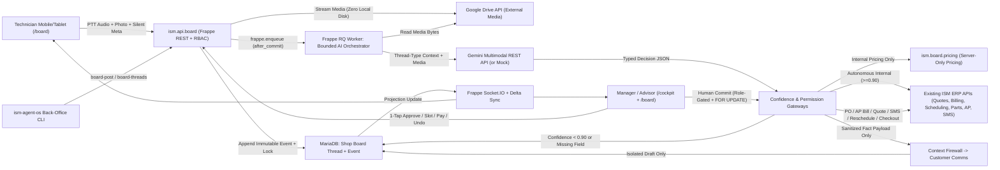
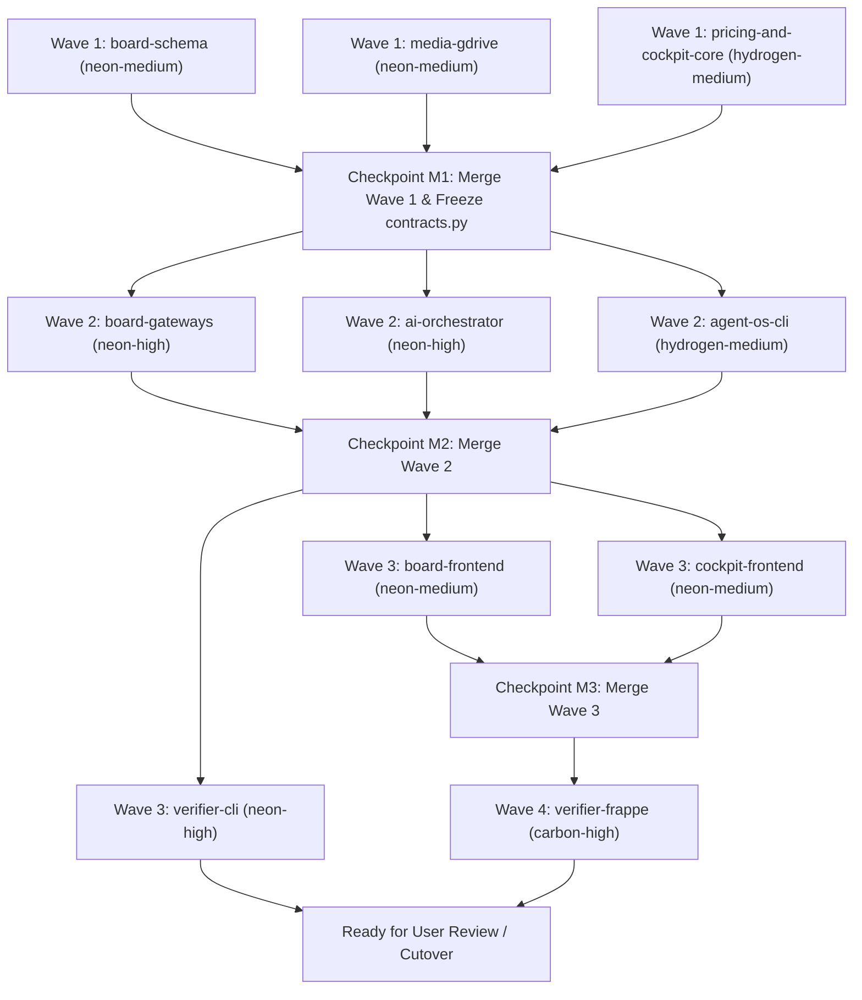

# Frappe-Hosted Shop OS Frontend Roadmap & One-Swarm Implementation Plan

> **Purpose:** Standalone architectural roadmap, full implementation plan, and single-`/swarm` execution runbook for building the **Frappe-Hosted Shop OS** (`/board` + `/cockpit`) directly inside `ism-frappe` (with thin `ism-agent-os` CLI/back-office integration). This document is self-contained and requires no separate implementation plan.

**Recommended Session Entry (`/model-triage`):** Launch `/swarm` with a `Gemini 4 Neon (High)` or `Gemini 4 Carbon (High)` coordinator (or `Orchestrator (Neon)` outside `/swarm`). All leaf workers use active **Gemini 4** tiers strictly per `model-triage` guardrails (`Hydrogen`, `Neon`, `Carbon` only).

---

## 1. Strategic Objective & Design Philosophy

Minimize friction across every shop role until human interaction collapses to **issue/artifact raising** and **1-tap decision approval**, with near-zero manual data entry:

1. **Asymmetric Ergonomics on a Shared Frappe Surface:**
   - **Technicians (Mobile/Tablet):** Push-to-Talk voice notes, camera snaps (damage, dash odometer, packing slips), quick-intent pills, and giant 1-tap clarification buttons. Zero mandatory ERP forms.
   - **Managers & Service Advisors (Mobile/Desktop):** Live `/cockpit` exception queue + Bay/Tech swimlane and `/board` pinned Andon headers with 1-tap `[Approve & Commit]`, `[Pick Slot]`, `[Bill & Release]`, and `[Undo]` cards.
   - **AI Orchestrator (Bounded Server-Side Worker):** Single visible AI persona running in Frappe RQ. High-confidence internal updates execute silently with reversible `[Undo]` receipts; low-confidence or missing-attribute captures emit 1-tap `CLARIFICATION_CARD`s; external/financial commits always stop at role-gated `APPROVAL_GATE`s.
2. **Frappe-First Daily Operations + Thin `ism-agent-os` Back-Office:**
   - **Move into `ism-frappe`:** All human-facing shop UIs (`/board` + `/cockpit`), multi-user RBAC, Socket.IO real-time updates, row-locked approvals, server-side Tesla-offset parts pricing, and bounded multimodal extraction. Retire localhost `stage_server.py` / `cockpit_ui.html` for routine daily operations.
   - **Keep in `ism-agent-os`:** Messy back-office ingestion (`supplier_catalog.py`, `tesla_manual_parser.py`), external email/PDF/browser intake, and ad-hoc multi-step executive queries — posting drafts onto Frappe `/board` via `board-post` so managers still approve everything in one place.
3. **Future-Proofed Generalized Event Log (Single Source of Truth):**
   - Threads are **NOT** hard-locked 1:1 to `Repair Order` as primary key. Every thread uses a generalized `thread_key` (`RO:<ro_name>`, `SHOP:INTAKE`, `SHOP:AP_RECEIVING`, `SHOP:DISPATCH`) and `thread_type`, with nullable indexed `repair_order`.
   - Every thread owns an append-only `Shop Board Event` stream and a deterministic derived projection (`Shop Board Thread`).

---

## 2. System Architecture Overview



---

## 3. Locked Architectural & Safety Invariants

1. **Zero `development.localhost:8000` Contact:**
   - Never run `sync-to-wsl.ps1`, `watch-sync.*`, `promote-to-main.ps1`, or raw `wsl`/`docker exec` commands targeting `frappe-bench` or `development.localhost` from worktrees or swarm workers.
   - Run all migrations, tests, and live previews strictly via `powershell -ExecutionPolicy Bypass -File ism-frappe\scripts\test-in-slot.ps1` (leases isolated `slot-1`..`slot-5`, ports `8001`–`8005`, Redis `/1`–`/5`).
   - Never fire parallel `test-in-slot.ps1` calls inside the same worktree; batch comma-separated `-Module` lists into a single call per worktree.
2. **Frappe Cloud Compatibility & Zero Extra Heavy Dependencies:**
   - Use pure HTTPS `requests` and Frappe-bundled `cryptography` for Google Drive and Gemini REST calls — zero new packages added to `ism-frappe/pyproject.toml`.
   - Zero heavy media written to Frappe's local disk when Google Drive mode is enabled (`Frappe Private File` kept as dev/test/offline fallback).
   - Zero Node build step required for `/board` or `/cockpit` (vanilla ES modules + CSS under `ism-frappe/ism/public/`).
3. **Strict RBAC & Financial Safety Boundaries:**
   - **Autonomous Internal Actions** (`AI_RECEIPT` with exact compensating `undo_spec`): `LOG_RO_NOTE`, `ATTACH_INSPECTION_MEDIA`, `ADD_SUPPLEMENT_DRAFT`, `SET_PARTS_HOLD`, `CLEAR_PARTS_HOLD`, `DRAFT_PURCHASE_ORDER` (always `submit=False` + auto-spawns Manager `SUBMIT_PO` gate), `UPDATE_JOB_STATUS` (enforces authorization lock & `odometer_out`), `TOGGLE_SERVICE_COMPLETION`, `ADD_DEFERRED_SERVICES`.
   - **Manager / Advisor Gated Commits ONLY** (`ISM Manager`, `ISM Service Advisor`, `System Manager`; `ISM Technician` sees read-only cards and receives `frappe.PermissionError` server-side): `SUBMIT_PO`, `AMEND_QUOTE`, `SEND_QUOTE_APPROVAL`, `DISPATCH_CUSTOMER_SMS`, `DISPATCH_CUSTOMER_EMAIL`, `RECORD_DEPOSIT`, `CHECKOUT_REPAIR_ORDER`, `RESCHEDULE_APPOINTMENT`, `INTAKE_QUOTE_AND_BOOK`, `CONVERT_APPOINTMENT_TO_RO`, `RECEIVE_PO`, `POST_PURCHASE_INVOICE`, `PAY_PURCHASE`.
   - **Zero Hallucination on Missing Mandatory Fields:** Never fabricate `odometer_in`, `odometer_out`, `payment_method`, `bill_no`, or ambiguous vehicle side (`LH`/`RH`). Always emit a `CLARIFICATION_CARD` or editable `APPROVAL_GATE` pill prompt.
4. **Context Firewall (Zero Internal Data Leakage):**
   - Customer-facing SMS, Email, and Quote messages are generated in an isolated single-turn call fed strictly an allowlisted `SanitizedCustomerFactPayload`.
   - Physically strips raw board chat history, audio transcripts, shop slang, tech/bay IDs, supplier costs, margin %, Tesla OEM reference prices, `override_notes`, and `verbal_notes`.
5. **Row-Locked Idempotency:**
   - All card resolutions (`resolve_board_card`) and undos (`undo_board_receipt`) lock the target `Shop Board Event` row with `SELECT ... FOR UPDATE` inside a single DB transaction, honoring client `idempotency_key` so rapid double-taps or concurrent managers execute ERP mutations **at most once**.
6. **Non-Blocking Defaults (Configurable in `ISM Settings`):**
   - **Google Drive Auth:** Defaults to **OAuth2 Refresh Token** (works on personal Gmail Drive and Google Workspace); **Service Account JSON + Shared Drive** supported as an optional auth mode.
   - **Gemini Model:** Defaults to `gemini-2.5-flash` (configurable in `ISM Settings`), with `Mock (Deterministic Test)` default in dev/test and `Disabled` safe default on fresh seed.
   - **Audio Retention:** Retained in `<Drive Root>/<thread_folder>/` alongside photos for immutable auditability and playable via authenticated Range-streaming proxy.

---

## 4. Phased Delivery Scope (Executed in One Continuous Swarm)

### Phase 1 — Core Multimodal Blackboard & Full RO Lifecycle
- Generalized `Shop Board Thread` + `Shop Board Event` schema (`thread_key`, `thread_type`, nullable `repair_order`) and deterministic Andon projection engine.
- External Google Drive streaming storage adapter + authenticated `Range`-capable media proxy + Frappe Private File fallback.
- Confidence & Permission Gateways + row-locked idempotent resolution/undo + complete RO lifecycle action handlers:
  - **Floor Runtime:** Notes, check-in inspection media, supplements (+ optional `duplicate_service_for_opposite_side`), parts hold, draft/submit PO, job status (`start`/`hold`/`park`/`complete`), service completion toggle, deferred services.
  - **Commercial & Billing:** Quote amendments (`amend_quote`), quote approvals (`send_quote_for_approval`), customer SMS/Email via Context Firewall, deposits (`record_ro_deposit`), and full checkout/Sales Invoice (`checkout_repair_order(..., confirm=True)` with 1-tap payment method pills + dash-photo odometer extraction).
  - **RO Scheduling:** Delay/blocker detection → `find_available_slots` → 1-tap `RESCHEDULE_APPOINTMENT` slot picker card + optional customer ETA SMS draft.
- Multimodal AI Orchestrator (Frappe RQ + Gemini REST + Deterministic Mock) & Context Firewall.
- Frappe-hosted `/board` mobile/desktop PWA + `Repair Order` Desk button + Workspace link + `ism-agent-os` CLI (`board-threads`, `board-thread`, `board-post`, `board-resolve`, `board-undo`).

### Phase 2 — Unified Shop OS Shell (`/cockpit`, Server Pricing, `#Intake` & `#Receiving-AP`)
- **Server-Side Parts Pricing (`ism.board.pricing`):** Port `ism-agent-os/tools/pricing.py` & `rules/parts_pricing.json` 4-regime Tesla-offset & cost-floor rules into `ISM Settings` (`sb_parts_pricing`) and a private server-only module consumed by supplements/intake quotes (blocked from customer serializers).
- **Frappe-Hosted Executive & Dispatch Cockpit (`/cockpit`):** Port `ism-agent-os/tools/monitoring.py` (`build_cockpit_view`) + `cockpit_ui.html` into `/cockpit` inside the same Shop OS navigation shell as `/board` — 7 KPI gauges, prioritized Action Queue with native Snooze/Dismiss/Reopen (`sync_cockpit_action`), live Bay & Technician swimlane, Socket.IO refresh, and 1-click jumps into RO threads, `#Intake`, and `#Receiving-AP`.
- **Global `#Intake` Channel (`SHOP:INTAKE`):** Voice/text/VIN-photo customer inquiry → `decode_vehicle_vin` + `search_vehicles` + `intake_and_find_slots` → 1-tap Quote & Slot Picker `APPROVAL_GATE` → commits booking (`book_appointment`) + opens new `RO:<id>` thread; walk-in appointment conversion (`create_ro_from_appointment`) with odometer clarification gate.
- **Global `#Receiving-AP` Channel (`SHOP:AP_RECEIVING`):** Photo of packing slip or supplier invoice → Vision AI matches open submitted POs → 1-tap Verification `APPROVAL_GATE` committing `receive_purchase_order`, `create_purchase_invoice` (with `bill_no`, `bill_date`, optional `update_stock`), and `create_purchase_payment`.

---

## 5. One-Swarm Execution Topology & `/model-triage` Pinning

### Hard Guardrails
- **Active Gemini 4 models ONLY:** `gemini-4-hydrogen-*`, `gemini-4-neon-*`, `gemini-4-carbon-*`.
- **Banned models:** Never use `gemini-4-argon-*`, `Gemini 3.8 Flash`, `Claude`, `GPT-OSS`, `Model="flash"`, or leaf `Orchestrator`.
- **No `Neon (Low)` or `Hydrogen (High/XHigh)` for repo coding.**
- **Cross-family verification mandatory:** `hydrogen-medium` authors verified by `gemini-4-neon-high`; `neon-medium` / `neon-high` authors verified by `gemini-4-carbon-high`.
- **Escalation rule:** If a worker stalls or fails verification twice, wait until `waiting` and switch models in-place via `swarm{action:"model", name, model}` — never `kill` + `add`.
- **Bench slot ceiling:** Maximum `3` concurrent `workspace:"share"` authors per wave (comfortably within `slot-1`..`slot-5`).

### Coordinator Startup Protocol
1. Run `swarm{action:"models", all:true}` once; verify active Gemini 4 IDs and quotas.
2. Create or checkout a clean integration branch (never run slot tests on canonical `development.localhost`).
3. Output the compact Worker Roster startup table and spawn **Wave 1** (3 parallel authors + optional `monitor`).
4. At each **Merge Checkpoint (`M1`, `M2`, `M3`)**, merge completed worker branches into the integration branch, confirm clean `git status` and frozen contracts, then launch the next wave.
5. After **Wave 4** passes all gates, kill temporary workers (preserve work on integration branch) and post the final verification summary.

### Worker Roster & Pinning Table

| Worker | Wave | Phase | Role & Strict File Ownership | Model ID | Workspace | Depends On | Why This Model |
| :--- | :---: | :---: | :--- | :--- | :---: | :---: | :--- |
| `board-schema` | 1 | P1+P2 | `contracts.py`, `Shop Board Thread` & `Shop Board Event` DocTypes, `projections.py`, `ISM Settings` (`sb_media_storage`, `sb_board_ai`, `sb_parts_pricing`), `seed.py`, `hooks.py`, `tests/base.py`, `test_board_schema_and_projections.py` | `gemini-4-neon-medium` | `share` | — | Schema invariants, generalized `thread_key`, concurrency-safe projection state machine |
| `media-gdrive` | 1 | P1 | `media_storage.py` (Google Drive OAuth2/SA, Redis cache, MIME/magic/SHA-256, Range proxy, Private File fallback), `test_board_media_storage.py` | `gemini-4-neon-medium` | `share` | — | Security-sensitive auth, IDOR, SSRF, and Range-streaming logic across 2 focused files |
| `pricing-and-cockpit-core` | 1 | P2 | `ism/board/pricing.py` (4-regime Tesla-offset parity port), `ism/board/cockpit_view.py` (`build_cockpit_view` port + board deep-links), `test_board_pricing_and_cockpit.py` | `gemini-4-hydrogen-medium` | `share` | — | Direct mechanical parity port of existing tested Python modules (`pricing.py`, `monitoring.py`) |
| `board-gateways` | 2 | P1+P2 | `gateways.py` (RBAC, confidence/acoustic router, `FOR UPDATE` idempotency, undo, ALL P1 RO & P2 `#Intake`/`#Receiving-AP` action handlers), `ism/api/board.py`, `agent_serializers.py`, `test_board_gateways.py` | `gemini-4-neon-high` | `share` | `M1` | Complex transactional locking, RBAC, financial commit safety (PO/AP/Sales Invoice/Deposit/Reschedule) |
| `ai-orchestrator` | 2 | P1+P2 | `comms_firewall.py`, `ai_providers.py` (Gemini REST, OpenAI-compat, full P1+P2 `MockMultimodalProvider`), `orchestrator.py` (thread-type context loaders + RQ worker), `test_board_orchestrator_and_firewall.py` | `gemini-4-neon-high` | `share` | `M1` | Multimodal structured output schema, context loaders across 3 thread types, strict zero-leak firewall |
| `agent-os-cli` | 2 | P1+P2 | `ism-agent-os/tools/client.py`, `cli_parsers.py`, `cli_commands.py`, `cli_validation.py`, `ism-agent-os/tests/test_board_cli.py` | `gemini-4-hydrogen-medium` | `share` | `M1` | Standard mechanical CLI/client extension following established patterns (zero Frappe file overlap) |
| `board-frontend` | 3 | P1+P2 | `ism/www/board.py`, `ism/www/board.html`, `ism/public/board/{board.css,api.js,realtime.js,capture.js,cards.js,app.js}`, `repair_order.js`, `ism.json` workspace | `gemini-4-neon-medium` | `share` | `M2` | Stateful realtime PWA, mobile `MediaRecorder`/camera compression, P1+P2 interactive cards, Shop OS nav |
| `cockpit-frontend` | 3 | P2 | `ism/www/cockpit.py`, `ism/www/cockpit.html`, `ism/public/cockpit/{cockpit.css,cockpit.js}` (7 gauges, Action Queue + native snooze/dismiss, Bay/Tech swimlane, Socket.IO, `/board` deep-links) | `gemini-4-neon-medium` | `share` | `M2` | Live schedule swimlane & dashboard state ported from `cockpit_ui.html` (zero file overlap with `board-frontend`) |
| `verifier-cli` | 3 | P1+P2 | Cross-family verification of `agent-os-cli` & `pricing-and-cockpit-core` (`unittest`, `--stage` gating, 4-regime pricing parity) | `gemini-4-neon-high` | `inherit` | `M2` | Cross-family verifier for `hydrogen-medium` authors |
| `verifier-frappe` | 4 | P1+P2 | Cross-family full-stack gate: batched `test-in-slot.ps1` migration + all new & regression suites, `ruff` + `eslint`, live `-Serve` smoke check of `/board` & `/cockpit`, RBAC/IDOR/Firewall audit | `gemini-4-carbon-high` | `inherit` | `M3` | Cross-family verifier for `neon-*` authors + strongest shell/WSL reliability for `test-in-slot.ps1` |
| `monitor` *(optional)* | 1–4 | All | Standard `swarm_monitor` stall watcher (only if running unattended) | `gemini-4-hydrogen-low` | `inherit` | — | Lightweight timer-based stall detection |

### Wave Dependency Graph



> **Zero-Conflict File Ownership Rule:** No two workers in the same wave edit the same file. `board-schema` exclusively owns `ism_settings.json`, `seed.py`, `hooks.py`, and `tests/base.py`. `board-gateways` exclusively owns `ism/api/board.py` and `agent_serializers.py`. `board-frontend` owns `ism/www/board.*` + `ism/public/board/*` + `repair_order.js` + `ism.json`; `cockpit-frontend` owns `ism/www/cockpit.*` + `ism/public/cockpit/*`.

---

## 6. Detailed Implementation Specification

### Wave 1A — Core Schema, Generalized Threads & Projections (`board-schema`)

#### `[NEW] ism-frappe/ism/board/__init__.py` & `ism-frappe/ism/board/contracts.py`
Frozen single source of truth for all constants, enums, and JSON schema validators across backend, AI orchestrator, frontend, and CLI:
- `THREAD_TYPES = ("REPAIR_ORDER", "INTAKE", "AP_RECEIVING", "DISPATCH")`
- `SINGLETON_THREADS = {"SHOP:INTAKE": ("INTAKE", "Front Desk Intake & Booking"), "SHOP:AP_RECEIVING": ("AP_RECEIVING", "Dock Receiving & Vendor Bills"), "SHOP:DISPATCH": ("DISPATCH", "Shop Dispatch & Floor Alerts")}`
- `ro_thread_key(ro_name: str) -> str`: returns `f"RO:{ro_name}"` (helper also normalizes raw RO names when `repair_order` is passed).
- `BOARD_STATUSES = ("ACTIVE", "BLOCKED_PARTS", "BLOCKED_DECISION", "WAITING_CUSTOMER", "CLOSED")`
- `ACTOR_TYPES = ("TECH", "MANAGER", "AI", "SYSTEM")`
- `PAYLOAD_TYPES = ("MEDIA_CAPTURE", "TEXT", "AI_RECEIPT", "CLARIFICATION_CARD", "APPROVAL_GATE", "STATE_MUTATION", "CARD_RESOLUTION")`
- `RESOLUTION_STATES = ("NONE", "PENDING", "EXECUTING", "RESOLVED", "REJECTED", "UNDONE", "EXPIRED")`
- `TARGET_ROLES = ("TECH", "MANAGER", "ALL")`
- `AUTONOMOUS_ACTIONS = ("LOG_RO_NOTE", "ATTACH_INSPECTION_MEDIA", "ADD_SUPPLEMENT_DRAFT", "SET_PARTS_HOLD", "CLEAR_PARTS_HOLD", "DRAFT_PURCHASE_ORDER", "UPDATE_JOB_STATUS", "TOGGLE_SERVICE_COMPLETION", "ADD_DEFERRED_SERVICES")`
- `MANAGER_GATED_ACTIONS = ("SUBMIT_PO", "AMEND_QUOTE", "SEND_QUOTE_APPROVAL", "DISPATCH_CUSTOMER_SMS", "DISPATCH_CUSTOMER_EMAIL", "RECORD_DEPOSIT", "CHECKOUT_REPAIR_ORDER", "RESCHEDULE_APPOINTMENT", "INTAKE_QUOTE_AND_BOOK", "CONVERT_APPOINTMENT_TO_RO", "RECEIVE_PO", "POST_PURCHASE_INVOICE", "PAY_PURCHASE")`
- Typed card payload schema validators (`validate_clarification_card`, `validate_approval_gate_card`, `validate_receipt_card`).

#### `[NEW] ism-frappe/ism/ism/doctype/shop_board_thread/shop_board_thread.{json,py}`
- `autoname: "field:thread_key"` (generalized primary key: `RO:<ro_name>`, `SHOP:INTAKE`, `SHOP:AP_RECEIVING`, `SHOP:DISPATCH`).
- Fields:
  - `thread_key` (`Data`, reqd, unique, in_list_view)
  - `thread_type` (`Select`: `REPAIR_ORDER\nINTAKE\nAP_RECEIVING\nDISPATCH`, reqd, indexed)
  - `title` (`Data`, reqd — e.g., `"RO-2026-00014 · 2022 Model Y · Bay 2"` or `"Front Desk Intake & Booking"`)
  - `repair_order` (`Link: Repair Order`, nullable, indexed)
  - `vehicle` (`Link: Repair Vehicle`, nullable)
  - `vin` (`Data`, nullable)
  - `customer` (`Link: Customer`, nullable)
  - `bay` (`Link: Service Bay`, nullable, indexed)
  - `assigned_technician` (`Link: Employee`, nullable, indexed)
  - `board_status` (`Select`: `ACTIVE\nBLOCKED_PARTS\nBLOCKED_DECISION\nWAITING_CUSTOMER\nCLOSED`, default `ACTIVE`, indexed)
  - `blocked_reason` (`Small Text`)
  - `blocked_since` (`Datetime`)
  - `open_action_count` (`Int`, default `0`)
  - `open_approval_count` (`Int`, default `0`)
  - `open_clarification_count` (`Int`, default `0`)
  - `open_action_card_ids` (`Code` / JSON)
  - `last_event_at` (`Datetime`, indexed)
  - `last_event_preview` (`Data`)
  - `projection_version` (`Int`, default `1`)
- Permissions: `System Manager`, `ISM Manager`, `ISM Service Advisor` (read/create/write); `ISM Technician` (read).

#### `[NEW] ism-frappe/ism/ism/doctype/shop_board_event/shop_board_event.{json,py}`
- `autoname: "naming_series:"`, series `BE-.YYYY.-.######`.
- Fields: `thread` (`Link: Shop Board Thread`, reqd, indexed), `thread_type` (`Data`, indexed), `repair_order` (`Link: Repair Order`, nullable, indexed), `event_timestamp` (`Datetime`, reqd), `actor_type` (`Select`), `actor_user` (`Link: User`), `intent_tag` (`Data`), `payload_type` (`Select`, reqd), `target_role` (`Select`, default `ALL`), `body_text` (`Long Text`), `transcript` (`Long Text`), `confidence_score` (`Float`), `metadata_json` (`Code`), `media_attachments` (`Code`), `card_schema` (`Code`), `resolution_state` (`Select`, default `NONE`, indexed), `resolved_by` (`Link: User`), `resolved_at` (`Datetime`), `resolution_payload` (`Code`), `parent_event` (`Link: Shop Board Event`), `idempotency_key` (`Data`, unique/indexed), `ai_status` (`Select`: `NONE\nQUEUED\nPROCESSING\nCOMPLETED\nFAILED`, default `NONE`), `ai_error` (`Small Text`).
- **Immutability Guard in `ShopBoardEvent`:**
  - `on_trash()` throws `frappe.ValidationError` unless `frappe.flags.in_test` teardown is active.
  - `validate()` rejects edits to immutable core fields (`thread`, `thread_type`, `repair_order`, `actor_type`, `actor_user`, `payload_type`, `body_text`, `metadata_json`, `media_attachments`, `idempotency_key`) after insert; only server-controlled resolution/AI fields may update.

#### `[NEW] ism-frappe/ism/board/projections.py`
- `ensure_singleton_shop_threads()`: idempotently ensures `SHOP:INTAKE`, `SHOP:AP_RECEIVING`, `SHOP:DISPATCH` exist (safe against `DuplicateEntryError`).
- `ensure_thread_for_ro(ro_name: str)`: idempotently provisions `RO:<ro_name>` with `thread_type="REPAIR_ORDER"`.
- `resolve_thread_key(thread_key: str | None = None, repair_order: str | None = None) -> str`: accepts either canonical `thread_key` (`RO:...`, `SHOP:...`) or bare `repair_order` name, ensuring thread existence lazily.
- `recompute_thread_projection(thread_key: str, *, publish: bool = True) -> dict`:
  - For `REPAIR_ORDER` threads, derives `board_status` deterministically:
    - RO `status` in `("Closed / Released", "Cancelled", "Billed / Paid")` -> `CLOSED`
    - Open `PENDING` `APPROVAL_GATE` or `CLARIFICATION_CARD` -> `BLOCKED_DECISION`
    - RO `status == "Waiting on Parts"` or `manual_parts_hold == 1` -> `BLOCKED_PARTS`
    - RO `approval_status == "Pending Approval"` or `status == "Pending Authorization"` -> `WAITING_CUSTOMER`
    - Otherwise -> `ACTIVE`
  - For singleton `INTAKE` / `AP_RECEIVING` / `DISPATCH` threads: `BLOCKED_DECISION` when open `PENDING` cards exist, else `ACTIVE` (never `CLOSED`).
  - Preserves original `blocked_since` while continuously blocked; sets `now_datetime()` when entering blocked/waiting; clears on `ACTIVE`/`CLOSED`.
  - Increments `projection_version` and broadcasts `frappe.publish_realtime("ism_board_projection", payload, doctype="Shop Board Thread", docname=thread_key, after_commit=True)` + site-room `"ism_board_thread_summary"`.
- Hook handlers: `on_repair_order_after_insert`, `on_repair_order_update`, `on_schedule_entry_update`.

#### `[MODIFY] ism-frappe/ism/ism/doctype/ism_settings/ism_settings.json` & `ism-frappe/ism/setup_tasks/seed.py`
Add three non-colliding sections (keeping existing `sb_pricing` untouched):
1. `sb_media_storage`: `media_storage_backend` (`Frappe Private File\nGoogle Drive`), `gdrive_auth_mode` (`OAuth2 Refresh Token\nService Account JSON`), `gdrive_client_id`, `gdrive_client_secret` (`Password`), `gdrive_refresh_token` (`Password`), `gdrive_service_account_json` (`Password`), `gdrive_root_folder_id`, `media_max_audio_mb` (`Int`), `media_max_image_mb` (`Int`).
2. `sb_board_ai`: `board_ai_provider` (`Disabled\nMock (Deterministic Test)\nGemini REST API\nOpenAI Compatible`), `board_ai_api_key` (`Password`), `board_ai_endpoint`, `board_ai_orchestrator_model`, `board_ai_comms_model`, `board_ai_confidence_threshold` (`Float`), `board_ai_auto_process` (`Check`).
3. `sb_parts_pricing`: `parts_pricing_baseline_discount_pct` (`Float`), `parts_pricing_small_ticket_max_tesla_price` (`Float`), `parts_pricing_small_ticket_discount_pct` (`Float`), `parts_pricing_min_sell_price` (`Float`), `parts_pricing_min_cost_markup_pct` (`Float`), `parts_pricing_min_cost_margin_dollars` (`Float`), `parts_pricing_fallback_cost_markup_pct` (`Float`), `parts_pricing_rounding_increment` (`Float`), `parts_pricing_condition_overrides_json` (`Small Text`), `parts_pricing_tesla_search_url_template` (`Data`).
- Seed safe defaults in `seed.py` matching `ism-agent-os/rules/parts_pricing.json` (`baseline_discount_pct=30.0`, `small_ticket_max_tesla_price=20.0`, `small_ticket_discount_pct=0.0`, `min_sell_price=5.0`, `min_cost_markup_pct=25.0`, `min_cost_margin_dollars=5.0`, `fallback_cost_markup_pct=40.0`, `rounding_increment=0.01`, `media_storage_backend="Frappe Private File"`, `board_ai_provider="Disabled"`, `board_ai_orchestrator_model="gemini-2.5-flash"`, `board_ai_comms_model="gemini-2.5-flash"`, `board_ai_confidence_threshold=0.90`, `media_max_audio_mb=15`, `media_max_image_mb=10`), and call `ensure_singleton_shop_threads()` during `after_migrate`.

#### `[MODIFY] ism-frappe/ism/hooks.py` & `ism-frappe/ism/tests/base.py`
- `hooks.py`:
  - Extend `website_route_rules` with:
    - `{"from_route": "/board/<thread_key>", "to_route": "board"}`
    - `{"from_route": "/board", "to_route": "board"}`
    - `{"from_route": "/cockpit", "to_route": "cockpit"}`
  - Add `doc_events` for `Repair Order` (`after_insert`, `on_update`) and `Schedule Entry` (`on_update`) pointing to `ism.board.projections.*`.
- `tests/base.py`:
  - Add `"Shop Board Event": 9` and `"Shop Board Thread": 10` to `_TEARDOWN_ORDER`.
  - Clean up linked `Shop Board Event` and `Shop Board Thread` (`repair_order == doc.name`) inside `_teardown_repair_order` so all existing & new tests remain 100% hermetic.

#### `[NEW] ism-frappe/ism/tests/test_board_schema_and_projections.py`
Tests auto-provisioning on RO insert, lazy ensure, singleton shop channels (`SHOP:INTAKE`, `SHOP:AP_RECEIVING`, `SHOP:DISPATCH`), event immutability (`on_trash` & core-field edit rejection), all projection state transitions, `blocked_since` preservation, `Schedule Entry` bay/tech sync, and `frappe.publish_realtime(..., after_commit=True)`.

---

### Wave 1B — External Google Drive Media Storage & Authenticated Proxy (`media-gdrive`)

#### `[NEW] ism-frappe/ism/board/media_storage.py`
- `validate_media_payload(filename, content_type, data_bytes, settings)`:
  - Strict MIME allowlist + magic-byte signature verification:
    - Images: `image/jpeg`, `image/png`, `image/webp`
    - Audio: `audio/webm`, `audio/ogg`, `audio/mp4`, `audio/mpeg`, `audio/wav`, `audio/x-m4a`
  - Enforces `media_max_audio_mb` / `media_max_image_mb` caps.
  - Sanitizes filename, computes `sha256`, and generates opaque `file_ref = f"m_{frappe.generate_hash(length=16)}"`.
- `GoogleDriveStorageBackend`:
  - Pure HTTPS via `requests` (zero new pip packages).
  - **OAuth2 Refresh Token auth (default):** exchanges refresh token at `https://oauth2.googleapis.com/token`, caches bearer token in Redis (`ism:gdrive:access_token`, TTL 3300s).
  - **Service Account JSON auth (optional):** signs RS256 JWT via bundled `cryptography` for Workspace Shared Drives.
  - Auto-creates/caches per-thread subfolder (`<ro_id>` or `SHOP_INTAKE` / `SHOP_AP_RECEIVING`) under `gdrive_root_folder_id` with `supportsAllDrives=true&includeItemsFromAllDrives=true` (cached in Redis `ism:gdrive:folder:<folder_name>`).
  - Multipart upload directly from memory bytes (zero writes to Frappe `private/files`).
  - Streaming download (`GET .../files/{id}?alt=media&supportsAllDrives=true`) with HTTP `Range` passthrough for mobile `<audio>` scrubbing.
- `FrappePrivateFileBackend`: dev/test/offline fallback saving private `File` (`is_private=1`) attached to `Repair Order` (or `Shop Board Thread` when `repair_order` is null).
- `test_google_drive_connection()`: Manager-only diagnostic verifying token exchange + root folder accessibility.

#### `[NEW] ism-frappe/ism/tests/test_board_media_storage.py`
Tests MIME/magic-byte rejection, size limits, SHA-256, mocked HTTPS OAuth2 & Service Account flows, Redis token/folder cache, multipart upload without local disk writes, `Range` header proxy streaming, IDOR rejection on mismatched `file_ref` or unauthorized user, and `FrappePrivateFileBackend` round-trip.

---

### Wave 1C — Server-Side Parts Pricing & Cockpit View Engine (`pricing-and-cockpit-core`)

#### `[NEW] ism-frappe/ism/board/pricing.py`
Server-side parity port of `ism-agent-os/tools/pricing.py` (strictly internal — never exposed in customer-facing serializers or Context Firewall outputs):
- `ServerPricingConfig` dataclass loaded from `ISM Settings` (`sb_parts_pricing` fields with safe `getattr` defaults matching `ism-agent-os/rules/parts_pricing.json`).
- `calculate_part_price(*, tesla_oem_price=None, cost=None, part_source="Aftermarket", part_condition="New", override_rate=None, part_number=None, part_name=None, config=None) -> dict`:
  - Exact 4-regime parity: (1) explicit `override_rate`, (2) Tesla-offset small-ticket (`<= 20.0`) & baseline discount (`30%` / condition override) bounded by cost markup (`25%`) + min margin (`$5`) + min sell (`$5`), (3) cost-only fallback (`40%` markup) bounded by floors, (4) rounding to `rounding_increment` (`0.01`).
  - Returns `sell_price`, `pricing_regime`, `cost`, `margin_dollars`, `margin_pct`, `tesla_search_url` — marked internal-only.

#### `[NEW] ism-frappe/ism/board/cockpit_view.py`
Server-side port of `ism-agent-os/tools/monitoring.py` (`build_cockpit_view`):
- Consumes output of `ism.api.agent_monitoring.get_cockpit_snapshot(date=...)`.
- Computes:
  - State-aware prioritized **Action Queue** (Dead Lifts, Cold Quotes, Parts Holds, Unscheduled Approved ROs, Pending Board Decisions).
  - **7 Shop Health Gauges** (utilization, bay occupancy, quote velocity, approval latency, WIP exposure, parts coverage, score freshness).
  - Coupled **Bay & Technician Swimlane** timeline with break-aware utilization math.
- Enriches every RO row and action item with `thread_key` (`RO:<ro_name>`), `board_url` (`/board?thread=RO:<ro_name>`), `board_status`, `open_approval_count`, and `open_clarification_count` from `Shop Board Thread`.

#### `[NEW] ism-frappe/ism/tests/test_board_pricing_and_cockpit.py`
Tests all 4 pricing regimes, negative/invalid bounds, rounding, condition overrides, and `build_cockpit_view` parity against `get_cockpit_snapshot` including dead-lift, cold-quote, swimlane overlap, and `Shop Board Thread` enrichment.

---

### Wave 2A — Full Lifecycle Confidence & Permission Gateways + Board REST API (`board-gateways`)

#### `[NEW] ism-frappe/ism/board/gateways.py`
- **RBAC Helpers:**
  - `resolve_actor_role(user: str) -> str`: `"MANAGER"` for `ISM Manager` / `ISM Service Advisor` / `System Manager`, else `"TECH"` (requires `ISM Technician` or `Repair Order` read permission).
  - `assert_can_commit_approval_gate(user: str)`: raises `frappe.PermissionError` for technicians or unauthorized users.
- **Confidence & Policy Router (`dispatch_orchestrator_decision(source_event, decision)`):**
  - Enforces acoustic clarity floor: if `audio_clarity_score < 0.75`, caps effective confidence at `min(confidence, 0.70)`.
  - Low confidence (`< threshold`) or missing mandatory attributes -> zero ERP mutation; appends `CLARIFICATION_CARD` (`resolution_state="PENDING"`, `target_role="TECH"` or `"MANAGER"`) with 1-tap option pills (or inline numeric input for `odometer_in` / `odometer_out`).
  - High confidence (`>= threshold`):
    - **`AUTONOMOUS_ACTIONS`** execute immediately via existing ISM APIs, capture reversible `undo_spec`, and emit `AI_RECEIPT`:
      - `LOG_RO_NOTE` -> append structured note on RO (`undo`: restore prior note).
      - `ATTACH_INSPECTION_MEDIA` -> `ism.api.inspection.record_check_in_inspection` (`undo`: unlink added inspection media/note).
      - `ADD_SUPPLEMENT_DRAFT` -> prices parts via `ism.board.pricing.calculate_part_price` (internal only), calls `agent_quotes.add_supplement` (+ `duplicate_service_for_opposite_side` when symmetrical `both` requested) (`undo`: remove unapproved row).
      - `SET_PARTS_HOLD` / `CLEAR_PARTS_HOLD` -> toggle `manual_parts_hold` + `Shop Action Item` (`undo`: revert hold flag & resolve/reopen action item).
      - `DRAFT_PURCHASE_ORDER` -> `agent_procurement.submit_procurement_orders(..., submit=False)` (`undo`: delete draft PO) AND auto-emits Manager `APPROVAL_GATE` (`SUBMIT_PO`).
      - `UPDATE_JOB_STATUS` -> `agent_quotes.update_job_status` (`start`/`hold`/`park`/`complete`); enforces authorization lock; if `complete` lacks `odometer_out`, degrades cleanly to `CLARIFICATION_CARD` instead of erroring (`undo`: revert non-terminal status).
      - `TOGGLE_SERVICE_COMPLETION` -> `agent_quotes.toggle_service_completion` (`undo`: flip `is_completed` back).
      - `ADD_DEFERRED_SERVICES` -> `agent_quotes.add_deferred_services` (`undo`: remove added deferred rows).
    - **`MANAGER_GATED_ACTIONS`** NEVER auto-execute; always append `APPROVAL_GATE` (`target_role="MANAGER"`, `resolution_state="PENDING"`):
      - `SUBMIT_PO` -> commits draft/new PO (`submit_procurement_orders(..., submit=True)` or `po.submit()`).
      - `AMEND_QUOTE` -> commits `agent_quotes.amend_quote` (shows itemized delta & new grand total).
      - `SEND_QUOTE_APPROVAL` -> generates sanitized preview via `comms_firewall`; commits `agent_quotes.send_quote_for_approval`.
      - `DISPATCH_CUSTOMER_SMS` / `DISPATCH_CUSTOMER_EMAIL` -> sanitized preview via `comms_firewall` (editable by Manager before tap); commits `ism.api.sms.dispatch_sms` / `frappe.sendmail`.
      - `RECORD_DEPOSIT` -> card displays amount + 1-tap payment method pills (`Debit / Interac`, `Credit Card`, `E-Transfer`, `Cash`) + optional ref#; commits `agent_quotes.record_ro_deposit`.
      - `CHECKOUT_REPAIR_ORDER` -> card displays final invoice total, remaining balance after deposits, verified `odometer_out` (from dash photo or input), completion check, and 1-tap payment method pills; commits `agent_quotes.checkout_repair_order(..., confirm=True)` creating/submitting `Sales Invoice` + `Payment Entry` + releasing RO.
      - `RESCHEDULE_APPOINTMENT` -> card includes top candidate slots from `agent_scheduling.find_available_slots` as 1-tap buttons + optional sanitized customer ETA SMS checkbox; commits `agent_scheduling.reschedule_appointment` (+ optional SMS).
      - `INTAKE_QUOTE_AND_BOOK` (`SHOP:INTAKE`) -> card displays decoded VIN/vehicle, drafted quote summary (priced via `ism.board.pricing`), and top candidate slots from `find_available_slots` as 1-tap slot buttons; Manager/Advisor tap executes `create_quote` / `intake_and_find_slots` + `book_appointment` (or provisional booking), auto-creates `RO:<id>` thread, and posts a deep-link receipt!
      - `CONVERT_APPOINTMENT_TO_RO` (`SHOP:INTAKE`) -> commits `agent_scheduling.create_ro_from_appointment` (requires verified `odometer_in`) and opens `RO:<id>` thread.
      - `RECEIVE_PO` (`SHOP:AP_RECEIVING`) -> commits `agent_procurement.receive_purchase_order` against matched PO/invoice.
      - `POST_PURCHASE_INVOICE` (`SHOP:AP_RECEIVING`) -> displays extracted supplier, `bill_no`, `bill_date`, matched PO, line items, total, and `update_stock` toggle; commits `agent_procurement.create_purchase_invoice` (optionally chaining `receive_purchase_order` if box also arrived).
      - `PAY_PURCHASE` (`SHOP:AP_RECEIVING`) -> commits `agent_procurement.create_purchase_payment` with 1-tap payment method & reference.
- **Row-Locked Idempotent Resolution (`resolve_card_action`) & Undo (`undo_receipt_action`):**
  - `SELECT name, resolution_state, payload_type, target_role, card_schema, resolution_payload FROM \`tabShop Board Event\` WHERE name=%s FOR UPDATE`.
  - Duplicate/already-resolved requests return `{"already_resolved": True, ...}` with zero side effects.
  - Supports `selected_option`, `edited_message`, and `form_patch` (e.g. `payment_method`, `odometer_out`, `slot_index`, `bill_no`, `update_stock`).
  - Appends immutable `CARD_RESOLUTION` event (`parent_event=card.name`), recomputes projection, emits realtime update `after_commit=True`.
  - Resolving a `CLARIFICATION_CARD` automatically re-enqueues `orchestrator.enqueue_board_event` with the merged `clarification_patch`.

#### `[NEW] ism-frappe/ism/api/board.py` & `[MODIFY] ism-frappe/ism/api/agent_serializers.py`
Whitelisted REST facade (`ism.api.board.*`):
- `list_board_threads(thread_type=None, status=None, assigned_only=False, query=None, limit=50)`
- `get_board_thread(thread_key=None, repair_order=None, limit=100, before_event=None)`
- `get_thread_delta(thread_key=None, repair_order=None, after_event=None, known_projection_version=0)`
- `post_board_capture(thread_key=None, repair_order=None, text=None, intent_tag=None, metadata=None, idempotency_key=None)` (multipart/form-data + JSON, server-side metadata verification, streams to `media_storage`, appends immutable event, updates projection, broadcasts realtime, enqueues AI if enabled)
- `resolve_board_card(event_name, decision, selected_option=None, edited_message=None, form_patch=None, notes=None, idempotency_key=None)`
- `undo_board_receipt(event_name, reason=None, idempotency_key=None)`
- `get_media(event_name, file_ref)` (authenticated RBAC + `file_ref` membership check + streaming proxy with `Range` passthrough)
- `get_cockpit_dashboard(date=None)` (Manager/Advisor/System Manager ONLY; merges `get_cockpit_snapshot` + `cockpit_view.build_cockpit_view` + open board card badges)
- `sync_cockpit_action(dedup_key, action, snooze_minutes=None, notes=None)` (Manager/Advisor/System Manager ONLY; proxies `agent_fleet.sync_action_item_state`)
- `price_part(...)` (Manager/Advisor/System Manager ONLY; internal pricing preview via `ism.board.pricing`)
- `test_media_storage()` (Manager/System Manager ONLY)
- Update `build_ro_urls()` in `ism/api/agent_serializers.py` to include `"board_url": f"{base}/board?thread={quote(f'RO:{ro_name}', safe='')}"` and `"cockpit_url": f"{base}/cockpit"`.

#### `[NEW] ism-frappe/ism/tests/test_board_gateways.py`
Covers RBAC rejection for technicians on every `APPROVAL_GATE` and `/cockpit` API, confidence & acoustic floor gating, `FOR UPDATE` double-tap idempotency, `[Undo]` compensating actions, all Phase 1 RO lifecycle actions (including `RECORD_DEPOSIT`, `CHECKOUT_REPAIR_ORDER`, `RESCHEDULE_APPOINTMENT`, `UPDATE_JOB_STATUS` auth-lock & odometer guard), and all Phase 2 `#Intake` & `#Receiving-AP` commits (`INTAKE_QUOTE_AND_BOOK`, `CONVERT_APPOINTMENT_TO_RO`, `RECEIVE_PO`, `POST_PURCHASE_INVOICE`, `PAY_PURCHASE`).

---

### Wave 2B — Multimodal AI Orchestrator & Context Firewall (`ai-orchestrator`)

#### `[NEW] ism-frappe/ism/board/comms_firewall.py`
- `SanitizedCustomerFactPayload` dataclass + `sanitize_for_customer_comms(ro_doc, finding_summary, approved_items, clean_photo_refs, approval_url, eta_window=None)` — strict allowlist serializer.
- Physically strips raw board chat history, audio transcripts, shop slang, tech/bay IDs, supplier costs, margin percentages, Tesla OEM reference pricing, `override_notes`, and `verbal_notes`.
- `draft_customer_message(sanitized_payload, channel="sms", provider=None) -> dict` — isolated single-turn LLM call (`board_ai_comms_model`) with zero access to board history, returning `{channel, subject, body, sanitized_facts_hash, clean_photo_refs}`.

#### `[NEW] ism-frappe/ism/board/ai_providers.py`
- `MultimodalProvider` protocol (`analyze_capture(thread_type, context, text, media_blobs, clarification_patch) -> dict`, `draft_customer_comms(sanitized_payload, channel) -> dict`).
- `GeminiRestProvider`: pure HTTPS `POST {endpoint}/models/{model}:generateContent` with inline base64 audio/image parts and `generationConfig.responseMimeType = "application/json"` + strict structured output schema.
- `OpenAICompatibleProvider`: optional fallback adapter.
- `MockMultimodalProvider`: deterministic zero-network provider covering all Phase 1 & Phase 2 scenarios:
  - Ambiguous finding (`"control arm bushing torn"`) -> `CLARIFICATION_CARD` (`[Front Left]` / `[Front Right]` / `[Both]`) -> after clarification: `ADD_SUPPLEMENT_DRAFT` + `DRAFT_PURCHASE_ORDER` + sanitized `DISPATCH_CUSTOMER_SMS`.
  - Noisy audio flag -> low acoustic clarity (`0.60`) clarification card.
  - `"FYI"` capture -> silent `LOG_RO_NOTE` receipt.
  - `"done, odometer 64210"` / checkout intent -> `CHECKOUT_REPAIR_ORDER` approval card (or missing-odometer clarification if omitted).
  - `"paid $500 deposit"` -> `RECORD_DEPOSIT` approval card.
  - `"seized bolt, need extra 2 hours"` -> `RESCHEDULE_APPOINTMENT` approval card populated with real candidate slots from context.
  - `SHOP:INTAKE` capture (VIN + customer + service) -> `INTAKE_QUOTE_AND_BOOK` approval card with decoded vehicle, priced quote, and real open slots.
  - `SHOP:AP_RECEIVING` capture (packing slip / vendor invoice photo or text with PO#/bill#) -> `RECEIVE_PO` and/or `POST_PURCHASE_INVOICE` verification card matched against open POs in context.

#### `[NEW] ism-frappe/ism/board/orchestrator.py`
- `enqueue_board_event(event_name: str, clarification_patch: dict | None = None)`: enqueues `process_board_event` on Frappe RQ (`enqueue_after_commit=True`; synchronous under `frappe.flags.in_test`).
- `process_board_event(event_name: str, clarification_patch: dict | None = None)`:
  1. Loads `Shop Board Event` + `Shop Board Thread`, transitions `ai_status` -> `PROCESSING`, broadcasts `"ism_board_ai_status"`.
  2. Gathers **thread-type-aware compact ERP context**:
     - `REPAIR_ORDER`: compact RO, `check_parts_stock`, `get_vehicle_intelligence`, active `Schedule Entry`, candidate slots from `find_available_slots` (when delay/reschedule intent detected), and internal pricing config.
     - `INTAKE`: VIN decode (`decode_vehicle_vin`), vehicle/customer matches (`search_vehicles`), active `Service Package` names, and candidate slots (`find_available_slots`).
     - `AP_RECEIVING`: open submitted/unreceived `Purchase Order`s, supplier names, and pending PO item codes/quantities for high-accuracy packing-slip & vendor-bill matching.
  3. Streams media bytes from `media_storage` within payload caps.
  4. Calls configured `MultimodalProvider`, persists `transcript` & `confidence_score`, routes decision via `gateways.dispatch_orchestrator_decision(...)`.
  5. Marks `ai_status = "COMPLETED"` (or `"FAILED"` with safe `ai_error` + system error pill) and broadcasts final status.

#### `[NEW] ism-frappe/ism/tests/test_board_orchestrator_and_firewall.py`
End-to-end mocked multimodal orchestration across RO supplement + PO + SMS, odometer checkout, deposit, delay rescheduling, `#Intake` quote+slot booking, `#Receiving-AP` packing slip & vendor invoice OCR matching, and strict Context Firewall security tests asserting zero leakage of supplier costs, margins, Tesla OEM prices, `override_notes`, or raw transcripts.

---

### Wave 2C — `ism-agent-os` CLI & Client Integration (`agent-os-cli`)

#### `[MODIFY] ism-agent-os/tools/{client.py, cli_parsers.py, cli_commands.py, cli_validation.py}`
- Add client methods on `IsmAgentClient`: `list_board_threads`, `get_board_thread`, `post_board_capture`, `resolve_board_card`, `undo_board_receipt`.
- Add CLI subcommands:
  - Read-only: `board-threads [--thread-type REPAIR_ORDER|INTAKE|AP_RECEIVING|DISPATCH] [--status ...]`, `board-thread (--thread-key <KEY> | --repair-order <RO>)`.
  - Write (enforced by `--stage` / `--dry-run`): `board-post (--thread-key <KEY> | --repair-order <RO>) --text <TEXT> [--intent <TAG>]`, `board-resolve --event <BE-ID> --decision <approve|reject|clarify> [--option <OPT>] [--edited-message <MSG>]`, `board-undo --event <BE-ID> [--reason <TEXT>]`.
- Allows back-office `ism-agent-os` workflows (catalog/Tesla research, external email/PDF parsing) to post directly onto `/board` threads so managers approve in one unified Frappe UI.

#### `[NEW] ism-agent-os/tests/test_board_cli.py`
Unittest coverage for all 5 client methods, CLI argument parsing (`--thread-key` and `--repair-order`), `--stage`/`--dry-run` gating on board writes, and error propagation.

---

### Wave 3A — Frappe-Hosted `/board` PWA & Shop OS Navigation (`board-frontend`)

#### `[NEW] ism-frappe/ism/www/board.{py,html}` & `ism-frappe/ism/public/board/*`
- `board.py` / `board.html`:
  - Redirects `Guest` to `/login?redirect-to=/board`.
  - Resolves authenticated `actor_role` (`MANAGER` vs `TECH`), linked `Employee` (`tech_id`), CSRF token, Socket.IO config, `can_access_cockpit` boolean, and initial thread list into `window.ISM_BOARD_BOOT`.
  - Shared **Shop OS Top Navigation Bar** switching cleanly between **Board (`/board`)** and **Cockpit (`/cockpit`, visible to Manager/Advisor/System Manager)** + quick `+ Intake` (`SHOP:INTAKE`) & `Receiving / AP` (`SHOP:AP_RECEIVING`) shortcuts.
  - Mobile-first viewport + PWA manifest headers (`theme-color`, `apple-mobile-web-app-capable`).
- `board.css`: High-contrast shop-floor dark theme tokens (also imported by `/cockpit`), `56px–72px` glove-friendly touch targets, iOS/Android safe-area insets, responsive 2-pane desktop + mobile drawer, pulsing Andon badges (`ACTIVE` green, `BLOCKED_PARTS` red, `BLOCKED_DECISION` amber, `WAITING_CUSTOMER` sky).
- `api.js`: Authenticated REST client with `X-Frappe-CSRF-Token`, multipart upload progress, UUID `idempotency_key`, and offline retry banner.
- `realtime.js`: Native Frappe Socket.IO subscriptions (`Shop Board Thread` rooms + `ism_board_event` / `ism_board_projection` / `ism_board_ai_status`) paired with `visibilitychange` + reconnect `get_thread_delta` catch-up sync.
- `capture.js`:
  - **Push-to-Talk (`MediaRecorder`):** Press-and-hold + tap-toggle, MIME negotiation (`audio/webm;codecs=opus` -> `audio/mp4` iOS Safari -> `audio/ogg`), live timer, cancel button, permission-denied fallback notice.
  - **Camera Capture:** `<input type="file" accept="image/*" capture="environment" multiple>` with offscreen `<canvas>` compression (`max 1600px`, JPEG/WebP `0.82`) + multi-photo staging tray for atomic photo + voice capture.
  - **Context-Aware Quick-Intent Pills:**
    - `REPAIR_ORDER`: `Blocker`, `Parts`, `Checkout`, `FYI`
    - `INTAKE`: `New Quote`, `Walk-In`, `VIN Photo`
    - `AP_RECEIVING`: `Packing Slip`, `Vendor Bill`, `Paid`
  - **Silent Metadata Injection:** automatically attaches `thread_key`, `ro_id`, `vin`, `bay_id`, `tech_id`, `client_timestamp`, and `idempotency_key`.
- `cards.js`: Interactive inline cards covering ALL Phase 1 & Phase 2 actions:
  - `MEDIA_CAPTURE` / `TEXT` bubble with inline authenticated `<audio controls>`, transcript accordion, photo lightbox, and metadata stamp.
  - `AI_RECEIPT` compact card with Frappe Desk link and idempotent 1-tap `[Undo]`.
  - `CLARIFICATION_CARD` with giant 1-tap option pills (and numeric odometer stepper when requested).
  - `APPROVAL_GATE` specialized card views (rendered read-only `"Pending Manager Approval"` for `ISM Technician`):
    - **PO Submit Card:** vendor, items, totals, `[Approve & Submit PO]` / `[Reject]`.
    - **Customer Comms / Quote Card:** sanitized message preview (editable textarea for Manager), clean photo thumbnails, `[Send to Customer]`.
    - **Checkout / Sales Invoice Card:** balance summary, verified `odometer_out`, 1-tap payment method pills (`Interac` / `Card` / `E-Transfer` / `Cash`), `[Bill & Release]`.
    - **Deposit Card:** amount + 1-tap payment method pills + `[Record Deposit]`.
    - **Reschedule Slot Picker Card:** top open bay/tech/time slots as 1-tap buttons + optional customer ETA SMS toggle.
    - **Intake Quote + Booking Card (`#Intake`):** decoded vehicle, quoted services, 1-tap slot buttons -> creates RO + jumps into `RO:<id>` thread.
    - **AP Receiving / Vendor Bill Card (`#Receiving-AP`):** extracted supplier, PO match, `bill_no`, `bill_date`, line items, `update_stock` toggle, `[Receive & Post Bill]` / `[Mark Paid]`.
- `app.js`: Pinned Andon Header with live 1-second ticking `blocked_since` timer, left rail split into **Shop Channels (`#Intake`, `#Receiving-AP`)** + **Active ROs** (filters: *My Bays*, *Needs Approval*, *Blocked*), URL sync (`/board?thread=...` and backward-compatible `/board?ro=...`).

#### `[MODIFY] ism-frappe/ism/ism/doctype/repair_order/repair_order.js` & `ism-frappe/ism/ism/workspace/ism/ism.json`
- Add `"Open Shop Board"` button on `Repair Order` form navigating to `/board?thread=RO:<doc.name>`.
- Add `"Shop Floor Blackboard"` (`/board`) and `"Shop Cockpit"` (`/cockpit`) shortcuts to the `ISM` Desk Workspace.

---

### Wave 3B — Frappe-Hosted Executive & Dispatch Cockpit (`/cockpit`) (`cockpit-frontend`)

#### `[NEW] ism-frappe/ism/www/cockpit.{py,html}` & `ism-frappe/ism/public/cockpit/{cockpit.css,cockpit.js}`
- `cockpit.py` / `cockpit.html`:
  - Redirects `Guest` to `/login?redirect-to=/cockpit`.
  - Server-side role gate: allows `ISM Manager`, `ISM Service Advisor`, `System Manager` ONLY; redirects `ISM Technician` to `/board` with non-privileged access guard.
  - Reuses the exact Shop OS Top Navigation Bar and CSS design tokens from `/board/board.css` for one seamless app feel.
- `cockpit.js` / `cockpit.css`: Frappe-native evolution of `ism-agent-os/tools/cockpit_ui.html`:
  - Date switcher (`Today` / `<` / `>` date picker) fetching `ism.api.board.get_cockpit_dashboard`.
  - **7 Health & Velocity Gauges** + P&L / Score freshness badges.
  - **Prioritized Action Queue:** dead lifts, cold quotes, parts holds, unscheduled approved ROs, and pending `/board` decisions — each row offers native 1-tap `Snooze` / `Dismiss` / `Reopen` (`ism.api.board.sync_cockpit_action`) AND a 1-click `Open Thread ->` deep-link into `/board?thread=RO:<id>`.
  - **Coupled Bay & Technician Swimlane:** visual timeline of today's scheduled bays & techs, active collisions, idle lifts, break blocks, and unscheduled approved jobs; clicking any scheduled block opens its `/board` thread.
  - **Live Realtime Sync:** listens to Frappe Socket.IO events (`ism_board_thread_summary`, schedule refreshes) + `visibilitychange` refresh so the floor board stays live without polling spam.
  - **Zero-Friction Quick Triggers:** `+ New Intake` button -> `/board?thread=SHOP:INTAKE`; `Receive / Vendor Bill` -> `/board?thread=SHOP:AP_RECEIVING`.

---

## 7. Verification Plan & Acceptance Gates

### Wave 3 Gate (`verifier-cli`, `gemini-4-neon-high`)
- Run full `ism-agent-os` unittest suite (including new `test_board_cli.py` and existing `test_pricing.py` / `test_monitoring_cockpit.py` / `test_skills_validation.py`):
  ```powershell
  python -m unittest discover -s ism-agent-os/tests -t ism-agent-os -v
  ```
- Verify `ism-agent-os/rules/AGENTS.md` hygiene (`< 24,000` bytes) and `--stage` / `--dry-run` gating on `board-post`, `board-resolve`, `board-undo`.
- Cross-check `ism-frappe/ism/board/pricing.py` formulas and defaults against `ism-agent-os/tools/pricing.py` and `ism-agent-os/rules/parts_pricing.json` across all 4 pricing regimes.

### Wave 4 Full-Stack Gate (`verifier-frappe`, `gemini-4-carbon-high`)
1. **Batched Frappe Migration + New & Regression Suites (single slot invocation):**
   ```powershell
   powershell -ExecutionPolicy Bypass -File ism-frappe\scripts\test-in-slot.ps1 -Module "ism.tests.test_board_schema_and_projections,ism.tests.test_board_media_storage,ism.tests.test_board_pricing_and_cockpit,ism.tests.test_board_gateways,ism.tests.test_board_orchestrator_and_firewall,ism.tests.test_auth_and_roles,ism.tests.test_approval_and_inspection,ism.tests.test_billing_and_deposits,ism.tests.test_ro_scheduling_e2e,ism.tests.test_monitoring_cockpit,ism.tests.test_parts_management,ism.tests.test_pricing_and_discounts"
   ```
2. **Static Lint Checks:**
   ```powershell
   ruff check ism-frappe/ism/board ism-frappe/ism/api/board.py ism-frappe/ism/api/agent_serializers.py ism-frappe/ism/www/board.py ism-frappe/ism/www/cockpit.py ism-frappe/ism/tests/test_board_*.py
   ```
   *(Plus ESLint check on `ism-frappe/ism/public/board/*.js`, `ism-frappe/ism/public/cockpit/*.js`, and `repair_order.js` if installed.)*
3. **Live Isolated Bench Browser Smoke Verification (`-Serve`):**
   ```powershell
   powershell -ExecutionPolicy Bypass -File ism-frappe\scripts\test-in-slot.ps1 -Serve start
   ```
   Verify with `ISM Settings` -> `board_ai_provider = Mock (Deterministic Test)`:
   - **Mobile Technician (`390x844`, `/board`):** Glove-friendly PTT + camera buttons, zero horizontal overflow, silent VIN/Bay/Tech badge, ambiguous finding -> 1-tap `CLARIFICATION_CARD` `[Front Left]` -> `AI_RECEIPT` with working `[Undo]`, `APPROVAL_GATE` rendered read-only, attempting `/cockpit` redirects to `/board`.
   - **Desktop Manager (`/cockpit` + `/board`):**
     - `/cockpit`: 7 gauges, Bay/Tech swimlane, Action Queue snooze/dismiss, 1-click jump into RO `/board` thread.
     - RO `/board` thread: live ticking `blocked_since` timer, sanitized Customer SMS preview (zero cost/margin/slang), rapid double-click on `[Approve & Commit]` executes once, Checkout card with odometer + 1-tap payment pill submits `Sales Invoice` and moves thread to `CLOSED`, delay capture surfaces 1-tap reschedule slots.
     - `#Intake` (`SHOP:INTAKE`): VIN + request capture -> 1-tap Quote & Slot card -> books appointment and opens new `RO:<id>` thread.
     - `#Receiving-AP` (`SHOP:AP_RECEIVING`): vendor invoice/packing slip capture -> 1-tap `[Receive PO & Post Bill]` verification card -> creates `Purchase Receipt` / `Purchase Invoice`.
   - Stop preview server cleanly:
     ```powershell
     powershell -ExecutionPolicy Bypass -File ism-frappe\scripts\test-in-slot.ps1 -Serve stop
     ```

### Exit KPIs (All Must Be Green Before Cutover)
- `100%` pass rate across all 5 new `test_board_*` Frappe suites and all 7 core regression suites in `test-in-slot.ps1`.
- `100%` pass rate across `ism-agent-os/tests/` (`unittest`).
- `0` `ruff` errors on all new/modified Python files.
- `0` Context Firewall leaks (verified by automated assertions on supplier cost, margin %, Tesla OEM price, `override_notes`, `verbal_notes`, and raw transcripts).
- `0` RBAC or IDOR bypasses (`ISM Technician` blocked on all `APPROVAL_GATE` commits, `/cockpit`, `price_part`, and foreign `file_ref` media requests).
- `0` stray temporary files in `git status`; zero contact with `development.localhost:8000`.

---

## 8. Execution Progress Checklist

### Wave 1 — Foundations
- [ ] **1A (`board-schema`):** `contracts.py`, `Shop Board Thread`, `Shop Board Event`, `projections.py`, `ISM Settings` (`sb_media_storage`, `sb_board_ai`, `sb_parts_pricing`), `seed.py`, `hooks.py`, `tests/base.py`, `test_board_schema_and_projections.py`
- [ ] **1B (`media-gdrive`):** `media_storage.py` (Google Drive OAuth2/SA + Redis cache + Range proxy + Private File fallback), `test_board_media_storage.py`
- [ ] **1C (`pricing-and-cockpit-core`):** `ism/board/pricing.py`, `ism/board/cockpit_view.py`, `test_board_pricing_and_cockpit.py`
- [ ] **Checkpoint M1:** Merge Wave 1 -> integration branch & freeze `ism/board/contracts.py`

### Wave 2 — Full Lifecycle Gateways, Multimodal AI & CLI
- [ ] **2A (`board-gateways`):** `gateways.py` (P1 RO runtime + billing/deposit/reschedule + P2 `#Intake`/`#Receiving-AP`), `ism/api/board.py`, `agent_serializers.py`, `test_board_gateways.py`
- [ ] **2B (`ai-orchestrator`):** `comms_firewall.py`, `ai_providers.py` (Gemini REST + OpenAI-compat + P1/P2 Mock), `orchestrator.py` (thread-type context loaders), `test_board_orchestrator_and_firewall.py`
- [ ] **2C (`agent-os-cli`):** `ism-agent-os/tools/{client.py,cli_parsers.py,cli_commands.py,cli_validation.py}`, `ism-agent-os/tests/test_board_cli.py`
- [ ] **Checkpoint M2:** Merge Wave 2 -> integration branch

### Wave 3 — Unified Frappe Frontend & CLI Verification
- [ ] **3A (`board-frontend`):** `/board` PWA (`ism/www/board.*`, `ism/public/board/*`, P1+P2 cards, Shop OS nav), `repair_order.js`, `ism.json`
- [ ] **3B (`cockpit-frontend`):** `/cockpit` live dashboard (`ism/www/cockpit.*`, `ism/public/cockpit/*`, 7 gauges, Action Queue, Bay/Tech swimlane, `/board` deep-links)
- [ ] **3C (`verifier-cli`):** Cross-family gate on `ism-agent-os` `unittest` + 4-regime pricing parity
- [ ] **Checkpoint M3:** Merge Wave 3 -> integration branch

### Wave 4 — Final Full-Stack Cross-Family Verification
- [ ] **4A (`verifier-frappe`):** Batched `test-in-slot.ps1` (12 suites), `ruff`/`eslint`, live `-Serve` smoke check of `/board` (Tech + Manager + `#Intake` + `#Receiving-AP`) & `/cockpit`, RBAC/IDOR/Firewall audit
- [ ] **Done:** Kill temporary swarm workers, confirm clean `git status`, report KPI summary for user review & cutover
